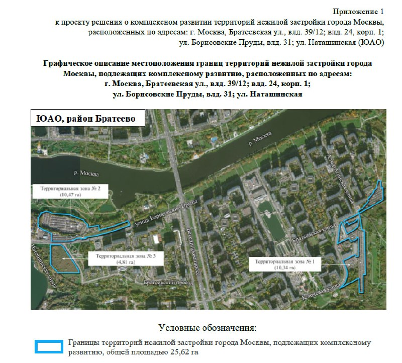
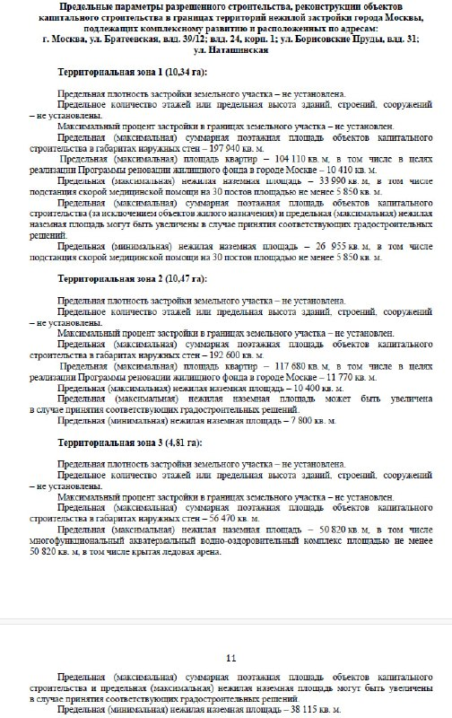

# КРТ в Братеево: 25,6 га, 222 тыс. м² квартир и ледовая арена

Братеево получит свою большую перестройку. Москва предложила комплексное развитие территорий (КРТ) на трёх участках на 25,62 га: до 447 тыс. м² построек, из них около 222 тыс. м² квартир. Спальный район, где с жильём всё давно решено, готовят к дозастройке — с аквакомплексом, ледовой ареной и подстанцией скорой помощи в нагрузку.

## Коротко

- **Где:** три территории в Братеево (ЮАО) у Братеевской улицы, Борисовских Прудов и Наташинской улицы, всего 25,62 га.
- **Квартиры:** предельная площадь около 221,8 тыс. м², из них около 22 тыс. м² под программу реновации.
- **Не жильё:** до 95 тыс. м² нежилой площади, включая водно-оздоровительный комплекс с крытой ледовой ареной.
- **Статус:** проект решения города, опубликован в феврале 2026 года; застройщик в документе не назван.

## Что именно предлагает город

В февральской сводке мэрии о новых КРТ среди десяти районов значится и Братеево. Сами параметры видно в приложениях к проекту решения. Территорий три: 10,34 га у Братеевской улицы, 10,47 га на западе района у Борисовских Прудов и Наташинской и 4,81 га третий участок.

*Приложение 1 к проекту решения о КРТ: границы трёх территорий. Источник: проект решения о комплексном развитии территорий, Москва.*

Параметры задают потолок, а не готовый проект ([ТЭП](/slovar/tep/) — технико-экономические показатели — будут уточнять):

| Зона | Площадь | Суммарная площадь построек | Квартиры | Нежилая площадь |
|---|---|---|---|---|
| 1 | 10,34 га | до 197,9 тыс. м² | до 104,1 тыс. м² (реновация — 10,4 тыс.) | до 34 тыс. м² |
| 2 | 10,47 га | до 192,6 тыс. м² | до 117,7 тыс. м² (реновация — 11,8 тыс.) | до 10,4 тыс. м² |
| 3 | 4,81 га | до 56,5 тыс. м² | без квартир | до 50,8 тыс. м² |

Сложив зоны, получаем около 447 тыс. м² построек и около 221,8 тыс. м² квартир.

*Предельные параметры по зонам (фрагмент проекта решения). Источник: проект решения о комплексном развитии территорий, Москва.*

Самое неожиданное — третья зона. Там вместо квартир документ требует водно-оздоровительный комплекс не меньше 50,8 тыс. м², включая крытую ледовую арену. А в первой зоне — подстанцию скорой помощи на 30 постов площадью не менее 5,85 тыс. м². Высоту и плотность застройки документ не ограничивает: предельные значения не установлены.

## Квартиры и реновация

Доля реновации здесь — около 22 тыс. м², то есть примерно каждый десятый квадратный метр жилья. Для покупателя это значит: часть домов построят не на продажу, а для переселения, и рыночных квартир будет меньше, чем кажется по общей цифре.

## Что с проектом сейчас

На 15 октября 2026 года об утверждении решения и о договоре с инвестором ничего не слышно, а в самом проекте решения застройщика нет: это документ о границах и параметрах. Проектной декларации и продаж по-прежнему нет, а значит, ни цен, ни сроков сдачи ждать рано. Полная история участков — в [досье «Братеевская, 39/12»](/obekty/brateevskaya-39-12/).

## Что это значит для покупателя и инвестора

Купить здесь пока нечего. Путь от проекта решения до первых ДДУ — это утверждение, договор с инвестором, проект планировки, разрешение на строительство: счёт идёт на годы.

Смотреть стоит на три вещи. Кто станет инвестором: от него зависят и качество, и темп. Как поделят участки между жильём и общественной частью: ледовая арена и аквакомплекс — серьёзная нагрузка на бюджет проекта, и их легко «ужать» по дороге. И какую высотность в итоге согласуют, раз документ её не ограничивает. Остальные проекты района и города — в разделе [новостроек Братеево](/novostroyki/brateevo/), а общий фон по механизму — в теме [«КРТ»](/temy/krt/).

## Карточка объекта

- Названия: Братеевская, 39/12; Борисовские Пруды, 31; Наташинская.
- Адреса: Братеевская ул., влд. 39/12 и влд. 24, корп. 1; ул. Борисовские Пруды, влд. 31; ул. Наташинская, Братеево, ЮАО, Москва.
- Площадь территорий: 25,62 га.
- Суммарная площадь построек: до 447 тыс. м².
- Квартиры: до 221,8 тыс. м², из них около 22 тыс. м² для реновации.
- Стадия: проект решения о [КРТ](/slovar/krt/); застройщик не назван.

## Вопросы и ответы

**Где проходит КРТ в Братеево?**
На трёх территориях в ЮАО: у Братеевской улицы (влд. 39/12 и влд. 24, корп. 1), на улице Борисовские Пруды (влд. 31) и на Наташинской улице. Общая площадь — 25,62 га.

**Сколько квартир построят в КРТ в Братеево?**
По проекту решения, предельная площадь квартир — около 221,8 тыс. м² на двух территориях, из них около 22 тыс. м² для программы реновации.

**Что построят в Братеево кроме жилья?**
Нежилую недвижимость до 95 тыс. м², в том числе подстанцию скорой помощи на 30 постов и водно-оздоровительный комплекс площадью не менее 50,8 тыс. м² с крытой ледовой ареной.

**Кто будет строить КРТ в Братеево?**
Застройщик в проекте решения не назван. Сроки строительства и продаж не объявлены.

## Источники

1. Стройкомплекс Москвы, 7 марта 2026 года, о новых проектах КРТ за февраль 2026 года: https://stroi.mos.ru/news/vladimir-iefimov-v-10-raionakh-moskvy-riealizuiut-novyie-proiekty-komplieksnogho-razvitiia-tierritorii
2. Проект решения о комплексном развитии территорий нежилой застройки в Братеево, приложение 1 и предельные параметры (сканы документа, см. иллюстрации).
3. Стройкомплекс Москвы, лента новостей на 15 октября 2026 года: https://stroi.mos.ru/news

Материал не является инвестиционной рекомендацией.
