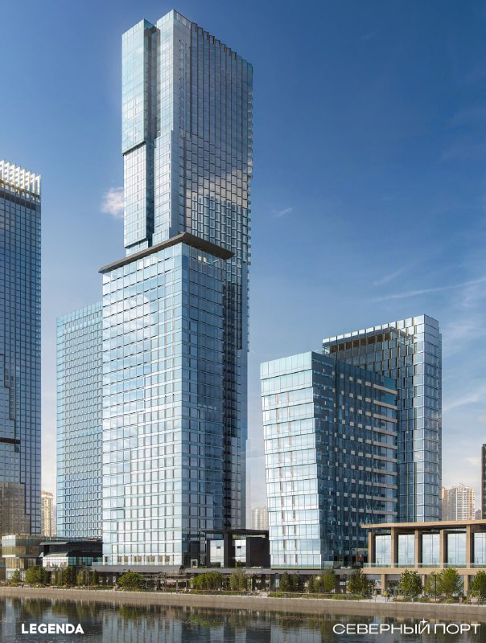
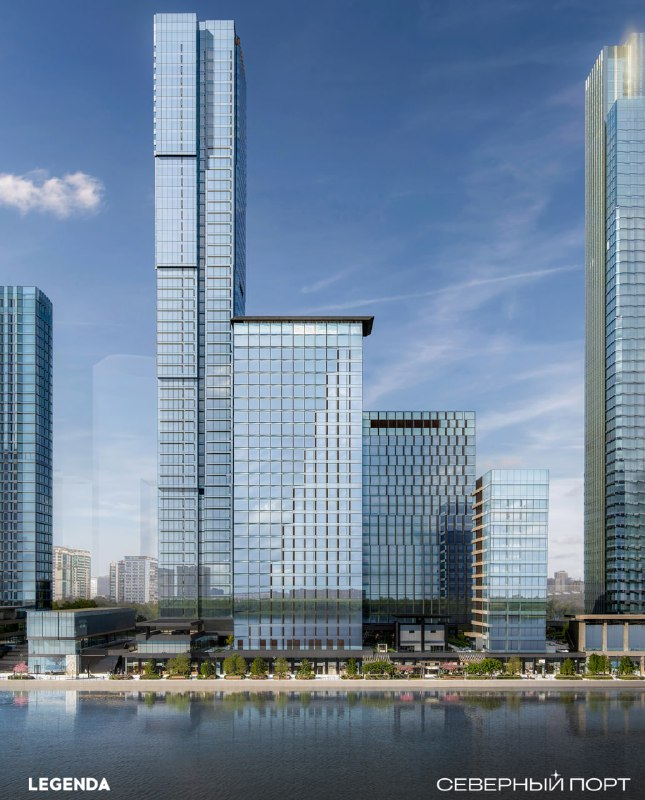
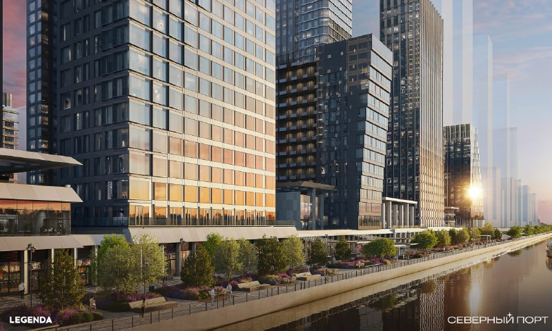

---
source:
  id: 33334
  date: 2026-03-05
status: needs_review
skip_reason: null
type: object
region: moscow
title: '«Северный порт» от LEGENDA: лот 6 в продаже, а первая очередь уже +48%'
title_alts:
- 'LEGENDA вывела лот 6 «Северного порта»: 1068 квартир и ключи только в 2030 году'
- 'Цены в «Северном порту» LEGENDA: первая очередь подорожала, вторая стартовала без цены метра'
slug: legenda-severnyy-port-lot-6-ceny
lead: LEGENDA открыла продажи второй очереди «Северного порта» — лота 6 на Ленинградском шоссе — в марте 2026 года, когда первая очередь уже сыграла за ранних покупателей. К лету средний метр там, по данным застройщика, дошёл до 618,4 тыс. ₽ — на 48% выше старта в 2024 году. Вопрос в том, повторит ли лот 6 этот путь.
developers:
- id: legenda
  name: LEGENDA Intelligent Development
  role: main
objects:
- id: severnyy-port
  names:
  - Северный порт
  - Северный Порт
  - лот 6
  - лот 7
  zu: Москва, Ленинградское шоссе, вл. 57
  main: true
  new: false
districts:
- levoberezhnyy
topics:
- ceny
- rynok
images:
- file: media/33334_1.jpg
  alt: Визуализация высотных корпусов LEGENDA в «Северном порту» на набережной, Левобережный район
  caption: 'Визуализация проекта «Северный порт». Источник: LEGENDA'
- file: media/33334_2.jpg
  alt: Корпуса «Северного порта» от LEGENDA с видом с воды, Левобережный район Москвы
  caption: 'Визуализация проекта «Северный порт». Источник: LEGENDA'
- file: media/33334_3.jpg
  alt: Набережная и жилые корпуса «Северного порта», визуализация LEGENDA
  caption: 'Визуализация проекта «Северный порт». Источник: LEGENDA'
factcheck:
- claim: В марте 2026 года LEGENDA открыла продажи лота 6 — второй очереди «Северного порта» (новость застройщика от 10.03.2026)
  status: confirmed
  source: https://legenda-dom.ru/news/legenda-otkryla-prodazhi-vo-vtoroj-ocheredi-proekta-severnyj-port
  checked: 2026-10-13
- claim: 'Лот 6: 4 жилых корпуса высотой 54, 24, 20 и 12 этажей на общем стилобате; квартиры 28–145 м², 68 планировок; двухуровневый подземный паркинг на 403 места; цены на старте — от 15,4 млн ₽'
  status: confirmed
  source: https://legenda-dom.ru/news/legenda-otkryla-prodazhi-vo-vtoroj-ocheredi-proekta-severnyj-port
  checked: 2026-10-13
- claim: В лоте 6 — 1068 квартир
  status: confirmed
  source: https://flats.legenda-dom.ru/projects/severniyport
  checked: 2026-10-13
- claim: 'Лот 7 (первая очередь): 3 корпуса на 34, 19 и 58 этажей, 1172 квартиры, продажи стартовали 2 апреля 2024 года'
  status: confirmed
  source: https://legenda-dom.ru/news/start-prodazh-v-proekte-severnyy-port
  checked: 2026-10-13
- claim: 'Проект: участок 7,8 га, 330 тыс. м², три очереди, Ленинградское шоссе, вл. 57, первая линия канала имени Москвы'
  status: confirmed
  source: https://realty.rbc.ru/news/664343289a7947c66eaa5e70
  checked: 2026-10-13
- claim: Концепцию территории разработало бюро Сергея Скуратова, проект — LEGENDA совместно с KAMEN Architects
  status: confirmed
  source: https://legenda-dom.ru/news/start-prodazh-v-proekte-severnyy-port
  checked: 2026-10-13
- claim: Лот 6 делит двор с лотом 5; архитектурный приём — «сдвиг» (разная высота и ориентация корпусов)
  status: confirmed
  source: https://legenda-dom.ru/news/legenda-otkryla-prodazhi-vo-vtoroj-ocheredi-proekta-severnyj-port
  checked: 2026-10-13
- claim: 'Проект: 11 корпусов в трёх очередях'
  status: confirmed
  source: https://finance.rambler.ru/realty/56941292-za-2-goda-tseny-v-proekte-severnyy-port-vyrosli-na-48/
  checked: 2026-10-13
- claim: LEGENDA основана в 2010 году в Петербурге
  status: confirmed
  source: https://realty.rbc.ru/news/664343289a7947c66eaa5e70
  checked: 2026-10-13
- claim: 'Плановые сроки по данным застройщика: I очередь — IV квартал 2028 года, II очередь — IV квартал 2030 года'
  status: confirmed
  source: https://flats.legenda-dom.ru/projects/severniyport
  checked: 2026-10-13
- claim: 'Средняя цена метра в первой очереди: 416 580 ₽ на старте в 2024 году → 618 400 ₽ в первом полугодии 2026 года (+48%)'
  status: confirmed
  source: https://newprospect.ru/news/developer-legenda-podvel-itogi-dvux-let-razvitiya-proekta-severnyij-port-v-moskve
  checked: 2026-10-13
- claim: Средняя цена предложения в начале октября 2025 года — 524 955 ₽/м², продано 816 из 1172 квартир первой очереди
  status: confirmed
  source: https://www.novostroy-m.ru/kompanii/legenda_intelligent_development_legenda/news/v_proekte_severnyy_port
  checked: 2026-10-13
- claim: Во второй очереди цена метра за четыре месяца после старта выросла на 10%; к июлю 2026 года продано около 10% квартир лота 6 и 84% квартир первой очереди
  status: confirmed
  source: https://finance.rambler.ru/realty/56941292-za-2-goda-tseny-v-proekte-severnyy-port-vyrosli-na-48/
  checked: 2026-10-13
- claim: Средняя цена в бизнес-классе Москвы в первом полугодии 2026 года — 604 тыс. ₽/м² (данные, приведённые LEGENDA)
  status: confirmed
  source: https://newprospect.ru/news/developer-legenda-podvel-itogi-dvux-let-razvitiya-proekta-severnyij-port-v-moskve
  checked: 2026-10-13
- claim: На сайте застройщика объявлены скидки до 20% при полной оплате или ипотеке и до 18% при рассрочке
  status: confirmed
  source: https://flats.legenda-dom.ru/projects/severniyport
  checked: 2026-10-13
- claim: Ключевая ставка 14% (снижена 24.07.2026, сохранена 11.09.2026; следующее заседание 23.10.2026)
  status: confirmed
  source: https://www.cbr.ru/press/keypr/
  checked: 2026-10-13
- claim: Левобережный район, САО; ближайшие станции метро — «Беломорская» и «Речной вокзал»
  status: confirmed
  source: https://www.novostroy-m.ru/baza/mfk_severnyy_port
  checked: 2026-10-13
- claim: Фактическая цена реализации первой очереди — около 560 тыс. ₽/м², лот 6 выведен по 610 тыс. ₽/м² (март 2026)
  status: unverified
  source: не найдено независимых данных; застройщик не публиковал цену метра лота 6 на старте
  checked: 2026-10-13
- claim: Проект продаёт в среднем 35 квартир в месяц
  status: unverified
  source: не найдено
  checked: 2026-10-13
removed:
- Цены 560 тыс. ₽/м² (первая очередь) и 610 тыс. ₽/м² (лот 6 на старте) — не подтверждены ни застройщиком, ни независимыми источниками; заменены опубликованными данными LEGENDA о средней цене первой очереди.
- Темп «35 квартир в месяц» — не подтверждён.
- Прогноз о будущих очередях и ценах «Мангазеи» на соседнем участке («от 600 тыс. ₽/м²») — предположение, не факт.
- Тезис из цепочки о мастер-девелопере территории и «скандалах» при продаже участков — не проверен, в статью не включён.
- Призыв подписаться на исходный канал и жаргон («бабки») — удалены по редакционным правилам.
data_points:
- metric: key_rate
  value: 14
  date: 2026-09-11
- metric: severnyy_port_q1_avg_price_rub_m2
  value: 618400
  date: 2026-06-30
- metric: moscow_business_class_avg_price_rub_m2
  value: 604000
  date: 2026-06-30
seo:
  main_query: северный порт легенда цены
  keywords:
  - жк северный порт
  - северный порт лот 6
  - северный порт сроки сдачи
  - ленинградское шоссе 57 новостройка
  - новостройки левобережный район беломорская
  - legenda северный порт вторая очередь
  frequency_checked: false
  title: 'Северный порт Легенда: цены, лот 6 и сроки сдачи'
  description: 'LEGENDA открыла продажи лота 6 в «Северном порту»: 1068 квартир, ключи в IV квартале 2030 года. Цены первой очереди выросли с 416,6 до 618,4 тыс. ₽/м².'
  canonical: https://шахматка.москва/novosti/legenda-severnyy-port-lot-6-ceny/
internal_links:
- anchor: досье проекта «Северный порт»
  url: /obekty/severnyy-port/
- anchor: все проекты LEGENDA в Москве
  url: /zastroyshchiki/legenda/
- anchor: новостройки Левобережного района
  url: /moskva/levoberezhnyy/
- anchor: что такое ключевая ставка и как она влияет на ипотеку
  url: /slovar/klyuchevaya-stavka/
- anchor: как меняются цены на новостройки Москвы
  url: /temy/ceny/
- anchor: разбор решений по ключевой ставке и семейной ипотеке
  url: /novosti/klyuchevaya-stavka-semeynaya-ipoteka-oktyabr-2026/
faq:
- q: Сколько стоят квартиры в ЖК «Северный порт»?
  a: По данным LEGENDA, средний метр в первой очереди в первом полугодии 2026 года стоил 618,4 тыс. ₽. Квартиры в лоте 6 на старте продаж в марте 2026 года предлагали от 15,4 млн ₽.
- q: Когда сдадут «Северный порт»?
  a: Застройщик обещает передать ключи первой очереди (лот 7) в IV квартале 2028 года, второй очереди (лот 6) — в IV квартале 2030 года.
- q: Кто строит «Северный порт» на Ленинградском шоссе?
  a: Проект на Ленинградском шоссе, вл. 57, строит петербургская компания LEGENDA Intelligent Development. Концепцию территории разработало бюро Сергея Скуратова, проект первой очереди — LEGENDA вместе с KAMEN Architects.
- q: Сколько квартир в лоте 6 «Северного порта»?
  a: По данным сайта застройщика — 1068 квартир площадью от 28 до 145 м² в четырёх корпусах высотой 12, 20, 24 и 54 этажа.
date_published: 2026-03-05   # дата исходной заметки
date_modified: 2026-10-13   # дата проверки фактов и обновления
author: Редакция Шахматки
schema: |-
  {
    "@context": "https://schema.org",
    "@graph": [
      {
        "@type": "NewsArticle",
        "headline": "«Северный порт» от LEGENDA: лот 6 в продаже, первая очередь подорожала на 48%",
        "description": "LEGENDA открыла продажи лота 6 в «Северном порту»: 1068 квартир, ключи в IV квартале 2030 года. Цены первой очереди выросли с 416,6 до 618,4 тыс. ₽/м².",
        "datePublished": "2026-03-05",
        "dateModified": "2026-10-13",
        "inLanguage": "ru",
        "image": [
          "https://шахматка.москва/media/33334_1.jpg",
          "https://шахматка.москва/media/33334_2.jpg",
          "https://шахматка.москва/media/33334_3.jpg"
        ],
        "author": {
          "@type": "Organization",
          "name": "Редакция Шахматки",
          "url": "https://шахматка.москва/"
        },
        "publisher": {
          "@type": "Organization",
          "name": "Шахматка",
          "url": "https://шахматка.москва/"
        },
        "mainEntityOfPage": {
          "@type": "WebPage",
          "@id": "https://шахматка.москва/novosti/legenda-severnyy-port-lot-6-ceny/"
        },
        "about": [
          {
            "@type": "Residence",
            "name": "Северный порт",
            "address": {
              "@type": "PostalAddress",
              "streetAddress": "Ленинградское шоссе, вл. 57",
              "addressLocality": "Москва",
              "addressRegion": "Москва",
              "addressCountry": "RU"
            }
          },
          {
            "@type": "Organization",
            "name": "LEGENDA Intelligent Development",
            "url": "https://legenda-dom.ru/"
          }
        ]
      },
      {
        "@type": "FAQPage",
        "mainEntity": [
          {
            "@type": "Question",
            "name": "Сколько стоят квартиры в ЖК «Северный порт»?",
            "acceptedAnswer": {
              "@type": "Answer",
              "text": "По данным LEGENDA, средняя цена метра в первой очереди в первом полугодии 2026 года составила 618,4 тыс. ₽. Квартиры в лоте 6 на старте продаж в марте 2026 года предлагались от 15,4 млн ₽."
            }
          },
          {
            "@type": "Question",
            "name": "Когда сдадут «Северный порт»?",
            "acceptedAnswer": {
              "@type": "Answer",
              "text": "Застройщик указывает передачу ключей первой очереди (лот 7) в IV квартале 2028 года, второй очереди (лот 6) — в IV квартале 2030 года."
            }
          },
          {
            "@type": "Question",
            "name": "Кто строит «Северный порт» на Ленинградском шоссе?",
            "acceptedAnswer": {
              "@type": "Answer",
              "text": "Проект на Ленинградском шоссе, вл. 57, строит петербургская компания LEGENDA Intelligent Development. Концепцию территории разработало бюро Сергея Скуратова, проект первой очереди — LEGENDA совместно с KAMEN Architects."
            }
          },
          {
            "@type": "Question",
            "name": "Сколько квартир в лоте 6 «Северного порта»?",
            "acceptedAnswer": {
              "@type": "Answer",
              "text": "По данным сайта застройщика — 1068 квартир площадью от 28 до 145 м² в четырёх корпусах высотой 12, 20, 24 и 54 этажа."
            }
          }
        ]
      }
    ]
  }
editor_notes: |-
  1) Наш.дом.рф (ЕИСЖС) недоступен из среды фактчекинга (robots/прокси) — проектные декларации лотов 6 и 7, сроки ввода по РС и распроданность не сверены; сроки в статье — плановые сроки передачи ключей по сайту застройщика. Агрегатор novostroy-m указывает иные сроки (корпуса 7.x — I кв. 2028, 6.x — II кв. 2030) — сверить с декларацией. 2) Расхождения в данных застройщика по лоту 6: 1068 квартир и 403 машино-места (сайт и новость LEGENDA от 10.03.2026) против 951 квартиры и 432 машино-мест (пресс-релиз LEGENDA, июль 2026, в пересказе newprospect.ru); в тексте — данные сайта, нужна сверка с декларацией. 3) Ключевые ценовые данные — только от застройщика (пресс-релизы в пересказе СМИ), независимой статистики по проекту нет → needs_review. 4) Файлы media/33334_1–3.jpg отсутствуют в рабочей папке: содержание фото не проверено, подписи и alt общие, автор изображений не установлен. 5) Цена метра лота 6 на старте не найдена; если редакция получит данные (прайс, ЕРЗ, Росреестр) — можно вернуть сравнение очередей.
  Фото проверены главным редактором 13.10.2026: alt и подписи переписаны по содержанию; непригодные изображения сняты (см. removed). Права на визуализации застройщиков подтвердить запросом в пресс-службу.
---

# «Северный порт» от LEGENDA: лот 6 в продаже, а первая очередь уже +48%

В марте 2026 года LEGENDA открыла продажи второй очереди «Северного порта» — лота 6 на Ленинградском шоссе. Первая очередь к этому моменту уже сыграла за тех, кто зашёл рано: к лету средний метр там, по данным застройщика, дошёл до 618,4 тыс. ₽ — на 48% выше старта продаж в 2024 году. Теперь вопрос, сможет ли лот 6 повторить этот путь.

**Коротко**

- **Лот 6:** 4 корпуса на 12, 20, 24 и 54 этажа, 1068 квартир от 28 до 145 м², на старте — от 15,4 млн ₽.
- **Первая очередь дорожает:** 416,6 тыс. ₽/м² в 2024 году → 524,9 тыс. ₽ в октябре 2025 года → 618,4 тыс. ₽ в первом полугодии 2026 года.
- **Вторая очередь разгоняется:** метр за первые четыре месяца продаж прибавил 10%.
- **Ключи по плану:** первая очередь — IV квартал 2028 года, вторая — IV квартал 2030 года.

## Четыре башни на одном стилобате

Лот 6 — вторая очередь «Северного порта» на Ленинградском шоссе, вл. 57, в Левобережном районе (САО). Продажи застройщик открыл в марте 2026 года.

В лоте четыре жилых корпуса разной высоты — 54, 24, 20 и 12 этажей — на общем стилобате, то есть на объединяющем нижнем этаже-основании. По данным сайта LEGENDA, в них 1068 квартир площадью от 28 до 145 м² и 68 вариантов планировок. Под домами — двухуровневый паркинг на 403 машино-места. Двор лот 6 будет делить с будущим лотом 5.

Концепцию всей территории делало бюро Сергея Скуратова, архитектуру первой очереди — LEGENDA вместе с KAMEN Architects. Свой приём для лота 6 застройщик называет «сдвигом»: корпуса разной высоты развёрнуты так, чтобы из окон была видна вода, парк или хотя бы двор.

*Визуализация проекта «Северный порт». Источник: LEGENDA*

## Сколько стоят квартиры в «Северном порту»: плюс 48% за два года

Цены LEGENDA публикует как среднюю цену метра по первой очереди. Траектория впечатляет:

- старт продаж в апреле 2024 года — 416 580 ₽/м²;
- начало октября 2025 года — 524 955 ₽/м²;
- первое полугодие 2026 года — 618 400 ₽/м², то есть плюс 48% за два года.

Для сравнения: средняя цена бизнес-класса в Москве в первом полугодии 2026 года, по данным, которые приводит сама LEGENDA, — 604 тыс. ₽/м². Первая очередь проекта уже стоит чуть дороже среднего по сегменту.

С лотом 6 картинка неполная: цену метра на старте застройщик не назвал — только «от 15,4 млн ₽» за квартиру и рост на 10% за четыре месяца. Так что сказать цифрами, что новую очередь вывели дороже старой, нельзя. Но общее наблюдение, на наш взгляд, верное: девелоперы всё чаще выводят новые объёмы не дешевле предыдущих, хотя те ближе к готовности.

*Визуализация проекта «Северный порт». Источник: LEGENDA*

## Первая очередь почти разобрана

По данным застройщика, к середине октября 2025 года в первой очереди продали 816 из 1172 квартир, к июлю 2026 года — 84%. Во второй очереди к июлю 2026 года разошлось около 10% квартир.

Деталь для тех, кто сравнивает прайсы: на сайте LEGENDA объявлены скидки до 20% при полной оплате или ипотеке и до 18% при рассрочке. Значит, средняя цена из пресс-релиза и цена в вашем договоре могут заметно разойтись.

## Когда сдадут «Северный порт»

Весь проект — три очереди, 11 корпусов на участке 7,8 га, 330 тыс. м². Ключи в первой очереди (лот 7, три корпуса на 34, 19 и 58 этажей) застройщик обещает в IV квартале 2028 года, во второй (лот 6) — в IV квартале 2030 года. Это сроки из материалов LEGENDA; что записано в проектной декларации, стоит проверить самому.

## Что это значит для покупателя и инвестора

Лот 6 — история на длинную дистанцию: до плановых ключей больше четырёх лет. В первой очереди ранний вход себя оправдал — плюс 48% к средней цене предложения за два года. Но прошлый рост — не обещание будущего.

Риски, на наш взгляд, стандартные для высотки: сроки (54-этажный корпус — самый сложный в лоте), стоимость денег и темп продаж. Ключевая ставка Банка России с 24 июля 2026 года — 14%, 11 сентября её сохранили, следующее заседание — 23 октября 2026 года. Подробнее — в нашем [разборе решений по ключевой ставке и семейной ипотеке](/novosti/klyuchevaya-stavka-semeynaya-ipoteka-oktyabr-2026/).

Что отслеживать: проектную декларацию лота 6 на наш.дом.рф, реальную цену сделок с учётом скидок и стройку первой очереди. Она покажет, держит ли застройщик график, лучше любого рендера.

*Визуализация проекта «Северный порт». Источник: LEGENDA*

## Карточка объекта

- **Адрес:** Москва, Ленинградское шоссе, вл. 57
- **Названия:** «Северный порт», «Северный Порт»; очереди — лот 7 (I), лот 6 (II), лот 5 (III)
- **Застройщик:** LEGENDA Intelligent Development
- **Регион и район:** Москва, САО, Левобережный район; метро «Беломорская», «Речной вокзал»
- **Класс:** бизнес
- **Площадь проекта:** 330 тыс. м², участок 7,8 га
- **Квартиры:** лот 7 — 1172, лот 6 — 1068
- **Стадия:** лот 7 — строительство и продажи, лот 6 — продажи с марта 2026 года
- **Передача ключей (план застройщика):** лот 7 — IV квартал 2028 года, лот 6 — IV квартал 2030 года
- **Цена:** средняя по первой очереди — 618,4 тыс. ₽/м² (первое полугодие 2026 года); лот 6 — от 15,4 млн ₽ на старте

Подробнее о проекте — в [досье проекта «Северный порт»](/obekty/severnyy-port/), о компании — на странице [все проекты LEGENDA в Москве](/zastroyshchiki/legenda/). Соседние проекты — в разделе [новостройки Левобережного района](/moskva/levoberezhnyy/), рыночный фон — в рубрике [как меняются цены на новостройки Москвы](/temy/ceny/) и в словаре: [что такое ключевая ставка и как она влияет на ипотеку](/slovar/klyuchevaya-stavka/).

## Вопросы и ответы

**Сколько стоят квартиры в ЖК «Северный порт»?**
По данным LEGENDA, средний метр в первой очереди в первом полугодии 2026 года стоил 618,4 тыс. ₽. Квартиры в лоте 6 на старте продаж в марте 2026 года предлагали от 15,4 млн ₽.

**Когда сдадут «Северный порт»?**
Застройщик обещает передать ключи первой очереди (лот 7) в IV квартале 2028 года, второй очереди (лот 6) — в IV квартале 2030 года.

**Кто строит «Северный порт» на Ленинградском шоссе?**
Проект на Ленинградском шоссе, вл. 57, строит петербургская компания LEGENDA Intelligent Development. Концепцию территории разработало бюро Сергея Скуратова, проект первой очереди — LEGENDA вместе с KAMEN Architects.

**Сколько квартир в лоте 6 «Северного порта»?**
По данным сайта застройщика — 1068 квартир площадью от 28 до 145 м² в четырёх корпусах высотой 12, 20, 24 и 54 этажа.

*Факты проверены по состоянию на 13 октября 2026 года.*

## Источники

1. LEGENDA. «LEGENDA открыла продажи во второй очереди проекта „Северный порт“», 10.03.2026 — https://legenda-dom.ru/news/legenda-otkryla-prodazhi-vo-vtoroj-ocheredi-proekta-severnyj-port
2. LEGENDA. Страница проекта «Северный порт» (лоты, сроки, условия) — https://flats.legenda-dom.ru/projects/severniyport
3. LEGENDA. «Старт продаж в проекте „Северный порт“», 01.04.2024 — https://legenda-dom.ru/news/start-prodazh-v-proekte-severnyy-port
4. РБК Недвижимость, 21.05.2024 — https://realty.rbc.ru/news/664343289a7947c66eaa5e70
5. Новострой-М: новость LEGENDA о продажах первой очереди, 11.11.2025 — https://www.novostroy-m.ru/kompanii/legenda_intelligent_development_legenda/news/v_proekte_severnyy_port
6. New Prospect: итоги двух лет проекта, 15.07.2026 — https://newprospect.ru/news/developer-legenda-podvel-itogi-dvux-let-razvitiya-proekta-severnyij-port-v-moskve
7. Рамблер/Финансы (по материалу РБК Компании), 21.08.2026 — https://finance.rambler.ru/realty/56941292-za-2-goda-tseny-v-proekte-severnyy-port-vyrosli-na-48/
8. Новострой-М: карточка ЖК «Северный Порт» (район, метро) — https://www.novostroy-m.ru/baza/mfk_severnyy_port
9. Банк России. Решение по ключевой ставке от 11.09.2026 — https://www.cbr.ru/press/keypr/
10. Банк России. Заявление Председателя по итогам заседания 24.07.2026 — https://www.cbr.ru/press/event/?id=32726

Материал не является инвестиционной рекомендацией.
