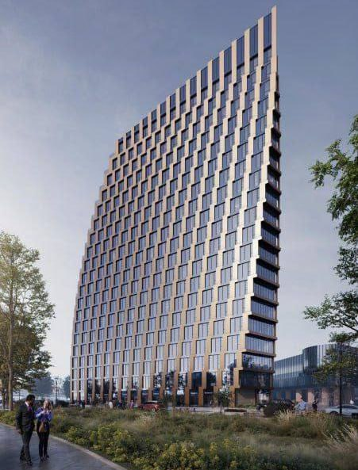
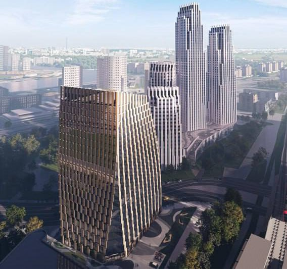

# Нагорный проезд, 3: Аквилон получил одобрение офиса на 27 тыс. м²

В начале марта 2026 года мэрия Москвы одобрила проект офисного здания «КОРП.Нагорная» рядом с МЦК «Верхние Котлы». Здание на 21 этаж и около 27 тыс. м² ведёт Аквилон; к октябрю 2026 года мы не нашли в открытых источниках сведений о старте продаж или стройки.

## Коротко

- Решение об одобрении проекта опубликовано 4 марта 2026 года.
- Параметры: 21 этаж, около 27 тыс. м², стоечно-ригельная конструкция (по данным сайта застройщика).
- Здание находится в районе Верхних Котлов, рядом со станцией МЦК «Верхние Котлы».
- Цен, сроков и сведений о начале стройки на 14 октября 2026 года нет.

## Что одобрили на Нагорном проезде

Речь о проекте «КОРП.Нагорная» — офисной части участка, который в досье значится как Нагорный проезд, 3 стр 4. Название «КОРП» Аквилон использует для офисных проектов; изображения для публикации о решении предоставил именно он.

По данным издания Moskvich Mag, здание рассчитано на 21 этаж и около 27 тыс. м². Конструкция стоечно-ригельная: несущие стойки и горизонтальные ригели каркаса. Главное преимущество проекта застройщик видит в пешей доступности станции МЦК «Верхние Котлы».

*Офисное здание «КОРП.Нагорная»: дневной вид. Визуализация: Аквилон*

На визуализациях здание сужается кверху, а верхний угол срезан по диагонали. На наш взгляд, это единственный заметный архитектурный приём: фасад строгий, без излишеств.

*Здание в окружении жилых башен: вид сверху. Визуализация: Аквилон*

## Кто застройщик и что известно об участке

Проект ведёт [Аквилон](/zastroyshchiki/akvilon/). О другом его московском проекте — отдельный материал: [Nexus от Аквилона у метро «Молодёжная»](/novosti/akvilon-nexus-yarcevskaya-21-1-ceny-sroki/).

Как участок перешёл к Аквилону, мы по независимым источникам подтвердить не смогли, поэтому детали сделки не приводим. Полная история проекта — в [досье «Нагорный проезд, 3 стр 4»](/obekty/nagornyy-proezd-3-str-4/).

## Что с проектом сейчас

По состоянию на 14 октября 2026 года мы не нашли в открытых источниках проектной декларации, разрешения на строительство, цен или объявления о старте продаж офисов в «КОРП.Нагорная». В июльском рекламном материале Аквилона на сайте «Ведомостей» среди офисных проектов назван только «КОРП. Молодежная», Нагорный проезд там не упомянут. Стадия проекта в [досье](/obekty/nagornyy-proezd-3-str-4/) — архитектура, мы её не пересматриваем.

Сроки ввода не объявлены. Новостью остаётся само согласование облика здания, а не начало строительства.

## Что это значит для покупателя и инвестора

Согласованный облик здания — ранний этап: до продаж и стройки остаются проектная документация, разрешение на строительство и проектная декларация. Цен и сроков нет, сравнивать проект с соседними офисами рано.

Что отслеживать: появление проектной декларации на наш.дом.рф, разрешения на строительство, объявление о продажах. Подборка [будущих проектов](/novostroyki/budushchie-proekty/) и страница [новостроек Москвы](/novostroyki/moskva/) помогут не пропустить новости.

## Карточка объекта

- Проект: «КОРП.Нагорная»
- Участок по досье: Нагорный проезд, 3 стр 4 (в документах также «Нагорный, 3, стр. 2-7, 9-13»)
- Застройщик: Аквилон
- Регион: Москва
- Назначение: офисное здание
- Этажность: 21
- Площадь: около 27 тыс. м²
- Ближайшая станция: МЦК «Верхние Котлы» (пешая доступность — по данным застройщика)
- Стадия: согласование облика (по данным на март 2026 года)

## Вопросы и ответы

**Что одобрила мэрия на Нагорном проезде, 3?**
Проект офисного здания «КОРП.Нагорная»: 21 этаж и около 27 тыс. м² рядом со станцией МЦК «Верхние Котлы». О решении сообщили 4 марта 2026 года.

**Кто застройщик офиса «КОРП.Нагорная»?**
Проект ведёт Аквилон: изображения для публикации предоставила эта компания. Документы на участок мы независимо не проверяли.

**Когда сдадут офис на Нагорном проезде, 3?**
Сроки не объявлены. Проектной декларации и разрешения на строительство в открытых источниках мы не нашли.

**Сколько стоят офисы в «КОРП.Нагорная»?**
Цены не опубликованы, старт продаж мы не подтвердили.

## Источники

1. [Мэрия одобрила проект «ригельного» БЦ в Верхних Котлах — Moskvich Mag, 4 марта 2026](https://moskvichmag.ru/?p=481929)
2. [Для работы и инвестиций: что предлагает на офисном рынке группа Аквилон — «Ведомости», реклама, 31 июля 2026](https://www.vedomosti.ru/kapital/special/2026/07/31/dlya-raboti-i-investitsii-chto-predlagaet-na-ofisnom-rinke-gruppa-akvilon-erid-2VfnxxJvKGX)

Материал не является инвестиционной рекомендацией.
