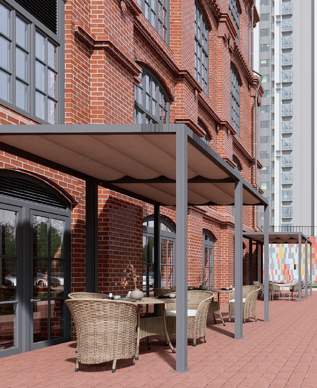
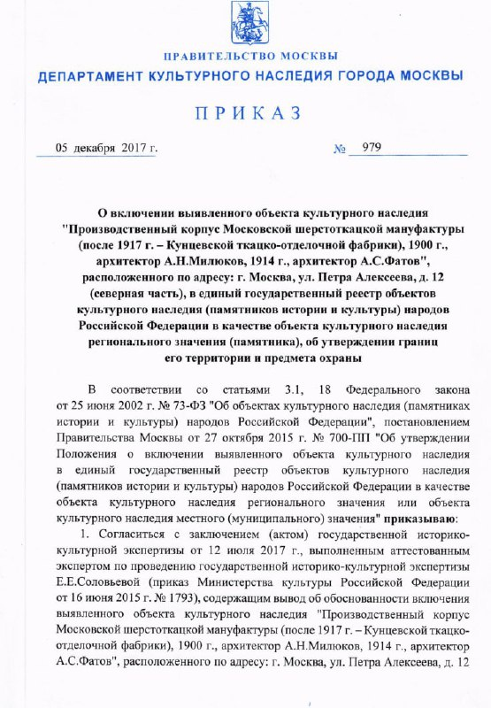
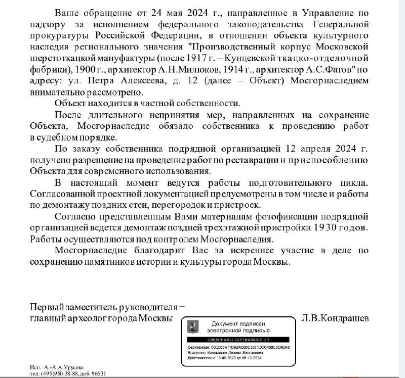

# «Мануфактура XIX» от Sminex: офисы в здании ОКН на Петра Алексеева

Sminex продаёт офисы в деловом центре «Мануфактура XIX» — реставрируемом корпусе бывшей шерстоткацкой фабрики на улице Петра Алексеева, 12, стр. 1. Помещения от 55,8 до 246,9 м² стоят от 25,4 до 106 млн ₽, сдача заявлена на IV квартал 2027 года.

*Визуализация террасы у кирпичного фасада «Мануфактуры XIX». Визуализация: Sminex*

## Коротко

- Застройщик — [Sminex](/zastroyshchiki/sminex/). Здание четырёхэтажное, в каталоге указано 52 офиса, в продаже 31 помещение.
- Офисы площадью от 55,8 до 246,9 м² стоят от 25,4 до 106 млн ₽.
- Срок по каталогу — IV квартал 2027 года; здание на стадии реставрации.
- Корпус — [объект культурного наследия (ОКН)](/slovar/okn/) регионального значения: это ограничивает, что и как можно менять.

## Что продаёт Sminex и сколько это стоит

«Мануфактура XIX» — деловой центр в историческом производственном корпусе на улице Петра Алексеева, 12, стр. 1. Каталог новостроек относит его к Можайскому району Западного округа Москвы.

На октябрь 2026 года в продаже 31 помещение площадью от 55,8 до 246,9 м². Бюджет покупки — от 25,4 до 106 млн ₽. Цену за квадратный метр каталог не раскрывает, поэтому сравнить предложение с рынком офисов в [Москве](/novostroyki/moskva/) по открытым данным нельзя.

## Что за здание: статус ОКН и реставрация

Приказом Департамента культурного наследия Москвы от 5 декабря 2017 года № 979 производственный корпус Московской шерстоткацкой мануфактуры (после 1917 года — Кунцевской ткацко-отделочной фабрики) 1900 года, архитектор А. Н. Милюков, 1914 года, архитектор А. С. Фатов, включён в реестр как объект культурного наследия регионального значения. Тем же приказом утверждены границы территории, режим использования и предмет охраны.

*Приказ Департамента культурного наследия города Москвы от 5 декабря 2017 года № 979: корпус включён в реестр как объект культурного наследия регионального значения.*

Из письма Мосгорнаследия следует, что собственник здания частный, а после длительного непринятия мер по сохранению объекта Мосгорнаследие через суд обязало его провести работы. Разрешение на реставрацию и приспособление для современного использования подрядчик получил 12 апреля 2024 года; проектом предусмотрен демонтаж поздних стен, перегородок и пристроек.

*Письмо Мосгорнаследия: собственник частный, разрешение на реставрацию получено 12 апреля 2024 года.*

## Что с проектом сейчас

По состоянию на 15 октября 2026 года здание остаётся на стадии реставрации, офисы продаются. По сообщению Sminex, реставрация облика, исторического фундамента и перекрытий должна завершиться в 2027 году, после чего на бетонных подпорных стенах рядом начнут создавать мурал длиной 176 метров и площадью 550 м². Это обещание компании; сроки мы проверить не можем.

Полная история проекта — в [досье «Мануфактура XIX»](/obekty/manufaktura-xix/).

## Что это значит для покупателя и инвестора

Офис в памятнике — продукт с особенностями. Режим использования и предмет охраны утверждены приказом, поэтому перепланировка и внешний облик ограничены; перед сделкой стоит запросить охранное обязательство и документы по реставрации.

Срок сдачи привязан к ходу реставрации. На наш взгляд, главный вопрос — не цена входа, а то, какой будет транспортная и парковочная инфраструктура: в источниках о ней данных нет. Информации о судах по проекту мы не искали.

## Карточка объекта

- **Адрес участка:** улица Петра Алексеева, 12, стр. 1, Москва
- **Название:** Мануфактура XIX
- **Застройщик:** [Sminex](/zastroyshchiki/sminex/)
- **Этажность:** 4
- **Помещения:** офисы от 55,8 до 246,9 м², в продаже 31 из 52
- **Цена:** от 25,4 до 106 млн ₽
- **Стадия:** реставрация, продажи
- **Срок:** IV квартал 2027 года (корпус 1)

## Вопросы и ответы

**Кто застройщик «Мануфактуры XIX»?**
Деловой центр на улице Петра Алексеева, 12, стр. 1 строит и продаёт Sminex.

**Сколько стоят офисы в «Мануфактуре XIX»?**
По данным каталога на октябрь 2026 года, помещения площадью от 55,8 до 246,9 м² стоят от 25,4 до 106 млн ₽.

**Когда сдадут «Мануфактуру XIX»?**
Срок сдачи корпуса 1 в каталоге — IV квартал 2027 года. Реставрация, по сообщению Sminex, должна завершиться в 2027 году.

**Почему здание считается объектом культурного наследия?**
Приказом Департамента культурного наследия Москвы от 5 декабря 2017 года № 979 корпус 1900 года включён в реестр как памятник регионального значения.

## Источники

1. [Каталог новостроек: бизнес-центр «Мануфактура XIX» (адрес, площади, цены, срок)](https://www.novostroy-m.ru/baza/biznestsentr_manufaktura_xix)
2. [Каталог новостроек: Sminex о мурале протяжённостью 176 метров и реставрации здания](https://www.novostroy-m.ru/kompanii/sminex/news/mural_protyajyonnostyu_176_metrov)
3. Приказ Департамента культурного наследия города Москвы от 5 декабря 2017 года № 979 (скан)
4. Письмо Мосгорнаследия о реставрации объекта (скан)

Материал не является инвестиционной рекомендацией.
