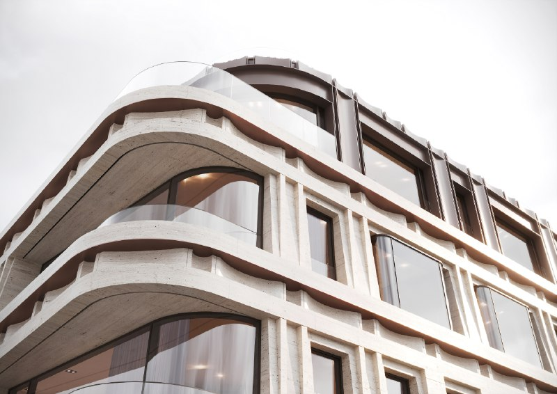
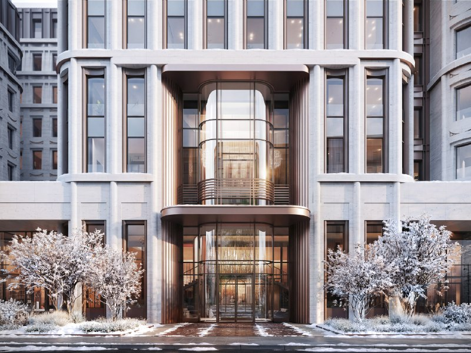
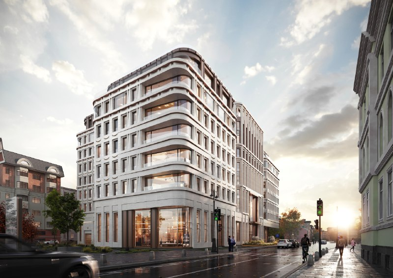
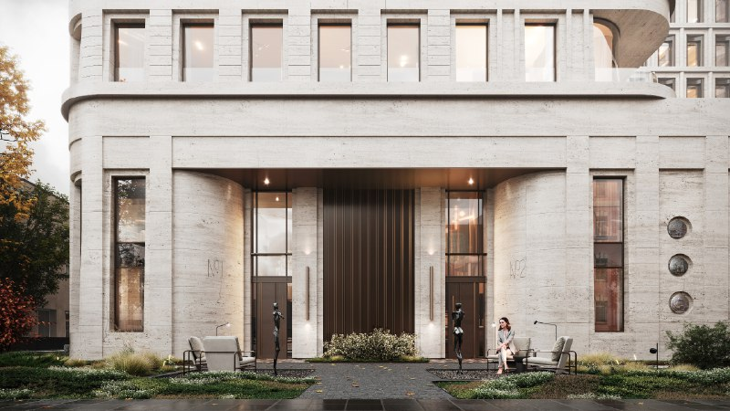
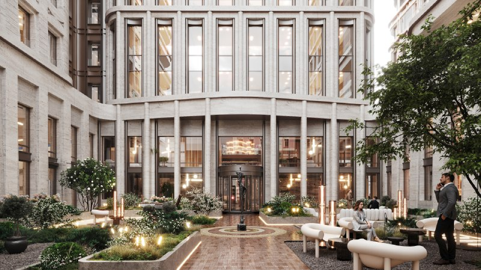
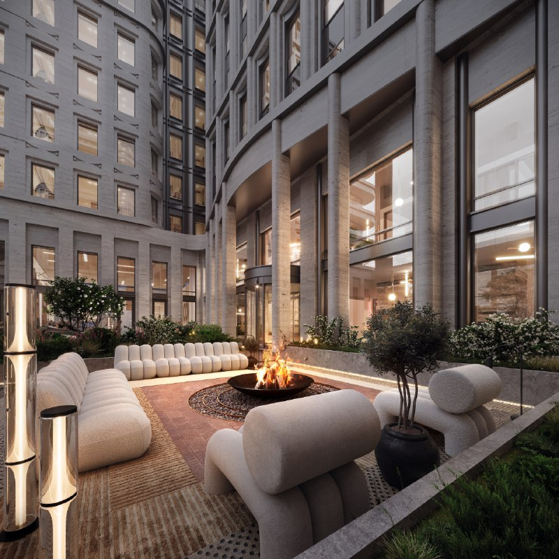

---
source:
  id: 33421
  date: 2026-03-12
status: needs_review
skip_reason: null
type: architecture
region: moscow
title: '«Большая Ордынка, 25»: первую московскую АТС снесут ради клубного дома AURIX'
title_alts:
- 'ЖК «Большая Ордынка, 25»: ГЗК выбрала купеческую усадьбу вместо конструктивизма'
- 'Клубный дом AURIX на Большой Ордынке: 94 лота от 3,2 млн ₽ за метр на месте АТС'
slug: bolshaya-ordynka-25-aurix-koncepciya-gzk
lead: Конструктивизм проиграл купеческим усадьбам. В марте 2026 года ГЗК Москвы одобрила концепцию клубного дома AURIX — премиального бренда группы «Эталон» — на месте здания первой московской АТС на Большой Ордынке. По презентации компании, это около 13 тыс. м² жилья, 94 лота и стартовая цена 3,2 млн ₽/м². Продаж пока нет, а вот споры вокруг сноса уже есть.
developers:
- id: etalon
  name: Группа «Эталон» (бренд AURIX)
  role: main
- id: afk-sistema
  name: АФК «Система»
  role: seller
  new: true
objects:
- id: bolshaya-ordynka-25
  names:
  - Большая Ордынка, 25
  - Большая Ордынка 25
  - АТС на Большой Ордынке
  zu: Москва, ул. Большая Ордынка, 25
  main: true
  new: false
districts:
- zamoskvorechye
topics:
- premium
- regulirovanie
images:
- file: media/33421_1.jpg
  alt: 'Фасад с закруглёнными балконами: концепция дома на Большой Ордынке, 25'
  caption: Концепция проекта «Большая Ордынка, 25». Правообладатель визуализации уточняется
- file: media/33421_2.jpg
  alt: Входная группа дома на Большой Ордынке, 25 в концепции, Замоскворечье
  caption: Концепция проекта «Большая Ордынка, 25». Правообладатель визуализации уточняется
- file: media/33421_3.jpg
  alt: Угловой фасад дома на Большой Ордынке, 25 со стороны улицы, концепция
  caption: Концепция проекта «Большая Ордынка, 25». Правообладатель визуализации уточняется
- file: media/33421_4.jpg
  alt: 'Вход в дом на Большой Ордынке, 25: светлый камень и бронзовые детали, концепция'
  caption: Концепция проекта «Большая Ордынка, 25». Правообладатель визуализации уточняется
- file: media/33421_5.jpg
  alt: Внутренний двор дома на Большой Ордынке, 25 с озеленением, концепция
  caption: Концепция проекта «Большая Ордынка, 25». Правообладатель визуализации уточняется
- file: media/33421_6.jpg
  alt: Двор с зоной отдыха в концепции дома на Большой Ордынке, 25
  caption: Концепция проекта «Большая Ордынка, 25». Правообладатель визуализации уточняется
factcheck:
- claim: ГЗК Москвы в марте 2026 года одобрила концепцию премиального жилого комплекса на Большой Ордынке, 25; проект предполагает снос здания АТС
  status: confirmed
  source: https://www.yabloko.ru/regnews/Moscow/2026/03/16
  checked: 2026-10-13
- claim: 'Концепция: 7 этажей, включая мансардный; скруглённые углы, волнообразные балконы и карнизы, отступающие верхние этажи с панорамным остеклением, закрытый двор (описание СМИ от 13.03.2026)'
  status: confirmed
  source: https://moskvichmag.ru/?p=483420
  checked: 2026-10-13
- claim: Застройщик отсылает к образу купеческих усадеб и планирует мозаики утраченных храмов на фасаде; ранее рассматривался вариант с сохранением исторического здания
  status: confirmed
  source: https://www.yabloko.ru/regnews/Moscow/2026/03/16
  checked: 2026-10-13
- claim: Здание — первая московская АТС, автор — В. Патек; вариант 2024 года с сохранением конструктивистского корпуса город не выбрал
  status: confirmed
  source: https://moskvichmag.ru/?p=453171
  checked: 2026-10-13
- claim: «Яблоко» 16.03.2026 назвало решение ошибкой, наносящей ущерб исторической среде Замоскворечья
  status: confirmed
  source: https://www.yabloko.ru/regnews/Moscow/2026/03/16
  checked: 2026-10-13
- claim: Участок у метро «Третьяковская», Замоскворечье
  status: confirmed
  source: https://moskvichmag.ru/?p=483420
  checked: 2026-10-13
- claim: «Эталон» покупает 100% АО «Бизнес-Недвижимость» у АФК «Система» за 14,1 млрд ₽; 42 объекта в Москве и Петербурге; 18 приоритетных проектов >200 тыс. м², выручка >185 млрд ₽ до 2032 года
  status: confirmed
  source: https://etalongroup.ru/msk/news/gruppa-etalon-rasshiryaet-prisutstvie-v-premialnom-segmente-blagodarya-pokupke-ao-biznes-nedvizhimos
  checked: 2026-10-13
- claim: Договор купли-продажи от 28.08.2025; в январе 2026 года компания пишет, что приобрела АО «Бизнес-Недвижимость» для развития бренда AURIX
  status: confirmed
  source: https://www.etalongroup.com/upload/iblock/dc5/v4iyo2y8qfbs0cg9pzvvg90p74oir45b/12Q25-Operating-Results-FIN.pdf
  checked: 2026-10-13
- claim: SPO «Эталона» в феврале 2026 года — 18,4 млрд ₽, из них 14,1 млрд ₽ направляются на финансирование покупки АО «Бизнес-Недвижимость»
  status: confirmed
  source: https://www.etalongroup.com/en/news/gruppa-etalon-privlekla-18-4-mlrd-rubley-v-rezultate-spo/
  checked: 2026-10-13
- claim: «Эталон» закрыл сделку по АО «Бизнес-Недвижимость» в декабре 2025 года
  status: unverified
  source: дата закрытия не найдена; релизы «Эталона» и «Коммерсанта» от февраля 2026 года говорят о финансировании покупки в будущем времени
  checked: 2026-10-13
- claim: 'Проект «Большая Ордынка, 25»: около 13 тыс. м² жилья без паркинга, 94 лота, стартовая цена 3,2 млн ₽/м², выручка около 45 млрд ₽ до 2032 года; участок прошёл ГЗК (презентация, октябрь 2025)'
  status: confirmed
  source: https://www.etalongroup.com/upload/iblock/378/77ljgomqvn4lyxd0ibc6tes2p2t5lrbn/Etalon-2025_10_25-final_.pdf
  checked: 2026-10-13
- claim: ТЭП «Большой Ордынки, 25» — 12,6 тыс. м² (презентации октября 2025 и января 2026); 10 московских проектов портфеля прошли ГЗК
  status: confirmed
  source: https://www.etalongroup.com/upload/iblock/dc5/v4iyo2y8qfbs0cg9pzvvg90p74oir45b/12Q25-Operating-Results-FIN.pdf
  checked: 2026-10-13
- claim: Средняя цена «Большой Ордынки, 25» будет не менее 3 млн ₽/м²
  status: changed
  source: https://www.etalongroup.com/upload/iblock/378/77ljgomqvn4lyxd0ibc6tes2p2t5lrbn/Etalon-2025_10_25-final_.pdf — компания называет стартовую цену 3,2 млн ₽/м²
  checked: 2026-10-13
- claim: Это самый дорогой проект «Эталона» в Москве
  status: refuted
  source: https://www.etalongroup.com/upload/iblock/378/77ljgomqvn4lyxd0ibc6tes2p2t5lrbn/Etalon-2025_10_25-final_.pdf — стартовая цена проекта в Серебряном Бору 3,5 млн ₽/м² выше
  checked: 2026-10-13
- claim: Это второй премиальный проект «Эталона»/AURIX в Москве
  status: refuted
  source: https://aurix-development.ru/ — на сайте AURIX в продаже в Москве Omega Residence и «Арбат 2», ещё четыре проекта в статусе «скоро»
  checked: 2026-10-13
- claim: AURIX Development входит в группу «Эталон»; первый проект в Москве — Omega Residence на улице Фотиевой, разрешение на строительство получено (сообщение 11.12.2025)
  status: confirmed
  source: https://realty.ria.ru/20251211/aurix-2061416114.html
  checked: 2026-10-13
- claim: На 13.10.2026 «Большая Ордынка 25» на сайте AURIX — в статусе «скоро», в продаже нет
  status: confirmed
  source: https://aurix-development.ru/projects/
  checked: 2026-10-13
- claim: Средняя цена в сегменте «делюкс» >3 млн ₽/м², +20% г/г (данные «Эталона»)
  status: confirmed
  source: https://www.etalongroup.com/upload/iblock/378/77ljgomqvn4lyxd0ibc6tes2p2t5lrbn/Etalon-2025_10_25-final_.pdf
  checked: 2026-10-13
- claim: В локации работают Sminex, «Русские сезоны», «Текта»
  status: unverified
  source: не проверено по первоисточникам
  checked: 2026-10-13
removed:
- Дата закрытия сделки «в декабре 2025 года» — не подтверждена; в феврале 2026 года «Эталон» и «Коммерсантъ» писали о финансировании покупки за счёт SPO в будущем времени.
- '«Второй проект „Эталона“/AURIX в премиалке» — опровергнуто: в Москве у AURIX уже в продаже Omega Residence и «Арбат 2».'
- '«Самый дорогой проект „Эталона“ в Москве» — опровергнуто: в той же презентации стартовая цена проекта в Серебряном Бору выше (3,5 млн ₽/м²).'
- «Средняя цена не менее 3 млн за метр» — заменено официальной стартовой ценой 3,2 млн ₽/м².
- Конкуренты в адресе (Sminex, «Русские сезоны», «Текта») — не проверены; конкуренция дана как мнение редакции без названий.
- Описание бизнеса «Бизнес-Недвижимости» (хостелы в АТС и т. п.) из цепочки — не проверено, слухи не публикуем.
- Год постройки АТС (1927 или 1930) — источники расходятся, в текст не включён.
- Срок ввода (IV квартал 2031 года) и площадь «более 17 тыс. м²» с сайтов агентств — не подтверждены застройщиком.
- Жаргон («ака», «топчик», «мусор из 42 АТС») — убран по редакционным правилам.
data_points:
- metric: etalon_biznes_nedvizhimost_deal_rub_bn
  value: 14.1
  date: 2025-08-28
- metric: etalon_spo_rub_bn
  value: 18.4
  date: 2026-02-20
- metric: bolshaya_ordynka_25_start_price_rub_m2
  value: 3200000
  date: 2025-10-31
seo:
  main_query: жк большая ордынка 25
  keywords:
  - большая ордынка 25 aurix
  - эталон большая ордынка
  - атс на большой ордынке снос
  - клубный дом замоскворечье третьяковская
  - aurix эталон проекты москва
  frequency_checked: false
  title: 'ЖК Большая Ордынка 25: АТС снесут ради дома AURIX'
  description: 'ГЗК одобрила клубный дом AURIX на месте первой московской АТС: около 13 тыс. м², 94 лота, старт от 3,2 млн ₽/м². Кто платит, что снесут и когда продажи.'
  canonical: https://шахматка.москва/novosti/bolshaya-ordynka-25-aurix-koncepciya-gzk/
internal_links:
- anchor: досье проекта «Большая Ордынка, 25»
  url: /obekty/bolshaya-ordynka-25/
- anchor: проекты группы «Эталон»
  url: /zastroyshchiki/etalon/
- anchor: новостройки Замоскворечья
  url: /moskva/zamoskvorechye/
- anchor: градостроительно-земельная комиссия
  url: /slovar/gzk/
- anchor: технико-экономические показатели
  url: /slovar/tep/
- anchor: премиальный рынок Москвы
  url: /temy/premium/
faq:
- q: Кто застройщик ЖК «Большая Ордынка, 25»?
  a: AURIX — премиальный бренд группы «Эталон». Участок пришёл в портфеле АО «Бизнес-Недвижимость», которое «Эталон» покупает у АФК «Система» за 14,1 млрд ₽.
- q: Сколько будут стоить квартиры на Большой Ордынке, 25?
  a: В презентации «Эталона» за октябрь 2025 года стартовая цена — 3,2 млн ₽ за м². Прайс-листа на 13 октября 2026 года нет.
- q: Когда начнутся продажи на Большой Ордынке, 25?
  a: На 13 октября 2026 года проект на сайте AURIX в статусе «скоро», продажи не открыты. Дату старта застройщик не называл.
- q: Что будет со зданием АТС на Большой Ордынке?
  a: Одобренная ГЗК концепция предполагает снос здания первой московской АТС. Против выступили градозащитники и московское отделение партии «Яблоко».
date_published: 2026-03-12   # дата исходной заметки
date_modified: 2026-10-13   # дата проверки фактов и обновления
author: Редакция Шахматки
schema: |-
  {
    "@context": "https://schema.org",
    "@graph": [
      {
        "@type": "NewsArticle",
        "headline": "ЖК «Большая Ордынка, 25»: ГЗК одобрила концепцию дома AURIX на месте АТС",
        "description": "ГЗК одобрила концепцию клубного дома AURIX на месте первой московской АТС: около 13 тыс. м², 94 лота, старт от 3,2 млн ₽/м². Что известно о проекте «Эталона».",
        "datePublished": "2026-03-12",
        "dateModified": "2026-10-13",
        "inLanguage": "ru",
        "image": [
          "https://шахматка.москва/media/33421_1.jpg",
          "https://шахматка.москва/media/33421_2.jpg",
          "https://шахматка.москва/media/33421_3.jpg",
          "https://шахматка.москва/media/33421_4.jpg",
          "https://шахматка.москва/media/33421_5.jpg",
          "https://шахматка.москва/media/33421_6.jpg"
        ],
        "author": {
          "@type": "Organization",
          "name": "Редакция Шахматки",
          "url": "https://шахматка.москва/"
        },
        "publisher": {
          "@type": "Organization",
          "name": "Шахматка",
          "url": "https://шахматка.москва/"
        },
        "mainEntityOfPage": {
          "@type": "WebPage",
          "@id": "https://шахматка.москва/novosti/bolshaya-ordynka-25-aurix-koncepciya-gzk/"
        },
        "about": [
          {
            "@type": "Place",
            "name": "Большая Ордынка, 25",
            "address": {
              "@type": "PostalAddress",
              "streetAddress": "ул. Большая Ордынка, 25",
              "addressLocality": "Москва",
              "addressRegion": "Москва",
              "addressCountry": "RU"
            }
          },
          {
            "@type": "Organization",
            "name": "AURIX",
            "parentOrganization": {
              "@type": "Organization",
              "name": "Группа «Эталон»",
              "url": "https://www.etalongroup.com/"
            }
          }
        ]
      },
      {
        "@type": "FAQPage",
        "mainEntity": [
          {
            "@type": "Question",
            "name": "Кто застройщик ЖК «Большая Ордынка, 25»?",
            "acceptedAnswer": {
              "@type": "Answer",
              "text": "Проект развивает AURIX — премиальный бренд группы «Эталон». Участок вошёл в портфель АО «Бизнес-Недвижимость», которое «Эталон» покупает у АФК «Система» за 14,1 млрд ₽."
            }
          },
          {
            "@type": "Question",
            "name": "Сколько будут стоить квартиры на Большой Ордынке, 25?",
            "acceptedAnswer": {
              "@type": "Answer",
              "text": "В презентации «Эталона» за октябрь 2025 года стартовая цена жилья в проекте указана на уровне 3,2 млн ₽ за м². Прайс-лист на 13 октября 2026 года не опубликован."
            }
          },
          {
            "@type": "Question",
            "name": "Когда начнутся продажи на Большой Ордынке, 25?",
            "acceptedAnswer": {
              "@type": "Answer",
              "text": "На 13 октября 2026 года проект на сайте AURIX значится в статусе «скоро», продажи не открыты. Официальной даты старта застройщик не называл."
            }
          },
          {
            "@type": "Question",
            "name": "Что будет со зданием АТС на Большой Ордынке?",
            "acceptedAnswer": {
              "@type": "Answer",
              "text": "Одобренная ГЗК концепция предполагает снос здания первой московской АТС. Против решения выступили градозащитники и московское отделение партии «Яблоко»."
            }
          }
        ]
      }
    ]
  }
editor_notes: |-
  1) Решение ГЗК подтверждено только СМИ и заявлением партии (Москвич Mag 13.03.2026, «Яблоко» 16.03.2026); официальной публикации на stroi.mos.ru / mos.ru найти не удалось, точная дата заседания не установлена (заметка указывает 11.03.2026, Москвич Mag — «накануне» 13.03) → needs_review. 2) Наш.дом.рф и etalongroup.com недоступны напрямую из среды (прокси/robots); проектной декларации и РС по адресу в выдаче не найдено. Презентации «Эталона» прочитаны через веб-просмотр, цифры (13 тыс. м², 94 лота, 3,2 млн ₽/м², 45 млрд ₽, ТЭП 12,6 тыс. м²) стоит сверить по PDF вручную. 3) Дата закрытия сделки по АО «Бизнес-Недвижимость» не найдена — проверить e-disclosure «Эталона» / ЕГРЮЛ (смена акционера АО). 4) Охранный статус АТС: «Москвич Mag» (09.2025) называл здание выявленным объектом культурного наследия, другие источники это не подтверждают — проверить на mos.ru (Мосгорнаследие); в тексте статус не указан. 5) Архитектор новой концепции в проверенных источниках не назван. 6) Файлы media/33421_1–6.jpg отсутствуют в рабочей папке: содержание не проверено, подписи и alt общие, автор не установлен (в СМИ рендеры подписаны «Aurix» — подтвердить). Скриншоты Telegram, если они среди фото, не использовать. 7) Сущность afk-sistema предложена как new. 8) Петиция на change.org в защиту здания существует, но в текст не включена — при желании проверить и добавить.
  Фото проверены главным редактором 13.10.2026: alt и подписи переписаны по содержанию; непригодные изображения сняты (см. removed). Права на визуализации застройщиков подтвердить запросом в пресс-службу.
---

# «Большая Ордынка, 25»: первую московскую АТС снесут ради клубного дома AURIX

Конструктивизм проиграл купеческим усадьбам. В марте 2026 года ГЗК Москвы одобрила концепцию клубного дома AURIX — премиального бренда группы «Эталон» — на месте здания первой московской АТС на Большой Ордынке. По презентации компании, это около 13 тыс. м² жилья, 94 лота и стартовая цена 3,2 млн ₽/м². Продаж пока нет, а вот споры вокруг сноса уже есть.

**Коротко**

- ГЗК одобрила концепцию в марте 2026 года: по описанию СМИ — семь этажей, включая мансардный. Здание АТС снесут.
- Участок достался «Эталону» вместе с АО «Бизнес-Недвижимость»: сделка с АФК «Система» на 14,1 млрд ₽, договор от 28 августа 2025 года, 42 объекта в Москве и Петербурге.
- По данным компании: около 13 тыс. м² жилья, 94 лота, старт от 3,2 млн ₽/м², выручка около 45 млрд ₽ до 2032 года.
- На 13 октября 2026 года проект на сайте AURIX висит в статусе «скоро».

## Город выбрал волну вместо конструктивизма

ГЗК — градостроительно-земельная комиссия Москвы, которая решает, что и в каких параметрах можно строить на участке. В марте 2026 года она одобрила концепцию премиального жилого комплекса на Большой Ордынке, 25, у метро «Третьяковская» в Замоскворечье. Проект предполагает снос здания АТС.

Сам участок прошёл ГЗК раньше: ещё в октябре 2025 года «Эталон» писал об этом в презентации для инвесторов. Мартовское решение — уже про то, как будет выглядеть дом.

А выглядеть он будет обтекаемо. По описанию «Москвич Mag», в доме семь этажей, верхний — мансардный. Скруглённые углы, волнообразные балконы и карнизы, отступающие верхние этажи с панорамным остеклением, закрытый озеленённый двор. По данным «Яблока», застройщик отсылает к образу купеческих усадеб и хочет разместить на фасаде мозаики утраченных храмов. Весь набор «исторической» премиальной Москвы на месте — кроме самого исторического здания. Автора концепции публично пока не называли.

*Концепция проекта «Большая Ордынка, 25». Правообладатель визуализации уточняется*

*Концепция проекта «Большая Ордынка, 25». Правообладатель визуализации уточняется*

## АТС не вписалась в усадьбу

На участке стоит здание первой в Москве автоматической телефонной станции. Конструктивизм, автор — В. Патек. В 2024 году обсуждали компромисс: снести только пристройку 1990-х, а исторический корпус встроить в новый комплекс. Город выбрал вариант со сносом.

16 марта 2026 года московское отделение «Яблока» назвало решение ГЗК ошибкой, наносящей ущерб исторической среде Замоскворечья. На наш взгляд, покупателю здесь важна не только эстетика: публичный конфликт вокруг сноса — лишний риск по срокам.

*Концепция проекта «Большая Ордынка, 25». Правообладатель визуализации уточняется*

*Концепция проекта «Большая Ордынка, 25». Правообладатель визуализации уточняется*

## Участок пришёл в пакете с 42 объектами

AURIX — премиальный бренд группы «Эталон», а AURIX Development, по данным РИА «Недвижимость», входит в группу. Ордынка досталась «Эталону» не отдельно, а в пакете: вместе с АО «Бизнес-Недвижимость», которое компания покупает у АФК «Система».

Договор купли-продажи подписан 28 августа 2025 года, цена — 14,1 млрд ₽. В портфеле 42 объекта в Москве и Петербурге, из них 18 приоритетных проектов общей площадью более 200 тыс. м². Выручку по ним до 2032 года компания ждёт на уровне более 185 млрд ₽.

Платит «Эталон» деньгами акционеров: покупку финансирует допэмиссия акций (SPO, вторичное размещение). Она завершилась в феврале 2026 года — компания привлекла 18,4 млрд ₽, из которых 14,1 млрд ₽ идут на сделку. В январской презентации 2026 года «Эталон» уже пишет, что «приобрела» АО «Бизнес-Недвижимость».

От подписания договора до одобрения концепции прошло около семи месяцев. Для исторического центра это быстро. Впрочем, варианты для участка прорабатывали и до сделки — проект обсуждали ещё в 2024 году.

*Концепция проекта «Большая Ордынка, 25». Правообладатель визуализации уточняется*

## Сколько будут стоить квартиры на Большой Ордынке, 25

Прайса пока нет. В презентации для инвесторов (октябрь 2025 года) «Эталон» называл для «Большой Ордынки, 25» стартовую цену 3,2 млн ₽/м² и около 13 тыс. м² жилья без паркинга на 94 лота. В тех же материалах ТЭП — технико-экономические показатели — участка указаны на уровне 12,6 тыс. м²; та же цифра повторяется в январской презентации 2026 года.

Поделим 13 тыс. м² на 94 лота — средний лот выходит около 138 м². Это наш расчёт, а не данные застройщика, но продукт он описывает точно: немного больших квартир для очень узкого круга.

Рекордсменом «Эталона» Ордынка при этом не станет: в той же презентации проект в Серебряном Бору стартует с 3,5 млн ₽/м². Средняя цена в сегменте «делюкс», по оценке компании, превышает 3 млн ₽/м² и выросла на 20% за год.

## Что это значит для покупателя и инвестора

Локация сильная: Замоскворечье, ЦАО, у метро «Третьяковская». Поэтому, на наш взгляд, за клубного покупателя здесь бьются плотно, и 3,2 млн ₽/м² — не скидка, а входной билет в общий ценовой ряд.

Что отслеживать дальше:

- разрешение на строительство и проектную декларацию на наш.дом.рф — без них продажи по ДДУ (договору долевого участия) невозможны;
- финальные ТЭП: в материалах компании фигурируют и 13, и 12,6 тыс. м²;
- градозащитников и возможные споры вокруг сноса;
- старт продаж и первый прайс.

## Пока «скоро»

На 13 октября 2026 года «Большая Ордынка 25» на сайте AURIX значится в статусе «скоро». В Москве у бренда в продаже Omega Residence и «Арбат 2». В той же очереди, что и Ордынка, — «Малая Полянка 3», «Эмпир» и «Земледельческий 15». Первым проектом AURIX в Москве стала Omega Residence на улице Фотиевой: о разрешении на строительство компания сообщила в декабре 2025 года.

*Концепция проекта «Большая Ордынка, 25». Правообладатель визуализации уточняется*

Подробнее — в [досье проекта «Большая Ордынка, 25»](/obekty/bolshaya-ordynka-25/), на странице [проекты группы «Эталон»](/zastroyshchiki/etalon/) и в разделе [новостройки Замоскворечья](/moskva/zamoskvorechye/). Термины — в словаре: [градостроительно-земельная комиссия](/slovar/gzk/), [технико-экономические показатели](/slovar/tep/). Рыночный фон — в рубрике [премиальный рынок Москвы](/temy/premium/).

## Вопросы и ответы

**Кто застройщик ЖК «Большая Ордынка, 25»?**
AURIX — премиальный бренд группы «Эталон». Участок пришёл в портфеле АО «Бизнес-Недвижимость», которое «Эталон» покупает у АФК «Система» за 14,1 млрд ₽.

**Сколько будут стоить квартиры на Большой Ордынке, 25?**
В презентации «Эталона» за октябрь 2025 года стартовая цена — 3,2 млн ₽ за м². Прайс-листа на 13 октября 2026 года нет.

**Когда начнутся продажи на Большой Ордынке, 25?**
На 13 октября 2026 года проект на сайте AURIX в статусе «скоро», продажи не открыты. Дату старта застройщик не называл.

**Что будет со зданием АТС на Большой Ордынке?**
Одобренная ГЗК концепция предполагает снос здания первой московской АТС. Против выступили градозащитники и московское отделение партии «Яблоко».

*Факты проверены по состоянию на 13 октября 2026 года.*

## Источники

1. «Яблоко» (Московское отделение). «О концепции строительства премиального ЖК на Большой Ордынке», 16.03.2026 — https://www.yabloko.ru/regnews/Moscow/2026/03/16
2. «Москвич Mag». «На Большой Ордынке построят „обтекаемый“ клубный дом на 7 этажей с мансардой», 13.03.2026 — https://moskvichmag.ru/?p=483420
3. «Москвич Mag». «У метро „Третьяковская“ снесут конструктивистскую АТС для строительства премиального ЖК», 18.09.2025 — https://moskvichmag.ru/?p=453171
4. Группа «Эталон». «Группа „Эталон“ расширяет присутствие в премиальном сегменте благодаря покупке АО „Бизнес-Недвижимость“», 28.08.2025 — https://etalongroup.ru/msk/news/gruppa-etalon-rasshiryaet-prisutstvie-v-premialnom-segmente-blagodarya-pokupke-ao-biznes-nedvizhimos
5. «Интерфакс». «„Эталон“ купит „Бизнес-Недвижимость“ у АФК „Система“ за 14,1 млрд рублей», 28.08.2025 — https://www.interfax.ru/business/1044560
6. Группа «Эталон». Презентация для инвесторов, октябрь 2025 — https://www.etalongroup.com/upload/iblock/378/77ljgomqvn4lyxd0ibc6tes2p2t5lrbn/Etalon-2025_10_25-final_.pdf
7. Группа «Эталон». Операционные результаты за 2025 год, январь 2026 — https://www.etalongroup.com/upload/iblock/dc5/v4iyo2y8qfbs0cg9pzvvg90p74oir45b/12Q25-Operating-Results-FIN.pdf
8. Группа «Эталон». «Etalon Group Raises RUB 18.4 Billion in SPO», 20.02.2026 — https://www.etalongroup.com/en/news/gruppa-etalon-privlekla-18-4-mlrd-rubley-v-rezultate-spo/
9. «Коммерсантъ», 10.02.2026 — https://www.kommersant.ru/doc/8420300
10. РИА «Недвижимость». «Aurix получил разрешение построить свой первый премиальный дом в Москве», 11.12.2025 — https://realty.ria.ru/20251211/aurix-2061416114.html
11. AURIX. Проекты — https://aurix-development.ru/projects/

Материал не является инвестиционной рекомендацией.
