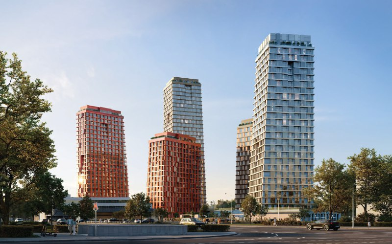
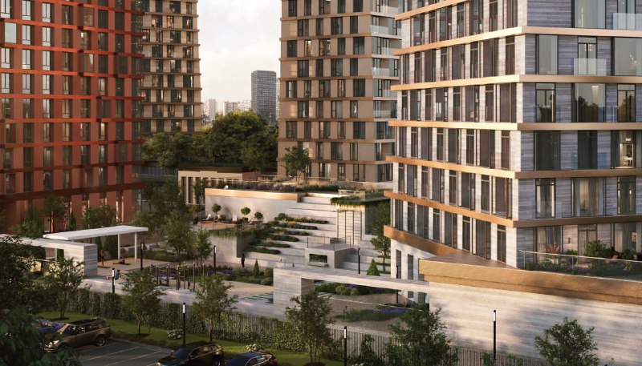
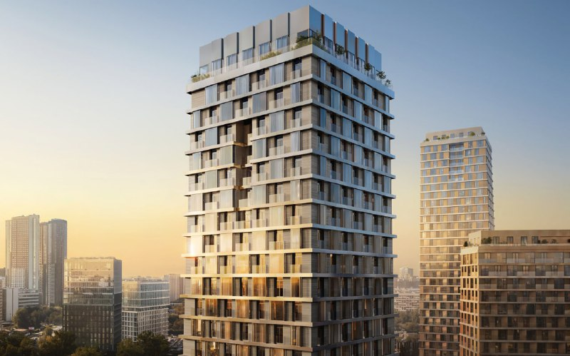

# ЖК «Татум» от Forma на Обручева, 27: от 20,6 млн ₽ за вход, ключи в 2029–2030

Forma вывела на рынок «Татум» на Обручева, 27 в марте 2026 года — и за полгода вход в проект успел подорожать, а сроки ввода сдвинуться. Котлован при этом всё ещё котлован.

## Коротко

- Продажи стартовали в марте 2026 года; 20 марта студия 30,3 м² без отделки стоила от 20,33 млн ₽.
- На 14 октября 2026 года цены в каталоге — от 20,6 до 83,8 млн ₽, студия 28,4 м² — от 20,56 млн ₽.
- Пять корпусов от 16 до 36 этажей, 796 квартир, 397 машино-мест.
- Ввод: первый корпус — 1 квартал 2029 года, второй — 2 квартал 2030 года (в апреле 2026 года первый значился на 3 квартал 2029 года).

## Пять башен у «Калужской»

ЖК «Татум» (адрес участка — Обручева, 27) строит Forma — компания, основанная в 2021 году как структура ПИК. Проект стоит в Обручевском районе Юго-Западного округа, рядом с метро «Калужская» и «Воронцовская». Класс — бизнес: квартиры без отделки, от студий до пентхаусов с террасами.

*Пять башен «Татума» разной высоты и цвета фасадов. Визуализация: Forma*

Архитектурную концепцию сделало бюро .ket. Пять корпусов от 16 до 36 этажей разной высоты и цвета фасадов — сплошной стены не будет. Внутри 796 квартир, под землёй — паркинг на 397 машино-мест, то есть примерно одно место на две квартиры. Машину здесь лучше планировать вместе с квартирой.

*Двор с террасами и лестничными зонами. Визуализация: Forma*

## Студия за 20 миллионов — это вход, а не скидка

В марте 2026 года самым доступным вариантом была студия 30,3 м² без отделки за 20,33 млн ₽.

В апреле 2026 года квадратный метр стоил так:

- однокомнатные — 650,5–800,5 тыс. ₽;
- двухкомнатные — 549,2–663,8 тыс. ₽;
- трёхкомнатные — 558,2–660,3 тыс. ₽.

Обратите внимание на арифметику: большой метр здесь дешевле маленького. На наш взгляд, это обычная картина для проектов, где ликвидность сидит в студиях и «однушках» — за компактность доплачивают.

## Полгода спустя: дороже и чуть позже

На 14 октября 2026 года, по данным каталога novostroy-m.ru:

- цены — от 20,6 до 83,8 млн ₽, студия 28,4 м² — от 20,56 млн ₽: студия стала меньше, а дешевле не стала;
- сроки: корпус 1 — 1 квартал 2029 года, корпус 2 — 2 квартал 2030 года; в апреле 2026 года для первого корпуса называли 3 квартал 2029 года;
- опубликованы [проектные декларации](/slovar/proektnaya-deklaratsiya/) от 6 марта и 15 сентября 2026 года;
- на начало октября стройка — на стадии котлована.

*Одна из башен проекта с озеленённым верхом. Визуализация: Forma*

## Что это значит для покупателя

Ключи в 2029–2030 годах — это три с лишним года ожидания при проекте на самой ранней стадии. Сроки уже успели поменяться между публикациями, так что даты в каталоге стоит воспринимать как ориентир, а не обещание. Если жильё нужно «здесь и сейчас», это не ваш вариант. Если вы смотрите на «Татум» как на вложение, считать надо темп продаж и то, как поведёт себя цена после выхода новых корпусов.

Что отслеживать: изменения в проектной декларации, число зарегистрированных [ДДУ](/slovar/ddu/) и ход стройки — темп продаж застройщик публично не раскрывает. Сравнивать «Татум» с соседями и другими [новостройками бизнес-класса Москвы](/novostroyki/biznes-klass/) честнее всего по цене метра в одинаковых типах квартир. Вопрос о сносе на участке когда-то поднимался — [снос на участке не подтвердился](/novosti/obrucheva-27-tatum-snos-ne-podtverzhden/); вся история проекта — в [досье «Татум»](/obekty/tatum/).

## Карточка объекта

- **Название:** ЖК «Татум»
- **Адрес участка:** Обручева, 27 (корпус 2)
- **Застройщик:** [Forma](/zastroyshchiki/forma/)
- **Регион:** Москва, Обручевский район, ЮЗАО
- **Класс:** бизнес
- **Корпуса:** 5, от 16 до 36 этажей
- **Квартиры:** 796; машино-мест — 397
- **Стадия:** продажи, строительство на начальной стадии
- **Ввод:** корпус 1 — 1 квартал 2029 года, корпус 2 — 2 квартал 2030 года
- **Цены:** от 20,6 млн ₽ (14 октября 2026 года)

## Вопросы и ответы

**Сколько стоят квартиры в ЖК «Татум» на Обручева, 27?**
По данным каталога novostroy-m.ru на 14 октября 2026 года — от 20,6 до 83,8 млн ₽; студия 28,4 м² — от 20,56 млн ₽. В апреле 2026 года метр в двухкомнатных и трёхкомнатных квартирах стоил примерно 550–660 тыс. ₽.

**Кто застройщик «Татума»?**
Forma — компания, основанная в 2021 году как структура ПИК.

**Когда сдадут ЖК «Татум»?**
Первый корпус — в 1 квартале 2029 года, второй — во 2 квартале 2030 года. В апреле 2026 года первый корпус значился на 3 квартал 2029 года.

**Где находится «Татум» и какое метро рядом?**
На улице Обручева, 27 в Обручевском районе ЮЗАО; рядом метро «Калужская» и «Воронцовская».

## Источники

1. [Каталог novostroy-m.ru: ЖК «Татум» (Обручева, 27)](https://novostroy-m.ru/baza/jk_obrucheva_27) — цены, сроки и стадия на 14 октября 2026 года.
2. [Новострой-М: Forma начала продажи в проекте «Татум»](https://www.novostroy-m.ru/novosti/novyy_proekt_tatum_i) — параметры проекта и цены на 20 марта 2026 года.
3. [Новострой-М: экспертный разбор ЖК «Татум» от Forma](https://www.novostroy-m.ru/expertise/jk_tatum_ot_forma) — цены за метр, архитектор, срок ввода в апреле 2026 года.

Материал не является инвестиционной рекомендацией.
