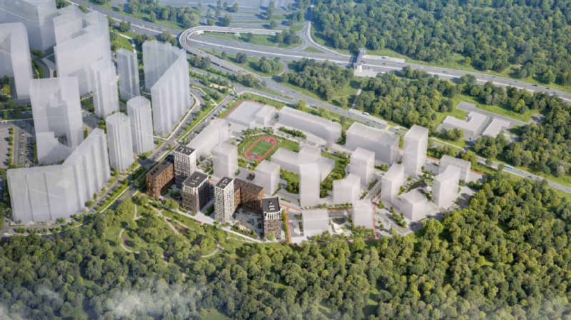
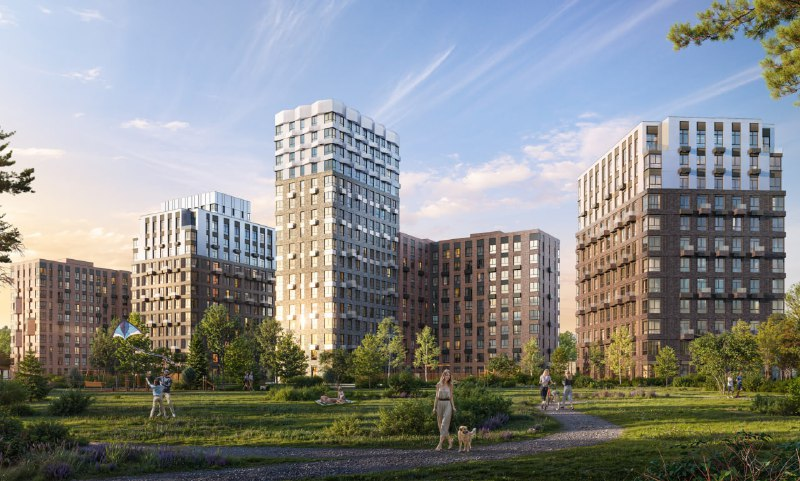

# «Литературный квартал» «Самолёта» в Рассказовке: от 12,9 млн ₽, сдача в 2028-м

«Самолёт» открыл новую серию — «Некст» — проектом в Рассказовке. «Литературный квартал» стоит на участке «Рассказовка, 204» в Новомосковском административном округе Москвы: проектная декларация от 18 марта 2026 года, два корпуса со сдачей в IV квартале 2028 года. К 14 октября 2026 года вход в проект стоит от 12,9 млн ₽ — и это цена самой маленькой квартиры, а не средняя.

## Коротко

- Застройщик — группа «Самолёт» ([страница девелопера](/zastroyshchiki/samolet/)); по версии каталога Новострой-М, проект открывает серию «Некст».
- Два монолитно-кирпичных корпуса на 10–17 этажей; квартиры от 28,7 до 77,7 кв. м.
- Разрешение на строительство — 22 февраля 2026 года, декларация — 18 марта 2026 года, сдача — IV квартал 2028 года.
- На 14 октября 2026 года цены — от 12,9 до 30,2 млн ₽; в каталоге 31 квартира в продаже.

## Два корпуса у Боровского парка

Участок «Рассказовка, 204» находится у деревни Рассказовка, Новомосковский административный округ ([досье «Литературный квартал»](/obekty/literaturnyy-kvartal/)). До метро «Пыхтино» — около 19 минут пешком, до «Рассказовки» — около 20. Выезд на Боровское шоссе, до МКАД около 10 км, двор связан с Боровским парком. Классический новомосковский расклад: метро есть, но не у подъезда, зато парк — под окнами.

По данным каталога, строят два монолитно-кирпичных корпуса на 10–17 этажей, с потолками 2,97–3,70 м и закрытой территорией. В продаже студии, одно-, двух- и трёхкомнатные квартиры — без отделки или с готовым ремонтом на выбор.

*Общий вид квартала с высоты (1). Визуализация: «Самолёт».*

*Дома и двор квартала (2). Визуализация: «Самолёт».*

## «От 12,9 млн» — это про одну квартиру

По данным Новострой-М на 14 октября 2026 года, цены в проекте — от 12,9 млн ₽ (однокомнатная 29,1 кв. м) до 30,2 млн ₽ (трёхкомнатная 76,4 кв. м).

А вот дальше начинается интересное. Остальные однокомнатные лоты стоят примерно от 17,4 до 19,1 млн ₽, двухкомнатные — от 25,8 до 28,1 млн ₽. То есть между рекламным «от» и реальной «однушкой» — несколько миллионов.

Сам каталог тоже не образец аккуратности: число квартир в продаже в разных блоках страницы указано по-разному, а цены отдельных лотов за месяц менялись на несколько миллионов рублей. Точную цену проверяйте у застройщика.

## Ключи — в конце 2028-го

По каталогу, оба корпуса сдадут в IV квартале 2028 года. [Проектная декларация](/slovar/proektnaya-deklaratsiya/) датирована 18 марта 2026 года, разрешение на строительство — 22 февраля 2026 года. Эксперт каталога допускает, что первые ключи выдадут уже в 2029 году; это оценка площадки, а не застройщика.

## Выбор уже небольшой

На 14 октября 2026 года стадия строительства в каталоге толком не расписана: у части лотов просто стоит «строится». Выбор в продаже скромный: по списку на странице — 31 квартира (22 однокомнатные, 8 двухкомнатных и 1 трёхкомнатная). Вся история проекта — в [досье «Литературный квартал»](/obekty/literaturnyy-kvartal/).

## Что это значит для покупателя и инвестора

Проект массовый, сроки по меркам рынка комфортные, но стройка на ранней стадии: сдача — в конце 2028 года, а разрешение получено лишь в феврале 2026-го. Первое, что стоит сделать, — открыть декларацию на наш.дом.рф и запросить цену у застройщика: ориентиры разных площадок расходятся.

На наш взгляд, сравнивать «Литературный квартал» с соседями по стартовому «от» бессмысленно: это цена самого маленького лота. Сравнивайте цену конкретной планировки. Общий фон — в разделах [цены на новостройки](/temy/ceny/) и [новостройки Москвы](/novostroyki/moskva/).

## Карточка объекта

- **Название:** «Литературный квартал».
- **Адрес участка:** Рассказовка, 204 (деревня Рассказовка, Новомосковский АО, Москва).
- **Застройщик:** группа «Самолёт».
- **Корпуса:** два, 10–17 этажей, монолитно-кирпичные.
- **Квартиры:** студии, 1–3-комнатные, 28,7–77,7 кв. м; в каталоге 31 квартира в продаже.
- **Разрешение на строительство:** 22 февраля 2026 года; проектная декларация: 18 марта 2026 года.
- **Срок сдачи:** IV квартал 2028 года.
- **Цены:** от 12,9 до 30,2 млн ₽ (Новострой-М, 14 октября 2026 года).

## Вопросы и ответы

**Кто застройщик ЖК «Литературный квартал»?**
Группа «Самолёт»; по данным каталога Новострой-М, это первый проект девелопера в серии «Некст».

**Когда сдадут «Литературный квартал»?**
По каталогу Новострой-М на 14 октября 2026 года, оба корпуса сдадут в IV квартале 2028 года. Разрешение на строительство датировано 22 февраля 2026 года.

**Сколько стоят квартиры в «Литературном квартале»?**
На 14 октября 2026 года Новострой-М показывает цены от 12,9 млн ₽ за однокомнатную 29,1 кв. м до 30,2 млн ₽ за трёхкомнатную 76,4 кв. м. Цифры на площадке местами расходятся — точную цену уточняйте у застройщика.

**Где находится «Литературный квартал» и что рядом?**
У деревни Рассказовка в Новомосковском административном округе Москвы, участок — «Рассказовка, 204». По данным каталога, до метро «Пыхтино» около 19 минут пешком, до «Рассказовки» — около 20.

## Источники

1. [ЖК «Литературный Квартал» — каталог Новострой-М](https://www.novostroy-m.ru/baza/jk_literaturnyy_kvartal) — застройщик, корпуса, сроки, декларация и разрешение, квартиры, цены.
2. [Однокомнатная квартира в ЖК «Литературный Квартал» — Новострой-М](https://www.novostroy-m.ru/kvartiry/odnokomnatnaya-kvartira-v-zhk-literaturnii-kvartal-5af8b44340d929cfdfc26bf34c97c4) — адрес, метро, цены по типам квартир, декларация и разрешение.

Материал не является инвестиционной рекомендацией.
