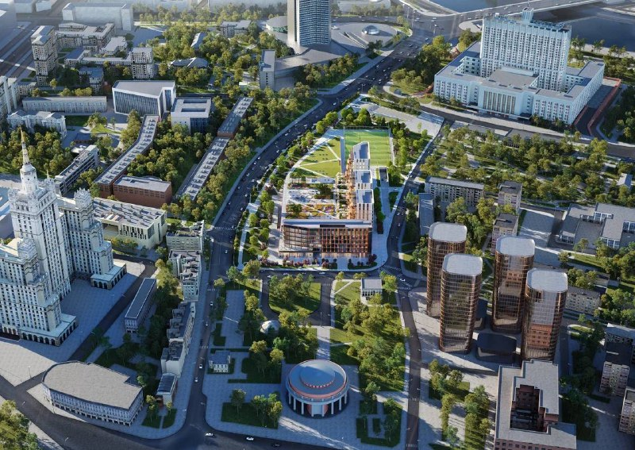

---
"source":
  "id": 33487
  "date": "2026-03-17"
"status": "needs_review"
"skip_reason": null
"type": "object"
"region": "moscow"
"title": "«Дом Спорта» на Дружинниковской, 18: клубный дом Capital Group за 2,4 млн ₽/м²"
"title_alts":
- "ЖК «Дом Спорта» на Дружинниковской: 8 этажей, сдача в 2029-м, спорт пока на словах"
- "Capital Group на Дружинниковской, 18: клубный «Дом Спорта» в трёх минутах от метро"
"slug": "dom-sporta-druzhinnikovskaya-18-capital-group"
"lead": "Capital Group строит в Пресне клубный «Дом Спорта» на Дружинниковской, 18: по данным справочника, восемь этажей, сдача в I квартале 2029 года и цены в объявлениях от 2,4 млн ₽/м². Спорт в названии есть, а расписанного состава спортивной части пока нет."
"developers":
- "id": "capital-group"
  "name": "Capital Group"
  "role": "main"
"objects":
- "id": "dom-sporta"
  "names":
  - "Дом Спорта"
  "zu": "Дружинниковская, 18"
  "main": true
  "new": false
"topics":
- "ceny"
- "premium"
"images":
- "file": "media/33487_1.jpg"
  "alt": "Визуализация клубного комплекса «Дом Спорта» на Дружинниковской, 18 с высоты, Пресненский район, Москва"
  "caption": "Визуализация комплекса «Дом Спорта» на Дружинниковской, 18 (1)"
  "credit": "Визуализация: Capital Group"
"factcheck":
- "claim": "Застройщик — Capital Group, ООО СЗ «А КЛАСС»; адрес — Дружинниковская, вл. 18, Пресненский район, ЦАО"
  "status": "confirmed"
  "source": "https://www.novostroy-m.ru/kvartiry/odnokomnatnaya-kvartira-v-zhk-dom-sporta-955b1609546087131b4902a4dee48e"
  "checked": "2026-10-14"
- "claim": "Срок сдачи — I квартал 2029 года; стадия — котлован и фундамент"
  "status": "confirmed"
  "source": "https://www.novostroy-m.ru/kvartiry/trehkomnatnaya-kvartira-v-zhk-dom-sporta-a2cca314366c6debe7c32475ff8e4e"
  "checked": "2026-10-14"
- "claim": "Дом восьмиэтажный, монолитно-кирпичный; лоты на 2-м и 6-м этажах из 8"
  "status": "confirmed"
  "source": "https://www.novostroy-m.ru/kvartiry/trehkomnatnaya-kvartira-v-zhk-dom-sporta-a2cca314366c6debe7c32475ff8e4e"
  "checked": "2026-10-14"
- "claim": "Цена: 110,4 млн ₽ за 45,76 м² (около 2,41 млн ₽/м²) и 323,5 млн ₽ за 116,02 м² (около 2,79 млн ₽/м²); в заметке ориентир был около 2 млн ₽/м²"
  "status": "changed"
  "source": "https://www.novostroy-m.ru/kvartiry/trehkomnatnaya-kvartira-v-zhk-dom-sporta-a2cca314366c6debe7c32475ff8e4e"
  "checked": "2026-10-14"
- "claim": "До метро «Краснопресненская» около 3 минут пешком, до «Баррикадной» около 7"
  "status": "confirmed"
  "source": "https://www.novostroy-m.ru/kvartiry/trehkomnatnaya-kvartira-v-zhk-dom-sporta-a2cca314366c6debe7c32475ff8e4e"
  "checked": "2026-10-14"
"removed":
- "Старт строительства 17 марта 2026 года: дата не подтверждена, в тексте только стадия по объявлениям"
- "Площадь 58 тыс. м², 92 квартиры, площади от 46 до 1022 м²: не подтверждены"
- "Архитектор (бюро Скуратова) и материалы фасадов: не подтверждены"
- "Состав спорткомплекса (две ледовые арены, шесть падел-кортов, бассейны 25 и 50 м, футбольное поле, спа): подтверждён только отзывом на объявлении, из статьи удалён"
- "Соседство со СЭВом, Домом Правительства и «золотой милей» Пресни; ценник «около 2 мультов» как прогноз: оценки без источника"
- "Акт ГИКЭ (апрель 2025) и ранние концепции участка из досье: не проверены"
"data_points":
- "metric": "price_offer_rub_m2"
  "value": 2413293
  "date": "2026-10-14"
"seo":
  "main_query": "дом спорта дружинниковская 18 цены"
  "keywords":
  - "жк дом спорта capital group"
  - "дружинниковская 18 пресненский район"
  - "дом спорта сроки сдачи"
  - "капитал груп краснопресненская новостройка"
  "frequency_checked": false
  "title": "Дом Спорта на Дружинниковской, 18: цены от 2,4 млн за метр"
  "description": "ЖК «Дом Спорта» на Дружинниковской, 18 в Пресне: 8 этажей, сдача в I квартале 2029 года, лоты от 2,4 млн ₽/м². Что есть за названием на октябрь 2026."
  "canonical": "https://шахматка.москва/novosti/dom-sporta-druzhinnikovskaya-18-capital-group/"
"internal_links":
- "anchor": "досье «Дом Спорта»"
  "url": "/obekty/dom-sporta/"
- "anchor": "Capital Group"
  "url": "/zastroyshchiki/capital-group/"
- "anchor": "Пресненский"
  "url": "/novostroyki/presnenskiy/"
- "anchor": "премиального класса"
  "url": "/novostroyki/premium-klass/"
- "anchor": "«Премиум»"
  "url": "/temy/premium/"
"faq":
- "q": "Кто застройщик ЖК «Дом Спорта» на Дружинниковской, 18?"
  "a": "Capital Group; проект ведёт ООО СЗ «А КЛАСС». Адрес — Дружинниковская улица, владение 18, Пресненский район, ЦАО Москвы."
- "q": "Когда сдадут ЖК «Дом Спорта»?"
  "a": "В объявлениях справочника «Новострой-М» — I квартал 2029 года, стадия — котлован и фундамент. Срок стоит сверить с проектной декларацией."
- "q": "Сколько стоят квартиры в ЖК «Дом Спорта»?"
  "a": "В объявлениях справочника — от 110,4 млн ₽ за 45,76 м² (около 2,41 млн ₽/м²) до 323,5 млн ₽ за 116 м² (около 2,79 млн ₽/м²). На октябрь 2026 года эти страницы помечены неактуальными."
- "q": "Сколько этажей в ЖК «Дом Спорта»?"
  "a": "Восемь: дом в объявлениях описан как монолитно-кирпичный, квартиры — на 2-м и 6-м этажах из 8."
- "q": "Какое метро рядом с «Домом Спорта»?"
  "a": "По данным справочника, до «Краснопресненской» около 3 минут пешком, до «Баррикадной» — около 7 минут."
"date_published": "2026-03-17"
"date_modified": "2026-10-14"
"author": "Редакция Шахматки"
"schema": "[{\"@context\": \"https://schema.org\", \"@type\": \"NewsArticle\", \"headline\": \"«Дом Спорта» на Дружинниковской, 18: Capital Group строит клубный дом\", \"description\": \"ЖК «Дом Спорта» на Дружинниковской, 18 в Пресне: 8 этажей, сдача в I квартале 2029 года, лоты от 2,4 млн ₽/м². Что известно о проекте к октябрю 2026.\", \"datePublished\": \"2026-03-17\", \"dateModified\": \"2026-10-14\", \"author\": {\"@type\": \"Organization\", \"name\": \"Редакция Шахматки\"}, \"publisher\": {\"@type\": \"Organization\", \"name\": \"Шахматка\", \"url\": \"https://шахматка.москва\"}, \"about\": {\"@type\": \"Residence\", \"name\": \"ЖК «Дом Спорта»\", \"address\": {\"@type\": \"PostalAddress\", \"streetAddress\": \"Дружинниковская ул., вл. 18\", \"addressLocality\": \"Москва\"}}, \"mainEntityOfPage\": {\"@type\": \"WebPage\", \"@id\": \"https://шахматка.москва/novosti/dom-sporta-druzhinnikovskaya-18-capital-group/\"}}, {\"@context\": \"https://schema.org\", \"@type\": \"FAQPage\", \"mainEntity\": [{\"@type\": \"Question\", \"name\": \"Кто застройщик ЖК «Дом Спорта» на Дружинниковской, 18?\", \"acceptedAnswer\": {\"@type\": \"Answer\", \"text\": \"Застройщик — Capital Group; проект ведёт ООО СЗ «А КЛАСС». Адрес — Дружинниковская улица, владение 18, Пресненский район, ЦАО Москвы.\"}}, {\"@type\": \"Question\", \"name\": \"Когда сдадут ЖК «Дом Спорта»?\", \"acceptedAnswer\": {\"@type\": \"Answer\", \"text\": \"В объявлениях справочника «Новострой-М» срок сдачи — I квартал 2029 года. Стадия строительства в них указана как котлован и фундамент; сверьте срок с проектной декларацией.\"}}, {\"@type\": \"Question\", \"name\": \"Сколько стоят квартиры в ЖК «Дом Спорта»?\", \"acceptedAnswer\": {\"@type\": \"Answer\", \"text\": \"В объявлениях справочника лоты стоили от 110,4 млн ₽ за 45,76 м² (около 2,41 млн ₽/м²) до 323,5 млн ₽ за 116 м² (около 2,79 млн ₽/м²). Страницы помечены неактуальными на октябрь 2026 года.\"}}, {\"@type\": \"Question\", \"name\": \"Сколько этажей в ЖК «Дом Спорта»?\", \"acceptedAnswer\": {\"@type\": \"Answer\", \"text\": \"Дом в объявлениях описан как монолитно-кирпичный, восьмиэтажный. Квартиры на 2-м и 6-м этажах из 8.\"}}, {\"@type\": \"Question\", \"name\": \"Какое метро рядом с «Домом Спорта»?\", \"acceptedAnswer\": {\"@type\": \"Answer\", \"text\": \"По данным справочника, до метро «Краснопресненская» около 3 минут пешком, до «Баррикадной» около 7 минут.\"}}]}]"
"editor_notes": "Все подтверждения — только из объявлений справочника «Новострой-М» (наш.дом.рф, сайт застройщика и новости о стройке не открылись; RBC Companies с заголовком о 37% фундамента нашёл поиск, но страница не загрузилась). Стоит свериться с проектной декларацией: срок, этажность, ТЭП, число квартир. Дату старта строительства и спортивный состав проекта подтвердить не удалось. Объявления помечены неактуальными. Бюджет: 3 WebSearch, 7 WebFetch. Фото — визуализация, права подтверждает пресс-служба; взято одно из трёх, остальные — такие же рендеры."
---

# «Дом Спорта» на Дружинниковской, 18: клубный дом Capital Group за 2,4 млн ₽/м²

Capital Group строит в Пресне клубный «Дом Спорта» на ЗУ (земельном участке) «Дружинниковская, 18». Восемь этажей, сдача в I квартале 2029 года, а квартиры в объявлениях — по 2,4–2,8 млн ₽/м². Спорт в названии есть, но расписанного состава спортивной части пока нет.

*Визуализация комплекса «Дом Спорта» на Дружинниковской, 18 (1). Визуализация: Capital Group*

## Коротко

- Клубный жилой комплекс «Дом Спорта»: Дружинниковская ул., вл. 18, Пресненский район, ЦАО; застройщик — Capital Group (ООО СЗ «А КЛАСС»).
- Монолитно-кирпичный дом в восемь этажей; сдача — I квартал 2029 года, стадия — котлован и фундамент (по объявлениям, обновлявшимся летом 2026 года).
- В объявлениях: около 2,41 млн ₽/м² за 45,76 м² и около 2,79 млн ₽/м² за 116 м².
- До метро «Краснопресненская» — около 3 минут пешком.

## Спорт в названии, бетон в котловане

[Capital Group](/zastroyshchiki/capital-group/) назвала проект «Дом Спорта», и в объявлениях о квартирах он числится как ЖК с крупной спортивной инфраструктурой. Что именно в неё войдёт — арены, бассейны, корты, — застройщик официально пока не расписывал. Так что главное слово в названии пока остаётся обещанием.

Общую площадь, число квартир и диапазон площадей застройщик публично тоже не раскрывал.

Зато про сам дом кое-что известно. По данным справочника «Новострой-М», он монолитно-кирпичный, восьмиэтажный. На июль 2026 года, когда объявления обновлялись в последний раз, стройка была на стадии котлована и фундамента.

## Однушка за сто с лишним миллионов

В двух объявлениях справочника цены такие:

- однокомнатная, 45,76 м², 2-й этаж из 8 — 110,4 млн ₽, около 2,41 млн ₽/м²;
- трёхкомнатная, 116,02 м², 6-й этаж из 8 — 323,5 млн ₽, около 2,79 млн ₽/м² (корпус 3).

Цену метра мы посчитали сами: стоимость, делённая на площадь. Оба объявления помечены как неактуальные на октябрь 2026 года, так что это ориентир, а не прайс-лист. Реальную картину покажут проектная декларация (документ застройщика на портале наш.дом.рф) и отдел продаж.

## Сдача — I квартал 2029-го, но с оговоркой

В объявлениях срок сдачи — I квартал 2029 года. Это данные справочника, а не проектной декларации. На наш взгляд, пока даты не сверены с декларацией, считайте их предварительными.

## Что это значит для покупателя и инвестора

Проект малоэтажный и дорогой: 2,4–2,8 млн ₽ за метр по объявлениям — это уровень [премиального класса](/novostroyki/premium-klass/) в центре Москвы. Платите вы за Пресню, метро в трёх минутах и заявленный спортивный формат.

Вот где подвох: стройка на ранней стадии, цены в объявлениях неактуальны, а то, ради чего проект назван именно так, — спортивная инфраструктура — документами пока не подкреплено. Покупать «Дом Спорта» ради спорта стоит не раньше, чем его состав появится на бумаге. Что отслеживать: проектную декларацию, сроки и состав спортивных объектов, актуальный прайс. Подробнее о сегменте — в теме [«Премиум»](/temy/premium/).

## Участок с историей

Участок на Дружинниковской, 18 фигурирует в истории проекта с 2021 года. Вся она — в [досье «Дом Спорта»](/obekty/dom-sporta/). Другие новостройки района — в разделе [Пресненский](/novostroyki/presnenskiy/).

## Карточка объекта

- **Адрес ЗУ:** Дружинниковская, 18 (Москва, Пресненский район, ЦАО).
- **Название:** «Дом Спорта».
- **Застройщик:** Capital Group, ООО СЗ «А КЛАСС».
- **Этажность:** 8 этажей, монолитно-кирпичный дом.
- **Стадия:** котлован и фундамент (по объявлениям, лето 2026 года).
- **Сдача:** I квартал 2029 года (по справочнику).
- **Цена в объявлениях:** около 2,41–2,79 млн ₽/м².
- **Метро:** «Краснопресненская» (около 3 минут пешком), «Баррикадная» (около 7 минут).

## Вопросы и ответы

**Кто застройщик ЖК «Дом Спорта» на Дружинниковской, 18?**
Capital Group; проект ведёт ООО СЗ «А КЛАСС». Адрес — Дружинниковская улица, владение 18, Пресненский район, ЦАО Москвы.

**Когда сдадут ЖК «Дом Спорта»?**
В объявлениях справочника «Новострой-М» — I квартал 2029 года, стадия — котлован и фундамент. Срок стоит сверить с проектной декларацией.

**Сколько стоят квартиры в ЖК «Дом Спорта»?**
В объявлениях справочника — от 110,4 млн ₽ за 45,76 м² (около 2,41 млн ₽/м²) до 323,5 млн ₽ за 116 м² (около 2,79 млн ₽/м²). На октябрь 2026 года эти страницы помечены неактуальными.

**Сколько этажей в ЖК «Дом Спорта»?**
Восемь: дом в объявлениях описан как монолитно-кирпичный, квартиры — на 2-м и 6-м этажах из 8.

**Какое метро рядом с «Домом Спорта»?**
По данным справочника, до «Краснопресненской» около 3 минут пешком, до «Баррикадной» — около 7 минут.

## Источники

1. [Объявление: 1-комнатная квартира в ЖК «Дом Спорта», Дружинниковская, вл. 18 — «Новострой-М»](https://www.novostroy-m.ru/kvartiry/odnokomnatnaya-kvartira-v-zhk-dom-sporta-955b1609546087131b4902a4dee48e) (цена, площадь, застройщик, срок сдачи, этажность).
2. [Объявление: 3-комнатная квартира в ЖК «Дом Спорта», Дружинниковская, вл. 18 — «Новострой-М»](https://www.novostroy-m.ru/kvartiry/trehkomnatnaya-kvartira-v-zhk-dom-sporta-a2cca314366c6debe7c32475ff8e4e) (цена, стадия строительства, метро, дом).

Материал не является инвестиционной рекомендацией.
