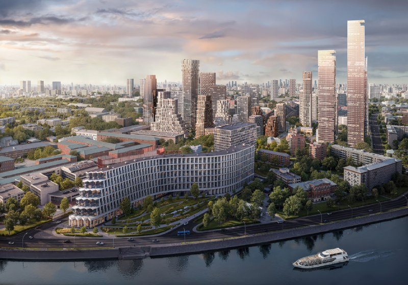

# КРТ «Дербеневская» от Пионера: 14,7 га у Павелецкой и стройка до 2034 года

Пионер раскрыл параметры комплексного развития территории (КРТ) у Павелецкой — проекта «Дербеневская»: 14,7 га, свыше 358 тыс. м² жилья, школа на 1000 мест, старт в 2027 году и завершение к 2034 году. Масштаб серьёзный, но и горизонт тоже: до первых жильцов здесь ещё далеко.

*Визуализация застройки на набережной Москвы-реки из материалов к проекту. Визуализация: Пионер*

## Коротко

- **Где и кто:** 14,7 га у Павелецкой, застройщик — [Пионер](/zastroyshchiki/pioner/).
- **Жильё:** свыше 358 тыс. м².
- **Сроки:** с 2027 года до 2034 года.
- **В нагрузку:** коммерция, школа на 1000 мест, парк и новая Дербеневская набережная.

## Квартал под ключ, с набережной в комплекте

По данным каталога новостроек, Пионер ведёт [КРТ](/slovar/krt/) у Павелецкой на 14,7 га. Кроме жилья в проекте заявлены коммерческая недвижимость, школа на 1000 мест и парк. Обещают и обновить Дербеневскую набережную вместе с детскими и спортивными площадками — то есть переделать не только участок, но и его окружение.

Над проектом работает целая сборная: «Цимайло Ляшенко и партнеры», APEX, ADM, WALL и Kleinewelt Architekten. Пять бюро на один квартал — заявка на разнообразие, а не на очередной ряд одинаковых корпусов. Насколько это получится, покажут архитектурные согласования.

## Город считал по-другому

В апреле 2024 года мэр Москвы принял решение о КРТ в Даниловском районе — на трёх участках между Дербеневской набережной, Летниковской и Кожевнической улицами. Параметры тогда звучали скромнее: 9,37 га, около 257,8 тыс. м² недвижимости, из них свыше 163 тыс. м² жилья, срок — семь лет. Пионера в сообщении города не называли.

Вот где нестыковка: 9,37 га у города против 14,7 га у девелопера. Ни мэрия, ни застройщик разницу публично не объясняли. Возможно, речь о разных границах или разных стадиях проекта — но пока это вопрос, а не ответ.

Полная история проекта — в [досье «Дербеневская»](/obekty/derbenevskaya/).

## Пока только планы

На 15 октября 2026 года об утверждённом проекте планировки территории и старте стройки не сообщалось. По заявленному графику работы начинаются только в 2027 году, так что тишина вполне объяснима.

## Что это значит для покупателя и инвестора

Квартиры здесь пока не продают: впереди стройка длиной в семь лет, с 2027 по 2034 год. Для тех, кто уже купил по соседству, расклад двоякий: долгие годы рядом со стройплощадкой — и, если обещания сбудутся, обновлённая набережная и школа на 1000 мест в итоге.

На наш взгляд, верить стоит проекту планировки и разрешениям на строительство, а не пресс-материалам: цифры по площади уже разошлись, и неизвестно, на какой версии всё остановится. Следите за решениями по [новостройкам Москвы](/novostroyki/moskva/) в этом районе.

## Вопросы и ответы

**Что такое КРТ «Дербеневская»?**
Проект комплексного развития территории у Павелецкой, который ведёт Пионер: 14,7 га, жильё, коммерция, школа на 1000 мест, парк и обновлённая Дербеневская набережная.

**Когда завершится КРТ у Павелецкой?**
По заявленному графику работы начнутся в 2027 году и должны завершиться к 2034 году.

**Сколько жилья построят в КРТ «Дербеневская»?**
Свыше 358 тыс. м² жилья — такую цифру называют для проекта Пионера.

**Кто проектирует КРТ у Павелецкой?**
В команде пять бюро: «Цимайло Ляшенко и партнеры», APEX, ADM, WALL и Kleinewelt Architekten.

## Источники

1. [Каталог новостроек: КРТ «Павелецкая» от Пионера, 26 марта](https://www.novostroy-m.ru/novosti/v_rayone_metro_paveletskaya)
2. [Правительство Москвы: решение о КРТ у Дербеневской набережной, 26 апреля 2024 года](https://www.mos.ru/news/item/138043073/)

Материал не является инвестиционной рекомендацией.
