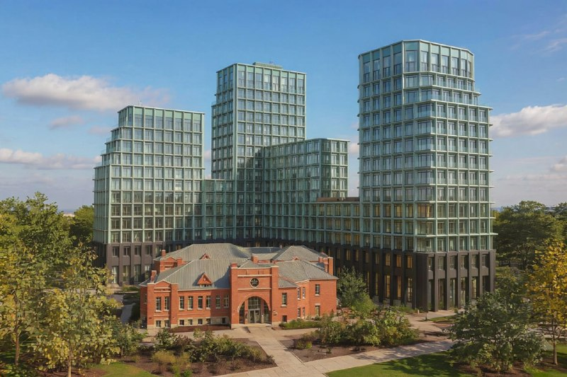
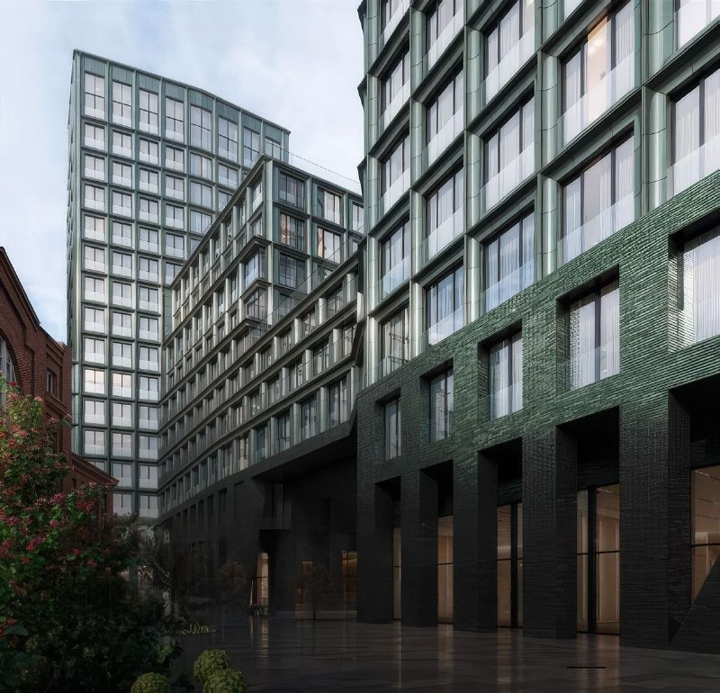

---
source:
  id: 34081
  date: '2026-04-29'
status: needs_review
skip_reason: null
type: object
region: moscow
title: '«26 ПаркВью» на Тимирязевской: MR Group ужала проект и оставила дом Гиппиуса'
title_alts:
- 'Тимирязевская, 26: «26 ПаркВью» стал меньше в 1,6 раза, а дом Гиппиуса остался'
- 'ЖК у дома Гиппиуса: MR Group продаёт клубный дом от 30,5 млн ₽'
slug: 26-parkvyu-timiryazevskaya-dom-gippiusa
lead: 'После протестов жителей MR Group переписала проект на Тимирязевской улице, 26: дом Гиппиуса остаётся во дворе, а застройка стала меньше в 1,6 раза. К октябрю 2026 года клубный дом «26 ПаркВью» уже продают — от 30,5 млн ₽, — а на площадке котлован.'
developers:
- id: mr-group
  name: MR Group
  role: main
objects:
- id: 26-parkvyu
  names:
  - 26 ПаркВью
  - Дом Гиппиуса
  - Тимирязевская, 26
  zu: Тимирязевская, 26
  main: true
  new: false
districts: []
topics:
- premium
- ceny
images:
- file: media/34081_3.jpg
  alt: 'Визуализация «26 ПаркВью»: ступенчатые корпуса с зелёными фасадами за кирпичным домом Гиппиуса, Тимирязевский район'
  caption: 'Корпуса «26 ПаркВью» и дом Гиппиуса на переднем плане. Визуализация: MR Group'
  credit: 'Визуализация: MR Group'
- file: media/34081_4.jpg
  alt: 'Визуализация двора «26 ПаркВью»: зелёный глазурованный кирпич, аркады первых этажей, Тимирязевский район Москвы'
  caption: 'Нижние этажи и аркады во дворе. Визуализация: MR Group'
  credit: 'Визуализация: MR Group'
factcheck:
- claim: Застройщик «26 ПаркВью» — MR Group; концепция — мастерская MAM; проект показан 29 апреля 2026 года
  status: confirmed
  source: https://moskvichmag.ru/?p=496086
  checked: '2026-10-13'
- claim: На территории стоит историческое здание, которое планируют отреставрировать и встроить в городскую среду (апрель 2026)
  status: confirmed
  source: https://moskvichmag.ru/?p=496086
  checked: '2026-10-13'
- claim: Проект уменьшен в 1,6 раза против прежнего варианта «около 50 тыс. кв. м»; 257 квартир, секции 5–16 этажей; дом Гиппиуса реконструируют (фитнес и рестораны); силуэт террасами к дому и паркам (публикация 12 июля 2026 года)
  status: confirmed
  source: https://moskvichmag.ru/?p=510676
  checked: '2026-10-13'
- claim: В июне 2024 года по словам депутата Мосгордумы А. Медведева застройщик отказался от сноса дома Гиппиуса; здание 1926 года, автор — Карл Гиппиус; по словам активистов, прежний план включал здание до 170 м и 50 этажей
  status: confirmed
  source: https://moskvichmag.ru/?p=368401
  checked: '2026-10-13'
- claim: 'Каталог на 13 октября 2026 года: «26 ПаркВью», MR Group, цены от 30,5 млн ₽, корпус 1 — 2 кв. 2029, котлован и фундамент на 26.09.2026, 257 квартир, 53 в продаже, метро «Тимирязевская» 10 мин пешком, Тимирязевский район САО'
  status: changed
  source: https://www.novostroy-m.ru/baza/jk_26_parkvyu
  checked: '2026-10-13'
- claim: 'Этажность корпуса 1: каталог называет 12–17 этажей, описание — 5–16 этажей для секций'
  status: changed
  source: https://www.novostroy-m.ru/baza/jk_26_parkvyu
  checked: '2026-10-13'
- claim: АГР Москвы одобрила проект (событие из заметки, апрель 2026)
  status: unverified
  source: ни в одном открытом источнике не найдено упоминания АГР; Moskvich Mag пишет о «положительном заключении экспертизы» (12 июля 2026)
  checked: '2026-10-13'
- claim: Потеряно 21 тыс. кв. м или 43% квартир
  status: unverified
  source: источник называет снижение в 1,6 раза от «около 50 тыс. кв. м»; 21 тыс. и 43% не подтверждены
  checked: '2026-10-13'
removed:
- 'Решение АГР: ни один источник не называет АГР; в статье только подтверждённое — показ проекта 29 апреля 2026 года и экспертиза, о которой пишет Moskvich Mag.'
- '«Потеряли 21 тыс. кв. м или 43% квартир» и рассуждения о фин. модели: цифры не подтверждены (источник — снижение в 1,6 раза), модель застройщика неизвестна.'
- '«ORION.3 — филиал MR»: не подтверждено.'
- 'Въезд в паркинг перенесён и находится под историческим зданием, три арки во двор: в источниках нет.'
- 'Дом «по всем признакам ОКН, но по бумажкам не ОКН»: статус здания не подтверждён.'
- 'Слухи 2024 года о продаже здания застройщиком: не подтверждены.'
- Фото 1 и 2 с пометками редакции канала, фото 5 и 6 (варианты 2024 года с пометками «2» и «3») не использованы; взяты фото 3 и 4.
- 'Цена 880 тыс. ₽/м² и ключи в 2029 году из хронологии досье: цена за м² по каталогу не подтверждена, 2029 год подтверждён только для корпуса 1.'
data_points:
- metric: min_price_mln_rub
  value: 30.5
  date: '2026-10-13'
seo:
  main_query: 26 парквью мр групп цены
  keywords:
  - жк 26 парквью
  - тимирязевская 26 новостройка
  - дом гиппиуса тимирязевская
  - mr group тимирязевский район
  - 26 парквью сроки сдачи
  frequency_checked: false
  title: '26 ПаркВью MR Group: цены от 30,5 млн ₽, сдача 2029'
  description: 'ЖК «26 ПаркВью» на Тимирязевской, 26: MR Group сохранила дом Гиппиуса и ужала проект в 1,6 раза. Цены от 30,5 млн ₽, сдача первого корпуса — во 2 кв. 2029 года.'
  canonical: https://шахматка.москва/novosti/26-parkvyu-timiryazevskaya-dom-gippiusa/
internal_links:
- anchor: полная история проекта — в досье «26 ПаркВью»
  url: /obekty/26-parkvyu/
- anchor: MR Group
  url: /zastroyshchiki/mr-group/
- anchor: новостройки Москвы
  url: /novostroyki/moskva/
- anchor: новостройки премиум-класса
  url: /novostroyki/premium-klass/
- anchor: ТЭП
  url: /slovar/tep/
- anchor: премиум
  url: /temy/premium/
faq:
- q: Кто застройщик ЖК «26 ПаркВью»?
  a: Застройщик — MR Group. Архитектурную концепцию разработала мастерская MAM.
- q: Что будет с домом Гиппиуса на Тимирязевской, 26?
  a: 'Здание не сносят: проект предусматривает его реконструкцию. По данным Moskvich Mag, после работ в нём откроют фитнес-центр и ресторанный комплекс.'
- q: Когда сдадут «26 ПаркВью»?
  a: По каталогу на октябрь 2026 года, корпус 1 сдают во 2 квартале 2029 года; сроки остальных корпусов пока не названы. На 26 сентября 2026 года на площадке были котлован и фундамент.
- q: Сколько стоят квартиры в «26 ПаркВью»?
  a: На 13 октября 2026 года — от 30,5 млн ₽ по данным каталога. Из 257 квартир проекта в продаже было 53.
date_published: '2026-04-29'
date_modified: '2026-10-13'
author: Редакция Шахматки
schema: '[{"@context": "https://schema.org", "@type": "NewsArticle", "headline": "26 ПаркВью на Тимирязевской: MR Group сохранила дом Гиппиуса", "description": "ЖК «26 ПаркВью» на Тимирязевской, 26: MR Group сохранила дом Гиппиуса, проект стал меньше в 1,6 раза. Цены от 30,5 млн ₽, сдача с 2 кв. 2029 года.", "datePublished": "2026-04-29", "dateModified": "2026-10-13", "author": {"@type": "Organization", "name": "Редакция Шахматки"}, "publisher": {"@type": "Organization", "name": "Шахматка"}, "about": [{"@type": "Residence", "name": "ЖК «26 ПаркВью», Тимирязевская улица, 26, Москва"}, {"@type": "Organization", "name": "MR Group"}], "mainEntityOfPage": "https://шахматка.москва/novosti/26-parkvyu-timiryazevskaya-dom-gippiusa/"}, {"@context": "https://schema.org", "@type": "FAQPage", "mainEntity": [{"@type": "Question", "name": "Кто застройщик ЖК «26 ПаркВью»?", "acceptedAnswer": {"@type": "Answer", "text": "Застройщик — MR Group. Автор архитектурной концепции — мастерская MAM."}}, {"@type": "Question", "name": "Что будет с домом Гиппиуса на Тимирязевской, 26?", "acceptedAnswer": {"@type": "Answer", "text": "Здание не сносят: проект предусматривает его реконструкцию. По данным Moskvich Mag, после работ в нём планируют открыть фитнес-центр и ресторанный комплекс."}}, {"@type": "Question", "name": "Когда сдадут «26 ПаркВью»?", "acceptedAnswer": {"@type": "Answer", "text": "По каталогу на октябрь 2026 года, корпус 1 сдают во 2 квартале 2029 года; сроки остальных корпусов каталог не указывает. На 26 сентября 2026 года на площадке был котлован и фундамент."}}, {"@type": "Question", "name": "Сколько стоят квартиры в «26 ПаркВью»?", "acceptedAnswer": {"@type": "Answer", "text": "Каталог на 13 октября 2026 года заявляет цены от 30,5 млн ₽. Из 257 квартир проекта в продаже было 53."}}]}]'
editor_notes: 'Главное событие заметки — «АГР одобрила проект» — прямо не подтверждено: ни один открытый источник не называет АГР (Moskvich Mag пишет о показе проекта 29.04.2026 и о «положительном заключении экспертизы» 12.07.2026). Подтверждена суть: пересмотренный проект с сохранением дома Гиппиуса, меньше в 1,6 раза, MR Group, продажи идут. Если решите, что без АГР статьи быть не должно, переведите в skip/unverifiable. Проверьте: протокол АГР на сайте Москомархитектуры; разрешение на строительство (июль 2026) и проектную декларацию на наш.дом.рф; статус дома Гиппиуса (ОКН или нет); этажность корпуса 1 (12–17 или 5–16); визуализации 3 и 4 взяты из публикации Moskvich Mag с подписью MR Group — права подтвердить у пресс-службы. Смены собственника нет: застройщик по досье и по каталогу — MR Group. Лимит запросов (6 поисков, 8 загрузок) исчерпан; наш.дом.рф и сайт MR Group не открывались.'
---

# «26 ПаркВью» на Тимирязевской: MR Group ужала проект и оставила дом Гиппиуса

В апреле 2026 года MR Group показала новый проект на Тимирязевской улице, 26 — и это редкий случай, когда история с протестами жителей закончилась сохранением старого дома. Дом Гиппиуса остаётся на месте, застройка стала меньше в 1,6 раза. К октябрю 2026 года клубный дом «26 ПаркВью» уже продают, а на площадке идёт нулевой цикл.

## Коротко

- **Проект:** клубный дом «26 ПаркВью», 257 квартир, секции от 5 до 16 этажей, концепция мастерской MAM.
- **Дом Гиппиуса** 1926 года не сносят, а реконструируют: внутри будут фитнес-центр и рестораны.
- **Минус 1,6 раза:** прежний вариант, по данным Moskvich Mag, тянул примерно на 50 тыс. м².
- **На 13 октября 2026 года:** от 30,5 млн ₽, корпус 1 — во 2 квартале 2029 года, на площадке котлован и фундамент.

*Корпуса «26 ПаркВью» и дом Гиппиуса на переднем плане. Визуализация: MR Group*

## Изумрудная скала за старым домом

Участок зажат между Тимирязевским лесом и парком «Дубки» — локация, за которую в Москве обычно и платят. Новый проект [MR Group](/zastroyshchiki/mr-group/) показали 29 апреля 2026 года: «изумрудные» фасады, корпуса разной высоты и террасы, которые дают эффект «скалы». Концепция — мастерской MAM. Силуэт, по словам архитекторов, спускается ступенями к историческому дому и паркам.

Главное отличие от прежних версий — старое здание теперь не мешает, а стоит во дворе. Его обещают отреставрировать и встроить в городскую среду. В июле 2026 года Moskvich Mag сообщил о положительном заключении экспертизы: 257 квартир в секциях от 5 до 16 этажей.

*Нижние этажи и аркады во дворе. Визуализация: MR Group*

## Сначала протест, потом компромисс

Первые варианты застройки на Тимирязевской, 26 жителям не понравились. Дом 1926 года, построенный по проекту архитектора Карла Гиппиуса, они считали ценным и защищали. По словам активистов, прежний план предполагал здание до 170 м и 50 этажей.

В июне 2024 года депутат Мосгордумы Андрей Медведев сообщил, что застройщик отказался от сноса дома. Потом проект сократили в 1,6 раза. Полная история — в [досье «26 ПаркВью»](/obekty/26-parkvyu/).

## Котлован и первые продажи

На 13 октября 2026 года, по данным каталога новостроек, проект называется «26 ПаркВью», застройщик — MR Group, адрес — Тимирязевская улица, 26, Тимирязевский район САО. До метро «Тимирязевская» — 10 минут пешком.

- **Стадия:** котлован и фундамент (данные на 26 сентября 2026 года).
- **Срок:** корпус 1 — второй квартал 2029 года; по остальным корпусам сроков пока нет.
- **Продажи:** из 257 квартир в продаже 53, открыт корпус 1.
- **Этажность:** каталог даёт для корпуса 1 12–17 этажей, а описание проекта — 5–16 этажей для секций. Цифры не сходятся, так что сверяйте по документам.

## Сколько стоят квартиры в «26 ПаркВью»

Вход — от 30,5 млн ₽. Цену за метр каталог на странице проекта не приводит. Один из лотов — однокомнатная квартира 44,25 м² — висел по 838 тыс. ₽/м², но на 13 октября 2026 года предложение помечено как неактуальное, так что ориентиром его считать не стоит. Каталог относит дом к премиальному классу — соседей по сегменту смотрите в подборке [новостроек премиум-класса](/novostroyki/premium-klass/) и в теме [«Премиум»](/temy/premium/).

## Что это значит для покупателя и инвестора

На наш взгляд, проект стал камернее и дороже в производстве: квартир меньше, а реставрация старого дома и двор вокруг него требуют дополнительных денег. Как это ударило по экономике MR Group, снаружи не видно — и гадать об этом по открытым данным мы не будем.

Для покупателя расклад такой. Дом на нулевом цикле, корпус 1 обещают сдать в 2029 году, по остальным корпусам сроков нет. Этажность и состав корпусов в источниках расходятся, поэтому сверяйте [проектную декларацию](/slovar/proektnaya-deklaratsiya/) и [ТЭП](/slovar/tep/) на наш.дом.рф. Лес и парк рядом — плюс, но это всё-таки точечная застройка в окружении исторических домов и зелёных зон, а не новый квартал. Другие проекты города — в подборке [новостроек Москвы](/novostroyki/moskva/).

Что отслеживать: сроки реставрации дома Гиппиуса, сроки по корпусам 2 и дальше, движение цен в каталоге.

## Карточка объекта

- Название: ЖК «26 ПаркВью» (клубный дом; Дом Гиппиуса)
- Адрес ЗУ: Тимирязевская, 26, Тимирязевский район, САО, Москва
- Застройщик: MR Group
- Архитектор: мастерская MAM
- Класс: премиум (по каталогу)
- Квартиры: 257, секции от 5 до 16 этажей
- Стадия: котлован и фундамент (на 26 сентября 2026 года)
- Сдача: корпус 1 — 2 квартал 2029 года
- Цена: от 30,5 млн ₽ (на 13 октября 2026 года)

## Вопросы и ответы

**Кто застройщик ЖК «26 ПаркВью»?**
Застройщик — MR Group. Архитектурную концепцию разработала мастерская MAM.

**Что будет с домом Гиппиуса на Тимирязевской, 26?**
Здание не сносят: проект предусматривает его реконструкцию. По данным Moskvich Mag, после работ в нём откроют фитнес-центр и ресторанный комплекс.

**Когда сдадут «26 ПаркВью»?**
По каталогу на октябрь 2026 года, корпус 1 сдают во 2 квартале 2029 года; сроки остальных корпусов пока не названы. На 26 сентября 2026 года на площадке были котлован и фундамент.

**Сколько стоят квартиры в «26 ПаркВью»?**
На 13 октября 2026 года — от 30,5 млн ₽ по данным каталога. Из 257 квартир проекта в продаже было 53.

## Источники

1. [Moskvich Mag: между парком «Дубки» и Тимирязевским лесом построят жилой комплекс с изумрудными фасадами, 29.04.2026](https://moskvichmag.ru/?p=496086)
2. [Moskvich Mag: ЖК рядом с домом Гиппиуса на Тимирязевской уменьшили в 1,6 раза, 12.07.2026](https://moskvichmag.ru/?p=510676)
3. [Moskvich Mag: застройщик решил не сносить дом Гиппиуса, 21.06.2024](https://moskvichmag.ru/?p=368401)
4. [Новостройки Москвы: ЖК «26 ПаркВью», данные на 13.10.2026](https://www.novostroy-m.ru/baza/jk_26_parkvyu)
5. [Новостройки Москвы: однокомнатная квартира в ЖК «26 ПаркВью»](https://www.novostroy-m.ru/kvartiry/odnokomnatnaya-kvartira-v-zhk-26-parkvyu-2ec300735d5335cd936c99cad67ddd)

Материал не является инвестиционной рекомендацией.
