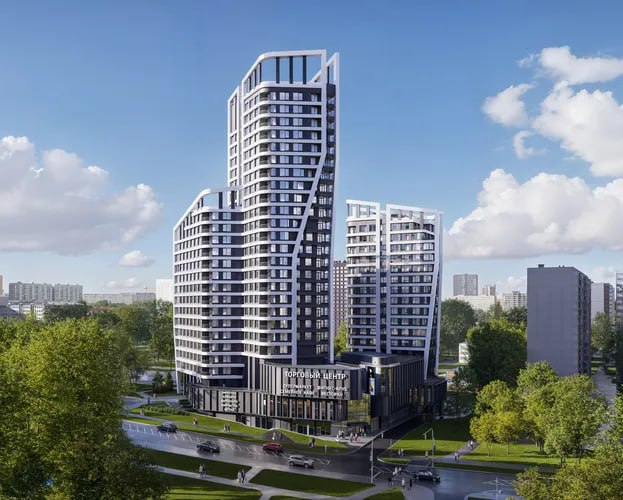
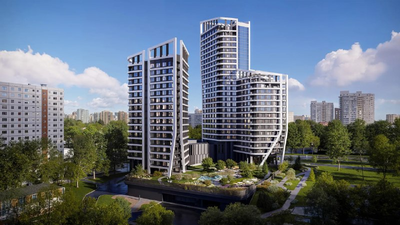
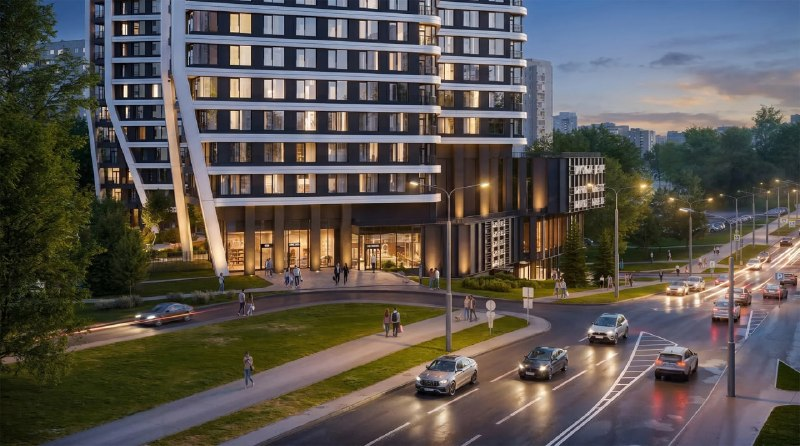

# Дом на Джалиля от А101 в Зябликове: студии от 18,7 млн ₽ и замах на бизнес-класс

В мае 2026 года А101 вывела в продажу ЖК «Дом на Джалиля» на ул. Мусы Джалиля, вл. 6, корп. 2 в Зябликове: две башни на торговом центре и студии от 18,7 млн ₽. Ценник бизнес-класса в спальном районе — смелое заявление, особенно для дома, который в октябре 2026 года ещё в котловане. Сдача — II квартал 2029 года.

## Коротко

- Застройщик — [А101](/zastroyshchiki/a101/); адрес — Мусы Джалиля, вл. 6, корп. 2, [Зябликово](/novostroyki/zyablikovo/), ЮАО.
- Две башни на общем торговом центре; около 282 квартир, студии от 31,6 м².
- Цены на 14 октября 2026 года: от 18,7 до 68,2 млн ₽; самая дешёвая студия выходит примерно в 592 тыс. ₽/м² (наш расчёт).
- Сдача — II квартал 2029 года, ключи с июля 2029 года.

*Визуализация «Дома на Джалиля» на Мусы Джалиля, 6, корп. 2: две башни и торговый центр в основании. (1) Визуализация: А101.*

## Две башни на торговом центре

«Дом на Джалиля» продают как бизнес-класс. Участок — в Зябликове, между метро «Борисово» и «Шипиловская»; сколько идти пешком, источники считают по-разному, в пределах 7–8 минут. По описаниям, дом монолитно-кирпичный, с закрытой территорией, двором без машин и потолками 3,1–3,25 м. Квартиры — без отделки.

Конструкция простая: две башни и торговый центр в стилобате. С этажностью разнобой — от 16 до 25–26 этажей в зависимости от источника. Участник строительства — ООО «СЗ «МИКС». Разрешение на строительство датировано 20 мая 2026 года, [проектная декларация](/slovar/proektnaya-deklaratsiya/) появилась в том же мае.

*Визуализация двора «Дома на Джалиля»: башни над озеленённым стилобатом. (2) Визуализация: А101.*

## Путь участка к продажам

До старта продаж участок на Мусы Джалиля, 6, корп. 2 прошёл свою порцию согласований. Вся цепочка — с исключением из КРТ и сменой концепции — собрана в [досье «Дом на Джалиля»](/obekty/dom-na-dzhalilya/).

## Сколько стоят квартиры: метр студии дороже полумиллиона

По данным «Новострой-М» на 14 октября 2026 года, квартиры стоят от 18,7 до 68,2 млн ₽. Минимальная студия 31,6 м² — 18 722 052 ₽, то есть около 592 тыс. ₽/м². Оговоримся: это расчёт по одной квартире, а не средняя цена проекта.

Для Зябликова цифра громкая. Как она выглядит на фоне соседних новостроек, покажет сравнение по свежим прайсам — его стоит сделать самому, прежде чем бронировать. Как вообще двигаются цены — в теме [цены](/temy/ceny/).

*Визуализация входной группы и магазинов на первом этаже «Дома на Джалиля». (3) Визуализация: А101.*

## Что с проектом сейчас

По состоянию на 14 октября 2026 года:

- **Стадия.** Котлован и фундамент обоих корпусов; последний фотоотчёт в базе — от 7 октября 2026 года.
- **Сроки.** Сдача во II квартале 2029 года, ключи с июля 2029 года.
- **Застройщик.** Тот же: проект ведёт А101.

## Что это значит для покупателя

Дом небольшой, но с амбициями: за студию просят цену бизнес-класса, а вокруг — Зябликово. Вот где стоит включить калькулятор. Сравните прайс с соседними новостройками и вторичкой, а в проектной декларации проверьте очереди, число машино-мест и условия оплаты. До сдачи почти три года, и сейчас на площадке котлован — так что следите за стройкой, а не за рендерами. Это не инвестиционная рекомендация.

## Карточка объекта

- **Адрес ЗУ:** Мусы Джалиля, 6, корп. 2, Москва.
- **Название:** Дом на Джалиля.
- **Застройщик:** [А101](/zastroyshchiki/a101/) (участник — ООО «СЗ «МИКС»).
- **Район:** Зябликово, ЮАО.
- **Класс:** бизнес.
- **Корпуса:** две башни и торговый центр.
- **Квартиры:** около 282, студии от 31,6 м² до четырёхкомнатных около 122 м².
- **Стадия:** котлован/фундамент.
- **Ввод:** II квартал 2029 года.
- **Цена:** от 18,7 до 68,2 млн ₽ (на 14 октября 2026 года).

## Вопросы и ответы

**Кто застройщик ЖК «Дом на Джалиля»?**
А101; участник строительства — ООО «СЗ «МИКС».

**Сколько стоят квартиры в «Доме на Джалиля»?**
На 14 октября 2026 года — от 18,7 до 68,2 млн ₽. Самая дешёвая студия 31,6 м² стоит 18,72 млн ₽, это около 592 тыс. ₽/м².

**Когда сдадут «Дом на Джалиля»?**
Заявлен II квартал 2029 года, ключи — с июля 2029 года.

**Какое метро рядом с «Домом на Джалиля»?**
«Борисово» и «Шипиловская»; время пешком источники называют разное.

## Источники

1. «Новострой-М», карточка ЖК «Дом на Джалиля» (застройщик, цены, срок, стадия, документы): https://www.novostroy-m.ru/baza/jk_dom_na_dzhalilya
2. «Новострой-М», новость о старте продаж «Дома на Джалиля», 27 мая 2026 года: https://www.novostroy-m.ru/novosti/dom_na_djalilya_i
3. «Яндекс Недвижимость», карточка ЖК «Дом на Джалиля» (участник строительства, разрешение на строительство, срок, метро): https://realty.yandex.ru/moskva_i_moskovskaya_oblast/kupit/novostrojka/dom-na-dzhalilya-4827257/
4. «Новострой-М», ход строительства ЖК «Дом на Джалиля» на 7 октября 2026 года: https://www.novostroy-m.ru/baza/jk_dom_na_dzhalilya/hod-stroitelstva

Материал не является инвестиционной рекомендацией.
