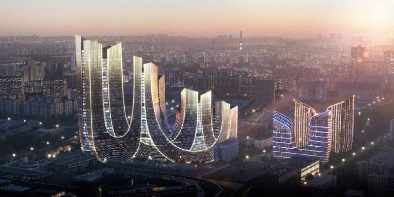
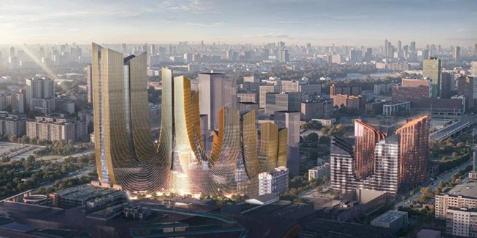

# Старопетровский проезд: Галс и Ariada показали БЦ из четырёх башен

В мае 2026 года появились рендеры офисного комплекса на месте бизнес-центра «Старопетровский атриум» на Старопетровском проезде у Войковской. Его проектирует бюро Ariada, а за проектом стоит «Галс-Девелопмент». По состоянию на 13 октября 2026 года ни подтверждения сноса, ни сроков строительства мы не нашли.

## Коротко

- Комплекс: четыре башни высотой от 13 до 38 этажей на общем стилобате (многоэтажное основание), автор концепции — бюро Ariada.
- Параметры по данным «Москвич Mag»: класс А, площадь более 100 тыс. м².
- Участок: в 2024 году «Галс-Девелопмент» купила здание «Старопетровский атриум» около 15 тыс. м² с участком около 1,7 га.
- Сроков старта, сдачи и данных о разрешении на строительство нет.

## Что показали на рендерах

Концепция выполнена в «бионическом» стиле: волнистые фасады с золотистыми элементами, башни связаны общим основанием. Об этом писали городские издания 28 мая 2026 года. Расположение — Войковский район Северного округа, метро «Войковская» примерно в 740 м пешком, МЦК «Балтийская» — около 770 м.

_Общий вид комплекса на визуализации. Вид сверху на четыре башни на общем стилобате. Визуализация: Галс-Девелопмент_

_Комплекс в окружении существующей застройки. Визуализация: Галс-Девелопмент_

Официальных ТЭП (технико-экономических показателей, [словарь](/slovar/tep/)) застройщик не раскрывал. Данные о площади и классе взяты из публикации «Москвич Mag».

## История участка

В 2024 году «Галс-Девелопмент» купила бизнес-центр «Старопетровский атриум» с участком около 1,7 га. Прежний владелец в источниках не назван, сумму сделки никто официально не подтверждал.

Рядом, на участке «Старопетровский, 11», по данным досье, развивается другой, жилой проект Level Group. О нём — в [отдельной статье о жилом проекте Level Group на соседнем участке](/novosti/level-voykovskaya-staropetrovskiy-ceny-sroki/). Полная история участка — в [досье «Старопетровский атриум»](/obekty/staropetrovskiy-atrium/).

## Что с проектом сейчас

Заметка от 27 мая 2026 года сообщала, что площадку готовят к сносу, а концепцию заканчивают согласовывать. Подтверждения мы не нашли. По данным «Москвич Mag» и городских изданий на 28 мая, действующий бизнес-центр продолжал работать, дат закрытия и сноса не называли. Сведений о разрешении на строительство и сроках у нас нет.

Мы не включаем в материал утверждения о технологиях стройки и сервисах для арендаторов: застройщик их по этому проекту не заявлял.

## Что это значит для арендатора и инвестора

Комплекс продолжает линию «Галса» в [премиальной коммерческой недвижимости](/temy/premium/), а локация в [Войковском районе](/novostroyki/voykovskiy/) удобна рядом с метро, МЦК и Ленинградским шоссе. На наш взгляд, пока это заявка на концепцию, а не проект с датой старта.

Что отслеживать: официальные ТЭП, разрешение на строительство, сроки сноса действующего здания, а также как проект впишется в застройку соседнего жилого участка.

## Карточка объекта

- Адрес: Старопетровский проезд, 11, к. 1, Москва, Войковский район, САО.
- Названия: «Старопетровский атриум».
- Застройщик: «Галс-Девелопмент».
- Архитектор: бюро Ariada.
- Параметры по публикациям: четыре башни 13–38 этажей, класс А, более 100 тыс. м².
- Участок: около 1,7 га.
- Стадия: концепция, сроки не объявлены.

## Вопросы и ответы

**Кто строит бизнес-центр на Старопетровском проезде?**
Проект связывают с «Галс-Девелопмент», которая в 2024 году купила здание «Старопетровский атриум» с участком около 1,7 га. Архитектор — бюро Ariada.

**Сколько этажей будет в бизнес-центре?**
По опубликованным рендерам — четыре башни высотой от 13 до 38 этажей на общем стилобате.

**Когда начнут строить БЦ у Войковской?**
Сроков старта и сдачи нет: на 13 октября 2026 года мы не нашли ни даты начала работ, ни подтверждения сноса, ни сведений о разрешении на строительство.

**Какая площадь у нового офисного комплекса?**
Издание «Москвич Mag» сообщало о классе А и площади более 100 тыс. м²; официально застройщик параметры не раскрывал.

## Источники

1. [Москвич Mag: проект бионических офисных небоскрёбов возле «Метрополиса»](https://moskvichmag.ru/?p=501502)
2. [msk1.ru: изогнутые небоскрёбы в «бионическом» стиле на севере Москвы, 28 мая 2026](https://msk1.ru/text/gorod/2026/05/28/76446715/)
3. [Новостройки Москвы: проект «Галс-Девелопмент» на Старопетровском проезде, вл. 11](https://www.novostroy-m.ru/baza/arhitekturnyy_proekt_na_prde)

Материал не является инвестиционной рекомендацией.
