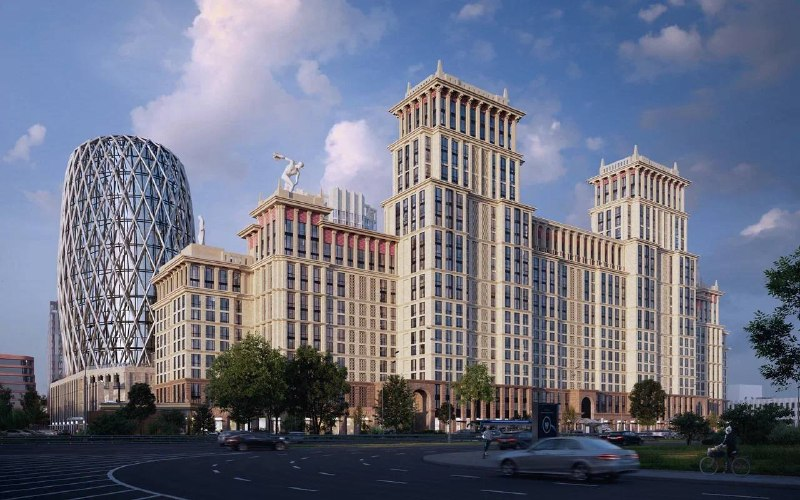
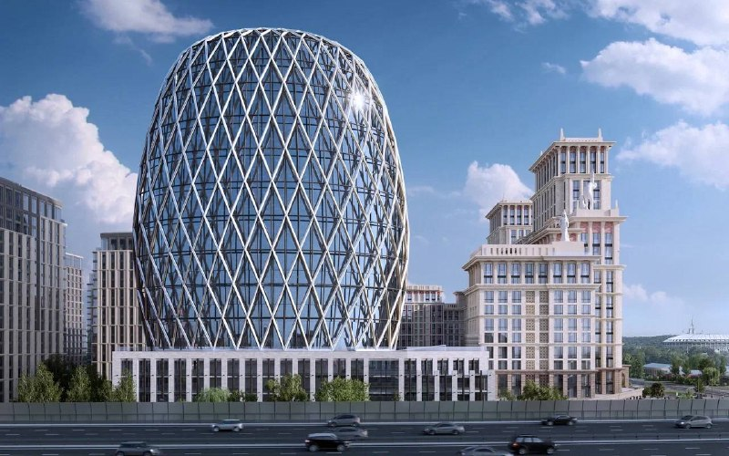
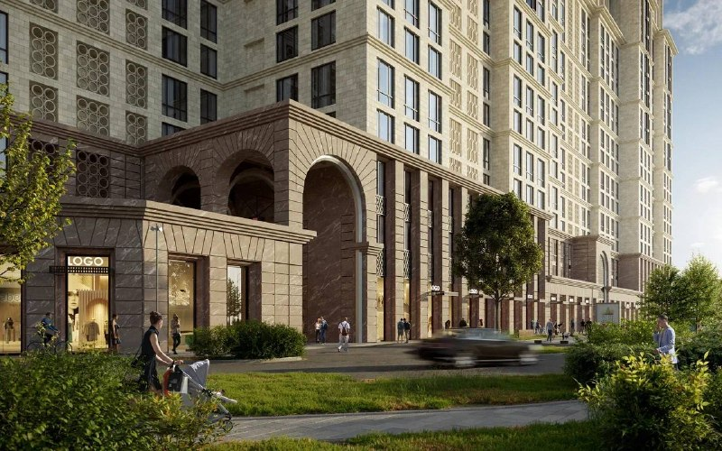

# Лужнецкая, 10А от Sminex: неоклассика и офис в форме яйца Фаберже

Город согласовал квартал [Sminex](/zastroyshchiki/sminex/) на Лужнецкой набережной, 10А рядом с «Лужниками»: два жилых дома в неоклассическом стиле и офисный центр площадью более 26 тыс. м² по проекту бюро UNK. Строительство планируют начать в 2027 году, а цен и даты старта продаж по состоянию на 13 октября 2026 года в открытых источниках нет.

## Коротко

- 28 мая 2026 года департамент градостроительной политики Москвы сообщил о согласовании квартала с офисным центром на Лужнецкой набережной, 10А ([район Хамовники](/novostroyki/khamovniki/)).
- Застройщик — Sminex, автор архитектуры — бюро UNK.
- Офис — более 26 тыс. м², жилых корпусов два, оба в неоклассическом стиле.
- Начало строительства запланировано на 2027 год; цены и старт продаж не объявлены.

## Что согласовали на Лужнецкой набережной, 10А

По словам главы департамента градостроительной политики Владислава Овчинского, офисное здание «вдохновлено эстетикой Фаберже». Оно эллиптической формы, с панорамным остеклением и декоративной сеткой ромбовидного рисунка на фасаде. В основании — стилобат с ретейлом.

*Жилые корпуса и офисное здание квартала на Лужнецкой набережной, 10А. Визуализация: Sminex*

Жилая часть — два корпуса в неоклассическом стиле. Фасады украшают колонны, балюстрады, колоннады из арок и скульптуры на кровле; верхние этажи сделаны аттиковыми. Количество квартир и этажность в источниках не названы.

*Офисное здание в форме «яйца» с диагональной сеткой на фасаде. Визуализация: Sminex*

*Арочный вход в жилой корпус неоклассического квартала. Визуализация: Sminex*

## Кто застройщик и кто автор проекта

Проект ведёт Sminex, архитектурную концепцию разработало бюро UNK, и этот вариант архитектуры согласован. Ранее участок был связан с «Росиумом» и МКБ: они планировали построить здесь комплекс с офисами и апартаментами. Полная история участка — в [досье «Лужнецкая, 10А»](/obekty/luzhnetskaya-10a/).

## Что с проектом сейчас

По состоянию на 13 октября 2026 года:

- **Стадия.** Концепция согласована в мае 2026 года. Начало строительства запланировано на 2027 год. В заметке 28 мая речь шла о старте продаж в 2027 году, но в источниках назван именно срок начала строительства.
- **Цены и продажи.** Цены, дату старта продаж и проектную декларацию на наш.дом.рф мы не нашли.
- **Параметры.** Этажность, площадь жилья и число квартир не опубликованы.

## Что это значит для покупателя и инвестора

Пока это согласованная концепция, а не проект с разрешением на строительство. Для покупателя важнее всего будут три вещи: параметры жилой части, цена и срок ввода.

На наш взгляд, Sminex продолжает ставить на высокий сегмент в Хамовниках: рядом у компании уже идут [проекты на Фрунзенской набережной](/novosti/frunzenskaya-30-sminex-ceny-ocheredi-sroki/). Сравнивать цены с ними пока рано: у Лужнецкой, 10А цен нет.

Что отслеживать: получение разрешения на строительство, публикацию проектной декларации и параметры квартир. Общий фон — в разделе про [рынок новостроек Москвы](/temy/rynok/).

## Карточка объекта

- **Название:** Лужнецкая, 10А (Лужнецкая набережная, 10А).
- **Застройщик:** Sminex.
- **Архитектор:** бюро UNK.
- **Район:** Хамовники, Москва; рядом «Лужники».
- **Состав:** два жилых корпуса в неоклассическом стиле и офисный центр более 26 тыс. м².
- **Стадия:** концепция согласована (май 2026 года).
- **Начало строительства:** 2027 год.

## Вопросы и ответы

**Кто застройщик квартала на Лужнецкой набережной, 10А?**
Проект ведёт девелопер Sminex. Ранее участок был связан с «Росиумом» и МКБ, которые планировали здесь комплекс с офисами и апартаментами.

**Кто автор проекта на Лужнецкой, 10А?**
Архитектурное бюро UNK. Его вариант архитектуры квартала согласован городом, об этом сообщал департамент градостроительной политики Москвы.

**Что построят на Лужнецкой, 10А?**
Два жилых корпуса в неоклассическом стиле и офисный центр площадью более 26 тыс. м² в эллиптической форме с ромбовидной сеткой на фасаде, внизу — стилобат с ретейлом.

**Когда начнётся строительство на Лужнецкой, 10А?**
По сообщениям на май 2026 года, начало строительства запланировано на 2027 год. Цены на квартиры и старт продаж в проверенных источниках не названы.

## Источники

1. [Москвич Mag: на Лужнецкой набережной построят офисный центр в эстетике Фаберже, 28 мая 2026 года](https://moskvichmag.ru/?p=501726) — застройщик, архитектор, офис, сроки.
2. [Mail Финансы: ЖК со зданием, похожим на яйцо Фаберже, 28 мая 2026 года](https://finance.mail.ru/article/v-moskve-na-luzhnetskoj-naberezhnoj-postroyat-zhk-so-zdaniem-pohozhim-na-yajtso-faberzhe-69210794/) — параметры квартала, пересказ сообщения департамента градостроительной политики.

Материал не является инвестиционной рекомендацией.
