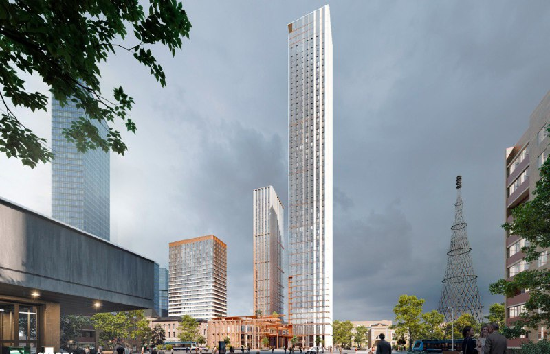
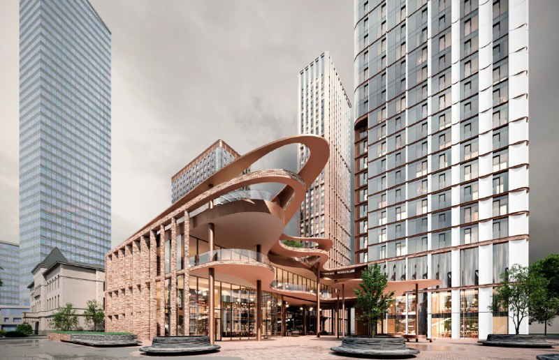

# Телецентр на Шаболовке: как менялся проект на Шаболовке, 35 с 2024 по 2026

Недостроенный телецентр у метро «Шаболовская» [ЛСР](/zastroyshchiki/lsr/) выкупала в два захода: 20% компании-владельца в 2023 году, остальные 80% у города в марте 2026-го. Проект за это время вырос из невысоких домов на стилобате в башни бюро Скуратова — и всё ещё остаётся концепцией.

## Коротко

- **Участок:** 1,3 га, недостроенный телецентр; 17 марта 2026 года ЛСР стала единственным владельцем компании, на балансе которой он числится.
- **Было:** бюро umbra предлагало несколько невысоких зданий на стилобате; по данным «Москвич Mag», вариант, по-видимому, не согласовали.
- **Стало:** с сентября 2024 года публично показывают башни разной высоты по концепции бюро Сергея Скуратова; площадь — более 86 тыс. м².
- **Сейчас:** ЛСР в марте 2026 года говорила, что ещё разрабатывает концепцию. Этажность, высота и разрешение на строительство остаются без ответа.

Полная история участка и проекта — в [досье «Шаболовка, 35»](/obekty/shabolovka-35/).

## С чего начинали

Телецентр на Шаболовке строили с середины 1980-х и так и не достроили. Он годами торчал у метро как памятник эпохе, которая закончилась раньше стройки.

Первый вариант новой жизни, по данным «Москвич Mag», нарисовало бюро umbra: несколько невысоких зданий на стилобате. Видимо, до согласования он не дошёл. Когда именно появились эти картинки, источники не уточняют, поэтому в таблице у этого этапа даты нет.

## Что меняли

**2023 год: хозяин.** ЛСР купила 20% компании «Навис инжиниринг» — на её балансе числится телецентр. «Москвич Mag» называет цену доли — 1,3 млрд ₽. Заметим: это не «покупка участка за 1,3 млрд», как иногда пересказывают, а доля в компании.

**Сентябрь 2024-го: башни.** «Москвич Mag» показал визуализации ЖК на месте телецентра. Проект сделала мастерская Сергея Скуратова: несколько башен разной высоты, общая площадь, по оценке издания, около 86,5 тыс. м². «МСК1» писал о премиальном комплексе, где одна из башен соединена переходом с двухэтажным общественным центром.

*Башни на Шаболовке, 35 в концепции бюро Скуратова на фоне Шуховской башни. Визуализация: бюро Сергея Скуратова, 2024*

**Март 2026-го: хозяин целиком.** 17 марта сведения о новом владельце появились в ЕГРЮЛ: ЛСР выкупила у города оставшиеся 80% «Навис инжиниринг». Площадка — 1,3 га, площадь проекта «Шаболовка, 35» превысит 86 тыс. м². И любопытная деталь: в тот же месяц ЛСР сообщала, что только «ведёт разработку концепции будущего проекта».

**Август 2026-го.** «Приложение Т—Ж» пишет, что ЛСР построит на Шаболовке несколько башен, а здания спроектировало бюро Скуратова. То есть автор, судя по публикациям, за два года не менялся.

## Каким проект стал

Пока — никаким окончательным. На 15 октября 2026 года перед нами концепция бюро Скуратова: башни разной высоты, медно-кирпичный низ с общественными пространствами, около 86 тыс. м² и более.

*Общественная часть проекта у подножия башен. Визуализация: бюро Сергея Скуратова, 2024*

Сколько этажей в башнях — вопрос без ответа: ни в 2024-м, ни в 2026-м цифр нет. Про цены и старт продаж говорить рано: проект на ранней стадии, а до продаж ему нужны согласование [АГР](/slovar/agr/) (архитектурно-градостроительного решения), разрешение на строительство и проектная декларация. Первые рендеры — в материале про [башни на Шаболовке](/novosti/shabolovka-35-lsr-koncepciya-bashni-shabolovskaya/).

На наш взгляд, главный риск здесь не в архитектуре, а в высоте: чем выше башни у метро в плотной исторической застройке, тем тяжелее будет согласование. Но это наша оценка, а не факт из документов.

Что делать тому, кто присматривается к проекту: следить за публикацией АГР и проектной декларации. Всё, что раньше, — рендеры.

## Было и стало

| Параметр | Ранний вариант (umbra), без даты | Сентябрь 2024 | Март—август 2026 |
|---|---|---|---|
| Архитектор | бюро umbra | бюро Сергея Скуратова | бюро Скуратова (по Т—Ж); ЛСР: концепция прорабатывается |
| Состав | несколько невысоких зданий на стилобате | несколько башен разной высоты | несколько башен |
| Этажность | — | — | — |
| Высота | — | — | — |
| Площадь | — | около 86,5 тыс. м² (оценка) | более 86 тыс. м² |
| Квартиры | — | — | — |
| Владелец участка | — | ЛСР (20% компании) | ЛСР (100% компании) |

## Карточка объекта

- **Адрес участка:** Шаболовка, 35, Донской район, Москва
- **Названия:** Шаболовка, 35; проект ЛСР на Шаболовке
- **Застройщик:** [ЛСР](/zastroyshchiki/lsr/)
- **Район:** [Донской](/novostroyki/donskoy/)
- **Площадка:** 1,3 га
- **Общая площадь проекта:** более 86 тыс. м²
- **Архитектор:** бюро Сергея Скуратова (по Т—Ж, август 2026)
- **Стадия:** концепция

## Вопросы и ответы

**Кто архитектор проекта на Шаболовке, 35?**
Бюро Сергея Скуратова: его концепцию показали в сентябре 2024 года, и в августе 2026-го Т—Ж по-прежнему называет его автором башен. В марте 2026 года ЛСР говорила, что ещё прорабатывает концепцию.

**Сколько этажей будет в проекте на Шаболовке, 35?**
Неизвестно. В публикациях 2024–2026 годов называют несколько башен разной высоты и общую площадь более 86 тыс. м², но этажность и высота не названы.

**Кому принадлежит участок на Шаболовке, 35?**
ЛСР. По данным МСК1, 17 марта 2026 года группа стала владельцем компании «Навис инжиниринг», на балансе которой числится недостроенный телецентр; 20% компании ЛСР купила ещё в 2023 году.

**Когда начнутся продажи квартир на Шаболовке, 35?**
Сроки не объявлены. Проект на стадии концепции, цен и разрешения на строительство пока нет.

## Источники

1. МСК1, 18 марта 2026 года: [«Вместо заброшки — большой ЖК. Телецентр на Шаболовке продали застройщику ЛСР»](https://msk1.ru/text/gorod/2026/03/18/76317866/)
2. «Москвич Mag»: [«Мэрия наконец продала легендарный долгострой — телецентр на Шаболовке»](https://moskvichmag.ru/?p=484963)
3. «Москвич Mag», 12 сентября 2024 года: [«Вот такой ЖК построят на месте заброшенного телецентра на Шаболовке напротив метро»](https://moskvichmag.ru/?p=384284)
4. МСК1, 16 сентября 2024 года: [материал о проекте «Шаболовка, 35»](https://msk1.ru/text/realty/2024/09/16/74079344/)
5. «Приложение Т—Ж», август 2026 года: [«Шаболовская: небоскрёб»](https://t-j.ru/shabolovskaya-neboskreb/)
6. РБК Недвижимость: [материал о выборе архитектуры участка у метро «Шаболовская»](https://realty.rbc.ru/news/6a6affec9a7947969db5a197) — история недостроенного телецентра

Материал не является инвестиционной рекомендацией.
