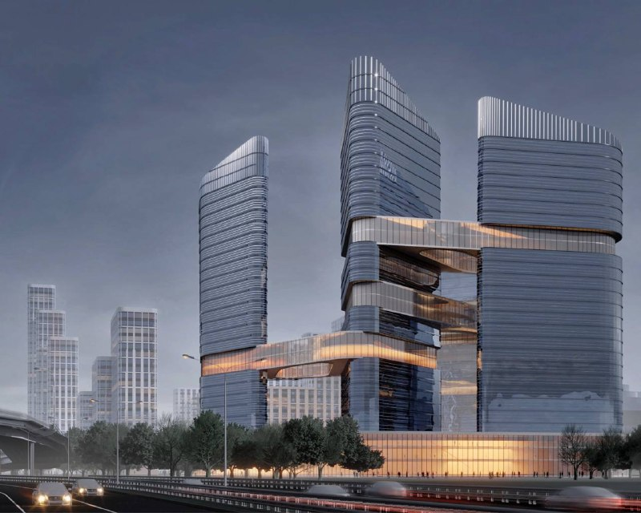
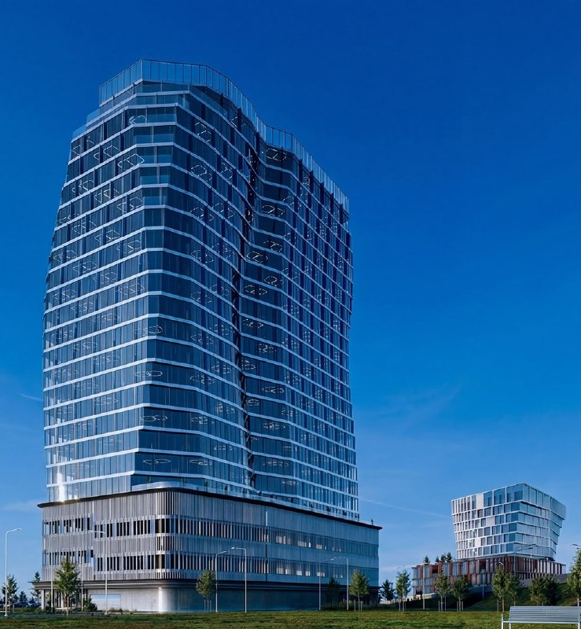

# АДЦ «Коммунарка»: как менялся проект — от единого лота к россыпи зданий

В декабре 2023 года административно-деловой центр (АДЦ) «Коммунарка» в Новой Москве продавали одним лотом: около 300 тыс. м² офисов и 294 тыс. м² жилья. К 2026 году от единого замысла осталась только сумма метров. Вместо мастер-плана — отдельные здания и отдельные бюро: концепция Steel почти на 600 тыс. м², офис Syntaxis на 72 тыс. м². Полная история — в [досье «АДЦ Коммунарка»](/obekty/adts-kommunarka/).

## Коротко

- Декабрь 2023 года: семь участков, более 6,5 га, 594 тыс. м² (жильё плюс офисы), цена — почти 3,5 млрд ₽.
- Август 2025 года: концепция Steel — почти 600 тыс. м², пополам жильё и офисы; итоги конкурса так и не объявили.
- Апрель 2026 года: конкурс на офисное здание около 72 тыс. м² выиграло бюро Syntaxis.
- Объём почти не изменился. Изменилась нарезка: проект идёт по зданию.

## Всё одним лотом

20 декабря 2023 года «Новострой-М» сообщил: Мосинжпроект выставил на торги семь участков АДЦ «Коммунарка» единым лотом. На продажу шли 99% уставного капитала шести обществ «АДЦ Коммунарка». Площадь участков — более 6,5 га, показатели застройки ([ТЭП](/slovar/tep/)) — около 300 тыс. м² торгово-офисной недвижимости и 294 тыс. м² жилья, начальная цена — почти 3,5 млрд ₽ [1]. Ни высоту, ни архитектора тогда не называли.

## Конкурсы, лоты, здания

**2024–2025 годы: конкурс без финала.** Летом 2024 года объявили архитектурный конкурс, в финал вышли IND, GA и Lampa. 28 августа 2025 года бюро Steel опубликовало свою конкурсную концепцию: почти 600 тыс. м², примерно пополам жильё и офисы, высотки, сшитые «парящими» мостами. Кто победил, публично так и не сказали; заказчика в публикации тоже не назвали [2].

*Концепция бюро Steel для АДЦ «Коммунарка», опубликована в августе 2025 года. Визуализация: бюро Steel, 2025*

**Октябрь 2025 года: город режет на куски.** 8 октября 2025 года Москва объявила торги на право заключить соглашения о масштабных инвестиционных проектах (МаИП) на пять участков в Коммунарке. В сумме — почти 4,9 га, на них разрешено построить от 89 до 174,8 тыс. м² общественно-деловых комплексов. Начальная цена — 1 ₽ за лот, аукционы — с 7 ноября по 5 декабря [3].

**Апрель 2026 года: одно здание — один конкурс.** 21 апреля 2026 года Moskvich Mag сообщил, что конкурс на офисное здание примерно на 72 тыс. м² в Коммунарке выиграло бюро Syntaxis. Бюро описывает фасад сложной геометрии, с изгибами и волнами: мягкий плавный контур и много естественного света. Заказчика в статье не назвали [4].

*Офисное здание примерно на 72 тыс. м², победившая концепция бюро Syntaxis, апрель 2026 года. Визуализация: бюро Syntaxis, 2026*

## Мастер-плана нет, есть здания

На октябрь 2026 года единого утверждённого проекта для всего АДЦ нет. Итоги конкурса 2024 года так и не обнародовали, а в публикациях 2025–2026 годов территорию описывают уже по частям: участок, заказчик, бюро. Цены, продажи и разрешения на строительство по этим проектам пока не объявлены.

На наш взгляд, это обычная судьба больших территорий в новой Москве: сначала фиксируют общий объём, потом он рассыпается на самостоятельные здания, и каждое проходит свой конкурс. Подчеркнём: это наша оценка — решений о мастер-плане АДЦ пока никто не называл.

## Было и стало

| Параметр | Декабрь 2023 (лот) | Август 2025 (концепция Steel) | Апрель 2026 (Syntaxis) |
|---|---|---|---|
| Территория | 7 участков, более 6,5 га | — | — |
| Жильё | 294 тыс. м² | около половины объёма | — |
| Офисы | около 300 тыс. м² | около половины объёма | около 72 тыс. м² (одно здание) |
| Всего | около 594 тыс. м² (сумма) | почти 600 тыс. м² | около 72 тыс. м² |
| Автор | — | Steel | Syntaxis |
| Высота | — | высотные здания, число этажей не названо | — |

Прочерк — цифру официально не называли.

## Что это значит для покупателя и инвестора

Покупать здесь пока нечего: концепции и конкурсы, ни цен, ни продаж. Если вы присматриваетесь к Коммунарке на будущее, следите за тремя вещами: кто станет заказчиком отдельных зданий, утвердят ли общий мастер-план и что город сделает с участками по МаИП. Без ответа на первый вопрос нельзя оценить ни сроки, ни качество будущих домов. Пока — другие проекты района среди [новостроек Сосенского](/novostroyki/sosenskoe/) и [будущих проектов Москвы](/novostroyki/budushchie-proekty/); об архитектурных конкурсах — в разделе [архитектура](/temy/arhitektura/).

## Карточка объекта

- **Название:** АДЦ «Коммунарка»
- **Район:** поселение Сосенское, Новая Москва
- **Лот 2023 года:** семь участков, более 6,5 га, около 594 тыс. м²
- **Концепция 2025 года:** почти 600 тыс. м² (Steel)
- **Стадия:** концепции и конкурсы
- **Цены:** не опубликованы

## Вопросы и ответы

**Что такое АДЦ «Коммунарка»?** Административно-деловой центр в посёлке Коммунарка (поселение Сосенское, Новая Москва): территория под общественно-деловую и жилую застройку, часть которой город в 2023 году продавал единым лотом на 594 тыс. м².

**Какие бюро проектируют АДЦ «Коммунарка»?** В финал архитектурного конкурса 2024 года вышли IND, GA и Lampa, итоги так и не объявили. Концепцию Steel опубликовали в августе 2025 года, а конкурс на офисное здание на 72 тыс. м² в апреле 2026 года выиграло бюро Syntaxis.

**Сколько всего планируют построить в АДЦ «Коммунарка»?** Лот 2023 года — около 594 тыс. м² (300 тыс. офисов и 294 тыс. жилья), концепция Steel 2025 года — почти 600 тыс. м². Единых утверждённых ТЭП на всю территорию город пока не публиковал.

**Можно ли купить квартиру или офис в АДЦ «Коммунарка»?** На октябрь 2026 года — нет: продаж не открывали, цены не публиковали, проекты пока на стадии концепций и конкурсов.

## Источники

1. [«Новострой-М»: мэрия Москвы выставила на торги АДЦ «Коммунарка», 20 декабря 2023](https://www.novostroy-m.ru/novosti/meriya_moskvy_vystavila_na)
2. [Moskvich Mag: бюро Steel предложило застроить Коммунарку небоскрёбами, 28 августа 2025](https://moskvichmag.ru/?p=449379)
3. [mos.ru: торги на пять участков в Коммунарке, 8 октября 2025](https://www.mos.ru/news/item/160683073/)
4. [Moskvich Mag: БЦ с серфинговым фасадом в Коммунарке, 21 апреля 2026](https://moskvichmag.ru/gorod/vot-takoj-bts-s-serfingovym-fasadom-postroyat-v-kommunarke/)

Материал не является инвестиционной рекомендацией.
