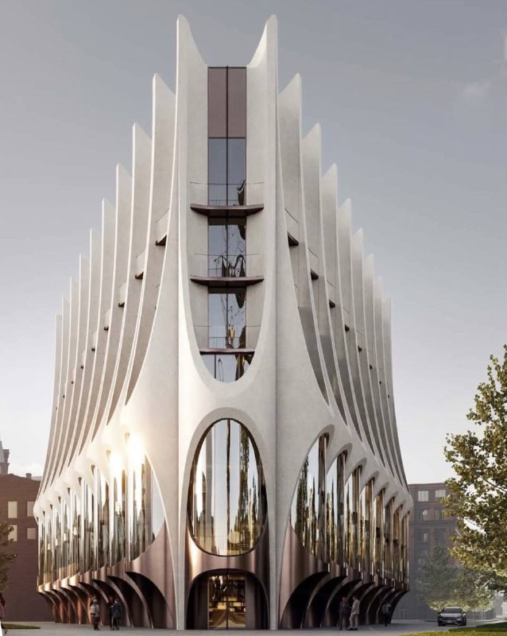
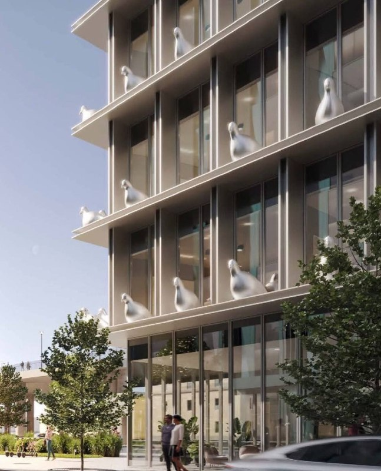

# «Красный Октябрь» от Гуты: пять бюро, башня и отель Savoy на Балчуге

Гута-Девелопмент показала обновлённую концепцию «Красного Октября» на острове Балчуг. Мастер-план рисовали сразу пять архитектурных бюро, в проекте — башня по соседству с Петром I и пятизвёздочный отель Savoy с гигантскими голубями на фасаде. Картинки есть, цен на новые дома пока нет.

## Коротко

- **Масштаб:** около 6 га, около 114 тыс. м² недвижимости в 22 зданиях, два из них — объекты культурного наследия.
- **Авторы:** «Меганом», «Цимайло, Ляшенко и Партнеры» (ЦЛП), GAFA, Parsek и Saga.
- **Сроки:** пять этапов, работы — минимум до 2032 года.
- **Цены:** официально не названы.

## Пять бюро на одном острове

Концепцию территории, по словам коммерческого директора Гута-Девелопмент Геннадия Устинова, в апреле согласовал мэр Москвы Сергей Собянин. Историческое название квартал сохранит, исторические здания отреставрируют.

Участки проекта — «Берсеневская, 6» и «Болотная, 15». Новые здания встанут в северной части острова, а часть корпусов бывшей фабрики пойдёт под снос.

Работу поделили так: клубные дома на Берсеневской набережной проектирует Parsec, шесть домов в красных тонах — GAFA, дома у Якиманской набережной и парка «Музеон» — «Меганом» вместе с Saga. Отель Savoy достался ЦЛП, и это, пожалуй, самая запоминающаяся часть проекта: на фасаде появятся арт-объекты в виде гигантских голубей. Для острова, где главные соседи — Пётр I и корпуса бывшей фабрики, ход смелый.

*Визуализация одного из корпусов проекта. Визуализация: Гута*

*Фрагмент фасада со скульптурами голубей. Визуализация: Гута*

## Башня, которая меряется с Петром

В проекте есть башня в 16 этажей с двухуровневым пентхаусом наверху. По данным городского издания, по высоте она почти сравняется с памятником Петру I. Точную высоту в метрах застройщик официально не называл.

На наш взгляд, именно башня станет главным поводом для споров. На Стрелке вертикаль давно занята Петром I, и любая высотная точка рядом неизбежно будет с ним сравниваться. Но это наша оценка: официальной критики высотности пока не звучало.

## Обещали к 2028-му, теперь — минимум к 2032-му

Нынешний мастер-план — результат совместной работы пяти бюро. Полная история проекта — в [досье «Красный Октябрь»](/obekty/krasnyy-oktyabr/). Застройщик — [Гута](/zastroyshchiki/guta/): раньше компания обещала преобразовать остров к 2028 году, а в августе 2026 года издание называло срок «минимум до 2032 года». Горизонт уехал на несколько лет вперёд.

С чем сравнивать — в подборках [новостроек Москвы](/novostroyki/moskva/) и [премиальных новостроек](/novostroyki/premium-klass/).

## Что с проектом сейчас

На 13 октября 2026 года проект идёт поэтапно: этапов пять, первый, по данным издания, должны сдать в ближайшее время. Заявленный масштаб — около 300 резиденций и отель.

Цены официально не опубликованы. Урбанист Аркадий Гершман ожидает очень высоких цен — но это его прогноз, а не прайс.

## Что это значит для покупателя и инвестора

Считать пока не из чего. Нет цен, нет опубликованных разрешений на строительство новых корпусов, нет сроков по каждому этапу. Это [премиум-сегмент](/temy/premium/), где главный риск — время: проект поэтапный, а ориентиры уже разъехались от 2028 года в прежних обещаниях застройщика до «минимум 2032 года» в августовской публикации.

Если вы присматриваетесь к острову, ориентируйтесь на документы, а не на голубей: проектные декларации по новым корпусам, разрешения на строительство, старт продаж и первые опубликованные цены.

## Карточка объекта

- **Название:** Красный Октябрь (Стрелка, остров Балчуг)
- **Адрес ЗУ:** Берсеневская, 6; Болотная, 15
- **Застройщик:** Гута-Девелопмент
- **Регион:** Москва
- **Площадь территории:** около 6 га
- **Площадь застройки:** около 114 тыс. м², 22 здания
- **Сроки:** этапы до 2032 года (минимум)

## Вопросы и ответы

**Кто разработал концепцию «Красного Октября»?** Мастер-план сделали пять бюро: «Меганом», «Цимайло, Ляшенко и Партнеры», GAFA, Parsek и Saga. Застройщик — Гута-Девелопмент.

**Что построят на месте «Красного Октября»?** Клубные дома, отель Savoy, башню и общественные пространства на территории около 6 га. Всего около 114 тыс. м² в 22 зданиях, два из них — объекты культурного наследия.

**Когда закончат проект «Красный Октябрь»?** Проект разбит на пять этапов, строительство и благоустройство продлятся минимум до 2032 года.

**Сколько стоят квартиры в новых домах «Красного Октября»?** Официально цены не называли: на 13 октября 2026 года застройщик стоимость не публиковал.

## Источники

1. [МСК1: новый квартал на стрелке острова Балчуг, 27 июля 2026](https://msk1.ru/text/realty/2026/07/27/76554666/)
2. [МСК1: что построят на месте «Красного Октября», 21 июля 2026](https://msk1.ru/text/realty/2026/07/21/76545964/)
3. [Moskvich Mag: «Красный Октябрь» будет выглядеть так, но только через шесть лет, 11 августа 2026](https://moskvichmag.ru/?p=516893)
4. [Moskvich Mag: остров Балчуг после масштабной застройки, 27 июля 2026](https://moskvichmag.ru/?p=513791)

Материал не является инвестиционной рекомендацией.
