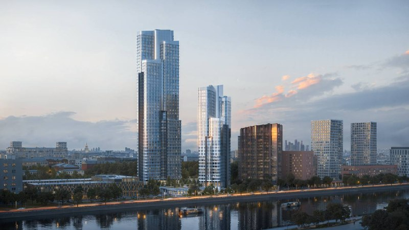
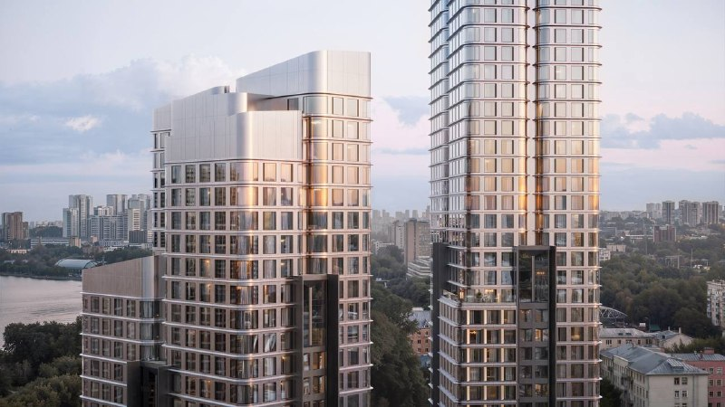
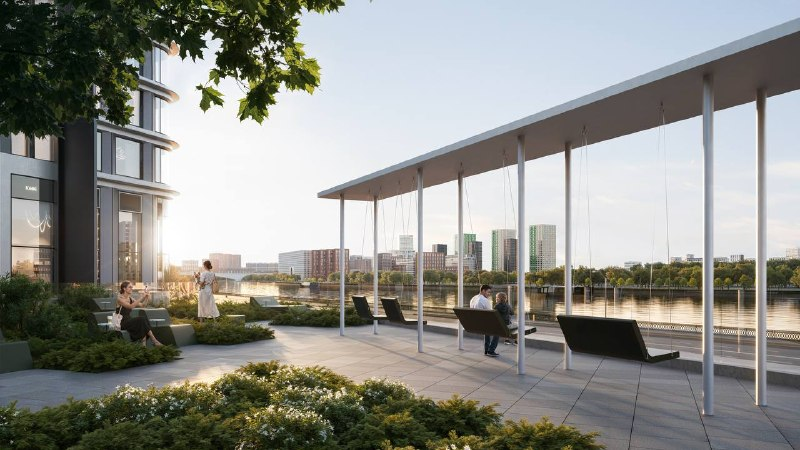

# ЖК «Блик» от Stone на Новоданиловской набережной: старт продаж и цены

Stone открыла продажи премиального ЖК «Блик» на Новоданиловской набережной, 12: две башни в 30 и 50 этажей и 763 квартиры. Стартовый бюджет — от 22,7 до 24,2 млн ₽, сдача по каталогу — в III квартале 2030 года.

*Визуализация башен ЖК «Блик» на берегу Москвы-реки. Визуализация: Stone*

## Коротко

- О старте продаж [Stone](/zastroyshchiki/stone/) объявила 23 июля 2026 года; это первый премиальный проект компании.
- Две башни в 30 и 50 этажей на общем стилобате, 763 квартиры площадью от 33 до 180 м².
- Цена входа — от 22,7 до 24,2 млн ₽, в зависимости от источника и даты.
- Сдача обеих башен — III квартал 2030 года; на площадке начались работы нулевого цикла.

## Что продаёт Stone

Проект находится на Новоданиловской набережной, 12, в Донском районе Москвы, на первой линии Москвы-реки. Участок — 2,7 га. Класс заявлен как премиум, дом монолитный. Застройщик — ООО «СЗ «АПАРТ-ПРОЕКТ» (бренд Stone), архитектура — бюро HADAA.

Две башни объединены общим стилобатом. В проекте 763 квартиры: студии, четырёхспальные варианты и двухуровневые пентхаусы с потолками до 6,65 м. По словам застройщика, около 80% квартир выходят окнами на Москву-реку, МГУ и «Москва-Сити». Это маркетинговое заявление, мы его не проверяли.

*Визуализация верхних этажей башен «Блика». Визуализация: Stone*

На первых этажах со стороны набережной заявлены магазины и сервисы, для жителей — бизнес-гостиная, детская комната, фитнес-студия и террасированный двор.

## Сколько стоят квартиры в «Блике»

Источники называют разную цену входа. В сообщении о старте продаж — от 24,2 млн ₽, каталог новостроек 24 июля указывал студию 33,1 м² от 23,8 млн ₽, а в карточке проекта, без даты, — от 22,7 млн ₽, при верхней границе 67,6 млн ₽. Расхождение объясняется, вероятно, моментом выгрузки и составом лотов; точной причины мы не знаем.

Покупка возможна по договору долевого участия ([ДДУ](/slovar/ddu/)) с эскроу-счетами, застройщик также предлагает беспроцентную рассрочку до трёх лет и ипотеку банков-партнёров. Квартиры продаются без отделки.

## Что с проектом сейчас

По состоянию на 15 октября 2026 года, по карточке каталога, продажи открыты в корпусе А, в продаже 206 квартир: 19 студий, 99 однокомнатных, 61 двухкомнатная и 27 трёхкомнатных. Стройка на стадии котлована и фундамента. Сроки сдачи обеих башен — III квартал 2030 года.

Полная история проекта — в [досье «Блик»](/obekty/blik/).

*Визуализация террасы с видом на реку. Визуализация: Stone*

## Что это значит для покупателя и инвестора

Главный козырь проекта — первая линия Москвы-реки. Сопоставимых проектов по набору характеристик в локации, по словам представителя Stone, нет — это оценка застройщика, независимо мы её не проверяли.

Риски понятны: до сдачи около четырёх лет, на сегодня идут земляные работы, а цена за квадратный метр в открытых источниках раскрыта неполно. На наш взгляд, покупателю стоит сверить срок и число квартир с проектной декларацией на наш.дом.рф и сравнить цену с другими [премиальными новостройками Москвы](/novostroyki/premium-klass/). Свежие запуски собраны в подборке [«Старты продаж»](/novostroyki/start-prodazh/).

## Карточка объекта

- **Адрес участка:** Москва, Новоданиловская набережная, 12
- **Название:** Блик («Стоун Блик»)
- **Застройщик:** [Stone](/zastroyshchiki/stone/) (ООО «СЗ «АПАРТ-ПРОЕКТ»)
- **Архитектор:** HADAA
- **Класс:** премиум, монолит
- **Площадь участка:** 2,7 га
- **Этажность:** две башни, 30 и 50 этажей
- **Квартиры:** 763, от 33 до 180 м²
- **Цена:** от 22,7 до 24,2 млн ₽ (разные источники)
- **Стадия:** котлован, продажи открыты
- **Ввод:** III квартал 2030 года

## Вопросы и ответы

**Когда начались продажи в ЖК «Блик»?**
Stone объявила о старте продаж 23 июля 2026 года. Продажи открыты в корпусе А.

**Сколько стоят квартиры в ЖК «Блик»?**
Стартовый бюджет — от 22,7 до 24,2 млн ₽ в зависимости от источника и даты; в каталоге указан диапазон до 67,6 млн ₽.

**Когда сдадут ЖК «Блик»?**
По каталогу новостроек, обе башни сдаются в III квартале 2030 года; на площадке начаты работы нулевого цикла.

**Кто застройщик и архитектор ЖК «Блик»?**
Застройщик — Stone (ООО «СЗ «АПАРТ-ПРОЕКТ»), архитектура — бюро HADAA.

## Источники

1. [«Мир квартир» через Рамблер: Stone объявила старт продаж в ЖК «Стоун Блик», 23 июля 2026 года](https://finance.rambler.ru/realty/56809376-stone-obyavil-start-prodazh-v-zhilom-komplekse-premium-klassa-stoun-blik/)
2. [Каталог новостроек: карточка ЖК «Стоун Блик»](https://www.novostroy-m.ru/baza/jk_stone_blik)
3. [Каталог новостроек: старты продаж ЖК «Стоун»](https://www.novostroy-m.ru/novosti/starty_prodaj_jk_stoun)

Материал не является инвестиционной рекомендацией.
