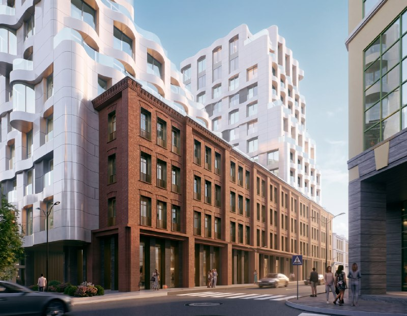
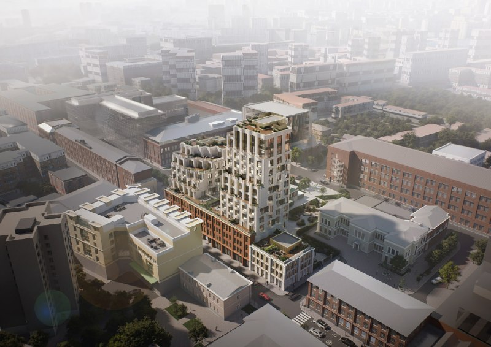
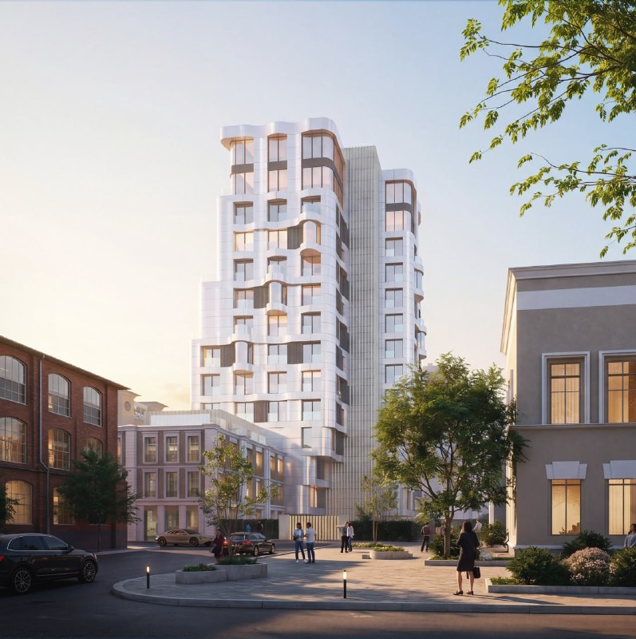

# Тимура Фрунзе, 11: Sminex показала белый каскад над кирпичной фабрикой

Через три месяца после покупки участка Sminex показала, как видит Тимура Фрунзе, 11: белоснежные каскадные объёмы растут над краснокирпичными корпусами бывшей фабрики. Это одна из возможных концепций, а не финальный проект: итоговый облик может заметно измениться.

## Коротко

- **Что показали:** 4 августа 2026 года появилась концепция ЖК на Тимура Фрунзе, 11 в [Хамовниках](/novostroyki/khamovniki/); визуализации подписаны «Фото: Sminex».
- **Как выглядит:** белые каскадные объёмы с террасами и эксплуатируемыми кровлями над историческими кирпичными зданиями.
- **Площадь:** [Sminex](/zastroyshchiki/sminex/) заявляла о жилом комплексе на 13 тыс. м².
- **Чего нет:** архитектора, этажности, цен и сроков публично не называли.

## Как выглядит концепция Тимура Фрунзе, 11

Весь чек-лист «роскошной Москвы» на месте: окна побольше, фасад побелее, кровля с озеленением. Плавные формы, скруглённые углы, крупное остекление, балконы и террасы. Над краснокирпичными корпусами, которые на рендерах остаются на месте, вырастает белая лента ступенчатых объёмов.

*Одна из возможных концепций: белые объёмы над кирпичным фасадом. Визуализация: Sminex*

Контраст с кирпичной архитектурой соседней «Красной Розы» — главная ставка проекта: участок стоит рядом с этим деловым кварталом и штаб-квартирой «Яндекса». На наш вкус, приём рабочий, но не новый: «белое на красном» в центре Москвы давно стало жанром. Вопрос в деталях фасада, а их на рендерах не разглядеть.

*Вид сверху: террасы на крышах и эксплуатируемая кровля. Визуализация: Sminex*

Высоту здания, этажность и автора концепции публично не называли. Судя по рендерам, «доминантой» района это не станет: проект камерный и точечный.

*Волнистые балконы и крупное остекление. Визуализация: Sminex*

## Предыстория: как Sminex получила участок

Участок Sminex купила весной 2026 года у «КР Плюс» — совместного предприятия Александра Клячина и «Сбера». Сделку по данным ЕГРЮЛ оформили 23 апреля 2026 года; в Sminex подтвердили планы по элитному жилому комплексу на 13 тыс. м². Подробности сделки — в материале [Sminex купила проект у «КР Плюс»](/novosti/timura-frunze-11-sminex-kupila-kr-plyus/). Полная история проекта — в [досье «Тимура Фрунзе, 11»](/obekty/timura-frunze-11/).

## Что это значит для покупателя и инвестора

Пока это картинка, а не продукт. Концепция — первая ступень: дальше ГПЗУ, согласование архитектурно-градостроительного решения ([АГР](/slovar/agr/)), проектная декларация и разрешение на строительство. Любая из ступеней может перекроить фасад и этажность.

Цен и старта продаж у проекта нет. Любые «три миллиона за метр» на этом этапе — гадание, а не прайс. Что отслеживать: появится ли в проекте архитектор с именем, пройдёт ли концепция АГР без потерь, и как Sminex разведёт предложение между этим проектом и соседней площадкой на Льва Толстого, 14. По [премиальным новостройкам Москвы](/novostroyki/premium-klass/) конкурентов у проекта хватает.

## Что с проектом сейчас

По состоянию на 15 октября 2026 года проект остаётся на стадии концепции. Старт продаж, цены, сроки ввода и разрешение на строительство не объявлены.

## Карточка объекта

- Адрес участка: Тимура Фрунзе, 11, Хамовники, ЦАО, Москва.
- Названия: Тимура Фрунзе, 11; рядом с «Красной Розой».
- Застройщик: [Sminex](/zastroyshchiki/sminex/); прежний владелец — «КР Плюс».
- Площадь комплекса: 13 тыс. м² (заявлено).
- Стадия: концепция.

## Вопросы и ответы

**Что строят на Тимура Фрунзе, 11 в Хамовниках?**
Sminex планирует элитный жилой комплекс на 13 тыс. м². Одна из показанных концепций — белоснежные каскадные объёмы над историческими кирпичными корпусами.

**Кто архитектор проекта на Тимура Фрунзе, 11?**
Публично автор концепции не назван.

**Когда начнутся продажи на Тимура Фрунзе, 11?**
Сроки старта продаж, цены и разрешение на строительство на 15 октября 2026 года не объявлены.

**Это окончательный проект?**
Нет. Это одна из возможных концепций, итоговый облик может заметно измениться.

## Источники

1. [«Появился проект белоснежного каскадного ЖК на улице Тимура Фрунзе в Хамовниках», «Москвич Mag», 4 августа 2026 года](https://moskvichmag.ru/?p=515391)
2. [«Девелопер пошел по активам», «Коммерсантъ», 23 апреля 2026 года](https://www.kommersant.ru/doc/8608432)

Материал не является инвестиционной рекомендацией.
