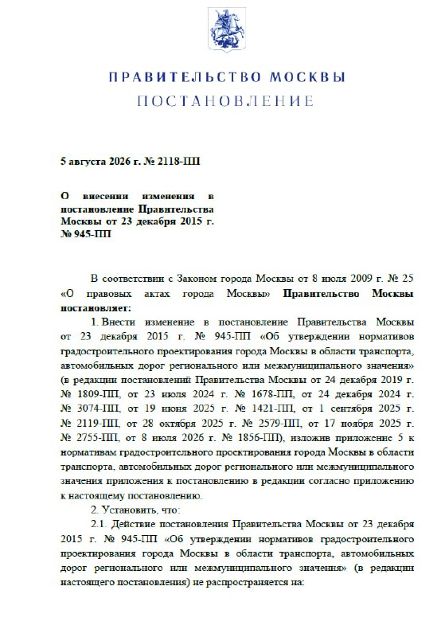
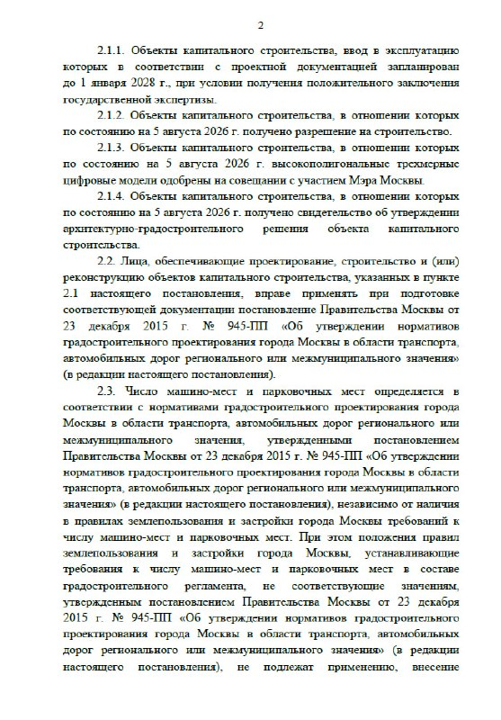
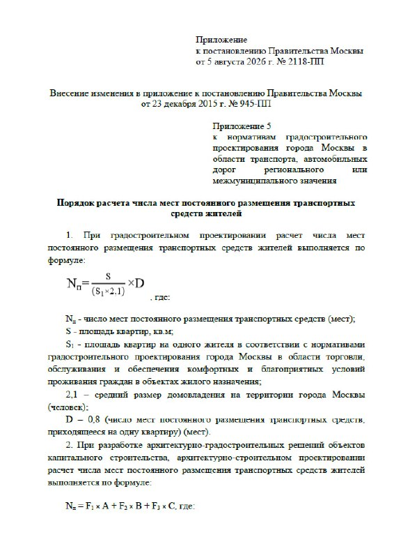
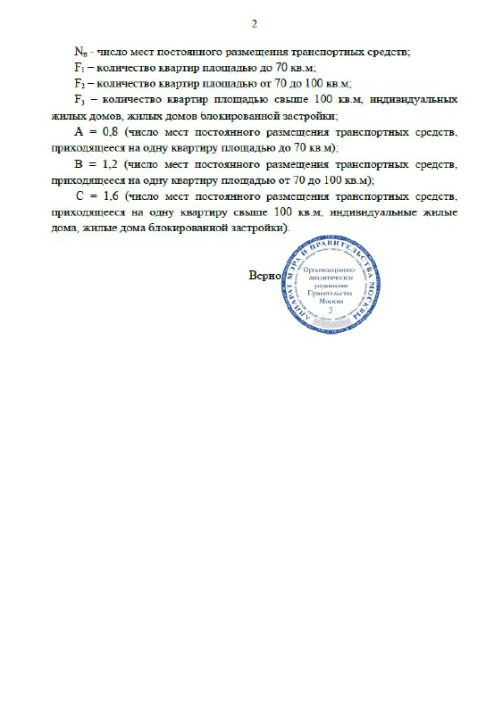

---
source:
  id: 35259
  date: '2026-08-05'
status: needs_review
skip_reason: null
type: regulation
region: moscow
title: 'Нормативы машино-мест в Москве по 2118-ПП: парковка почти на каждую квартиру'
title_alts:
- 'Москва удвоила парковочную планку: от 0,8 до 1,6 машино-места на квартиру'
- 'Постановление 2118-ПП: сколько машино-мест теперь нужно новостройкам и кто за это заплатит'
slug: normativy-mashino-mest-moskva-2118-pp
lead: 'Москва круто развернула парковочную политику. Постановлением № 2118-ПП от 5 августа 2026 года минимум для новостроек вырос до 0,8 машино-места на квартиру до 70 м² и до 1,6 — на квартиры больше 100 м². Девелоперам — лишние этажи подземного паркинга, покупателям — вероятное давление на цену метра.'
developers: []
objects: []
districts: []
topics:
- regulirovanie
- ceny
- rynok
images:
- file: media/35259_1.jpg
  alt: Первая страница постановления Правительства Москвы от 5 августа 2026 года № 2118-ПП
  caption: Постановление Правительства Москвы от 5 августа 2026 года № 2118-ПП, с. 1
- file: media/35259_2.jpg
  alt: Пункт о переходных положениях в постановлении Правительства Москвы № 2118-ПП
  caption: 'Постановление № 2118-ПП: переходные положения'
- file: media/35259_4.jpg
  alt: 'Приложение к постановлению № 2118-ПП: формула расчёта машино-мест на стадии ГЗК'
  caption: 'Приложение к постановлению № 2118-ПП: расчёт при градостроительном проектировании'
- file: media/35259_5.jpg
  alt: Нормативы 0,8, 1,2 и 1,6 машино-места по площади квартир в приложении к № 2118-ПП
  caption: 'Приложение к постановлению № 2118-ПП: нормативы по площади квартир'
factcheck:
- claim: Постановление Правительства Москвы № 2118-ПП принято 5 августа 2026 года
  status: confirmed
  source: https://mperspektiva.ru/topics/moskva-izmenila-normativy-obespechennosti-novostroek-parkovkami/
  checked: '2026-10-13'
  note: 'Номер и дата — «Московская перспектива»; номер также 360.ru, дата — РБК. Официальный текст (mos.ru, «Вестник Москвы» № 45) открыть не удалось: mos.ru и vestnikmoscow.mos.ru недоступны для робота/прокси.'
- claim: Норматив 0,8 машино-места на квартиру до 70 м²
  status: confirmed
  source: https://mperspektiva.ru/topics/moskva-izmenila-normativy-obespechennosti-novostroek-parkovkami/
  checked: '2026-10-13'
- claim: Норматив 1,2 машино-места на квартиру 70–100 м²
  status: confirmed
  source: https://360.ru/tekst/dengi/v-moskve-izmenili-normativy-parkovok-dlja-novostroek/
  checked: '2026-10-13'
- claim: Норматив 1,6 машино-места на квартиру свыше 100 м², а также для индивидуальных и блокированных домов
  status: confirmed
  source: https://360.ru/tekst/dengi/v-moskve-izmenili-normativy-parkovok-dlja-novostroek/
  checked: '2026-10-13'
- claim: На стадии градостроительного проектирования расчёт от общей площади квартир, на стадии архитектурно-строительного — по числу квартир с учётом площади
  status: confirmed
  source: https://mperspektiva.ru/topics/moskva-izmenila-normativy-obespechennosti-novostroek-parkovkami/
  checked: '2026-10-13'
- claim: Стадии соответствуют ГЗК и АГР
  status: confirmed
  source: https://www.novostroy-m.ru/analitika/mashinomesta_novye_normativy_2026
  checked: '2026-10-13'
- claim: Новые нормы не применяются к объектам, имевшим на 5 августа 2026 года разрешение на строительство, положительное заключение экспертизы, утверждённое АГР и другие документы из перечня постановления
  status: confirmed
  source: https://mperspektiva.ru/topics/moskva-izmenila-normativy-obespechennosti-novostroek-parkovkami/
  checked: '2026-10-13'
- claim: Нормы не коснутся новостроек со сдачей по проектной декларации до 2028 года при наличии положительного заключения госэкспертизы
  status: confirmed
  source: https://realty.rbc.ru/news/6a7b3a209a79473fb36fae2c
  checked: '2026-10-13'
  note: Только СМИ (РБК; похоже — novostroy-m.ru). Сверить с текстом постановления.
- claim: Ранее норматив зависел от пешей доступности рельсового каркаса (понижающий коэффициент)
  status: confirmed
  source: https://realty.rbc.ru/news/6a7b3a209a79473fb36fae2c
  checked: '2026-10-13'
- claim: 0,4 машино-места на квартиру — прежний минимально допустимый показатель в Москве
  status: confirmed
  source: https://realty.rbc.ru/news/6a7b3a209a79473fb36fae2c
  checked: '2026-10-13'
- claim: Большинство проектов ранее закладывали 0,4–0,6 машино-места на квартиру
  status: confirmed
  source: https://mperspektiva.ru/topics/moskva-izmenila-normativy-obespechennosti-novostroek-parkovkami/
  checked: '2026-10-13'
  note: Оценка эксперта (Вадим Иванов, «ЭПИК»); то же — 360.ru.
- claim: Нормативы парковок в Москве с 2015 года регулирует постановление № 945-ПП; в 2024 году Москомархитектура готовила его изменение в сторону снижения норм
  status: confirmed
  source: https://www.kommersant.ru/doc/7215195
  checked: '2026-10-13'
- claim: Фактическая обеспеченность в массовых новостройках Старой Москвы — в среднем 0,4, в бизнес-классе — 0,8, в Новой Москве — 0,33 машино-места на квартиру (май 2026)
  status: confirmed
  source: https://realty.rbc.ru/news/6a0c46189a79471b3d1b6e4e
  checked: '2026-10-13'
  note: Данные «Метриум» в изложении РБК.
- claim: Средняя цена машино-места в Старой Москве к началу лета 2026 года — 5,4 млн ₽, +46% за год
  status: confirmed
  source: https://realty.rbc.ru/news/6a7b3a209a79473fb36fae2c
  checked: '2026-10-13'
  note: Данные Ricci в изложении РБК.
- claim: При полном переносе затрат в цену студии подорожают на 18,2%, двухкомнатные — на 9,1%, трёхкомнатные — на 6,8%
  status: confirmed
  source: https://www.novostroy-m.ru/analitika/mashinomesta_novye_normativy_2026
  checked: '2026-10-13'
  note: Оценка ФГ «Ферро-Строй»; подаётся как оценка.
- claim: Для 1 тыс. квартир до 70 м² потребуется около 800 машино-мест; аналитик ГК ФСК допускает 3–4 подземных уровня
  status: confirmed
  source: https://www.dp.ru/a/2026/09/25/bitva-za-parkovki
  checked: '2026-10-13'
- claim: Нормы 945-ПП в новой редакции применяются независимо от ПЗЗ; противоречащие нормы ПЗЗ не применяются
  status: unverified
  source: https://mperspektiva.ru/topics/moskva-izmenila-normativy-obespechennosti-novostroek-parkovkami/
  checked: '2026-10-13'
  note: Ни в одном открытом источнике этого положения нет; официальный текст недоступен. Удалено.
- claim: По состоянию на 13.10.2026 поправок или отсрочки 2118-ПП не найдено
  status: confirmed
  source: https://www.dp.ru/a/2026/09/25/bitva-za-parkovki
  checked: '2026-10-13'
  note: Поиск по СМИ до 13.10.2026; материал «ДП» от 26.09.2026 описывает нормы как действующие.
removed:
- Положение о приоритете норм 945-ПП над ПЗЗ — не подтверждено ни одним открытым источником, официальный текст недоступен.
- Тезис заметки «фин. модели многих проектов лягут» — оценка без данных; заменена оценками аналитиков с атрибуцией и нашим мнением.
- Расчёты по проектам «Аурус», «Сикрет Гарден», «Мастерс», «Муза», «С5» из связанной заметки — данные из Telegram, проектные декларации не открывались; в статью не вошли.
- Тезис о размещении постоянных машино-мест только в подземных/встроенных/отдельно стоящих паркингах — источники противоречат друг другу («ДП» против РБК, который включает дворовые места); убран до сверки с текстом постановления.
- Ограничение превышения норматива более чем на 10% через ГЗК и переходный порог «РС до 1 августа 2026 года» — это параметры проекта из июльской заметки, в принятой версии не подтверждены.
- 'Изображение 35259_3: страница с подписью — не несёт информации'
data_points:
- metric: moscow_parking_norm_min_per_flat_lt70
  value: 0.8
  date: '2026-08-05'
- metric: moscow_parking_norm_per_flat_70_100
  value: 1.2
  date: '2026-08-05'
- metric: moscow_parking_norm_per_flat_gt100
  value: 1.6
  date: '2026-08-05'
- metric: moscow_parking_space_avg_price_old_moscow_mln_rub
  value: 5.4
  date: '2026-06-01'
  source: Ricci via РБК
seo:
  main_query: нормативы машино-мест москва
  keywords:
  - постановление 2118-пп
  - норматив машино-мест на квартиру москва 2026
  - новые нормативы парковок для новостроек москва
  - сколько машино-мест на квартиру в новостройке
  - 945-пп машино-места
  frequency_checked: false
  title: 'Нормативы машино-мест в Москве: что меняет 2118-ПП'
  description: 'Москва подняла минимум до 0,8 машино-места на квартиру до 70 м² и 1,6 — для квартир больше 100 м². Разбираем 2118-ПП: кого касается и что будет с ценами.'
  canonical: https://шахматка.москва/novosti/normativy-mashino-mest-moskva-2118-pp/
internal_links:
- anchor: что такое машино-место
  url: /slovar/mashino-mesto/
- anchor: Градостроительно-земельная комиссия (ГЗК)
  url: /slovar/gzk/
- anchor: архитектурно-градостроительное решение (АГР)
  url: /slovar/agr/
- anchor: проектной декларации
  url: /slovar/proektnaya-deklaratsiya/
- anchor: все материалы о регулировании
  url: /temy/regulirovanie/
- anchor: новые условия семейной ипотеки с 1 октября 2026 года
  url: /novosti/semeynaya-ipoteka-s-1-oktyabrya-stavki-limity/
faq:
- q: Сколько машино-мест на квартиру теперь требуют в Москве?
  a: По постановлению № 2118-ПП от 5 августа 2026 года — 0,8 машино-места на квартиру до 70 м², 1,2 — на квартиру 70–100 м² и 1,6 — на квартиру больше 100 м², а также на индивидуальный или блокированный дом.
- q: Касаются ли новые нормативы уже строящихся домов?
  a: Нет, если на 5 августа 2026 года у проекта уже были разрешение на строительство, положительное заключение экспертизы, утверждённое АГР или другие документы из перечня постановления.
- q: Каким был норматив машино-мест раньше?
  a: По данным РБК, минимум в Москве составлял 0,4 машино-места на квартиру, и он снижался с учётом пешей доступности метро и железной дороги. Большинство проектов закладывали 0,4–0,6.
- q: Подорожают ли квартиры из-за новых нормативов парковок?
  a: 'Себестоимость вырастет. По оценке ФГ «Ферро-Строй», при полном переносе затрат в цену студии подорожали бы на 18,2%, трёхкомнатные — на 6,8%. Сколько застройщики переложат на покупателей, покажут новые проекты.'
date_published: 2026-08-05   # дата исходной заметки
date_modified: 2026-10-13   # дата проверки фактов и обновления
author: Редакция Шахматки
editor_notes: |-
  1) Официальный текст 2118-ПП не открыт: mos.ru и PDF «Вестника Москвы» № 45 (vestnikmoscow.mos.ru) недоступны для робота; реквизиты подтверждены «Московской перспективой», 360.ru и РБК — сверить номер, дату, переходные положения (в т.ч. условие «сдача до 2028 года») и добавить ссылку на официальную публикацию. 2) Положение о приоритете над ПЗЗ из заметки убрано — если есть в тексте постановления, вернуть. 3) Вопрос, засчитываются ли в норматив открытые дворовые стоянки, источники описывают по-разному — проверить по тексту. 4) Файлы media/35259_1–5.jpg не были доступны при подготовке: alt и подписи временные, проверить содержание, автора и что это не скриншоты чужих Telegram-постов. 5) Внутренняя ссылка на статью о семейной ипотеке ведёт на материал этого же пилота (out/34584-...).
  Скан постановления (изображения 35259_1, _2, _4, _5) показывает реквизиты «5 августа 2026 г. № 2118-ПП», ссылку на 945-ПП и нормативы 0,8/1,2/1,6 — это подтверждает номер, дату и нормативы по первоисточнику; источник скана для ссылки (mos.ru / «Вестник Москвы») всё равно указать. Фото проверены главным редактором 13.10.2026: alt и подписи переписаны по содержанию; непригодные изображения сняты (см. removed). Права на визуализации застройщиков подтвердить запросом в пресс-службу.
schema: |-
  [
    {
      "@context": "https://schema.org",
      "@type": "NewsArticle",
      "headline": "Нормативы машино-мест в Москве: 0,8–1,6 места на квартиру по 2118-ПП",
      "description": "Москва ввела минимум 0,8 машино-места на квартиру до 70 м² и 1,6 — для квартир больше 100 м². Разбираем 2118-ПП: кого касается и что будет с ценами.",
      "datePublished": "2026-08-05",
      "dateModified": "2026-10-13",
      "author": {
        "@type": "Organization",
        "name": "Редакция Шахматки"
      },
      "publisher": {
        "@type": "Organization",
        "name": "Шахматка",
        "url": "https://шахматка.москва/"
      },
      "mainEntityOfPage": {
        "@type": "WebPage",
        "@id": "https://шахматка.москва/novosti/normativy-mashino-mest-moskva-2118-pp/"
      },
      "inLanguage": "ru",
      "about": [
        {
          "@type": "Legislation",
          "name": "Постановление Правительства Москвы № 2118-ПП от 5 августа 2026 года",
          "legislationJurisdiction": "Москва"
        },
        {
          "@type": "Place",
          "name": "Москва"
        }
      ],
      "image": [
        "https://шахматка.москва/media/35259_1.jpg",
        "https://шахматка.москва/media/35259_2.jpg",
        "https://шахматка.москва/media/35259_4.jpg",
        "https://шахматка.москва/media/35259_5.jpg"
      ]
    },
    {
      "@context": "https://schema.org",
      "@type": "FAQPage",
      "mainEntity": [
        {
          "@type": "Question",
          "name": "Сколько машино-мест на квартиру теперь требуют в Москве?",
          "acceptedAnswer": {
            "@type": "Answer",
            "text": "По постановлению № 2118-ПП от 5 августа 2026 года — 0,8 машино-места на квартиру до 70 м², 1,2 — на квартиру 70–100 м² и 1,6 — на квартиру больше 100 м², а также на индивидуальный или блокированный дом."
          }
        },
        {
          "@type": "Question",
          "name": "Касаются ли новые нормативы уже строящихся домов?",
          "acceptedAnswer": {
            "@type": "Answer",
            "text": "Нет, если на 5 августа 2026 года у проекта уже были разрешение на строительство, положительное заключение экспертизы, утверждённое АГР или другие документы из перечня постановления."
          }
        },
        {
          "@type": "Question",
          "name": "Каким был норматив машино-мест раньше?",
          "acceptedAnswer": {
            "@type": "Answer",
            "text": "По данным РБК, минимально допустимым в Москве было 0,4 машино-места на квартиру, причём норматив снижался с учётом пешей доступности метро и железной дороги. Большинство проектов закладывали 0,4–0,6."
          }
        },
        {
          "@type": "Question",
          "name": "Подорожают ли квартиры из-за новых нормативов парковок?",
          "acceptedAnswer": {
            "@type": "Answer",
            "text": "Аналитики ожидают роста себестоимости: по оценке ФГ «Ферро-Строй», при полном переносе затрат в цену студии подорожали бы на 18,2%, трёхкомнатные — на 6,8%. Сколько застройщики переложат на покупателей, покажут новые проекты."
          }
        }
      ]
    }
  ]
---

# Нормативы машино-мест в Москве по 2118-ПП: парковка почти на каждую квартиру

Ещё недавно город обсуждал, как парковок в новостройках сделать меньше. Теперь их станет заметно больше. Постановлением № 2118-ПП от 5 августа 2026 года Правительство Москвы подняло минимум до 0,8 машино-места на квартиру до 70 м² и до 1,6 — на квартиры больше 100 м². Для девелоперов это новые этажи подземного паркинга, для покупателей — вероятное давление на цену метра.

**Коротко**
- Постановление Правительства Москвы № 2118-ПП принято 5 августа 2026 года.
- Новые нормативы: 0,8 машино-места — на квартиру до 70 м², 1,2 — на 70–100 м², 1,6 — на квартиру больше 100 м² и на индивидуальный или блокированный дом.
- Прежний минимум, по данным РБК, — 0,4 места на квартиру: для небольших квартир планка выросла вдвое.
- Проекты, у которых на 5 августа 2026 года уже были разрешение на строительство, заключение экспертизы или утверждённое АГР, живут по старым правилам.

*Постановление Правительства Москвы от 5 августа 2026 года № 2118-ПП, с. 1*

## Город переписал парковочную арифметику

Постановление № 2118-ПП от 5 августа 2026 года поменяло городские нормативы градостроительного проектирования в части парковок. Базовый документ, по которому Москва считает машино-места с 2015 года, — постановление № 945-ПП.

Главное: минимум постоянных [машино-мест](/slovar/mashino-mesto/) привязан к площади квартиры.

| Площадь квартиры | Машино-мест на квартиру |
|---|---|
| до 70 м² | 0,8 |
| от 70 до 100 м² | 1,2 |
| свыше 100 м², индивидуальные и блокированные дома | 1,6 |

Поменялся и сам способ счёта. Пока проект проходит [Градостроительно-земельную комиссию (ГЗК)](/slovar/gzk/), норматив считают от общей площади квартир. На стадии [архитектурно-градостроительного решения (АГР)](/slovar/agr/) и архитектурно-строительного проектирования — уже по числу квартир с учётом площади каждой.

## Было 0,4 — стало почти по месту на квартиру

По данным РБК, минимально допустимым в Москве было 0,4 машино-места на квартиру. И даже эту планку можно было опустить: норматив зависел от пешей доступности «рельсового каркаса» — метро, МЦК, МЦД. Чем ближе станция, тем больше понижающий коэффициент.

На деле, по оценке руководителя агентства «ЭПИК» Вадима Иванова, большинство проектов закладывали 0,4–0,6 машино-места на квартиру. Новый минимум 0,8 он назвал «практически одно машино-место на квартиру».

Самое интересное — в направлении движения. Ещё осенью 2024 года Москомархитектура готовила поправки к 945-ПП в обратную сторону: с сокращением парковочных норм в среднем на 15–20%, по оценке Клуба инвесторов Москвы. Прошло меньше двух лет — и маятник качнулся к «машино-месту почти на каждую квартиру».

*Постановление № 2118-ПП: переходные положения*

## Под удар — проекты, которые не успели

Новые требования не касаются комплексов, у которых на 5 августа 2026 года уже были разрешение на строительство, положительное заключение экспертизы, утверждённое АГР или другие документы из перечня постановления.

РБК добавляет: нормы не тронут новостройки, которые по [проектной декларации](/slovar/proektnaya-deklaratsiya/) сдаются до 2028 года, если положительное заключение госэкспертизы уже получено.

Значит, платить по новому счёту будут те, кто к началу августа не прошёл ключевые согласования. Прежде всего — участки, купленные под будущую стройку.

## Паркинг уходит вглубь, цена — вверх

Разрыв хорошо виден по фактической обеспеченности. По данным «Метриум» на май 2026 года, массовые новостройки Старой Москвы давали в среднем 0,4 машино-места на квартиру, бизнес-класс — 0,8, Новая Москва — 0,33. Новый минимум для квартир до 70 м² — 0,8, то есть уровень бизнес-класса. Комфорт-классу придётся строить примерно вдвое больше мест, чем сейчас.

Арифметика от «Делового Петербурга» простая: комплексу на 1 тыс. квартир до 70 м² нужно около 800 машино-мест. Аналитик ГК ФСК Ксения Цаплина допускает, что под них понадобится три–четыре подземных уровня. А каждый такой уровень — это себестоимость, сроки и в итоге цена метра.

Насколько подорожает квадрат — оценки расходятся. По расчёту ФГ «Ферро-Строй», при полном переносе затрат в цену студии подорожали бы на 18,2%, двухкомнатные — на 9,1%, трёхкомнатные — на 6,8%. Григорий Ваулин из той же компании ожидает, что застройщики ограничат рост 5–10%, а остальное возьмут из маржи.

На наш взгляд, сильнее всего достанется проектам с мелкой нарезкой. Норматив считается на квартиру, а не на метр: 120 студий по 30 м² требуют 96 машино-мест, а 60 двухкомнатных по 60 м² на той же площади — 48. Для студийной нарезки это неприятная поправка, и девелоперы наверняка пересчитают, не пора ли укрупнять квартирографию.

Да и сами места дешевле не становятся. По данным Ricci, к началу лета 2026 года средняя цена машино-места в Старой Москве выросла за год на 46%, до 5,4 млн ₽. Лишние места застройщикам придётся ещё и продать — по-нашему, это отдельный риск для экономики проектов, особенно в комфорт-классе.

## Что с нормативами сейчас

По состоянию на 13 октября 2026 года ни поправок к 2118-ПП, ни отсрочки его применения город не объявлял. В сентябрьских публикациях деловых СМИ нормы описываются как действующие.

За чем следить:
- первые проекты, которые пройдут ГЗК и АГР по новым правилам, — их квартирография и число мест в [проектных декларациях](/slovar/proektnaya-deklaratsiya/);
- стартовые цены таких проектов против соседей, согласованных до 5 августа;
- цены и сроки продажи машино-мест в новостройках.

*Приложение к постановлению № 2118-ПП: расчёт при градостроительном проектировании*

*Приложение к постановлению № 2118-ПП: нормативы по площади квартир*

Другие решения города — в разделе [о регулировании](/temy/regulirovanie/). А о том, как с 1 октября изменился главный ипотечный инструмент рынка, — в материале про [новые условия семейной ипотеки с 1 октября 2026 года](/novosti/semeynaya-ipoteka-s-1-oktyabrya-stavki-limity/).

*Дата публикации: 13 октября 2026 года. Факты проверены 13 октября 2026 года. Автор: Редакция Шахматки.*

## Вопросы и ответы

**Сколько машино-мест на квартиру теперь требуют в Москве?**
По постановлению № 2118-ПП от 5 августа 2026 года — 0,8 машино-места на квартиру до 70 м², 1,2 — на квартиру 70–100 м² и 1,6 — на квартиру больше 100 м², а также на индивидуальный или блокированный дом.

**Касаются ли новые нормативы уже строящихся домов?**
Нет, если на 5 августа 2026 года у проекта уже были разрешение на строительство, положительное заключение экспертизы, утверждённое АГР или другие документы из перечня постановления.

**Каким был норматив машино-мест раньше?**
По данным РБК, минимум в Москве составлял 0,4 машино-места на квартиру, и он снижался с учётом пешей доступности метро и железной дороги. Большинство проектов закладывали 0,4–0,6.

**Подорожают ли квартиры из-за новых нормативов парковок?**
Себестоимость вырастет. По оценке ФГ «Ферро-Строй», при полном переносе затрат в цену студии подорожали бы на 18,2%, трёхкомнатные — на 6,8%. Сколько застройщики переложат на покупателей, покажут новые проекты.

## Источники

1. «Московская перспектива», 05.08.2026 — https://mperspektiva.ru/topics/moskva-izmenila-normativy-obespechennosti-novostroek-parkovkami/
2. 360.ru, 06.08.2026 — https://360.ru/tekst/dengi/v-moskve-izmenili-normativy-parkovok-dlja-novostroek/
3. РБК Недвижимость, 11.08.2026 — https://realty.rbc.ru/news/6a7b3a209a79473fb36fae2c
4. Novostroy-M, аналитика, 27.08.2026 — https://www.novostroy-m.ru/analitika/mashinomesta_novye_normativy_2026
5. «Деловой Петербург», 26.09.2026 — https://www.dp.ru/a/2026/09/25/bitva-za-parkovki
6. РБК Недвижимость (данные «Метриум»), 19.05.2026 — https://realty.rbc.ru/news/6a0c46189a79471b3d1b6e4e
7. «Коммерсантъ», 10.10.2024 — https://www.kommersant.ru/doc/7215195

Материал не является инвестиционной рекомендацией.
