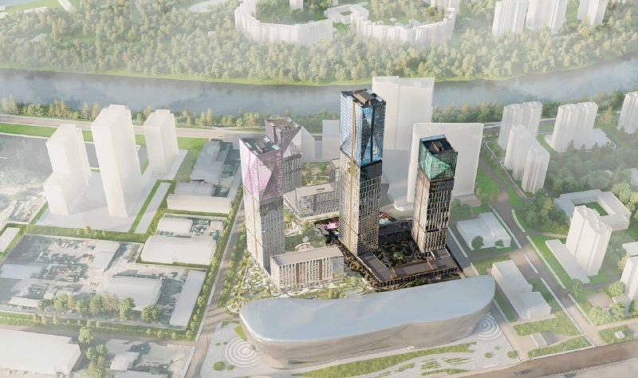
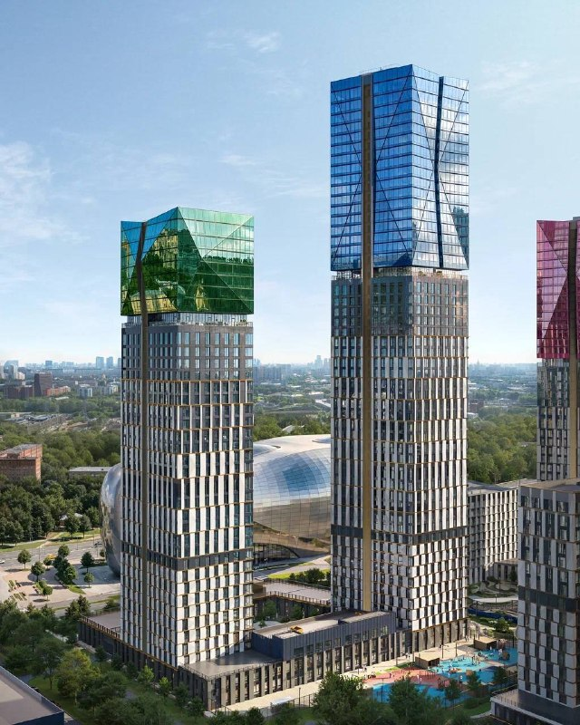
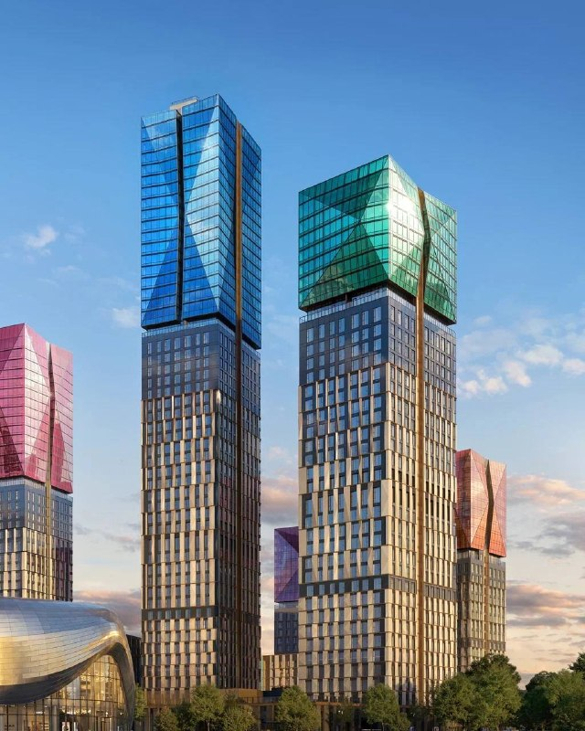
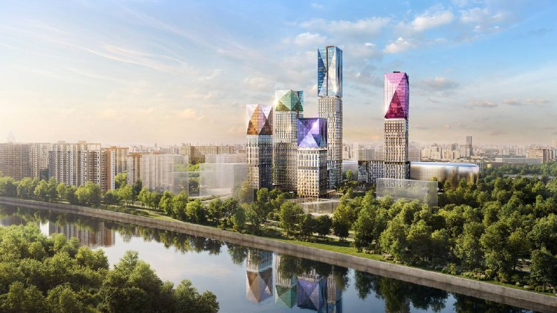
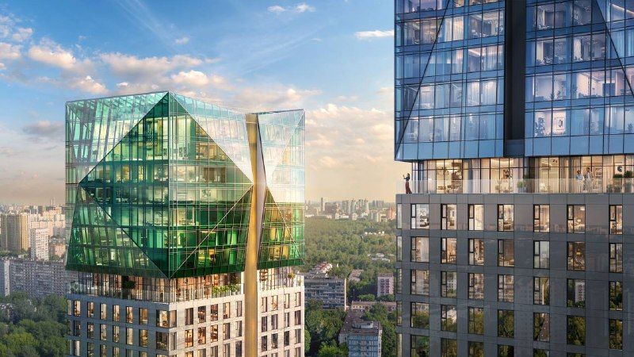

---
source:
  id: 35413
  date: 2026-08-14
status: ready
skip_reason: null
type: object
region: moscow
title: '«Сезар Силика» после старта продаж: от 22,7 млн ₽, ключи только в 2030 году'
title_alts:
- 'ЖК «Сезар Силика» на 3-м Силикатном: старт продаж и первые 33 сделки'
- 'Sezar Group открыла «Силику» по декларации: от 22,7 млн ₽ и долгие четыре года до сдачи'
slug: sezar-silika-start-prodazh-ceny-sroki
lead: 'Sezar Group в августе 2026 года официально открыла продажи в ЖК «Сезар Силика» на 3-м Силикатном проезде — с проектной декларацией, а не на честном слове. Вход — от 22,7 млн ₽, ключи — до конца сентября 2030 года. За два месяца ушло 33 квартиры из 666: спокойный старт для долгого проекта.'
developers:
- id: sezar-group
  name: Sezar Group
  role: main
objects:
- id: silika
  names:
  - Сезар Силика
  - Силика
  - SEZAR SILICA
  zu: 3-й Силикатный, 1
  main: true
  new: false
districts:
- khoroshevo-mnevniki
topics:
- ceny
- premium
images:
- file: media/35413_1.jpg
  alt: Аэровид на ЖК «Сезар Силика» у Москвы-реки, Хорошёво-Мнёвники, визуализация
  caption: 'Визуализация: Sezar Group'
- file: media/35413_2.jpg
  alt: Башни ЖК «Сезар Силика» с цветными стеклянными завершениями, Хорошёво-Мнёвники
  caption: 'Визуализация: Sezar Group'
- file: media/35413_3.jpg
  alt: Две башни «Сезар Силика» с синим и зелёным стеклянными завершениями, визуализация
  caption: 'Визуализация: Sezar Group'
- file: media/35413_4.jpg
  alt: 'ЖК «Сезар Силика»: вид на башни с другого берега реки, визуализация'
  caption: 'Визуализация: Sezar Group'
- file: media/35413_5.jpg
  alt: Зелёное стеклянное завершение башни ЖК «Сезар Силика», визуализация
  caption: 'Визуализация: Sezar Group'
factcheck:
- claim: ЖК «Сезар Силика» строит ООО «СЗ 3-й Силикатный» (ИНН 7714913665), группа — Sezar Group
  status: confirmed
  source: https://наш.дом.рф/сервисы/каталог-новостроек/объект/73110
  checked: &id001 2026-10-13
- claim: Проектная декларация № 77-003349 опубликована 11.08.2026 — официальный старт продаж в августе 2026 года
  status: confirmed
  source: https://наш.дом.рф/сервисы/каталог-новостроек/объект/73110
  checked: *id001
- claim: Сдача — I кв. 2030; выдача ключей — 30.09.2030 («ключи осенью 2030 года»)
  status: confirmed
  source: https://наш.дом.рф/сервисы/каталог-новостроек/объект/73110
  checked: *id001
- claim: '666 квартир: 287 однокомнатных, 146 двухкомнатных, 202 трёхкомнатные, 31 — четыре комнаты и более; площади 32,9–342,5 м²; 704 нежилых помещения'
  status: confirmed
  source: https://наш.дом.рф/сервисы/каталог-новостроек/объект/73110
  checked: *id001
- claim: Класс в ЕИСЖС — элитный; на сайте застройщика — премиум
  status: confirmed
  source: https://наш.дом.рф/сервисы/каталог-новостроек/объект/73110 ; https://sezar-group.ru/projects/sezar-silica
  checked: *id001
- claim: Максимальная этажность — 54; обеспеченность машино-местами — 38%; генподрядчик — ООО «Форсайт» (ИНН 9704230857)
  status: confirmed
  source: https://наш.дом.рф/сервисы/каталог-новостроек/объект/73110
  checked: *id001
- claim: Продано 33 квартиры из 666 (≈5%); средняя цена 1 м² на сентябрь 2026 года — 527 547 ₽
  status: confirmed
  source: https://наш.дом.рф/сервисы/каталог-новостроек/объект/73110
  checked: *id001
- claim: Район Хорошёво-Мнёвники; метро «Народное Ополчение» 16 мин, «Хорошёво» 17 мин, «Звенигородская» 23 мин
  status: confirmed
  source: https://наш.дом.рф/сервисы/каталог-новостроек/объект/73110
  checked: *id001
- claim: Адрес по сайту застройщика — 3-й Силикатный проезд, вл. 3, СЗАО
  status: confirmed
  source: https://sezar-group.ru/projects/sezar-silica
  checked: *id001
- claim: Цены от 22 668 800 ₽ до 55 234 800 ₽, площади 35–92 м², корпуса 1А и 2А (первая очередь)
  status: confirmed
  source: https://sezar-group.ru/projects/sezar-silica
  checked: *id001
- claim: 'В продаже 256 лотов: 123 однокомнатные, 61 двухкомнатная, 72 трёхкомнатные'
  status: confirmed
  source: https://www.novostroy-m.ru/baza/jk_na_3m_silikatnom
  checked: *id001
- claim: В проекте ТРЦ «Силика», детский сад на 150 мест, подземный паркинг; лобби оформляет студия Nobbey
  status: confirmed
  source: https://sezar-group.ru/projects/sezar-silica
  checked: *id001
- claim: 'Портфель Sezar Group: «Династия» и Full House сданы; «Сезар Сити» — сдача III–IV кв. 2027; «Сезар Будущее» — IV кв. 2029'
  status: confirmed
  source: https://sezar-group.ru/
  checked: *id001
- claim: 'На 3-м Силикатном проезде, вл. 1, корп. 1 город реализует КРТ: научно-производственный объект (технопарк) около 20 тыс. м² на месте недостроенного паркинга'
  status: confirmed
  source: https://www.gazetametro.ru/articles/vladislav-ovchinskij-nauchno-proizvodstvennyj-obekt-pojavitsja-na-meste-nedostroennogo-parkinga-v-3-m-silikatnom-proezde-03-02-2025 ; https://www.mskagency.ru/materials/3544281
  checked: *id001
- claim: Цена на старте — около 650 тыс. ₽/м²
  status: unverified
  source: независимого источника нет; rnrf.ru — перепечатка Telegram-поста; в ЕИСЖС средняя цена 527,5 тыс. ₽/м²
  checked: *id001
- claim: Бронирование велось с конца 2025 года, в ноябре 2025 года проект рекламировали как «архитектурный проект»
  status: unverified
  source: подтверждений вне Telegram не найдено
  checked: *id001
- claim: Московская «такса» на старте продаж — не менее 500 тыс. ₽/м²
  status: unverified
  source: обобщение без источника
  checked: *id001
- claim: КРТ на ЗУ «3-й Силикатный, 1 к. 1» реализует Sezar; компания стала совладельцем ООО-владельца участка
  status: unverified
  source: в официальных сообщениях по КРТ инвестор не назван
  checked: *id001
- claim: Жилые башни до 49 этажей, офисы по 13 этажей вдоль набережной
  status: unverified
  source: из ранних заметок; декларация даёт 54 этажа, офисов в описании проекта нет
  checked: *id001
removed:
- Цена «около 650 тыс. ₽/м²» — независимого подтверждения нет (единственная публикация — перепечатка Telegram-поста), ЕИСЖС показывает 527,5 тыс. ₽/м²; в тексте даны цены лотов с сайта застройщика.
- Бронирование с конца 2025 года и реклама «архитектурного проекта» с ноября 2025 года — не подтверждено вне Telegram.
- Тезис о «московской таксе» не ниже 500 тыс. ₽/м² и прогноз «миллион за метр» — нет источника, прогноз без данных.
- Участие Sezar в КРТ на 3-м Силикатном, вл. 1, корп. 1 и доля в компании-владельце — не подтверждено; оставлен только официальный факт о КРТ без привязки к Sezar.
- Этажность 49 и 13-этажные офисы на набережной — устаревшие и неподтверждённые данные из ранних заметок.
- Ссылка «презентация и планировки тут», жаргон («полмульта», «лям за метр», «бабки») — убраны по редполитике.
data_points:
- metric: avg_price_m2_eisgs
  object: silika
  value: 527547
  unit: RUB/m2
  date: 2026-09-30
  note: 'подпись ЕИСЖС: на сентябрь 2026'
- metric: min_lot_price
  object: silika
  value: 22668800
  unit: RUB
  date: *id001
- metric: sold_share
  object: silika
  value: 33
  of: 666
  date: *id001
- metric: completion_date
  object: silika
  value: 2030-Q1
  date: *id001
seo:
  main_query: жк сезар силика старт продаж
  keywords:
  - сезар силика цены
  - сезар силика сроки сдачи
  - sezar silica
  - жк силика 3-й силикатный проезд
  - новостройки хорошево-мневники народное ополчение
  frequency_checked: false
  title: 'ЖК Сезар Силика: старт продаж, цены и сроки сдачи'
  description: 'ЖК «Сезар Силика» от Sezar Group в Хорошёво-Мнёвниках: квартиры от 22,7 млн ₽, сдача в I квартале 2030 года, продано 33 из 666. Цены, ТЭП, риски.'
  canonical: https://шахматка.москва/novosti/sezar-silika-start-prodazh-ceny-sroki/
internal_links:
- anchor: карточка проекта «Сезар Силика»
  url: /obekty/silika/
- anchor: досье Sezar Group
  url: /zastroyshchiki/sezar-group/
- anchor: новостройки Хорошёво-Мнёвников
  url: /moskva/khoroshevo-mnevniki/
- anchor: комплексное развитие территорий (КРТ)
  url: /slovar/krt/
- anchor: что такое проектная декларация
  url: /slovar/proektnaya-deklaratsiya/
- anchor: как соотносятся цены новостроек Москвы и Подмосковья
  url: /novosti/razryv-cen-novostroek-moskva-podmoskove/
faq:
- q: Сколько стоят квартиры в ЖК «Сезар Силика»?
  a: На 13 октября 2026 года на сайте Sezar Group цены начинаются от 22,67 млн ₽, самый дорогой лот в подборе — 55,23 млн ₽, площади — от 35 до 92 м². Средняя цена 1 м² в ЕИСЖС на сентябрь 2026 года — 527,5 тыс. ₽.
- q: Когда сдадут ЖК «Сезар Силика»?
  a: По проектной декларации стройку завершат в I квартале 2030 года, ключи выдадут до 30 сентября 2030 года.
- q: Кто застройщик ЖК «Сезар Силика»?
  a: ООО «Специализированный застройщик „3-й Силикатный“» (ИНН 7714913665) из Sezar Group. Генподрядчик, по данным ЕИСЖС, — ООО «Форсайт».
- q: Где находится ЖК «Сезар Силика» и какое метро рядом?
  a: На 3-м Силикатном проезде в Хорошёво-Мнёвниках (СЗАО). По данным ЕИСЖС, до «Народного Ополчения» 16 минут, до «Хорошёво» (МЦК) — 17 минут, до «Звенигородской» — 23 минуты.
- q: Сколько квартир продано в ЖК «Сезар Силика»?
  a: По данным ЕИСЖС на 13 октября 2026 года, продано 33 квартиры из 666 — около 5%.
date_published: 2026-08-14   # дата исходной заметки
date_modified: 2026-10-13   # дата проверки фактов и обновления
author: Редакция Шахматки
schema: |-
  [
    {
      "@context": "https://schema.org",
      "@type": "NewsArticle",
      "headline": "«Сезар Силика» после старта продаж: цены от 22,7 млн ₽, ключи в 2030 году",
      "description": "ЖК «Сезар Силика» от Sezar Group в Хорошёво-Мнёвниках: квартиры от 22,7 млн ₽, сдача в I квартале 2030 года, продано 33 из 666. Цены, ТЭП и риски.",
      "datePublished": "2026-08-14",
      "dateModified": "2026-10-13",
      "inLanguage": "ru",
      "author": {
        "@type": "Organization",
        "name": "Редакция Шахматки"
      },
      "publisher": {
        "@type": "Organization",
        "name": "Шахматка",
        "url": "https://шахматка.москва/"
      },
      "mainEntityOfPage": {
        "@type": "WebPage",
        "@id": "https://шахматка.москва/novosti/sezar-silika-start-prodazh-ceny-sroki/"
      },
      "image": [
        "https://шахматка.москва/media/35413_1.jpg",
        "https://шахматка.москва/media/35413_2.jpg",
        "https://шахматка.москва/media/35413_3.jpg",
        "https://шахматка.москва/media/35413_4.jpg",
        "https://шахматка.москва/media/35413_5.jpg"
      ],
      "about": [
        {
          "@type": "Residence",
          "name": "ЖК «Сезар Силика»",
          "alternateName": [
            "Силика",
            "SEZAR SILICA"
          ],
          "address": {
            "@type": "PostalAddress",
            "addressLocality": "Москва",
            "addressRegion": "Москва",
            "streetAddress": "3-й Силикатный проезд, вл. 3"
          }
        },
        {
          "@type": "Organization",
          "name": "Sezar Group"
        }
      ]
    },
    {
      "@context": "https://schema.org",
      "@type": "FAQPage",
      "mainEntity": [
        {
          "@type": "Question",
          "name": "Сколько стоят квартиры в ЖК «Сезар Силика»?",
          "acceptedAnswer": {
            "@type": "Answer",
            "text": "По состоянию на 13 октября 2026 года на сайте Sezar Group цены начинаются от 22,67 млн ₽, самый дорогой лот в подборе — 55,23 млн ₽ при площадях от 35 до 92 м². Средняя цена 1 м² в ЕИСЖС на сентябрь 2026 года — 527,5 тыс. ₽."
          }
        },
        {
          "@type": "Question",
          "name": "Когда сдадут ЖК «Сезар Силика»?",
          "acceptedAnswer": {
            "@type": "Answer",
            "text": "По проектной декларации завершение строительства — I квартал 2030 года, выдача ключей — до 30 сентября 2030 года."
          }
        },
        {
          "@type": "Question",
          "name": "Кто застройщик ЖК «Сезар Силика»?",
          "acceptedAnswer": {
            "@type": "Answer",
            "text": "Застройщик — ООО «Специализированный застройщик „3-й Силикатный“» (ИНН 7714913665), входит в Sezar Group. Генподрядчик по данным ЕИСЖС — ООО «Форсайт»."
          }
        },
        {
          "@type": "Question",
          "name": "Где находится ЖК «Сезар Силика» и какое метро рядом?",
          "acceptedAnswer": {
            "@type": "Answer",
            "text": "Комплекс строится на 3-м Силикатном проезде в районе Хорошёво-Мнёвники (СЗАО). По данным ЕИСЖС, до станции «Народное Ополчение» 16 минут, до «Хорошёво» (МЦК) — 17 минут, до «Звенигородской» — 23 минуты."
          }
        },
        {
          "@type": "Question",
          "name": "Сколько квартир продано в ЖК «Сезар Силика»?",
          "acceptedAnswer": {
            "@type": "Answer",
            "text": "По данным ЕИСЖС на 13 октября 2026 года, продано 33 квартиры из 666 — около 5%."
          }
        }
      ]
    }
  ]
editor_notes: |-
  1) Изображения media/35413_1..5.jpg в пакет не переданы — содержимое, авторство и alt не проверены; рендеры, вероятно, от Sezar Group — уточнить автора архитектуры (на сайте застройщика назван только дизайнер лобби Nobbey). 2) Расхождение адресов: в справочнике ЗУ «3-й Силикатный, 1» и «3-й Силикатный, 1 к. 1», на сайте застройщика — «3-й Силикатный проезд, вл. 3». Сверить по ГПЗУ/разрешению на строительство и, если нужно, поправить zu. 3) Методика средней цены 527,5 тыс. ₽/м² в ЕИСЖС не раскрыта на странице; при желании сверить с отчётами продома.дом.рф. 4) Сообщение о КРТ на вл. 1, корп. 1 найдено в городских СМИ (Газета Метро, Агентство «Москва»); при наличии доступа заменить ссылкой на mos.ru или постановление. 5) Внутренние ссылки на /novosti/ не ставились: в out/ на момент работы не было статей пилота.
  Фото проверены главным редактором 13.10.2026: alt и подписи переписаны по содержанию; непригодные изображения сняты (см. removed). Права на визуализации застройщиков подтвердить запросом в пресс-службу.
---

# «Сезар Силика» после старта продаж: от 22,7 млн ₽, ключи только в 2030 году

Sezar Group в августе 2026 года официально открыла продажи в ЖК «Сезар Силика» на 3-м Силикатном проезде — с проектной декларацией, а не на честном слове. Вход — от 22,7 млн ₽, ключи — до конца сентября 2030 года. За первые два месяца ушло 33 квартиры из 666: спокойный старт для проекта, где ждать придётся долго.

**Коротко**

- Старт продаж ЖК «Сезар Силика» подтверждён проектной декларацией № 77-003349, опубликованной в ЕИСЖС 11 августа 2026 года.
- Цены на сайте застройщика на 13 октября 2026 года — от 22,67 до 55,23 млн ₽ за 35–92 м².
- Сдача — I квартал 2030 года, ключи — до 30 сентября 2030 года.
- Продано 33 квартиры из 666 (около 5%), средний метр в ЕИСЖС на сентябрь 2026 года — 527,5 тыс. ₽.

## Старт по документам, а не по рекламе

[Sezar Group](/zastroyshchiki/sezar-group/) вывела в продажу жилой комплекс «Сезар Силика» (SEZAR SILICA) в Хорошёво-Мнёвниках. Главное здесь — бумага: [проектная декларация](/slovar/proektnaya-deklaratsiya/) появилась в Единой информационной системе жилищного строительства (ЕИСЖС, наш.дом.рф) 11 августа 2026 года. С этой даты продажи официальные. Застройщик — ООО «Специализированный застройщик „3-й Силикатный“», генподрядчик — ООО «Форсайт».

Деньги покупателей по договорам долевого участия (ДДУ) идут на счета эскроу — это видно в карточке объекта в ЕИСЖС.

*Визуализация: Sezar Group*

## Сколько стоят квартиры в «Сезар Силике»: два прайса и одна средняя

На сайте Sezar Group на 13 октября 2026 года — 256 лотов в первой очереди (корпуса 1А и 2А). Нижняя граница прайса — 22 668 800 ₽, верхняя — 55 234 800 ₽, площади — от 35 до 92 м².

Выборка агрегатора «Новострой-М» на ту же дату:

| Формат | Площадь | Цена |
|---|---|---|
| 1-комнатные | 35,2–35,6 м² | 22,67–25,91 млн ₽ |
| 2-комнатные | 65,7–67,7 м² | 34,82–39,02 млн ₽ |
| 3-комнатные | 73,0–73,8 м² | 41,32–47,32 млн ₽ |

Теперь арифметика. Самый доступный лот — не меньше 35 м² за 22,67 млн ₽, то есть до 648 тыс. ₽ за 1 м² (наш расчёт). А средняя цена в ЕИСЖС на сентябрь 2026 года заметно скромнее — 527,5 тыс. ₽/м². Разница, на наш взгляд, сидит в методике расчёта и в структуре первых сделок. Вывод простой: средняя по системе — для статистики, считать покупку стоит по цене конкретного лота. Рыночный фон — в материале о том, [как соотносятся цены новостроек Москвы и Подмосковья](/novosti/razryv-cen-novostroek-moskva-podmoskove/).

*Визуализация: Sezar Group*

## Когда сдадут: терпение входит в цену

По декларации строительство завершится в I квартале 2030 года, ключи передадут до 30 сентября 2030 года. До новоселья — почти четыре года. Для покупателя на старте это главный параметр риска, и никакие стеклянные завершения башен его не отменяют.

## Что строят: ТЭП и квартирография

- 666 квартир: 287 однокомнатных, 146 двухкомнатных, 202 трёхкомнатные и 31 — с четырьмя комнатами и более.
- Площади — от 32,9 до 342,5 м², суммарно 44,7 тыс. м²; средняя квартира — около 67 м² (наш расчёт).
- До 54 этажей; 704 нежилых помещения; обеспеченность машино-местами — 38%, паркинг подземный.
- Класс: «элитный» по ЕИСЖС, «премиум» — по версии застройщика. Система оказалась щедрее маркетинга.
- В составе проекта — ТРЦ «Силика» и детский сад на 150 мест.

Трёхкомнатных и больших квартир — 35%. На наш взгляд, это продукт для тех, кто собирается здесь жить, а не только для инвестора со студией.

*Визуализация: Sezar Group*

## Где находится ЖК «Сезар Силика» и что по соседству

Комплекс строится на 3-м Силикатном проезде ([Хорошёво-Мнёвники](/moskva/khoroshevo-mnevniki/), СЗАО); на сайте застройщика указан адрес вл. 3. По данным ЕИСЖС, до станции «Народное Ополчение» Большой кольцевой линии — 16 минут пешком, до «Хорошёво» (МЦК) — 17 минут, до «Звенигородской» — 23 минуты.

Соседи тоже меняются. На том же проезде, по адресу вл. 1, корп. 1, город запустил [комплексное развитие территории (КРТ)](/slovar/krt/): в феврале 2025 года руководитель Департамента градостроительной политики Владислав Овчинский сообщил, что на месте недостроенного паркинга появится научно-производственный объект — технопарк площадью около 20 тыс. м².

*Визуализация: Sezar Group*

## Что это значит для покупателя и инвестора

**Застройщик, который уже сдавал.** У Sezar Group сданы «Династия», клубный дом Full House и «Рассказово», в стройке — «Сезар Сити» (сдача в III–IV кварталах 2027 года) и «Сезар Будущее» (IV квартал 2029 года). «Силика» — один из самых длинных проектов в портфеле.

**Темп продаж.** 33 квартиры за первые два месяца — 5% жилого фонда. Не ажиотаж, но и не провал. Держит ли проект темп после стартовой волны, покажут следующие отчёты ЕИСЖС.

**Дорогая сложность.** Башни до 54 этажей плюс торговый центр — проект, который дорого строить. Именно поэтому, по-нашему, следить стоит за версиями декларации: изменения ТЭП и сроков появляются там раньше, чем в рекламе.

**Что отслеживать дальше:** продажи и среднюю цену в ЕИСЖС, фотоотчёты со стройки, сроки по второй очереди и ТРЦ.

*Визуализация: Sezar Group*

## Карточка объекта

Полная история проекта — в досье «Шахматки»: [карточка проекта «Сезар Силика»](/obekty/silika/).

- **Адрес ЗУ:** Москва, 3-й Силикатный проезд (по сайту застройщика — вл. 3)
- **Названия:** «Сезар Силика», «Силика», SEZAR SILICA
- **Застройщик:** ООО «СЗ „3-й Силикатный“» (ИНН 7714913665), Sezar Group
- **Генподрядчик:** ООО «Форсайт»
- **Регион, район:** Москва, СЗАО, Хорошёво-Мнёвники
- **Метро:** «Народное Ополчение» — 16 мин, «Хорошёво» (МЦК) — 17 мин, «Звенигородская» — 23 мин
- **Класс:** элитный (ЕИСЖС) / премиум (застройщик)
- **Этажность:** до 54 этажей
- **Квартиры:** 666, площадью 32,9–342,5 м²
- **Стадия:** строится; проектная декларация № 77-003349; эскроу
- **Ввод:** I квартал 2030 года, ключи — до 30.09.2030
- **Цена (13.10.2026):** от 22,67 до 55,23 млн ₽; средняя в ЕИСЖС — 527,5 тыс. ₽/м² (сентябрь 2026)
- **Продано:** 33 из 666 квартир

## Вопросы и ответы

**Сколько стоят квартиры в ЖК «Сезар Силика»?**

На 13 октября 2026 года на сайте Sezar Group цены начинаются от 22,67 млн ₽, самый дорогой лот в подборе — 55,23 млн ₽, площади — от 35 до 92 м². Средняя цена 1 м² в ЕИСЖС на сентябрь 2026 года — 527,5 тыс. ₽.

**Когда сдадут ЖК «Сезар Силика»?**

По проектной декларации стройку завершат в I квартале 2030 года, ключи выдадут до 30 сентября 2030 года.

**Кто застройщик ЖК «Сезар Силика»?**

ООО «Специализированный застройщик „3-й Силикатный“» (ИНН 7714913665) из Sezar Group. Генподрядчик, по данным ЕИСЖС, — ООО «Форсайт».

**Где находится ЖК «Сезар Силика» и какое метро рядом?**

На 3-м Силикатном проезде в Хорошёво-Мнёвниках (СЗАО). По данным ЕИСЖС, до «Народного Ополчения» 16 минут, до «Хорошёво» (МЦК) — 17 минут, до «Звенигородской» — 23 минуты.

**Сколько квартир продано в ЖК «Сезар Силика»?**

По данным ЕИСЖС на 13 октября 2026 года, продано 33 квартиры из 666 — около 5%.

## Источники

1. ЕИСЖС (наш.дом.рф), карточка объекта «Жилой комплекс „СЕЗАР СИЛИКА“»: https://наш.дом.рф/сервисы/каталог-новостроек/объект/73110
2. Sezar Group, страница ЖК «Сезар Силика»: https://sezar-group.ru/projects/sezar-silica
3. Sezar Group, каталог проектов: https://sezar-group.ru/
4. Новострой-М, ЖК «Сезар Силика» (лоты и цены): https://www.novostroy-m.ru/baza/jk_na_3m_silikatnom
5. Газета «Метро», «Владислав Овчинский: научно-производственный объект появится на месте недостроенного паркинга в 3-м Силикатном проезде» (03.02.2025): https://www.gazetametro.ru/articles/vladislav-ovchinskij-nauchno-proizvodstvennyj-obekt-pojavitsja-na-meste-nedostroennogo-parkinga-v-3-m-silikatnom-proezde-03-02-2025
6. Агентство «Москва», «Почти 7,4 га земли реорганизуют в Хорошево-Мневниках в рамках КРТ»: https://www.mskagency.ru/materials/3544281

Дата публикации и проверки фактов: 13 октября 2026 года. Автор: Редакция Шахматки.

Материал не является инвестиционной рекомендацией.
