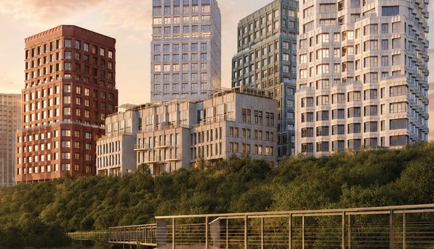
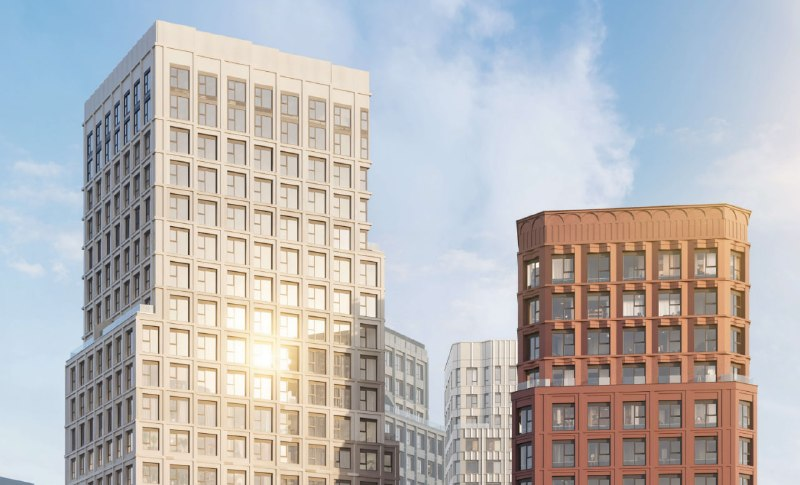

---
source:
  id: 35439
  date: '2026-08-19'
status: needs_review
skip_reason: null
type: object
region: moscow
title: 'ОМ Ботанический на Сельскохозяйственной: цены от 19,3 млн ₽, сдача 2029'
title_alts:
- 'ЖК «ОМ Ботанический» у метро «Ботанический сад»: старт продаж, цены, сдача 2029'
- '«ОМ Ботанический»: что строит «ОМ Девелопмент» в Свиблове и почём квартиры'
slug: om-botanicheskiy-ceny-sroki
lead: '«ОМ Девелопмент» начал продажи ЖК «ОМ Ботанический» на Сельскохозяйственной улице: к октябрю 2026 года квартиры предлагают от 19,3 млн ₽, сдача пяти корпусов намечена на IV квартал 2029 года.'
developers:
- id: om-development
  name: ОМ Девелопмент
  role: main
- id: pioner
  name: Пионер
  role: previous
ownership_changes:
- object: om-botanicheskiy
  from: ГК «Пионер»
  to: ОМ Девелопмент
  to_slug: om-development
  date: апрель 2024
  how: «ОМ Девелопмент» купила у «Пионера» два участка, в том числе площадку на Сельскохозяйственной улице (около 1,37 га); покупку подтвердил покупатель.
  source: https://www.kommersant.ru/doc/6663730
objects:
- id: om-botanicheskiy
  names:
  - ОМ Ботанический
  - Лайф Ботанический Сад
  - Сельскохозяйственная, 42
  zu: Сельскохозяйственная, 42, стр. 1
  main: true
  new: false
districts:
- sviblovo
topics:
- ceny
- premium
images:
- file: media/35439_2.jpg
  alt: Визуализация жилых корпусов ЖК «ОМ Ботанический» на Сельскохозяйственной улице, Свиблово
  caption: 'Корпуса «ОМ Ботанического» с видом на парковую зону. Визуализация: ОМ Девелопмент'
  credit: 'Визуализация: ОМ Девелопмент'
- file: media/35439_5.jpg
  alt: 'Визуализация фасадов ЖК «ОМ Ботанический»: светлые и терракотовые корпуса, Свиблово'
  caption: 'Фасады корпусов: светлый и терракотовый. Визуализация: ОМ Девелопмент'
  credit: 'Визуализация: ОМ Девелопмент'
factcheck:
- claim: Застройщик — ОМ Девелопмент (ООО СЗ «Деком»), основан в 2022 году; 0 сданных и 4 строящихся объекта
  status: confirmed
  source: https://www.novostroy-m.ru/kvartiry/studiya-v-zhk-om-botanicheskii-578740fb695d920090e155cbb830de
  checked: '2026-10-13'
- claim: Участок на Сельскохозяйственной (около 1,37 га, согласовано около 41 тыс. м² жилья) продан Пионером ОМ Девелопменту; сделка опубликована в апреле 2024 года, а не в декабре 2024
  status: changed
  source: https://www.kommersant.ru/doc/6663730
  checked: '2026-10-13'
- claim: Архитектор — IND; пять корпусов от 4 до 19 этажей; 178 машино-мест; класс — премиум; ввод — IV кв. 2029
  status: confirmed
  source: https://www.novostroy-m.ru/expertise/jk_om_botanicheskiy_ot
  checked: '2026-10-13'
- claim: Проектные декларации от 10.04.2026, 05.05.2026, 06.08.2026; стадия — котлован/фундамент; ввод всех пяти корпусов — IV кв. 2029
  status: confirmed
  source: https://www.novostroy-m.ru/baza/arhitekturnyy_proekt_ul_selskohozyaystvennaya
  checked: '2026-10-13'
- claim: 'Цены на 1 октября 2026: студия 28 м² — 22,09 млн ₽ (около 789 тыс. ₽/м²); диапазоны по типам квартир; в обзоре минимум 19,3 млн ₽ (сентябрь 2026)'
  status: changed
  source: https://www.novostroy-m.ru/kvartiry/studiya-v-zhk-om-botanicheskii-578740fb695d920090e155cbb830de
  checked: '2026-10-13'
- claim: 'Нижняя цена на старте: от 19,6 млн ₽ (19.08.2026)'
  status: unverified
  source: только заметка; в каталогах на октябрь — 19,3 млн ₽ (обзор) и 21,7 млн ₽ (Яндекс Недвижимость)
  checked: '2026-10-13'
- claim: Метро «Ботанический сад» около 10 минут пешком; район Свиблово, СВАО
  status: confirmed
  source: https://realty.yandex.ru/moskva_i_moskovskaya_oblast/kupit/novostrojka/om-botanicheskij-4809012/
  checked: '2026-10-13'
- claim: Средняя цена 690 тыс. ₽/м²
  status: unverified
  source: не подтверждено независимым источником; в каталоге на 1 октября — около 789 тыс. ₽/м² по студии
  checked: '2026-10-13'
- claim: Средняя площадь квартир 62 м²; террасы, антресоли, патио, второй свет, дровяные камины в пентхаусах
  status: unverified
  source: в открытых источниках не найдено
  checked: '2026-10-13'
removed:
- 'Средняя цена 690 тыс. ₽/м² и средняя площадь 62 м²: не подтверждены; заменены ценами каталога на 1 октября 2026 года.'
- 'Террасы, антресоли, патио, второй свет, дровяные камины: маркетинговые обещания, не подтверждены.'
- 'Оценки вроде «как уплачено — так и науячено», рассуждения о фин. моделях и банках, сравнение с проектом «Союз», тезис про 68 кв. м, жалоба на колл-центр: мнение или не подтверждено.'
- 'Участки в портфеле ОМ Девелопмент (Малая Тульская, Летная, 1-й Митинский): не проверены, к событию не относятся.'
- 'КРТ на Сельскохозяйственной, 42 и дата АГР из хронологии досье: не открыты в лимите запросов, в текст не включены.'
- Дата сделки по участку (31.12.2024 в досье) заменена на апрель 2024 по публикации «Коммерсанта».
data_points:
- metric: min_price_mln_rub
  value: 19.3
  date: '2026-09-30'
seo:
  main_query: ом ботанический цены
  keywords:
  - жк ом ботанический
  - ом девелопмент ботанический
  - сельскохозяйственная 42 жк
  - ботанический сад новостройка сроки сдачи
  - лайф ботанический сад
  frequency_checked: false
  title: 'ОМ Ботанический: цены от 19,3 млн ₽, сдача 2029'
  description: 'ЖК «ОМ Ботанический» у метро «Ботанический сад»: продажи с лета 2026 года, цены от 19,3 млн ₽, сдача в IV квартале 2029 года. Что известно о проекте и цене.'
  canonical: https://шахматка.москва/novosti/om-botanicheskiy-ceny-sroki/
internal_links:
- anchor: полная история проекта — в досье «ОМ Ботанический»
  url: /obekty/om-botanicheskiy/
- anchor: «ОМ Девелопмент»
  url: /zastroyshchiki/om-development/
- anchor: новостроек премиум-класса
  url: /novostroyki/premium-klass/
- anchor: проектной декларации
  url: /slovar/proektnaya-deklaratsiya/
- anchor: ДДУ
  url: /slovar/ddu/
- anchor: цены
  url: /temy/ceny/
faq:
- q: Кто застройщик ЖК «ОМ Ботанический»?
  a: 'Проект ведёт «ОМ Девелопмент» (юрлицо — ООО СЗ «Деком»). Участок на Сельскохозяйственной улице компания купила у ГК «Пионер»: покупку подтвердил сам покупатель, сделка описана в «Коммерсанте» в апреле 2024 года.'
- q: Сколько стоят квартиры в «ОМ Ботаническом»?
  a: По данным каталога на сентябрь–октябрь 2026 года, минимальная цена — около 19,3 млн ₽ за студию 28 м²; в объявлениях на 1 октября студии стоят 21,7–22,7 млн ₽, четырёхкомнатные квартиры — до 112,9 млн ₽.
- q: Когда сдадут «ОМ Ботанический»?
  a: Срок сдачи всех пяти корпусов по данным каталога — IV квартал 2029 года. Стадия — котлован и фундамент.
- q: Где находится «ОМ Ботанический»?
  a: Проект расположен на Сельскохозяйственной улице в районе Свиблово (СВАО Москвы). Ближайшая станция — «Ботанический сад», около 10 минут пешком.
date_published: '2026-08-19'
date_modified: '2026-10-13'
author: Редакция Шахматки
schema: '[{"@context": "https://schema.org", "@type": "NewsArticle", "headline": "ОМ Ботанический на Сельскохозяйственной: цены от 19,3 млн ₽, сдача 2029", "description": "ЖК «ОМ Ботанический» у метро «Ботанический сад»: продажи с лета 2026 года, цены от 19,3 млн ₽, сдача в IV квартале 2029 года. Что известно о проекте и цене.", "datePublished": "2026-08-19", "dateModified": "2026-10-13", "author": {"@type": "Organization", "name": "Редакция Шахматки"}, "publisher": {"@type": "Organization", "name": "Шахматка"}, "about": [{"@type": "Place", "name": "Сельскохозяйственная улица, 42, Свиблово, Москва"}, {"@type": "Organization", "name": "ОМ Девелопмент"}], "mainEntityOfPage": "https://шахматка.москва/novosti/om-botanicheskiy-ceny-sroki/"}, {"@context": "https://schema.org", "@type": "FAQPage", "mainEntity": [{"@type": "Question", "name": "Кто застройщик ЖК «ОМ Ботанический»?", "acceptedAnswer": {"@type": "Answer", "text": "Проект ведёт «ОМ Девелопмент» (юрлицо — ООО СЗ «Деком»). Участок на Сельскохозяйственной улице компания купила у ГК «Пионер»: покупку подтвердил сам покупатель, сделка описана в «Коммерсанте» в апреле 2024 года."}}, {"@type": "Question", "name": "Сколько стоят квартиры в «ОМ Ботаническом»?", "acceptedAnswer": {"@type": "Answer", "text": "По данным каталога на сентябрь–октябрь 2026 года, минимальная цена — около 19,3 млн ₽ за студию 28 м²; в объявлениях на 1 октября студии стоят 21,7–22,7 млн ₽, четырёхкомнатные квартиры — до 112,9 млн ₽."}}, {"@type": "Question", "name": "Когда сдадут «ОМ Ботанический»?", "acceptedAnswer": {"@type": "Answer", "text": "Срок сдачи всех пяти корпусов по данным каталога — IV квартал 2029 года. Стадия — котлован и фундамент."}}, {"@type": "Question", "name": "Где находится «ОМ Ботанический»?", "acceptedAnswer": {"@type": "Answer", "text": "Проект расположен на Сельскохозяйственной улице в районе Свиблово (СВАО Москвы). Ближайшая станция — «Ботанический сад», около 10 минут пешком."}}]}]'
editor_notes: 'Наш.дом.рф и сайт ОМ Девелопмент в лимите не открывались; сроки, этажность и цены — по каталогам (Новострой-М, Яндекс Недвижимость), поэтому needs_review. Проверьте по проектной декларации: число корпусов/этажность (каталоги: 4–19 и 21), число квартир (428 по ЕИСЖС против 174 в одной карточке), минимальную цену (19,3 против 21,7 млн ₽). Дата сделки по участку: «Коммерсантъ» — апрель 2024, в досье — 31.12.2024; досье стоит поправить. Slug района sviblovo не из пакета (в тексте на район ссылки нет). Старт «закрытых» продаж 19.08.2026 подтверждён косвенно (каталог: продажи с лета 2026).'
---

# ОМ Ботанический на Сельскохозяйственной: цены от 19,3 млн ₽, сдача 2029

Летом 2026 года «ОМ Девелопмент» начал продажи ЖК «ОМ Ботанический» на Сельскохозяйственной улице в Свиблове. К октябрю квартиры в пяти корпусах предлагают от 19,3 млн ₽, а сдача намечена на IV квартал 2029 года.

## Коротко

- Проект: пять корпусов от 4 до 19 этажей, автор — архитектурное бюро IND; класс — премиум.
- Продажи начались летом 2026 года.
- Цены на сентябрь–октябрь 2026 года: от 19,3 млн ₽ за студию 28 м²; в объявлениях на 1 октября студия обходится примерно в 789 тыс. ₽/м².
- Сдача: IV квартал 2029 года; стадия — котлован и фундамент.

*Корпуса «ОМ Ботанического» с видом на парковую зону. Визуализация: ОМ Девелопмент*

## Что такое «ОМ Ботанический» и кто его строит

Это жилой комплекс на участке «Сельскохозяйственная, 42, стр. 1» в районе Свиблово, СВАО. Застройщик — [«ОМ Девелопмент»](/zastroyshchiki/om-development/), компания основана в 2022 году; юридическое лицо проекта — ООО СЗ «Деком». Ближайшее метро — «Ботанический сад», около 10 минут пешком.

По данным каталога, в проекте пять корпусов от 4 до 19 этажей (с подземной частью — до 22), около 1,3 га озеленения, безавтомобильный двор и подземный паркинг на 178 машино-мест. Архитектор — международное бюро IND. На наш взгляд, это узнаваемый почерк бюро: прагматичная архитектура с «приёмами» вместо радикальных решений.

*Фасады корпусов: светлый и терракотовый. Визуализация: ОМ Девелопмент*

## Как участок попал к «ОМ Девелопменту»

Участок раньше был в портфеле ГК «Пионер», которая согласовывала здесь жилую застройку около 41 тыс. м². В апреле 2024 года «Коммерсантъ» сообщил, что «Пионер» продала «ОМ Девелопменту» два участка, один из них — на Сельскохозяйственной улице площадью около 1,37 га. Покупку подтвердили в «ОМ Девелопменте»; в «Пионере» от комментариев отказались.

Сумма сделки в публикации — оценка NF Group (3,2–3,5 млрд ₽) и относится к обоим участкам, поэтому цену именно этого проекта выделить нельзя. Заметим: в нашем архиве сделка была датирована концом 2024 года, но по публикации она состоялась раньше — весной 2024-го.

Полная история проекта — в [досье «ОМ Ботанический»](/obekty/om-botanicheskiy/).

## Что с проектом сейчас

По состоянию на 13 октября 2026 года проект в продаже, стройка на стадии котлована и фундамента. В каталоге указаны проектные декларации от 10 апреля, 5 мая и 6 августа 2026 года. Срок сдачи всех пяти корпусов — IV квартал 2029 года.

Сроки ввода и этажность в каталогах расходятся: часть карточек называет 21 этаж, другая — от 4 до 19. Ориентируйтесь на проектную декларацию.

## Сколько стоят квартиры в «ОМ Ботаническом»

На сентябрь–октябрь 2026 года минимальный лот в каталоге — около 19,3 млн ₽ (студия 28 м² без отделки). В объявлениях на 1 октября 2026 года:

- студии 28–28,8 м² — от 21,7 до 22,7 млн ₽, около 789 тыс. ₽/м² на примере студии за 22,1 млн ₽;
- однокомнатные 35–36,7 м² — от 22,3 до 27,6 млн ₽;
- двухкомнатные 52–55 м² — от 31,9 до 41,3 млн ₽;
- трёхкомнатные 78–85 м² — от 48,9 до 68,5 млн ₽;
- четырёхкомнатные 118–120 м² — от 75,2 до 112,9 млн ₽.

Каталоги расходятся между собой на 1–2 млн ₽ по нижней границе, поэтому точную цену уточняйте у застройщика. Подробнее о классе — в подборке [новостроек премиум-класса](/novostroyki/premium-klass/).

## Что это значит для покупателя и инвестора

Плюс очевиден: готовый пакет документов, понятный срок сдачи и локация у парка «Свибловские пруды» и Яузы. Уровень цен — премиальный для района, и это решение застройщика, а не рыночная аксиома: на наш взгляд, ценник держится на классе и окружении, а не на спросе.

Риски: корпуса ещё на нулевом цикле, срок — конец 2029 года, у «ОМ Девелопмента» по данным каталога нет сданных объектов (0 сданных, 4 строящихся). Что отслеживать: изменения в [проектной декларации](/slovar/proektnaya-deklaratsiya/), темпы стройки и условия [ДДУ](/slovar/ddu/). Тема — [цены](/temy/ceny/).

## Карточка объекта

- Название: ЖК «ОМ Ботанический» (в досье также «Лайф Ботанический Сад»)
- Адрес ЗУ: Сельскохозяйственная, 42, стр. 1, Свиблово, СВАО, Москва
- Застройщик: ОМ Девелопмент (ООО СЗ «Деком»)
- Архитектор: IND
- Класс: премиум
- Корпуса: 5, от 4 до 19 этажей
- Паркинг: 178 машино-мест
- Стадия: котлован и фундамент
- Сдача: IV квартал 2029 года
- Цена: от 19,3 млн ₽ (сентябрь 2026 года)

## Вопросы и ответы

**Кто застройщик ЖК «ОМ Ботанический»?**
Проект ведёт «ОМ Девелопмент» (юрлицо — ООО СЗ «Деком»). Участок на Сельскохозяйственной улице компания купила у ГК «Пионер»: покупку подтвердил сам покупатель, сделка описана в «Коммерсанте» в апреле 2024 года.

**Сколько стоят квартиры в «ОМ Ботаническом»?**
По данным каталога на сентябрь–октябрь 2026 года, минимальная цена — около 19,3 млн ₽ за студию 28 м²; в объявлениях на 1 октября студии стоят 21,7–22,7 млн ₽, четырёхкомнатные квартиры — до 112,9 млн ₽.

**Когда сдадут «ОМ Ботанический»?**
Срок сдачи всех пяти корпусов по данным каталога — IV квартал 2029 года. Стадия — котлован и фундамент.

**Где находится «ОМ Ботанический»?**
Проект расположен на Сельскохозяйственной улице в районе Свиблово (СВАО Москвы). Ближайшая станция — «Ботанический сад», около 10 минут пешком.

## Источники

1. [Новострой-М: ЖК «ОМ Ботанический» — обзор, цены, сроки (сентябрь 2026)](https://www.novostroy-m.ru/expertise/jk_om_botanicheskiy_ot)
2. [Новострой-М: ул. Сельскохозяйственная, 42/1 — застройщик, декларации, сроки](https://www.novostroy-m.ru/baza/arhitekturnyy_proekt_ul_selskohozyaystvennaya)
3. [Новострой-М: объявление о студии в ЖК «ОМ Ботанический», цены на 1 октября 2026 года](https://www.novostroy-m.ru/kvartiry/studiya-v-zhk-om-botanicheskii-578740fb695d920090e155cbb830de)
4. [Яндекс Недвижимость: ЖК «ОМ Ботанический»](https://realty.yandex.ru/moskva_i_moskovskaya_oblast/kupit/novostrojka/om-botanicheskij-4809012/)
5. [«Коммерсантъ»: «Пионер» продал участки «ОМ Девелопменту», апрель 2024](https://www.kommersant.ru/doc/6663730)

Материал не является инвестиционной рекомендацией.
