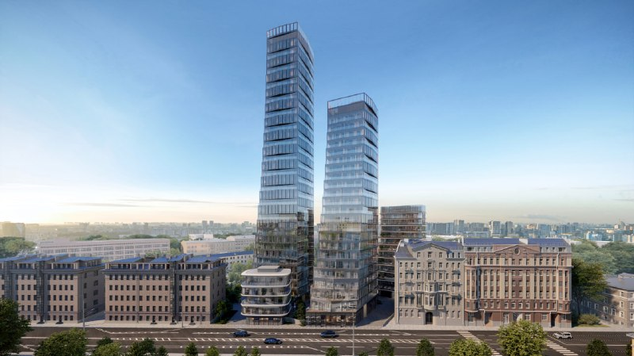
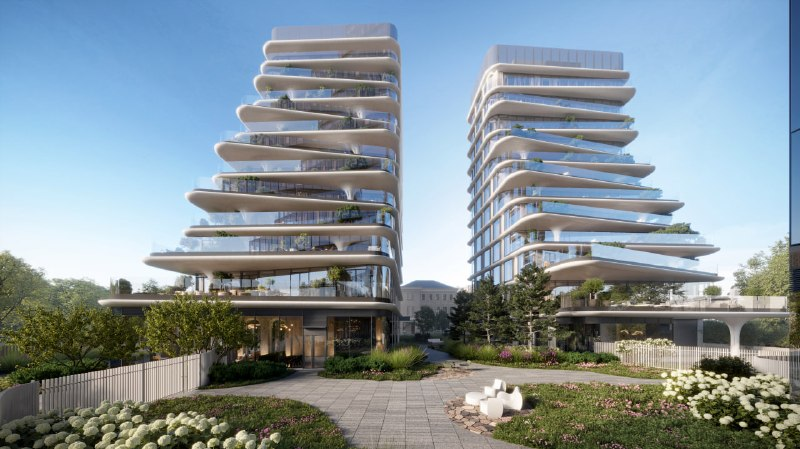

# «Демидов, 26» на Новой Басманной: Отрада начала продажи, цены от 1 млн ₽/м²

Проект на Новой Басманной, 26 сменил владельца: в июле 2026 года девелопер «Отрада» купил его у MR Group, а 24 августа брокеры объявили о старте продаж квартир в ЖК «Демидов, 26». Это первый московский проект красногорской группы, и стартовал он на фоне протеста жителей района.

## Коротко

- **Застройщик:** «Отрада» (с июля 2026 года), прежде проект вела MR Group.
- **Цена:** от 1,02 млн ₽/м² на старте (Whitewill, 24 августа 2026 года); на сайте застройщика 1 октября однокомнатные от 69,9 млн ₽.
- **Параметры:** пять корпусов от 5 до 36 этажей, 233 квартиры, около 45,3 тыс. м² общей площади.
- **Срок:** II квартал 2028 года по данным брокеров и порталов; стройка на стадии котлована.

## Кто застройщик «Демидов, 26» и что произошло со сделкой

По данным СПАРК-Интерфакс, которые приводят «Ведомости», 8 июля 2026 года закрыта сделка: «Отрада Хаус», связанная с группой [«Отрада»](/zastroyshchiki/otrada/), купила «Оникс-Холдинг» у структур MR Group. «Оникс-Холдинг» владеет правами на жилой проект на месте бывшей городской клинической больницы № 6. Цена не раскрыта, стороны на запрос издания не ответили. Эксперты оценивали площадку до 7 млрд ₽ (РИА Новости со ссылкой на «Ведомости»).

В сентябре застройщик подтвердил, что получил разрешение на строительство (его выдала Мосгосстройнадзор), а проектная документация прошла обязательную экспертизу с положительным заключением. Для «Отрады», которая с 2009 года строит в основном в Красногорском районе, это дебют в Москве.

## Сколько стоят квартиры в «Демидов, 26»

Брокер Whitewill на 24 августа 2026 года сообщал о старте продаж и ценах от 1,02 млн ₽/м² с рассрочкой до 2,5 лет. Прайс на сайте застройщика, который разбирало издание MSK1 на 1 октября, выглядит так:

- однокомнатные (57,8–122,7 м²) — от 69,9 млн ₽;
- двухкомнатные (65,9–147,3 м²) — от 78,3 млн ₽;
- трёхкомнатные (126,8–145,3 м²) — от 141,9 млн ₽;
- четырёхкомнатные (142,4–161 м²) — от 144,8 млн ₽.

Точные цены конкретных лотов застройщик публикует по запросу. По нашему расчёту, 69,9 млн ₽ за 57,8 м² — около 1,2 млн ₽/м², то есть стартовая «от» относится к самым компактным и дешёвым вариантам. Дальше цена зависит от этажа и вида.

*Визуализация: Отрада. Две высотные секции проекта на фоне исторической застройки.*

## Что построят на Новой Басманной, 26

Квартал состоит из пяти корпусов высотой от 5 до 36 этажей с единой подземной частью. Самая высокая башня — 130,3 м (заявление застройщика, РИАМО, 1 октября). Квартир 233, их общая площадь превышает 23 тыс. м², общая площадь комплекса — 45,3 тыс. м² (РИА Новости, 28 сентября). Брокеры указывают этажность «до 35»; мы приводим цифру застройщика. В более раннем городском согласовании, о котором писали «Ведомости», фигурировали четыре корпуса и 239 квартир: параметры уточнялись.

Архитектурная идея — каскадные озеленённые террасы. На той же площадке застройщик обещает восстановить усадьбу Демидовых под надзором департамента культурного наследия Москвы.

*Визуализация: Отрада. Корпус с каскадными террасами и озеленением.*

## Контекст: как проект дошёл до продаж

Площадка — бывшая городская клиническая больница № 6, закрытая более десяти лет назад. Ранее проект вела MR Group; городские власти утвердили квартал общей площадью 44,5 тыс. м² («Ведомости»). Полная история проекта — в [досье «Демидов, 26»](/obekty/demidov-26/).

## Когда сдадут «Демидов, 26»: что с проектом сейчас

По состоянию на 14 октября 2026 года брокеры и портал новостроек называют срок ввода II квартал 2028 года, стадия — котлован. Последняя проектная декларация датирована 28 сентября 2026 года. На наш взгляд, два года на комплекс с 36-этажной башней и подземной частью выглядят оптимистично: реальные сроки стоит уточнять у застройщика и сверять с декларацией. Класс проекта позиционируется как элитный; проект относится к [премиум-классу](/novostroyki/premium-klass/) в [Басманном районе](/novostroyki/basmannyy/).

## Что это значит для покупателя и инвестора

Плюсы: локация в центре, пешая доступность трёх станций метро (по данным портала, «Баумановская» около 12 минут, «Комсомольская» около 13, «Красные ворота» около 15), рассрочка и фасадная идея, выбивающаяся из типового стекла. Риски: протест жителей и петиция против высотных башен, первый московский опыт застройщика, срок сдачи и парковка.

С парковкой данные расходятся: в описании проекта на портале указан двухуровневый гараж на 171 машино-место, в характеристиках — 59. Если верна первая цифра, на 233 квартиры приходится около 0,73 места на квартиру: для элитного проекта это немного. Следите за [проектной декларацией](/slovar/proektnaya-deklaratsiya/), первыми договорами долевого участия ([ДДУ](/slovar/ddu/)) и ходом работ на площадке. Решение о покупке остаётся за читателем.

## Карточка объекта

- **Название:** «Демидов, 26» (ранее — проект на месте бывшей ГКБ № 6, «Усадьба Демидовых»)
- **Адрес ЗУ:** Новая Басманная, 26
- **Застройщик:** «Отрада» (прежде MR Group)
- **Район:** Басманный, ЦАО, Москва
- **Метро:** «Баумановская», «Комсомольская», «Красные ворота» (пешком 12–15 минут)
- **Класс:** элитный
- **Корпуса и этажность:** 5 корпусов, от 5 до 36 этажей
- **Квартиры:** 233
- **Общая площадь:** около 45,3 тыс. м²
- **Стадия:** котлован, продажи открыты
- **Ввод:** II квартал 2028 года
- **Цена:** от 1,02 млн ₽/м²; однокомнатные от 69,9 млн ₽

## Вопросы и ответы

**Кто застройщик ЖК «Демидов, 26»?**
Проект ведёт группа «Отрада». В июле 2026 года компания «Отрада Хаус», связанная с группой, купила у структур MR Group «Оникс-Холдинг» с правами на проект (по данным СПАРК-Интерфакс, «Ведомости»).

**Сколько стоят квартиры в «Демидов, 26»?**
Брокер Whitewill на 24 августа 2026 года называл цены от 1,02 млн ₽/м². На 1 октября на сайте застройщика однокомнатные стартовали от 69,9 млн ₽, двухкомнатные от 78,3 млн ₽.

**Когда сдадут «Демидов, 26»?**
В проектной документации и у брокеров указан II квартал 2028 года. Мы рекомендуем сверять срок с проектной декларацией на наш.дом.рф.

**Где находится ЖК «Демидов, 26»?**
На Новой Басманной улице, 26, в Басманном районе ЦАО, на месте бывшей городской клинической больницы № 6. До метро «Баумановская» около 12 минут пешком.

**Почему жители Басманного района против проекта?**
Инициативная группа и жители собирают подписи против высотных башен до 36 этажей, ссылаясь на нагрузку на транспорт, школы и инженерные сети и на облик исторического района.

## Источники

1. [«Красногорский девелопер "Отрада" приобрёл первый проект в Москве», «Ведомости», 10 июля 2026](https://www.vedomosti.ru/realty/articles/2026/07/10/1212613-otrada-priobrel-pervii-proekt-v-moskve)
2. [«Красногорский девелопер "Отрада" приобрёл у MR площадку в центре Москвы», РИА Новости, 10 июля 2026](https://realty.ria.ru/20260710/otrada-2103995039.html)
3. [«"Отрада" построит элитный ЖК с террасами в Басманном районе», РИА Новости, 28 сентября 2026](https://realty.ria.ru/20260928/otrada-2120646583.html)
4. [«Застройщик: параметры ЖК "Демидов'26" прошли все необходимые согласования», РИАМО, 1 октября 2026](https://riamo.ru/news/nedvizhimost/zastrojschik-parametry-zhk-demidov26-proshli-vse-neobhodimye-soglasovanija/)
5. [Старт продаж «Демидов, 26», Whitewill, 24 августа 2026](https://whitewill.ru/en/news/novye-proekty/start-prodaj-demidov-26)
6. [ЖК «Демидов'26», портал novostroy-m.ru](https://www.novostroy-m.ru/baza/jk_usadba_demidova)
7. [Жилой комплекс на месте больницы на Новой Басманной, MSK1, 1 октября 2026](https://msk1.ru/text/gorod/2026/10/01/76671848/)

Материал не является инвестиционной рекомендацией.
