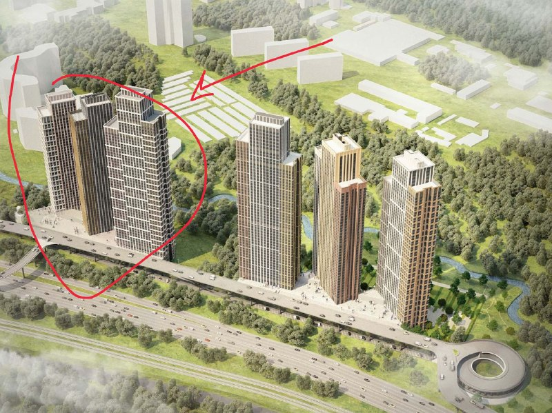

# Level Group отклонили на торгах СЗ «Волынская»: старт 4,9 млрд ₽

Заявку «Левел Груп» не допустили к аукциону по продаже 100% уставного капитала ООО «СЗ «Волынская». Начальная цена — 4,904 млрд ₽, а продавец — «Минские холмы», застройщик Will Towers на проспекте Генерала Дорохова.

## Коротко

- **Что продают:** не землю напрямую, а долю 100% в уставном капитале ООО «СЗ «Волынская». Лот № 1, электронный аукцион.
- **Цена:** начальная цена договора — 4 904 000 000 ₽.
- **Кого не допустили:** ООО «Левел Груп», заявка № 2737792, зарегистрирована 17 июля 2026 года в 10:59.
- **Кто продаёт:** ООО «Минские холмы» — по протоколу, это ей принадлежит продаваемая доля.

## Что известно о торгах

Протокол короткий, как и положено документу об отказе: форма процедуры, предмет, цена и таблица с отклонёнными заявками. В таблице одна строка — «Левел Груп». Причину отказа протокол в выписке не называет, поэтому гадать о ней мы не будем.

Предмет торгов сформулирован юридически точно: продаётся доля в компании-застройщике, а не участок. Что именно числится на её балансе, в выписке не сказано. Для покупателя компании это не мелочь: вместе с долей он получает всё, что внутри, включая обязательства.

## Кто такие «Минские холмы»

Это застройщик ЖК Will Towers на проспекте Генерала Дорохова, 49 в [Раменках](/novostroyki/moskva/). Три башни — Creativity, Energy и Inspiration — по данным каталога новостроек, в феврале 2025 года вышли на выдачу ключей. Отсюда и интерес к лоту: продавец знакомый, площадка по соседству, а полная история проекта — в [досье «Will Towers, вторая очередь»](/obekty/will-towers-vtoraya-ochered/).

Заметим: напрямую связь лота с второй очередью Will Towers по протоколу не следует. Это логичное предположение, но не документ.

## Что это значит для покупателя и инвестора

Квартир по этому лоту нет и пока не будет: это сделка по компании, а не старт продаж. Ориентироваться стоит на другое.

- **Цена входа.** 4,9 млрд ₽ — стартовая цифра. Итоговая зависит от торгов и состава активов и обязательств, которые покупатель принимает вместе с долей.
- **Круг участников.** Отказ в допуске одному из претендентов сужает конкуренцию, но не отменяет её.
- **Что отслеживать.** Итоги аукциона, нового владельца компании и заявленные параметры проекта: пока они не названы, считать вторую очередь «решённой» рано. Смотрите будущие проекты в подборке [«Будущие проекты»](/novostroyki/budushchie-proekty/) и общий фон в теме [«Рынок»](/temy/rynok/).

## Карточка объекта

- Объект: Will Towers, вторая очередь (досье); юридическое лицо — ООО «СЗ «Волынская».
- Продавец доли: ООО «Минские холмы».
- Формат торгов: электронный аукцион, лот № 1.
- Начальная цена: 4,904 млрд ₽.
- Район: Раменки, Москва (для Will Towers, проспект Генерала Дорохова, 49).
- Стадия: земельный актив / сделка по компании.

*Выписка из протокола аукциона: единственная заявка в списке отклонённых — ООО «Левел Груп», подана 17 июля 2026 года. Источник: протокол аукциона на площадке Росэлторг.*

## Вопросы и ответы

**Кого не допустили к аукциону на СЗ «Волынская»?**
В перечне отклонённых заявок значится ООО «Левел Груп»: заявка № 2737792 зарегистрирована 17 июля 2026 года.

**Что продают на аукционе?**
100% уставного капитала ООО «СЗ «Волынская», которые принадлежат ООО «Минские холмы». Начальная цена договора — 4,904 млрд ₽.

**Кто такие «Минские холмы»?**
Застройщик ЖК Will Towers на проспекте Генерала Дорохова, 49 в Раменках: в феврале 2025 года в трёх корпусах началась выдача ключей.

## Источники

1. [Протокол об отклонённых заявках на аукционе по продаже 100% ООО «СЗ «Волынская», электронная торговая площадка Росэлторг (178fz.roseltorg.ru)](http://178fz.roseltorg.ru)
2. [«Стартовала выдача ключей», Will Towers, ООО «Минские холмы», novostroy-m.ru, 10 февраля 2025 года](https://www.novostroy-m.ru/kompanii/ooo_minskie_holmy/news/startovala_vydacha_klyuchey)

Материал не является инвестиционной рекомендацией.
