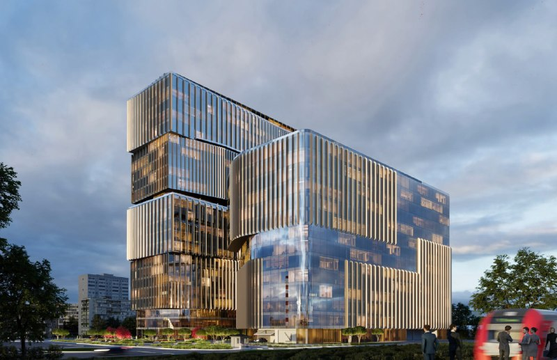

# ЭОН на Варшавском шоссе, 36: технопарк на 120,8 тыс. кв. м, продажи без цен

ПРАЙМ ЛАЙФ (PLD) оформил проектную декларацию на технопарк «ЭОН» на Варшавском шоссе, 36 и объявил продажи помещений: декларация датирована 18 сентября 2026 года. Дверь открыта, но витрина пустая: ни цен, ни схемы расчётов застройщик пока не показал.

## Коротко

- Проект — многофункциональный научно-производственный комплекс (технопарк, [МПТ](/slovar/mpt/)) на Варшавском шоссе, вл. 36, в Нагорном районе ЮАО.
- Общая площадь — 120 783 кв. м, сдача — III квартал 2029 года (Новострой-М на 14 октября 2026 года).
- [Проектная декларация](/slovar/proektnaya-deklaratsiya/) — от 18 сентября 2026 года, на странице проекта значится, что продажи открыты.
- Кредитную линию, банк для эскроу, число помещений и машино-мест застройщик публично не называл.

## Технопарк на Варшавском шоссе: два корпуса, и оба ниже, чем в АГР

Каталог Новострой-М называет проект бизнес-центром «ЭОН» класса A: два корпуса, подземный паркинг, ближайшее метро — «Нагатинская». Застройщик — ПРАЙМ ЛАЙФ, общая площадь — 120 783 кв. м.

Корпус 1 в каталоге — 21 этаж, корпус 2 — 8 этажей. На этапе согласования архитектуры проект был крупнее: в апреле 2025 года Москомархитектура выдала [АГР](/slovar/agr/) на комплекс площадью 123,6 тыс. кв. м с 25-этажной офисной частью и 9-этажной научно-производственной, на участке 2,39 га с паркингом на 690 машино-мест. Выходит, проект похудел примерно на 2,8 тыс. кв. м и на несколько этажей. Почему — застройщик не объяснял.

Стройка в каталоге — на стадии котлована и фундамента. Сдача обоих корпусов — III квартал 2029 года.

## Продажи открыты — а что продают?

Твёрдых фактов два: проектная декларация от 18 сентября 2026 года и отметка «продажи открыты» на странице проекта. Декларацию обычно публикуют, когда собираются привлекать деньги покупателей по [ДДУ](/slovar/ddu/). Но прямо о договорах долевого участия застройщик не говорил.

Всё остальное пока за кадром: схема расчётов через эскроу, банк-кредитор, размер кредитной линии, стоимость строительства. Цен на странице каталога нет, а на 14 октября 2026 года Новострой-М пишет, что предложений от застройщика в этом бизнес-центре не найдено. Продажи, в которых нечего купить, — жанр для рынка не новый.

## Что это значит для покупателя и инвестора

Если помещения пойдут физлицам по ДДУ, деньги, скорее всего, будут лежать на [эскроу-счёте](/slovar/eskrou-schet/). Но сам продукт для частного инвестора непривычный: помещение в технопарке на стадии котлована со сдачей в 2029 году. На наш взгляд, его ликвидность будут решать арендаторы — и то, появится ли в здании настоящая производственная и технологическая часть, а не только офисы под табличкой «технопарк».

Считать доходность до публикации цен и состава помещений — гадание. Что проверить самому: проектную декларацию на наш.дом.рф (площади, сроки, банк, раздел о финансировании), разрешение на строительство, договор и перечень помещений, доступных физлицам.

## Как проект дошёл до декларации

Главная веха до декларации — апрель 2025 года: Москомархитектура выдала АГР на комплекс площадью 123,6 тыс. кв. м (по данным Новострой-М). Вся история проекта — в [досье «ЭОН»](/obekty/eon/), другие проекты девелопера — на странице [ПРАЙМ ЛАЙФ (PLD)](/zastroyshchiki/pld/).

*Визуализация: PLD (ПРАЙМ ЛАЙФ). Ступенчатые остеклённые объёмы комплекса с вертикальными рёбрами фасада.*

## Карточка объекта

- **Название:** «ЭОН» (бизнес-центр, технопарк).
- **Адрес участка:** Москва, Варшавское шоссе, вл. 36 (Нагорный район, ЮАО).
- **Застройщик:** ПРАЙМ ЛАЙФ (PLD).
- **Класс:** A (по данным каталога).
- **Общая площадь:** 120 783 кв. м.
- **Этажность:** 21 и 8 этажей по данным каталога (в АГР 2025 года — 25 и 9).
- **Стадия:** котлован и фундамент.
- **Срок сдачи:** III квартал 2029 года.
- **Цена:** не опубликована.

## Вопросы и ответы

**Кто строит «ЭОН» на Варшавском шоссе, 36?**
По данным каталога Новострой-М, застройщик — ПРАЙМ ЛАЙФ (в досье проекта — PLD). Участок находится в Нагорном районе ЮАО, адрес — Варшавское шоссе, вл. 36.

**Какая площадь у технопарка «ЭОН»?**
По данным Новострой-М, общая площадь проекта — 120 783 кв. м; в апреле 2025 года Москомархитектура согласовала АГР на комплекс площадью 123,6 тыс. кв. м.

**Когда сдадут «ЭОН»?**
На странице проекта в каталоге Новострой-М срок сдачи обоих корпусов указан на III квартал 2029 года; на дату проверки значится стадия котлована и фундамента.

**Можно ли купить помещения в «ЭОН»?**
Формально да: на странице проекта указано, что продажи открыты, а проектная декларация датирована 18 сентября 2026 года. Но конкретных предложений и цен в каталоге на 14 октября 2026 года нет.

## Источники

1. [Бизнес-центр «ЭОН» — каталог Новострой-М](https://www.novostroy-m.ru/baza/biznestsentr_eon) — адрес, застройщик, площадь, этажность, срок сдачи, дата проектной декларации.
2. [«ЭОН» — предложения застройщиков, Новострой-М](https://www.novostroy-m.ru/kvartiry/novostroyka/biznestsentr_eon) — отсутствие предложений на 14 октября 2026 года.
3. [«Прайм Лайф получил АГР» — Новострой-М, 7 апреля 2025 года](https://www.novostroy-m.ru/kompanii/prime_life_development/news/praym_layf_poluchil_agr) — площадь, этажность и паркинг по АГР.
4. [Девелопер ПРАЙМ ЛАЙФ — Новострой-М](https://www.novostroy-m.ru/kompanii/prime_life_development) — компания и её проекты.

Материал не является инвестиционной рекомендацией.
