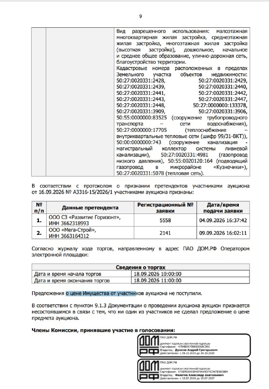

# Кузнечики под Подольском: торги ДОМ.РФ снова не состоялись — пришли, но молчали

ДОМ.РФ и со второй попытки не продал недостроенный комплекс «Кузнечики» под Подольском. Старт снизили на 44,6% — до 2,63 млрд ₽, на аукцион 18 сентября 2026 года допустили двух участников. Оба пришли — и ни один не назвал цену.

## Коротко

- Лот: 40,66 га земли и 213,8 тыс. кв. м недвижимости в посёлке Кузнечики, городской округ Подольск ([досье «Кузнечики»](/obekty/kuznechiki/)). Продавец — [ДОМ.РФ](/zastroyshchiki/dom-rf/).
- Старт повторных торгов — 2,63 млрд ₽, осенью 2025 года было 4,75 млрд ₽ (минус 44,6%).
- Допущены двое: ООО СЗ «Развитие Горизонт» и ООО «Мега-Строй».
- Предложений о цене — ноль, аукцион не состоялся.

## Аукцион, на котором никто не поднял руку

Повторный аукцион по имущественному комплексу в Кузнечиках назначили на 18 сентября 2026 года, заявки принимали до 14 сентября. По протоколу ДОМ.РФ, комиссия допустила двух претендентов: ООО СЗ «Развитие Горизонт» (заявка от 4 сентября) и ООО «Мега-Строй» (заявка от 9 сентября). Торги шли на электронной площадке с 10:00 до 11:00.

Час прошёл в тишине. Журнал торгов, на который ссылается протокол, фиксирует: «предложения о цене имущества от участников аукциона не поступили». По пункту 9.1.3 документации об аукционе это означает одно — торги несостоявшиеся.

*Страница протокола ДОМ.РФ об итогах аукциона 18 сентября 2026 года (1). Документ: ДОМ.РФ.*

Ситуация почти театральная: участники внесли заявки, прошли допуск — и не сделали ни одного шага. Цену никто не принял, но и вслух не отверг. Почему — в протоколе не сказано, а гадать мы не будем.

## Что продают в Кузнечиках: земля, недострой и большой потенциал

По данным ДОМ.РФ, в лот входят участки на 40,66 га и недвижимость общей площадью 213,8 тыс. кв. м. Разрешённое использование — малоэтажная, среднеэтажная и многоэтажная жилая застройка, дошкольное, начальное и среднее образование, улично-дорожная сеть и благоустройство. Расчётный градостроительный потенциал ДОМ.РФ оценивает в 569,2 тыс. кв. м, из них 358,6 тыс. кв. м жилья. По инициативе победителя возможен проект [комплексного развития территории (КРТ)](/slovar/krt/).

Состояние существующих зданий в сообщении о торгах названо удовлетворительным. Участок соседствует с микрорайоном Кузнечики-1 и частично выходит к Варшавскому шоссе, на границе есть остановка общественного транспорта. До станции МЦД-2 — около 15 минут на машине, до МКАД — около 40 минут.

## Пятнадцать лет на паузе

- **Конец 2000-х — 2010 год.** Стройку начали на месте бывшей военной части, под военное жильё. В 2010 году работы встали из-за спора с местными властями.
- **Осень 2025 года.** ДОМ.РФ выставил комплекс на торги со стартом 4,75 млрд ₽, заявки принимали до 10 ноября 2025 года.
- **Сентябрь 2026 года.** Повторный аукцион со стартом 2,63 млрд ₽ — снова мимо.

Вся история проекта — в [досье «Кузнечики»](/obekty/kuznechiki/).

## Что с проектом сейчас

На 14 октября 2026 года о новых торгах по лоту ДОМ.РФ не объявлял, о смене собственника тоже не сообщалось: комплекс по-прежнему у ДОМ.РФ. Новую цену и формат продажи пока не называли.

## Что это значит для покупателя и инвестора

Две заявки и ноль ставок — сигнал понятный: интерес к лоту есть, но 2,63 млрд ₽ за землю с большим недостроем участников не убедили. На наш взгляд, дело не только в цене входа. Вместе с гектарами покупатель получает чужие конструкции и инженерные сети, которые сначала надо обследовать и оформить, а потом решить судьбу всей территории — в том числе через КРТ. В стартовой цене эти расходы не видны, но в расчётах любого девелопера они стоят первой строкой.

Для тех, кто ищет квартиру, вывод простой: здесь пока нечего покупать, а сроки будущего проекта зависят от того, найдётся ли у Кузнечиков новый хозяин. Следите за новыми торгами ДОМ.РФ и общим фоном на [рынке новостроек](/temy/rynok/) и в [Московской области](/novostroyki/moskovskaya-oblast/).

## Карточка объекта

- **Название:** Кузнечики (Кузнечики-2).
- **Расположение:** посёлок Кузнечики, район улиц 43-й Армии и Кирова, городской округ Подольск, Московская область.
- **Продавец:** ДОМ.РФ.
- **Площадь лота:** земля — 40,66 га; недвижимость — 213,8 тыс. кв. м.
- **Градостроительный потенциал (по данным ДОМ.РФ):** 569,2 тыс. кв. м, в том числе 358,6 тыс. кв. м жилья.
- **Стадия:** земельный лот с недостроенными объектами, торги 18 сентября 2026 года не состоялись.
- **Стартовая цена:** 2,63 млрд ₽ (на торгах осенью 2025 года — 4,75 млрд ₽).

## Вопросы и ответы

**Кто продаёт Кузнечики под Подольском?**
Имущественный комплекс в посёлке Кузнечики выставляет на торги ДОМ.РФ. В лот входят 40,66 га земли и объекты недвижимости общей площадью 213,8 тыс. кв. м.

**Почему торги по Кузнечикам не состоялись?**
На торги 18 сентября 2026 года допустили двух участников, но, по протоколу ДОМ.РФ, ни один не сделал предложения о цене — и аукцион признали несостоявшимся.

**Какая была стартовая цена Кузнечиков?**
На повторных торгах 18 сентября 2026 года стартовая цена составляла 2,63 млрд ₽, на 44,6% ниже прошлой (4,75 млрд ₽).

**Что можно построить на участке в Кузнечиках?**
Вид разрешённого использования — малоэтажная, среднеэтажная и многоэтажная жилая застройка, школы и детские сады. ДОМ.РФ называет расчётный потенциал 569,2 тыс. кв. м, в том числе 358,6 тыс. кв. м жилья.

## Источники

1. [Повторный аукцион ДОМ.РФ по Кузнечикам — РБК Недвижимость, 19 августа 2026 года](https://realty.rbc.ru/news/6a842c469a794776ec233754) — лот, старт 2,63 млрд ₽, потенциал, дата торгов. Материал опубликован как рекламный (ПАО «ДОМ.РФ»).
2. [ДОМ.РФ снова выставил на торги Кузнечики — Новострой-М, 20 августа 2026 года](https://www.novostroy-m.ru/novosti/domrf_snova_vystavil_na) — срок заявок, прошлая цена, разрешённое использование, история.
3. [В Подмосковье на аукцион выставили земельный массив — РИАМО, 24 сентября 2025 года](https://riamo.ru/news/nedvizhimost/v-podmoskove-na-auktsion-vystavili-zemelnyj-massiv-pod-stroitelstvo-zhilja/) — предыдущий аукцион, срок заявок до 10 ноября.
4. [Миллиардер из Воронежа сдал назад. В подмосковных Кузнечиках не смогли продать «город-призрак» — msk1.ru, 18 сентября 2026 года](https://msk1.ru/text/gorod/2026/09/18/76650359/) — сообщение об итоге торгов (страница не открылась, использован заголовок).
5. Протокол ДОМ.РФ об итогах аукциона от 18 сентября 2026 года (протокол о признании претендентов участниками от 16 сентября 2026 года, № А3316-15/2026/1) — скан документа, участники и итог торгов.

Материал не является инвестиционной рекомендацией.
