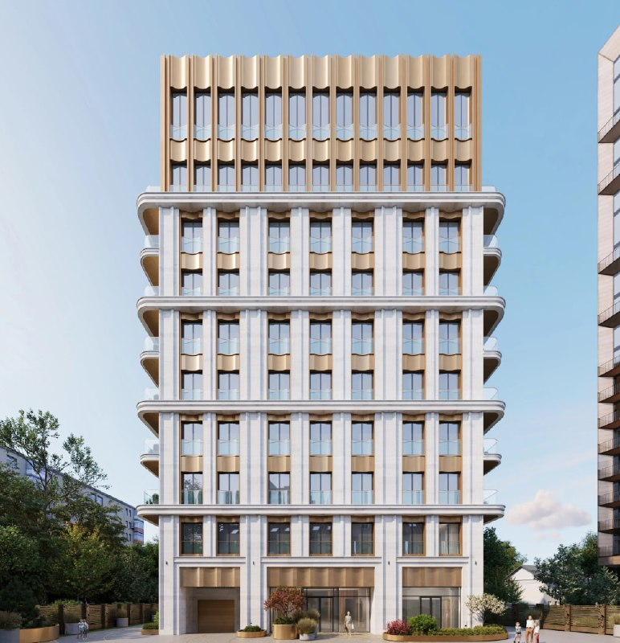
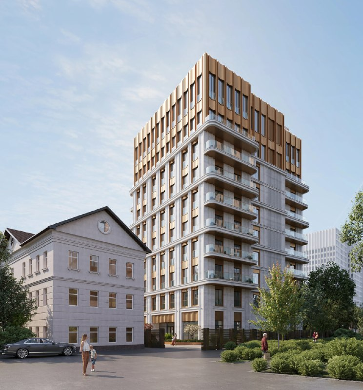
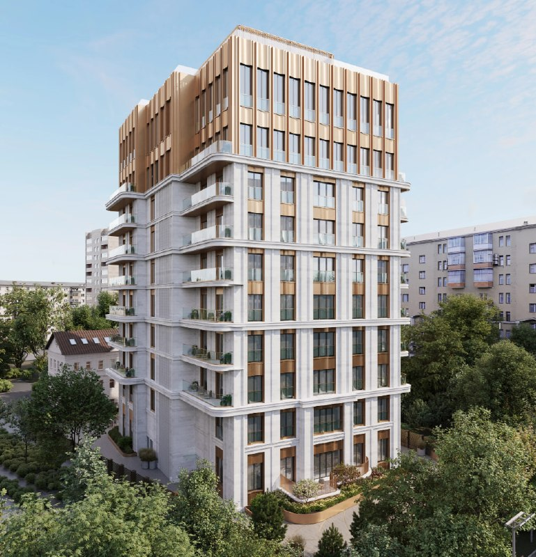

# «Лоран» на Ленинском, 11: клубный дом на 31 квартиру и Stone в доле

На Ленинском проспекте, 11, стр. 4 снесли двухэтажный кирпичный дом — его место займёт клубный «Лоран»: 31 квартира, почти 45 метров высоты, сдача в I квартале 2029 года. Самое любопытное здесь не фасад, а таблица собственников: в июне 2026 года 51% застройщика, СЗ «ЛП Холдинг», перешёл к Stone — девелоперу офисов.

## Коротко

- 31 квартира, почти 45 метров, 14 этажей; разрешение на строительство выдано.
- Застройщик — СЗ «ЛП Холдинг»: с 2 июня 2026 года 51% у Stone, 49% у «Лесной Капитал», которую источники связывают с MR Group.
- Сдача — I квартал 2029 года по данным Циан; ключи, по данным Москвич Mag, обещают до конца июня.
- Цен застройщик пока не показывал.

## Особняк снесли, дом подрос

По данным Циан, адрес — Ленинский проспект, 11с4, район Якиманка (ЦАО), до метро «Шаболовская» около 8 минут пешком. Проект там значится как ЖК «Лоран», застройщик — СЗ «ЛП Холдинг».

29 сентября 2026 года Москвич Mag сообщил: старый двухэтажный кирпичный дом на участке снесли, разрешение на новое строительство уже выдано. Новый дом будет 14-этажным, высотой почти 45 метров, на 31 квартиру. На ранних визуализациях он был десятиэтажным — по дороге к разрешению проект заметно вытянулся.

*Фасад клубного дома «Лоран». Визуализация: СЗ «ЛП Холдинг» (1)*

По данным «Коммерсанта», на участке согласован элитный дом площадью около 10,2 тыс. м², из них около 4,9 тыс. м² — продаваемая жилая площадь. Делим на 31 квартиру и получаем в среднем около 160 м² на лот (это наш расчёт). Студий здесь не будет: это квартиры, которые меряют сотнями метров.

*Дом «Лоран» в окружении двора. Визуализация: СЗ «ЛП Холдинг» (2)*

## Stone в капитале: 51% и вопрос о руле

2 июня 2026 года, по данным СПАРК, которые привёл «Коммерсантъ», АО «Стоунхедж» — головная компания девелопера [Stone](/zastroyshchiki/stone/) — получило 51% в ООО «СЗ ЛП Холдинг». Доля ООО «Лесная Капитал» сократилась со 100% до 49%. Stone и «Лесная Капитал» на запрос издания не ответили.

Вот где интересно. Stone развивает офисы, и источники газеты связывают «Лесную Капитал» с MR Group и допускают, что участие Stone может быть формальным: оно нужно для льготы при смене [вида разрешённого использования](/slovar/vri/) участка (ВРИ). Фактический контроль, по их словам, сохранит «Лесная Капитал». Это версия источников, а не установленный факт — но держать её в голове стоит.

*Вид на «Лоран» с высоты. Визуализация: СЗ «ЛП Холдинг» (3)*

## Стройка готовится, прайса нет

На 15 октября 2026 года проект на старте: снос завершается, разрешение выдано, сдача заявлена на I квартал 2029 года. Цены на квартиры застройщик публично не называл — цифры на странице Циан относятся ко всей выборке по проспекту, а не к этому дому. Об официальном старте продаж тоже не объявляли.

Полная история проекта — в [досье «Лоран»](/obekty/loran/).

## Что это значит для покупателя и инвестора

На наш взгляд, «Лоран» — продукт для очень узкого круга: 31 квартира в [премиальном](/temy/premium/) сегменте, адрес на Ленинском проспекте и компактный дом. Гадать о цене за метр сейчас бессмысленно: пока прайса нет, любая цифра — гипотеза.

Следить стоит за тремя вещами: проектной декларацией и ценами на старте продаж, составом владельцев «ЛП Холдинга» и темпом стройки. Сравнить с соседями по сегменту можно в подборках [премиум-класса](/novostroyki/premium-klass/) и [новостроек Москвы](/novostroyki/moskva/).

## Карточка объекта

- Название: «Лоран»
- Адрес: Москва, Ленинский проспект, 11, стр. 4 (ЗУ «Ленинский, 11/4/1»)
- Застройщик: СЗ «ЛП Холдинг» (51% — Stone, 49% — «Лесной Капитал»)
- Район: Якиманка, ЦАО
- Метро: «Шаболовская», около 8 минут пешком
- Квартиры: 31
- Высота: почти 45 м; этажей — 14 (по данным Москвич Mag)
- Площадь: около 10,2 тыс. м², из них продаваемой жилой около 4,9 тыс. м²
- Сдача: I квартал 2029 года

## Вопросы и ответы

**Кто застройщик ЖК «Лоран» на Ленинском проспекте?**
СЗ «ЛП Холдинг». С 2 июня 2026 года 51% компании принадлежит Stone, 49% осталось у «Лесной Капитал».

**Когда сдадут «Лоран»?**
По данным Циан, в I квартале 2029 года. Москвич Mag пишет, что квартиры обещают передать до конца июня.

**Сколько квартир и этажей в «Лоране»?**
31 квартира, высота почти 45 метров. По данным Москвич Mag, дом 14-этажный; на ранних визуализациях он был десятиэтажным.

**Сколько стоят квартиры в «Лоране»?**
Застройщик цены пока не публиковал: на 15 октября 2026 года прайса по этому дому нет.

## Источники

1. [Циан: ЖК «Лоран», Ленинский проспект, 11с4](https://www.cian.ru/novostroyki-moskva-leninskiy-prospekt-021351/)
2. [«Коммерсантъ»: Stone получила 51% в СЗ «ЛП Холдинг» (8 июня 2026)](https://www.kommersant.ru/doc/8726557)
3. [Москвич Mag: на Ленинском проспекте снесли кирпичный особняк для клубного дома (29 сентября 2026)](https://moskvichmag.ru/?p=526521)
4. [Finance Mail.ru: Stone получила долю в проекте в центре Москвы](https://finance.mail.ru/article/kamen-v-novyij-ogorod-69212166/)

Материал не является инвестиционной рекомендацией.
