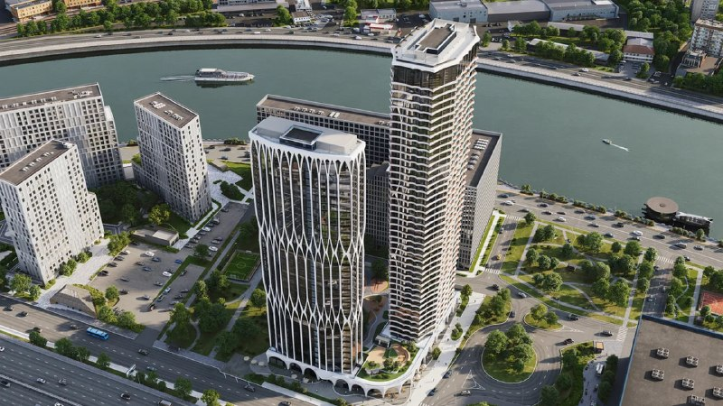
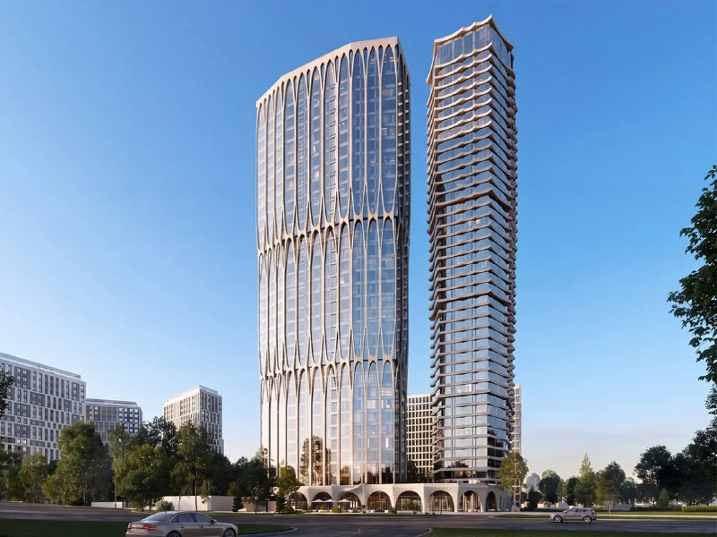
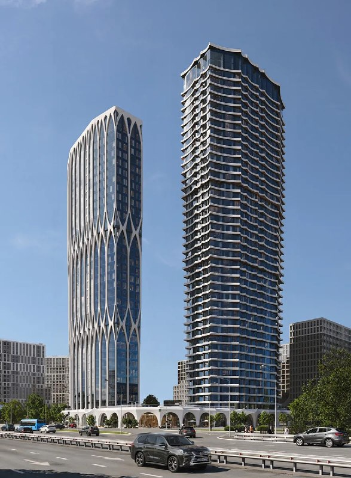
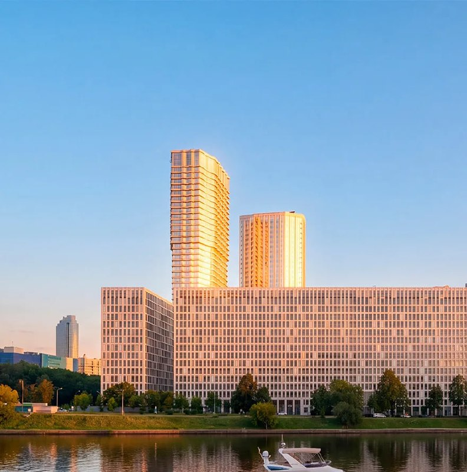

---
source:
  id: 35877
  date: 2026-09-23
status: ready
skip_reason: null
type: object
region: moscow
title: '«Даниловский от Гранель»: бывший А22 вернулся в продажу от 17,6 млн ₽'
title_alts:
- 'Бывший А22 на Автозаводской сменил вывеску на «Гранель»: цены и сроки'
- '«Даниловский от Гранель»: скидки до 32% и сдача, уехавшая в 2030 год'
slug: danilovskiy-ot-granel-ceny-sroki-sdachi
lead: 'Две башни на Автозаводской, 22, которые «Консоль» продавала как А22, вышли на рынок второй раз — уже под вывеской «Даниловский от Гранель». Квартиры — от 17,6 млн ₽, скидки до 32%, а сдача уехала на I квартал 2030 года. Новое имя у проекта есть. Покупателей пока почти нет.'
developers:
- id: granel
  name: ГК «Гранель»
  role: main
- id: konsol
  name: ГК «Консоль»
  role: previous
objects:
- id: danilovskiy-ot-granel
  names:
  - Даниловский от Гранель
  - А22
  - Автозаводская, 22
  zu: Автозаводская, 22
  main: true
  new: false
districts:
- danilovskiy
topics:
- ceny
- rynok
images:
- file: media/35877_1.jpg
  alt: Аэровид на две башни «Даниловского от Гранель» у Москвы-реки, визуализация
  caption: 'Визуализация: материалы застройщика, правообладатель уточняется'
- file: media/35877_2.jpg
  alt: Башни ЖК «Даниловский от Гранель» с белой ажурной оболочкой, Автозаводская, 22
  caption: 'Визуализация: материалы застройщика, правообладатель уточняется'
- file: media/35877_3.jpg
  alt: 'ЖК «Даниловский от Гранель» с уровня улицы: две башни на стилобате, визуализация'
  caption: 'Визуализация: материалы застройщика, правообладатель уточняется'
- file: media/35877_4.jpg
  alt: Вид на башни на Автозаводской, 22 со стороны реки, визуализация
  caption: 'Визуализация: материалы застройщика, правообладатель уточняется'
factcheck:
- claim: Проект на Автозаводской, 22 выведен на рынок под названием «Даниловский от Гранель» и продаётся на сайте ГК «Гранель»
  status: confirmed
  source: https://granelle.ru/objects/
  checked: &id001 2026-10-13
- claim: В ЕИСЖС объект значится как «ЖК Даниловский от Гранель», застройщик — ООО «СЗ Автозаводская 22» (ИНН 9717144860), проектная декларация № 77-003174, опубликована 17.03.2025, последняя версия — 08.10.2026
  status: confirmed
  source: https://наш.дом.рф/сервисы/каталог-новостроек/объект/64921
  checked: *id001
- claim: 'Застройщик в ЕИСЖС не привязан к группе компаний; в карточке застройщика: 1 дом строится, 1 — «строится с задержкой», сданных домов нет'
  status: confirmed
  source: https://наш.дом.рф/сервисы/каталог-новостроек/объект/64921
  checked: *id001
- claim: Генподрядчик — ООО «Гарант-СТ» (ИНН 7734449970)
  status: confirmed
  source: https://наш.дом.рф/сервисы/каталог-новостроек/объект/64921
  checked: *id001
- claim: Ранее проект представляла ГК «Консоль» (страница ЖК «Автозаводская», ул. Автозаводская, 22)
  status: confirmed
  source: https://konsole.ru/zhk-yug/
  checked: *id001
- claim: Под маркой А22 проект ведёт тот же застройщик ООО «СЗ Автозаводская 22»
  status: confirmed
  source: https://zhk-a22-i.cian.ru/
  checked: *id001
- claim: Проекты «Консоли» — Тула, Смоленская область, Тверь, Нижний Новгород
  status: confirmed
  source: https://konsole.ru/
  checked: *id001
- claim: 'Срок ввода: IV кв. 2028 (А22, февраль 2026) → I кв. 2030 (ЕИСЖС, октябрь 2026); ключи — до 30.09.2030'
  status: changed
  source: https://наш.дом.рф/сервисы/каталог-новостроек/объект/64921 ; https://rusdevelopers.ru/lenta_novostej/zhiloi-kompleks-a22-proekt-biznes-klassa-po-adresu-ulica-avtozavodskaya-22
  checked: *id001
- claim: Продано 7 квартир из 907 (1%)
  status: confirmed
  source: https://наш.дом.рф/сервисы/каталог-новостроек/объект/64921
  checked: *id001
- claim: '907 квартир: 641 однокомнатная (с учётом студий), 185 двухкомнатных, 81 трёхкомнатная; площади 28,7–101,5 м²; 306 нежилых помещений'
  status: confirmed
  source: https://наш.дом.рф/сервисы/каталог-новостроек/объект/64921
  checked: *id001
- claim: Площадь квартир 45 303,3 м², средняя площадь ≈ 50 м² (расчёт редакции)
  status: confirmed
  source: https://наш.дом.рф/сервисы/каталог-новостроек/объект/64921
  checked: *id001
- claim: Класс — бизнес; максимальная этажность — 45; обеспеченность машино-местами — 26%
  status: confirmed
  source: https://наш.дом.рф/сервисы/каталог-новостроек/объект/64921
  checked: *id001
- claim: Две башни 34 и 42 этажа, стилобат, паркинг на 236 машино-мест (описание проекта А22, февраль 2026)
  status: confirmed
  source: https://rusdevelopers.ru/lenta_novostej/zhiloi-kompleks-a22-proekt-biznes-klassa-po-adresu-ulica-avtozavodskaya-22
  checked: *id001
- claim: 'Метро: «Тульская» 14 мин, «Автозаводская» 20 мин, «ЗИЛ» 22 мин; Даниловский район'
  status: confirmed
  source: https://наш.дом.рф/сервисы/каталог-новостроек/объект/64921
  checked: *id001
- claim: Округ — ЮАО
  status: confirmed
  source: https://www.novostroy-m.ru/kvartiry/studiya-v-zhk-danilovskii-ot-granel-3b8cfa46d40ba0487fe110c59ab3b0
  checked: *id001
- claim: 'Расположение у ТТК (на сайте застройщика: «ТТК от 1 мин.»)'
  status: confirmed
  source: https://granelle.ru/objects/danilovskij-ot-granel/
  checked: *id001
- claim: На 13.10.2026 в продаже 61 квартира от 17,6 млн ₽; студия 28,7 м² — 17 561 128 ₽ (−32%) и 18 591 975 ₽ при базовой цене 25 662 162 ₽ (−27%)
  status: confirmed
  source: https://granelle.ru/objects/danilovskij-ot-granel/
  checked: *id001
- claim: Однокомнатная 35,2 м² — от 19 758 816 ₽; трёхкомнатная 76 м² — 38 797 240 ₽ при базовой 53 551 120 ₽
  status: confirmed
  source: https://granelle.ru/objects/danilovskij-ot-granel/
  checked: *id001
- claim: Двухкомнатная 56 м² — 29 187 816 ₽ (вторая цена 40 287 408 ₽)
  status: confirmed
  source: https://www.novostroy-m.ru/kvartiry/dvuhkomnatnaya-kvartira-v-zhk-danilovskii-ot-granel-f44690fd7d5ab5fdaa6b524445bbfa
  checked: *id001
- claim: Скидка на старте одинаковая для всех квартир ~27,5% → на 13.10.2026 на сайте скидки −27% и −32%
  status: changed
  source: https://granelle.ru/objects/danilovskij-ot-granel/
  checked: *id001
- claim: 'Средняя цена 1 м² в карточке ЕИСЖС — 570 556 ₽ (подпись: на декабрь 2025 года)'
  status: confirmed
  source: https://наш.дом.рф/сервисы/каталог-новостроек/объект/64921
  checked: *id001
- claim: 'Средние цены соседних проектов в ЕИСЖС: «Левел Павелецкая Сити» 561–587 тыс. ₽/м², «ЗИЛАРТ Марк» 540 тыс., «ЗИЛАРТ Спарк» 591 тыс., «ПЕЙВ» 508–530 тыс.'
  status: confirmed
  source: https://наш.дом.рф/сервисы/каталог-новостроек/список-объектов/список?searchValue=Даниловский
  checked: *id001
- claim: Средневзвешенная цена по стартовому прайсу — 555 тыс. ₽/м²
  status: unverified
  source: стартовый прайс от 23.09.2026 недоступен, архивных копий нет
  checked: *id001
- claim: На старте в выгрузке 37 квартир; однокомнатные от 20,68 млн за 38,5 м²; двухкомнатные от 27,78 млн за 53,3 м²; трёхкомнатная 84,4 м² за 43,53 млн ₽
  status: unverified
  source: стартовый прайс от 23.09.2026 недоступен
  checked: *id001
- claim: «Гранель» полностью забрала проект у «Консоли» (смена собственника)
  status: unverified
  source: https://saby.ru/profile/9717144860
  checked: *id001
- claim: Проект пострадал от пересмотра «коэффициента Д», сокращение ТЭП стало фатальным для экономики «Консоли»
  status: unverified
  source: только анонимные «знающие люди», документов нет
  checked: *id001
- claim: Бюро APEX взыскало с «Консоли» 13,8 млн ₽ долга, 1,4 млн ₽ неустойки и госпошлину
  status: unverified
  source: kad.arbitr.ru недоступен для автоматической проверки; в открытых источниках номер дела не найден
  checked: *id001
- claim: Проект разработан бюро APEX для ЛСР, ЛСР продала проект «Консоли» в 2024 году
  status: unverified
  source: подтверждающих первоисточников не найдено
  checked: *id001
- claim: Старт продаж «Консоли» по средней цене 490 тыс. ₽/м² (апрель 2025)
  status: unverified
  source: первоисточник не найден
  checked: *id001
- claim: 'Фасад: стеклянная башня с белой ажурной оболочкой, часть которой проходит перед окнами'
  status: unverified
  source: на странице проекта у «Гранель» фасад не описан; изображения в редакцию не переданы
  checked: *id001
- claim: Стройка стоит
  status: unverified
  source: в ЕИСЖС ежемесячно публикуются фото хода строительства; стадию по ним независимо не установить
  checked: *id001
removed:
- Средневзвешенная цена 555 тыс. ₽/м² по стартовому прайсу — стартовый прайс от 23.09.2026 недоступен, расчёт не воспроизводится.
- Состав стартовой выгрузки (37 квартир, однушка 38,5 м² за 20,68 млн, двушка 53,3 м² за 27,78 млн, трёшка 84,4 м² за 43,53 млн) — не подтверждается; вместо этого даны цены на 13.10.2026.
- Тезис, что «Гранель» полностью забрала проект, — смена собственника по открытым данным не подтверждена; в ЕИСЖС застройщик прежний.
- История с «коэффициентом Д» и «фатальным» сокращением ТЭП — слух («как нам подсказывают знающие люди»).
- Спор APEX с «Консолью» (13,8 млн ₽ долга, 1,4 млн ₽ неустойки) — карточку дела в kad.arbitr.ru найти и открыть не удалось.
- Связка ЛСР → «Консоль» и авторство APEX — первоисточников не найдено.
- Стартовая цена «Консоли» 490 тыс. ₽/м² (апрель 2025) — не подтверждена.
- Описание фасада («белая ажурная оболочка», «ферма перед стеклом») и оценка его себестоимости — не подтверждено, изображения не проверены.
- «Стройка стоит» — не подтверждено.
- Ссылки на сторонние Telegram-каналы («СиТ», «Или-Или») и жаргон («лох», «восточный базар», «джир») — убраны по редполитике.
- 'Изображение 35877_5: рендер с пометками редакции канала (красный круг)'
data_points:
- metric: avg_price_m2_eisgs
  object: danilovskiy-ot-granel
  value: 570556
  unit: RUB/m2
  date: 2025-12-31
  note: 'подпись ЕИСЖС: на декабрь 2025'
- metric: min_lot_price
  object: danilovskiy-ot-granel
  value: 17561128
  unit: RUB
  date: *id001
- metric: flats_for_sale_site
  object: danilovskiy-ot-granel
  value: 61
  date: *id001
- metric: sold_share
  object: danilovskiy-ot-granel
  value: 7
  of: 907
  date: *id001
- metric: completion_date
  object: danilovskiy-ot-granel
  value: 2030-Q1
  date: *id001
seo:
  main_query: даниловский от гранель цены
  keywords:
  - жк даниловский от гранель
  - даниловский от гранель сроки сдачи
  - жк а22 автозаводская 22
  - гранель автозаводская 22
  - новостройки даниловский район метро тульская
  frequency_checked: false
  title: 'Даниловский от Гранель: цены, скидки и сроки сдачи А22'
  description: 'ЖК «Даниловский от Гранель» на Автозаводской, 22: бывший А22 продают от 17,6 млн ₽ со скидками до 32%, сдача — I квартал 2030 года. Цены, сроки и риски.'
  canonical: https://шахматка.москва/novosti/danilovskiy-ot-granel-ceny-sroki-sdachi/
internal_links:
- anchor: карточка проекта «Даниловский от Гранель»
  url: /obekty/danilovskiy-ot-granel/
- anchor: досье ГК «Гранель»
  url: /zastroyshchiki/granel/
- anchor: досье ГК «Консоль»
  url: /zastroyshchiki/konsol/
- anchor: новостройки Даниловского района
  url: /moskva/danilovskiy/
- anchor: что такое проектная декларация
  url: /slovar/proektnaya-deklaratsiya/
- anchor: новые нормативы машино-мест в Москве
  url: /novosti/normativy-mashino-mest-moskva-2118-pp/
faq:
- q: Сколько стоят квартиры в ЖК «Даниловский от Гранель»?
  a: На 13 октября 2026 года на сайте «Гранель» в продаже 61 квартира, самая дешёвая — студия 28,7 м² за 17,6 млн ₽. Трёхкомнатная 76 м² стоит 38,8 млн ₽; на квартиры действуют скидки 27–32% от базовой цены.
- q: Когда сдадут ЖК «Даниловский от Гранель»?
  a: По проектной декларации в ЕИСЖС стройка завершится в I квартале 2030 года, ключи выдадут до 30 сентября 2030 года. В начале 2026 года проект, тогда ещё А22, обещали сдать в IV квартале 2028 года.
- q: Кто застройщик ЖК «Даниловский от Гранель»?
  a: По проектной декларации — ООО «Специализированный застройщик „Автозаводская 22“», генподрядчик — ООО «Гарант-СТ». Продаёт проект ГК «Гранель», а раньше его под названием А22 представляла ГК «Консоль».
- q: Где находится ЖК «Даниловский от Гранель» и какое метро рядом?
  a: На Автозаводской улице, вл. 22, в Даниловском районе (ЮАО). По данным ЕИСЖС, до «Тульской» 14 минут, до «Автозаводской» — 20 минут, до станции «ЗИЛ» — 22 минуты.
- q: Сколько квартир уже продано в «Даниловском от Гранель»?
  a: По данным ЕИСЖС на 13 октября 2026 года — 7 квартир из 907, около 1%.
date_published: 2026-09-23   # дата исходной заметки
date_modified: 2026-10-13   # дата проверки фактов и обновления
author: Редакция Шахматки
schema: |-
  [
    {
      "@context": "https://schema.org",
      "@type": "NewsArticle",
      "headline": "«Даниловский от Гранель»: бывший А22 вернулся в продажу с ценой от 17,6 млн ₽",
      "description": "ЖК «Даниловский от Гранель» на Автозаводской, 22: квартиры от 17,6 млн ₽, сдача в I квартале 2030 года, продано 7 из 907. Цены, скидки и риски проекта.",
      "datePublished": "2026-09-23",
      "dateModified": "2026-10-13",
      "inLanguage": "ru",
      "author": {
        "@type": "Organization",
        "name": "Редакция Шахматки"
      },
      "publisher": {
        "@type": "Organization",
        "name": "Шахматка",
        "url": "https://шахматка.москва/"
      },
      "mainEntityOfPage": {
        "@type": "WebPage",
        "@id": "https://шахматка.москва/novosti/danilovskiy-ot-granel-ceny-sroki-sdachi/"
      },
      "image": [
        "https://шахматка.москва/media/35877_1.jpg",
        "https://шахматка.москва/media/35877_2.jpg",
        "https://шахматка.москва/media/35877_3.jpg",
        "https://шахматка.москва/media/35877_4.jpg"
      ],
      "about": [
        {
          "@type": "Residence",
          "name": "ЖК «Даниловский от Гранель»",
          "alternateName": [
            "А22",
            "Автозаводская, 22"
          ],
          "address": {
            "@type": "PostalAddress",
            "addressLocality": "Москва",
            "addressRegion": "Москва",
            "streetAddress": "Автозаводская ул., вл. 22"
          }
        },
        {
          "@type": "Organization",
          "name": "ГК «Гранель»"
        },
        {
          "@type": "Organization",
          "name": "ГК «Консоль»"
        }
      ]
    },
    {
      "@context": "https://schema.org",
      "@type": "FAQPage",
      "mainEntity": [
        {
          "@type": "Question",
          "name": "Сколько стоят квартиры в ЖК «Даниловский от Гранель»?",
          "acceptedAnswer": {
            "@type": "Answer",
            "text": "По состоянию на 13 октября 2026 года на сайте «Гранель» в продаже 61 квартира, минимальная цена — 17,6 млн ₽ за студию 28,7 м². Трёхкомнатная 76 м² предлагается за 38,8 млн ₽, на квартиры действуют скидки 27–32% от базовой цены."
          }
        },
        {
          "@type": "Question",
          "name": "Когда сдадут ЖК «Даниловский от Гранель»?",
          "acceptedAnswer": {
            "@type": "Answer",
            "text": "По проектной декларации в ЕИСЖС завершение строительства — I квартал 2030 года, выдача ключей — до 30 сентября 2030 года. В начале 2026 года проект, тогда ещё А22, заявлялся со сроком сдачи в IV квартале 2028 года."
          }
        },
        {
          "@type": "Question",
          "name": "Кто застройщик ЖК «Даниловский от Гранель»?",
          "acceptedAnswer": {
            "@type": "Answer",
            "text": "Застройщик по проектной декларации — ООО «Специализированный застройщик „Автозаводская 22“», генподрядчик — ООО «Гарант-СТ». Проект продаётся на сайте ГК «Гранель», а ранее его представляла ГК «Консоль» под названием А22."
          }
        },
        {
          "@type": "Question",
          "name": "Где находится ЖК «Даниловский от Гранель» и какое метро рядом?",
          "acceptedAnswer": {
            "@type": "Answer",
            "text": "Дом строится на Автозаводской улице, вл. 22, в Даниловском районе (ЮАО). По данным ЕИСЖС, до станции «Тульская» 14 минут, до «Автозаводской» — 20 минут, до станции «ЗИЛ» — 22 минуты."
          }
        },
        {
          "@type": "Question",
          "name": "Сколько квартир уже продано в «Даниловском от Гранель»?",
          "acceptedAnswer": {
            "@type": "Answer",
            "text": "По данным ЕИСЖС на 13 октября 2026 года, продано 7 квартир из 907, то есть около 1%."
          }
        }
      ]
    }
  ]
editor_notes: |-
  1) Изображения media/35877_1..5.jpg в пакет не переданы — содержимое, авторство и alt не проверены; если это скриншоты прайсов или Telegram-постов, убрать; для рендеров уточнить автора. 2) Проверить вручную в kad.arbitr.ru спор APEX (ООО «Проектное бюро АПЕКС», ИНН 7725825428) с ООО «СЗ Автозаводская 22» (ИНН 9717144860): по saby.ru у застройщика 13 дел в роли ответчика и 5 исполнительных документов — при подтверждении добавить блок о судах с номером дела и стадией (статус станет needs_review). 3) Проверить в ЕГРЮЛ текущих участников ООО «СЗ Автозаводская 22» (по saby.ru: ООО «Перспективные Инвестиции» с 06.09.2024 и смоленская компания ИНН 6700010710 с 17.06.2024) — связана ли смена бренда со сменой собственника. 4) Средняя цена 570 556 ₽/м² в ЕИСЖС подписана «на декабрь 2025» — при обновлении в ЕИСЖС заменить. 5) Отметка «строится с задержкой» в карточке застройщика ЕИСЖС — уточнить, к какой версии срока она относится. 6) Внутренние ссылки на /novosti/ не ставились: в out/ на момент работы не было статей пилота.
  Фото проверены главным редактором 13.10.2026: alt и подписи переписаны по содержанию; непригодные изображения сняты (см. removed). Права на визуализации застройщиков подтвердить запросом в пресс-службу.
---

# «Даниловский от Гранель»: бывший А22 вернулся в продажу от 17,6 млн ₽

Две башни на Автозаводской, 22, которые «Консоль» продавала как А22, вышли на рынок второй раз — уже под вывеской «Даниловский от Гранель». Квартиры — от 17,6 млн ₽, скидки до 32%, а сдача уехала на I квартал 2030 года. Новое имя у проекта есть. Покупателей пока почти нет.

**Коротко**

- На 13 октября 2026 года на сайте «Гранель» в продаже 61 квартира, самая дешёвая — студия 28,7 м² за 17,6 млн ₽.
- Скидка есть на каждом показанном лоте — 27% или 32%: трёхкомнатная 76 м² стоит 38,8 млн ₽ вместо 53,6 млн ₽.
- Сдача по декларации — I квартал 2030 года, ключи — до 30 сентября 2030 года. В начале 2026 года обещали IV квартал 2028-го.
- Продано 7 квартир из 907 — около 1% (ЕИСЖС).

## Сменилась вывеска, а не застройщик

Жилой комплекс на Автозаводской улице, вл. 22, рынок знал как А22. Его представляла [ГК «Консоль»](/zastroyshchiki/konsol/) — региональный девелопер, который строит в Туле, Смоленской области, Твери и Нижнем Новгороде. Теперь новостройку продаёт [ГК «Гранель»](/zastroyshchiki/granel/) под названием «Даниловский от Гранель», и в Единой информационной системе жилищного строительства (ЕИСЖС, наш.дом.рф) объект уже переименован.

А вот юрлицо осталось прежним. В [проектной декларации](/slovar/proektnaya-deklaratsiya/) № 77-003174 застройщиком по-прежнему записано ООО «Специализированный застройщик „Автозаводская 22“», генподрядчиком — ООО «Гарант-СТ». К какой-либо группе компаний ЕИСЖС этого застройщика не привязывает. Кем «Гранель» приходится проекту — новым владельцем или управляющим девелопером, — публично не объясняли.

*Визуализация: материалы застройщика, правообладатель уточняется*

## Цены: скидка — это и есть цена

Ниже — прайс с сайта «Гранель» на 13 октября 2026 года. У каждого лота две цифры: базовая цена и цена со скидкой.

| Лот | Площадь | Цена со скидкой | Базовая цена | Скидка | За 1 м² |
|---|---|---|---|---|---|
| Студия | 28,7 м² | 17,56 млн ₽ | 26,08 млн ₽ | 32% | 612 тыс. ₽ |
| Студия | 28,7 м² | 18,59 млн ₽ | 25,66 млн ₽ | 27% | 648 тыс. ₽ |
| 1-комнатная | 35,2 м² | 19,76 млн ₽ | 29,34 млн ₽ | 32% | 561 тыс. ₽ |
| 2-комнатная* | 56 м² | 29,19 млн ₽ | 40,29 млн ₽ | 27,5% | 521 тыс. ₽ |
| 3-комнатная | 76 м² | 38,80 млн ₽ | 53,55 млн ₽ | 27% | 510 тыс. ₽ |

*Двухкомнатная — по данным агрегатора «Новострой-М»: на странице проекта застройщик показывает 12 из 61 лота, и двушек среди них нет. Цена за 1 м² — наш расчёт.

Присмотритесь к конструкции прайса. Базовая цена здесь, на наш взгляд, нужна в основном для того, чтобы от неё было что отнимать: заплатить «полную» в этой схеме почти невозможно. Поэтому сравнивайте проект с соседями по цене со скидкой — и сверяйте её на дату сделки.

*Визуализация: материалы застройщика, правообладатель уточняется*

## Сдача уехала в 2030 год

По декларации в ЕИСЖС стройка должна закончиться в I квартале 2030 года, ключи — до 30 сентября 2030 года. Ещё в феврале 2026 года А22 описывали со сдачей в IV квартале 2028 года. Новое имя проект получил вместе с новым сроком: перенос — больше года.

В карточке застройщика в ЕИСЖС дом помечен как «строится с задержкой». Деньги покупателей по договорам долевого участия (ДДУ) идут на счета эскроу. Фотоотчёты со стройки застройщик выкладывает ежемесячно, последний — 2 октября 2026 года.

## Что строят: технико-экономические показатели (ТЭП) и квартирография

- 907 квартир: 641 однокомнатная (студии ЕИСЖС считает однокомнатными), 185 двухкомнатных, 81 трёхкомнатная.
- Площади — от 28,7 до 101,5 м², в сумме 45,3 тыс. м². Средняя квартира — около 50 м² (наш расчёт).
- 306 нежилых помещений; машино-местами дом обеспечен на 26% (как город ужесточил требования к паркингу для новых проектов — в разборе [новых нормативов машино-мест в Москве](/novosti/normativy-mashino-mest-moskva-2118-pp/)).
- Две башни на общем стилобате — 34 и 42 этажа по описанию проекта; максимальная этажность в декларации — 45.

Средние 50 м² в бизнес-классе у ТТК — это нарезка под инвестора и ипотечного покупателя, а не под семью. Трёхкомнатных здесь меньше 9%.

*Визуализация: материалы застройщика, правообладатель уточняется*

## Соседи по Даниловскому: большие квартиры выигрывают, студии — нет

По карточкам ЕИСЖС соседний бизнес-класс в [Даниловском районе](/moskva/danilovskiy/) стоит в среднем от 508 до 591 тыс. ₽/м²: «ПЕЙВ» (Forma) — 508–530 тыс., «ЗИЛАРТ Марк» (ЛСР) — 540 тыс., «Левел Павелецкая Сити» — 561–587 тыс., «ЗИЛАРТ Спарк» — 591 тыс. ₽/м². Самому «Даниловскому» ЕИСЖС рисует 570,6 тыс. ₽/м², но с подписью «на декабрь 2025 года» — то есть ещё по ценам эпохи А22.

Живые цены «Гранель» за метр — от 510 тыс. ₽ в трёхкомнатных до 648 тыс. ₽ в студиях. Крупные форматы на фоне соседей выглядят конкурентно. Студии — нет: за компактность здесь, как и везде, доплачивают в цене метра.

*Визуализация: материалы застройщика, правообладатель уточняется*

## Что это значит для покупателя и инвестора

**Спроса пока не видно.** Декларацию опубликовали 17 марта 2025 года, и за полтора года продано 7 квартир из 907. Новое имя и щедрые скидки — попытка перезапуска. Сработала ли она, покажут продажи ближайших месяцев, а не баннеры.

**Срок уже ездил.** С конца 2028-го на начало 2030 года, плюс отметка «строится с задержкой». Если берёте под перепродажу или аренду, закладывайте запас по времени — и не один квартал.

**Кто за юрлицом — вопрос открытый.** Застройщик — отдельная компания без привязки к группе в ЕИСЖС, а на вывеске — «Гранель». Перед сделкой выясните, кто стоит за юрлицом, и загляните в картотеку арбитражных дел.

**Что отслеживать дальше:** продажи и цены в ЕИСЖС, новые версии декларации (сроки, ТЭП) и фотоотчёты со стройки.

## Карточка объекта

Полная история проекта — в досье «Шахматки»: [карточка проекта «Даниловский от Гранель»](/obekty/danilovskiy-ot-granel/).

- **Адрес ЗУ:** Москва, Автозаводская ул., вл. 22
- **Названия:** «Даниловский от Гранель», ранее А22
- **Застройщик:** ООО «СЗ „Автозаводская 22“» (ИНН 9717144860); продажи — ГК «Гранель»; ранее проект представляла ГК «Консоль»
- **Генподрядчик:** ООО «Гарант-СТ»
- **Регион, район:** Москва, ЮАО, Даниловский район
- **Метро:** «Тульская» — 14 мин, «Автозаводская» — 20 мин, «ЗИЛ» — 22 мин
- **Класс:** бизнес
- **Этажность:** до 45 этажей
- **Квартиры:** 907, площадью 28,7–101,5 м²
- **Стадия:** строится; проектная декларация № 77-003174; эскроу
- **Ввод:** I квартал 2030 года, ключи — до 30.09.2030
- **Цена (13.10.2026):** от 17,6 млн ₽; 510–648 тыс. ₽/м² по показанным лотам
- **Продано:** 7 из 907 квартир

## Вопросы и ответы

**Сколько стоят квартиры в ЖК «Даниловский от Гранель»?**

На 13 октября 2026 года на сайте «Гранель» в продаже 61 квартира, самая дешёвая — студия 28,7 м² за 17,6 млн ₽. Трёхкомнатная 76 м² стоит 38,8 млн ₽; на квартиры действуют скидки 27–32% от базовой цены.

**Когда сдадут ЖК «Даниловский от Гранель»?**

По проектной декларации в ЕИСЖС стройка завершится в I квартале 2030 года, ключи выдадут до 30 сентября 2030 года. В начале 2026 года проект, тогда ещё А22, обещали сдать в IV квартале 2028 года.

**Кто застройщик ЖК «Даниловский от Гранель»?**

По проектной декларации — ООО «Специализированный застройщик „Автозаводская 22“», генподрядчик — ООО «Гарант-СТ». Продаёт проект ГК «Гранель», а раньше его под названием А22 представляла ГК «Консоль».

**Где находится ЖК «Даниловский от Гранель» и какое метро рядом?**

На Автозаводской улице, вл. 22, в Даниловском районе (ЮАО). По данным ЕИСЖС, до «Тульской» 14 минут, до «Автозаводской» — 20 минут, до станции «ЗИЛ» — 22 минуты.

**Сколько квартир уже продано в «Даниловском от Гранель»?**

По данным ЕИСЖС на 13 октября 2026 года — 7 квартир из 907, около 1%.

## Источники

1. ЕИСЖС (наш.дом.рф), карточка объекта «ЖК Даниловский от Гранель»: https://наш.дом.рф/сервисы/каталог-новостроек/объект/64921
2. ЕИСЖС (наш.дом.рф), каталог новостроек Даниловского района: https://наш.дом.рф/сервисы/каталог-новостроек/список-объектов/список?searchValue=Даниловский
3. ГК «Гранель», страница проекта «Даниловский от Гранель»: https://granelle.ru/objects/danilovskij-ot-granel/
4. ГК «Гранель», каталог проектов: https://granelle.ru/objects/
5. ГК «Консоль», страница ЖК «Автозаводская»: https://konsole.ru/zhk-yug/
6. ГК «Консоль», главная страница (география проектов): https://konsole.ru/
7. Rusdevelopers, «Жилой комплекс „А22“ — проект бизнес-класса по адресу: улица Автозаводская, 22» (11.02.2026): https://rusdevelopers.ru/lenta_novostej/zhiloi-kompleks-a22-proekt-biznes-klassa-po-adresu-ulica-avtozavodskaya-22
8. Циан, страница ЖК: https://zhk-a22-i.cian.ru/
9. Новострой-М, двухкомнатная квартира 56 м²: https://www.novostroy-m.ru/kvartiry/dvuhkomnatnaya-kvartira-v-zhk-danilovskii-ot-granel-f44690fd7d5ab5fdaa6b524445bbfa
10. Новострой-М, студия (район, округ): https://www.novostroy-m.ru/kvartiry/studiya-v-zhk-danilovskii-ot-granel-3b8cfa46d40ba0487fe110c59ab3b0

Дата публикации и проверки фактов: 13 октября 2026 года. Автор: Редакция Шахматки.

Материал не является инвестиционной рекомендацией.
