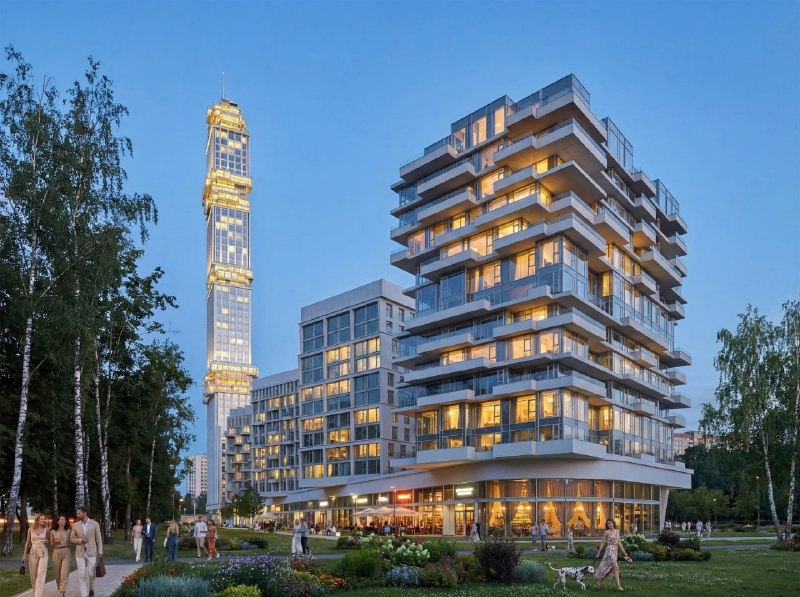
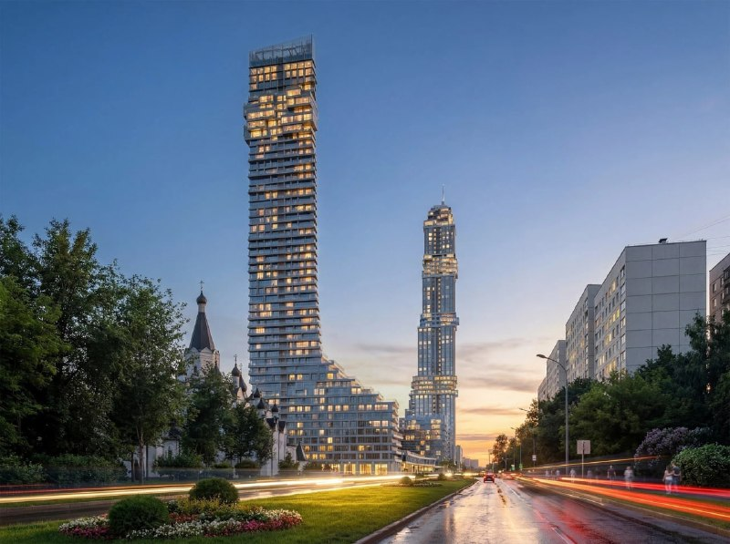

# ЖК «Верн» на Вернадского, 10: башни 190 и 230 м и шпиль в придачу

У метро «Университет» на месте недостроя «Рособоронэкспорта» обещают «Верн»: более 188 тыс. м², две башни в 190 и 230 м и шпиль в 21 м. Картинки показали в сентябре 2026 года, бронирование «Неометрия» открыла 9 октября. А разрешения на первую очередь ещё оформляют.

## Коротко

- Более 188 тыс. м², две высотные доминанты — 190 и 230 м, у одной шпиль 21 м (визуализации от 21 сентября 2026 года).
- Место — у метро «Университет» в Раменках, на месте недостроенного здания «Рособоронэкспорта».
- Первая очередь — малоэтажные корпуса на 560 квартир; разрешения для неё, по данным издания, ещё оформляются.
- С 9 октября 2026 года идёт бронирование, на рынок проект выводит «Неометрия». Цены пока не объявлены.

## Метров стало почти вдвое больше

Новые визуализации «Верна» вышли в сентябре 2026 года. Проект — больше 188 тыс. м². Для сравнения: в мае 2025 года жилой комплекс Capital Alliance на проспекте Вернадского описывали в 110 тыс. м². Аппетиты выросли почти вдвое.

Две башни — 190 и 230 м. У высокой шпиль в 21 м, а уступы явно кивают в сторону сталинских высоток. В стилобате (общей нижней части комплекса) — коммерция, вокруг — малоэтажные корпуса. С них и начнут: первая очередь — это они, 560 квартир.

*Визуализация «Верна»: башня со шпилем и террасный корпус стилобата (2026). Визуализация: застройщик проекта*

*Визуализация «Верна»: две башни вдоль проспекта (2026). Визуализация: застройщик проекта*

Автора архитектуры не называют. На наш взгляд, пока это заявка на силуэт, а не готовые [технико-экономические показатели](/slovar/tep/) (ТЭП): метры и высоты ещё должны дойти до документов и разрешения на строительство. Рендер стерпит всё — экспертиза меньше.

## Четыре года, две концепции и несколько хозяев

В 2022 году участок выкупил московский застройщик — почти за 3 млрд ₽. В июле 2025 года здесь показывали другую концепцию, от бюро Archivista: до 150 м, несколько небоскрёбов на общем стилобате. С тех пор проект подрос до 190 и 230 м.

В сентябре 2024 года [Capital Group](/zastroyshchiki/capital-group/) и Alias Group объявили о едином бренде Capital Alliance, и проспект Вернадского вошёл в его портфель из трёх объектов. В октябре 2026 года проект на рынок выводит уже «Неометрия». Как и когда проект перешёл к ней, участники публично не рассказывали. Вся цепочка — в [досье «Верн»](/obekty/vern/).

## Бронь есть, цен нет

На 13 октября 2026 года идёт бронирование, открытое 9 октября. Первыми в продажу пойдёт низкоэтажная часть: от студий до четырёхкомнатных. На верхних этажах башен обещают пентхаусы, под комплексом — два подземных уровня парковки. Цены и срок сдачи пока не объявлены. Другие проекты на этапе [старта продаж](/novostroyki/start-prodazh/) — в подборке сайта.

## Что это значит для покупателя

У участка длинная биография: концепции менялись, девелоперские структуры — тоже, параметры росли. Бронь — это ещё не договор долевого участия ([ДДУ](/slovar/ddu/)), а разрешения на первую очередь, по данным издания, пока в работе. Иными словами, вы бронируете очередь к проекту, а не квартиру в нём.

Что отслеживать: проектную декларацию на «Наш.дом.рф», разрешение на строительство первой очереди, итоговые ТЭП, цены и сроки сдачи. Пока их нет, цена за метр и дата ключей — догадки. Район: [Раменки](/novostroyki/ramenki/).

## Карточка объекта

- Адрес ЗУ: проспект Вернадского, 10 (Раменки, Москва)
- Названия: «Верн»
- Девелопер: «Неометрия» (по состоянию на 9 октября 2026); ранее — Capital Group
- Площадь проекта: более 188 тыс. м²
- Высота башен: 190 и 230 м, шпиль 21 м
- Первая очередь: малоэтажные корпуса, 560 квартир
- Стадия: бронирование квартир с 9 октября 2026 года

## Вопросы и ответы

**Что построят на проспекте Вернадского, 10?**
Жилой комплекс «Верн» — более 188 тыс. м²: две башни в 190 и 230 м, малоэтажные корпуса и коммерция в стилобате.

**Кто застройщик ЖК «Верн»?**
По данным на 9 октября 2026 года, проект выводит на рынок «Неометрия». Раньше участком занимались Capital Group и Capital Alliance — совместная структура с Alias Group.

**Когда началось бронирование квартир в «Верне»?**
9 октября 2026 года. Цены застройщик пока не объявлял.

**Где находится «Верн»?**
На проспекте Вернадского в Раменках, у метро «Университет», на месте недостроенного здания «Рособоронэкспорта».

## Источники

1. [Разноуровневый золотистый ЖК на 200 тыс. кв. м построят на проспекте Вернадского — Moskvich mag, 21 сентября 2026](https://moskvichmag.ru/?p=525156)
2. [На месте недостроенной башни «Рособоронэкспорта» построят высотный ЖК — Moskvich mag, 22 июля 2025](https://moskvichmag.ru/gorod/na-meste-nedostroennoj-bashni-rosoboroneksporta-na-prospekte-vernadskogo-postroyat-vysotnyj-zhk/)
3. [Новое на рынке: «Верн» и «Фрунзенский» — novostroy-m.ru, 9 октября](https://www.novostroy-m.ru/novosti/novoe_na_rynke_proekt)
4. [Alias Group и Capital Group создали совместную компанию — Rambler Finance, 27 сентября 2024](https://finance.rambler.ru/business/53486077-holdingi-alias-group-i-capital-group-sozdali-sovmestnuyu-kompaniyu/amp/)
5. [ВТБ предоставит более 60 млрд ₽ девелоперу Capital Alliance — Rambler, 15 мая 2025](https://news.rambler.ru/moscow_city/54665687-vtb-predostavit-bolee-60-mlrd-rubley-developeru-capital-alliance/)

Материал не является инвестиционной рекомендацией.
