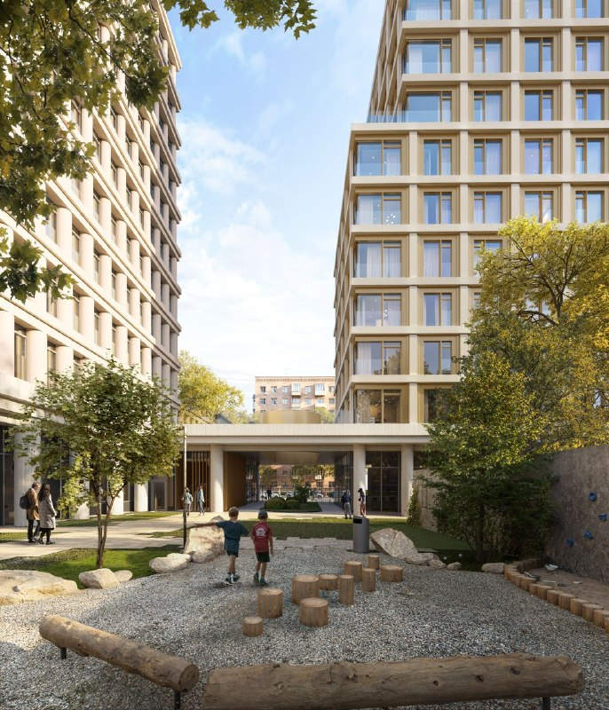

# Сельскохозяйственная, 5: «Эталон» передал проект ЖК группе «Голос»

Челябинская группа «Голос» дебютирует в Москве без земельных мук. Она купила у «Эталона» не просто участок на месте бывшей АТС на Сельскохозяйственной улице, а почти готовый камерный проект на 144 квартиры от бюро Syntaxis.

## Коротко

- **Сделка:** «Голос» через специализированного застройщика «Голос.15» купил у «Эталона» проект жилого комплекса на Сельскохозяйственной улице у проспекта Мира.
- **Проект:** два корпуса на общем стилобате, 144 квартиры, архитектура — Syntaxis.
- **Статус:** документация готова, не хватает разрешения на строительство.
- **Деньги:** сумму сделки стороны не раскрывали.

## Кто купил проект на Сельскохозяйственной улице

Площадка на месте бывшей АТС (участок «Сельскохозяйственная, 5, стр. 1, 2») досталась группе «Голос» из Челябинска. Покупает её специализированный застройщик «Голос.15». По данным «Новострой-М», участок находится у пересечения Сельскохозяйственной улицы и проспекта Мира, в Ростокине. Для «Голоса» это первый московский проект.

«Эталон» тем временем делает то, что на девелоперском языке называется «монетизацией земельного банка»: площадка с готовой архитектурой уходит другому игроку. Покупатель получает обычно самое дорогое во времени, а именно проект, который уже прошёл проектирование. Не нужно годами выяснять, что на участке разрешат построить.

## Что построят: камерный дом на 144 квартиры

Архитектура — бюро Syntaxis: два корпуса на общем стилобате (нижняя общая часть здания, на которой стоят корпуса). На визуализациях, подготовленных для «Эталона», это стройные объёмы с колоннами на первом этаже, скруглёнными углами, вертикальным ритмом фасада и кофейней в уровне земли. Спокойно и аккуратно, без попытки сделать из дома городскую достопримечательность. На наш вкус, для небольшого участка у магистрали это разумный выбор.

_Визуализация проекта на Сельскохозяйственной, 5, подготовленная для «Эталона». Автор архитектуры — бюро Syntaxis. Визуализация: Эталон_

_Двор между корпусами: детская площадка и проход под стилобатом. Визуализация: Эталон_

Всего в проекте 144 квартиры. Гендиректор «Голоса» Сергей Пахомов в интервью «Московской перспективе» назвал его «камерным жилым комплексом премиум-класса всего на 144 квартиры». Класс — оценка самого застройщика; цены и состав квартир он пока не называл.

## Что с проектом сейчас

Документация, по данным «Новострой-М», готова, остаётся получить [разрешение на строительство](/novostroyki/razreshenie-na-stroitelstvo/). Пока его нет, это проект, а не стройка: сроков старта продаж и сдачи нет, а цены не объявлены. Полная история участка, от проекта «Эталона» до продажи, — в [досье «Сельскохозяйственная, 5, стр. 1,2»](/obekty/selskokhozyaystvennaya-5-str-1-2/).

## Что это значит для покупателя

Новых квартир сейчас нет, и продавать их будет не «Эталон», а новый для Москвы региональный застройщик. Поэтому следить стоит за тремя вещами.

- **Разрешение на строительство и проектная декларация.** Это точка, после которой появляются сроки и цены.
- **Опыт «Голоса» в московских условиях.** В Челябинске компания известна, в Москве у неё пока ни одного дома. Репутация там не переносится автоматически, как и подрядчики.
- **Цена входа.** Камерный проект рядом с проспектом Мира, скорее всего, будут продавать как премиальный, но об этом судить по заявленному классу рано: цен нет.

Рядом с этим проектом в Москве у «Эталона» есть и другие истории, например [Sokolinn Park на 3-й Гражданской](/novosti/sokolinn-park-etalon-start-prodazh/). Общий фон — [рынок](/temy/rynok/), где девелоперы всё чаще продают площадки друг другу.

## Карточка объекта

- **Адрес ЗУ:** Сельскохозяйственная, 5, стр. 1, 2.
- **Названия:** Сельскохозяйственная, 5.
- **Застройщик:** группа «Голос» (СЗ «Голос.15»); прежний владелец проекта — [«Эталон»](/zastroyshchiki/etalon/).
- **Город:** [Москва](/novostroyki/moskva/), Ростокино.
- **Архитектор:** Syntaxis.
- **Квартиры:** 144.
- **Стадия:** документация готова, разрешения на строительство нет.

## Вопросы и ответы

**Кто купил проект на Сельскохозяйственной, 5?**
Челябинская группа «Голос» через специализированного застройщика «Голос.15». Продавец — группа «Эталон».

**Сколько квартир будет в ЖК на Сельскохозяйственной улице?**
144 квартиры в двух корпусах на общем стилобате. Архитектор — бюро Syntaxis.

**Когда начнётся строительство?**
Документация готова, но разрешения на строительство пока нет. Сроков старта и сдачи застройщик не называл.

**Сколько стоила сделка?**
Сумма не раскрыта.

## Источники

1. «Новострой-М»: «Застройщик из Челябинска построит…» (публикация от 4 октября, пересказ интервью гендиректора «Голоса» «Московской перспективе»): https://www.novostroy-m.ru/novosti/zastroyschik_iz_chelyabinska_postroit

Материал не является инвестиционной рекомендацией.
