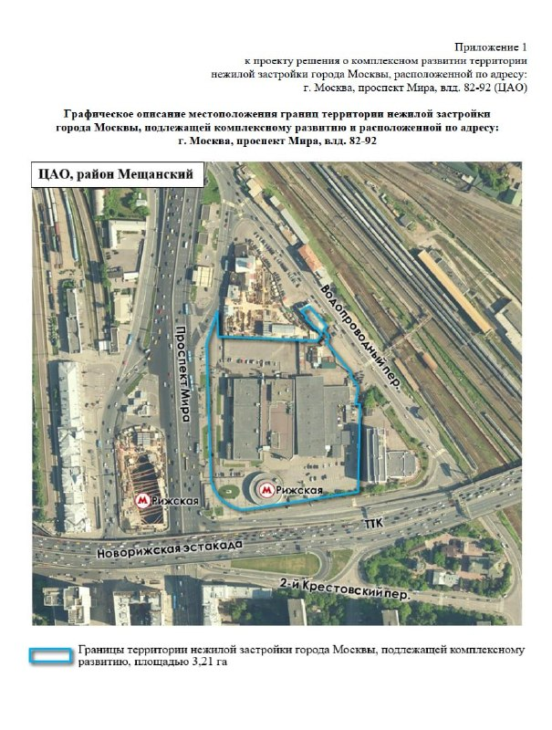

# КРТ на проспекте Мира, 82–92: торги на 3,21 га у «Рижской», старт 155,4 млн ₽

Москва выставила на аукцион право на комплексное развитие территории (КРТ) на проспекте Мира, 82–92 рядом с метро «Рижская» и Рижским вокзалом. Документ Департамента градостроительной политики опубликован 7 октября 2026 года, начальная цена права — 155,4 млн ₽, торги должны пройти в течение 90 дней.

## Коротко

- Территория — 3,21 га на проспекте Мира, вл. 82–92; в границах Рижский цветочный рынок и универмаг «Крестовский».
- Предельная суммарная площадь застройки — до 170 тыс. м².
- Начальная цена права на договор о КРТ — 155,4 млн ₽; это не цена земли и зданий.
- По состоянию на 14 октября 2026 года итогов торгов мы не нашли.

## Что выставили на аукцион

Город продаёт право заключить договор о [комплексном развитии территории (КРТ)](/slovar/krt/) на участке в 3,21 га на проспекте Мира, владения 82–92. Такой аукцион должен состояться в течение 90 дней после публикации документа, сообщает New Retail со ссылкой на РБК и на сам документ Департамента градостроительной политики.

Предельная суммарная площадь объектов капитального строительства — до 170 тыс. м² общественно-делового и иного назначения. Параметры состава застройки город пересматривал несколько раз, и публикации о них расходятся, поэтому точные пропорции мы здесь не приводим: смотрите их в документе об аукционе.

*Схема границ территории КРТ «Проспект Мира, вл. 82–92» площадью 3,21 га (приложение 1 к документу об аукционе). Источник: Департамент градостроительной политики Москвы.*

## Сколько стоит вход и что получит победитель

Начальная цена права — 155,4 млн ₽. «Москвич Mag» уточняет: это стоимость права на реализацию КРТ, а не самих зданий. Победитель получает обязательство реорганизовать территорию, при этом для существующих зданий допускаются и снос, и реконструкция; немедленного сноса после торгов не предполагается.

В границы попали Рижский цветочный рынок (нынешнее здание работает с 1982 года) и универмаг «Крестовский». Что станет с торговлей на этих площадках и в какие сроки пройдёт реализация проекта, в открытых публикациях не раскрыто.

На наш взгляд, 155 млн ₽ здесь — входной билет, а не цена проекта. Настоящую стоимость будет определять то, на каких условиях победитель сможет работать с объектами в границах территории; пока таких данных нет.

## Контекст: история КРТ и архитектура

О планах КРТ на этой территории город сообщал ещё в 2023 году. Тогда инвестиции оценивали в 23,4 млрд ₽, а бюджетный эффект — в 1,7 млрд ₽ в год, а в составе проекта значились гостиница, торговые и офисные центры. Полная история проекта — в [досье «Крестовский»](/obekty/krestovskiy/).

В марте 2026 года появились неофициальные визуализации двух «парусных» башен на этом месте. Авторы в открытых материалах не названы, сведений об утверждении архитектурной концепции нет. Пока это лишь представление о том, что здесь могут построить.

## Что это значит для покупателя и инвестора

Жилья здесь не предусмотрено: речь об общественно-деловой застройке и гостинице, поэтому квартир в ближайшие годы в этом проекте не будет. Для рынка событие важно как индикатор: город продолжает выводить на торги крупные площадки КРТ в центре, вокруг будущих [проектов](/novostroyki/budushchie-proekty/) формируется конкуренция за участки. Подробнее о теме — в [разделе про КРТ](/temy/krt/).

Что отслеживать дальше: дату и площадку аукциона, число заявок, итоговую цену и имя победителя, а затем условия по существующим объектам в контуре.

## Карточка объекта

- **Адрес участка:** Москва, проспект Мира, вл. 82–92 (рядом с метро «Рижская»).
- **Названия:** «Крестовский», КРТ «Проспект Мира, 82–92».
- **Площадь территории:** 3,21 га.
- **Предельная суммарная площадь застройки:** до 170 тыс. м².
- **Стадия:** торги на право договора о КРТ объявлены 7 октября 2026 года.
- **Начальная цена права:** 155,4 млн ₽.
- **Застройщик:** не определён.

## Вопросы и ответы

**Что выставили на торги на проспекте Мира, 82–92?**
Право заключить договор о комплексном развитии территории площадью 3,21 га у метро «Рижская». Сами здания и земля победителю не продаются.

**Сколько стоит участие в торгах по КРТ «Проспект Мира, 82–92»?**
Начальная цена права — 155,4 млн ₽. Это не стоимость проекта: победителю предстоит работать с объектами в границах территории, включая Рижский рынок и универмаг «Крестовский».

**Когда пройдёт аукцион по КРТ на проспекте Мира?**
По сообщению New Retail, аукцион должен состояться в течение 90 дней после публикации документа 7 октября 2026 года. Точную дату и итоги мы на 14 октября не нашли.

**Сколько можно построить на проспекте Мира, 82–92?**
Предельная суммарная площадь объектов — до 170 тыс. м². Состав и минимальные объёмы застройки город уточнял несколько раз, окончательные цифры смотрите в документе об аукционе.

## Источники

1. [New Retail: «Москва выставила на торги участок с Рижским рынком», 9 октября 2026](https://new-retail.ru/novosti/retail/moskva_vystavila_na_torgi_uchastok_s_rizhskim_rynkom/)
2. [«Москвич Mag»: «Кому Рижский рынок и «Крестовский» всего за 155 млн рублей», 7 октября 2026](https://moskvichmag.ru/?p=528365)
3. [«Москвич Mag»: «На проспекте Мира у «Рижской» построят «дубайские» парные небоскрёбы», 1 марта 2026](https://moskvichmag.ru/?p=480830)

Материал не является инвестиционной рекомендацией.
