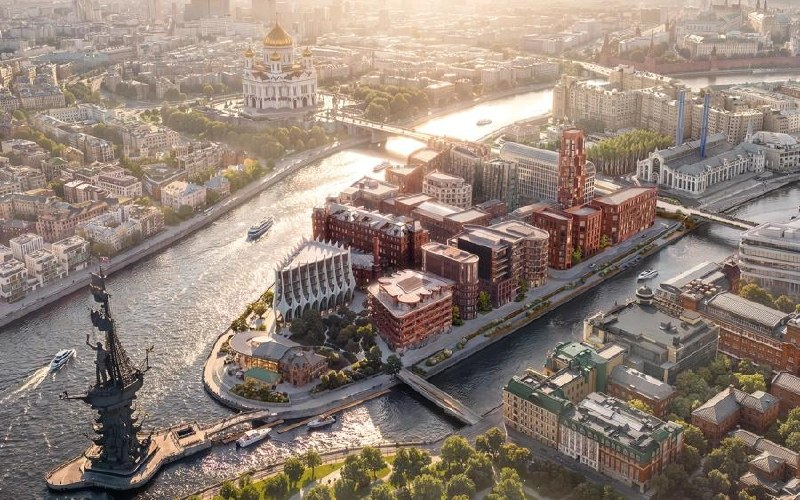

# «Красный Октябрь» на Берсеневской, 6: как 1 млн м² сжался до 300 резиденций

Проект «Гуты» на острове Балчуг в Якиманке за два десятилетия похудел с заявленного 1 млн м² до примерно 300 резиденций и отеля Savoy. Зато авторов стало больше: в 2023 году мастер-план вёл один «Меганом», в 2026-м над домами работают пять бюро. В сентябре 2026 года банк «Дом.РФ» открыл финансирование второй очереди — проект наконец обрёл деньги, а не только рендеры. Полная история — в [досье «Красный Октябрь»](/obekty/krasnyy-oktyabr/).

## Коротко

- С 2003 года [«Гута»](/zastroyshchiki/guta/) говорила о проекте до 1 млн м²; в 2013 году — 212 тыс. м², в 2017-м — 139 тыс. м².
- В 2022–2023 годах — малоэтажный формат: около 300 квартир, первая очередь из трёх корпусов, мастер-план «Меганома».
- В 2026 году над домами работают пять бюро: «Меганом», ЦЛП, GAFA, Parsec и Saga.
- Вторая очередь — клубные дома на 129 квартир и паркинг на 333 машино-места; цен пока нет.

## Миллион квадратных метров на старте

По данным РБК Недвижимость, с 2003 года «Гута» предлагала на территории бывшей фабрики до 1 млн м² офисов, гостиниц и жилья. К 2013 году аппетит уменьшился до 212 тыс. м², в 2014 году проект заморозили на неопределённый срок, а в апреле 2017 года разморозили [1].

Версия 2017 года: 139 тыс. м² по градостроительному плану, из них 94,5 тыс. м² жилья и 17,5 тыс. м² апартаментов, на участке 15 га между Берсеневской и Болотной набережными. Часть фабрики — памятник архитектуры, его обещали отреставрировать [1]. Имя архитектора тогда не звучало.

## Ниже и тише, но авторов больше

**Май 2022 года: ставка на малоэтажность.** Moskvich Mag сообщил, что на весь комплекс планируют около 300 квартир и он «не будет высотным». Первая очередь — три корпуса на 29 квартир и около 4,2 тыс. м² у Патриаршего моста, где незадолго до этого снесли клуб Icon. Продажи вёл Savills, в проекте уже фигурировал отель под брендом Savoy [2].

**Март 2023 года: «город в городе» от «Меганома».** В интервью «Ведомостям» архитектор Юрий Григорян (бюро «Меганом») назвал свой мастер-план вторым и описал его принцип: низкоэтажные жилые дома, отреставрированные исторические здания, парк, пешеходный мост к «Музеону», набережная и отель Savoy. Территория — около 6 га, объём — около 140 тыс. м² (девелопер называл 120 тыс. м²), примерно половина жилая. Первая очередь — три корпуса около 12,7 тыс. м² [3]. Годом раньше та же очередь описывалась как 4,2 тыс. м² — откуда разница, никто не объяснял.

**2026 год: одно бюро превратилось в пять.** 27 июля 2026 года Moskvich Mag описывал проект как застройку в несколько очередей вместе с реставрацией исторических зданий: около 300 резиденций и пятизвёздочный отель Savoy; визуализацию издание приписало «Меганому» [4]. А по данным банка «Дом.РФ» на сентябрь 2026 года, мастер-план и жилые дома разрабатывали уже «Меганом», «Цимайло, Ляшенко и Партнеры» (ЦЛП), GAFA, Parsec и Saga [5].

*Общий вид нового квартала на острове Балчуг. Визуализация: Гута-Девелопмент, 2026*

Почему сменилась команда и мастер-план пересобрали, девелопер публично не объяснял.

## Деньги пришли во вторую очередь

10 сентября 2026 года банк «Дом.РФ» открыл финансирование второй очереди «Красного Октября». По данным РИА Новости, в неё входят клубные дома на 129 квартир, реставрация зданий бывшей кондитерской фабрики «Эйнем» на Берсеневской набережной, коммерческие помещения и подземный паркинг на 333 машино-места. Застройщик — Гута-Девелопмент [5].

Цен застройщик пока не публиковал. Это [премиальный](/novostroyki/premium-klass/) проект в [Якиманке](/novostroyki/yakimanka/), где исторические здания — [объекты культурного наследия](/slovar/okn/), поэтому реставрация и новое строительство здесь идут в одной связке.

На наш взгляд, главное изменение — не масштаб, а подход. Был один автор мастер-плана, стал набор бюро, у каждого свои дома. Сложится ли из этого единый квартал или получится выставка архитектурных портфолио, станет видно по итоговым проектам корпусов — это наша оценка, а не факт.

## Было и стало

| Параметр | 2017 год | 2022 год | 2023 год | 2026 год |
|---|---|---|---|---|
| Площадь | 139 тыс. м² (94,5 жильё, 17,5 апартаменты) | — | около 140 тыс. м² (девелопер: 120 тыс.) | — |
| Участок | 15 га | — | около 6 га | — |
| Квартиры | — | около 300 | — | около 300 резиденций |
| Формат | — | малоэтажный | низкоэтажная застройка | — |
| Первая и вторая очереди | — | 1-я: 3 корпуса, 29 квартир, около 4,2 тыс. м² | 1-я: 3 корпуса, около 12,7 тыс. м² | 2-я: клубные дома на 129 квартир, паркинг на 333 м/м |
| Архитектор | — | не назван | «Меганом» | «Меганом», ЦЛП, GAFA, Parsec, Saga |
| Отель | — | Savoy (планируется) | Savoy | Savoy, пять звёзд |

Прочерк — цифру в тот год не называли. Почему участок в 2017-м занимал 15 га, а в 2023-м около 6 га, девелопер не объяснял.

## Что это значит для покупателя и инвестора

Главные риски — сроки и согласования: проект пересобирали не раз, а сроков по очередям застройщик не называл. Хороший знак — проектное финансирование второй очереди: банк деньги на рендеры не даёт. Что отслеживать: проектные декларации и разрешения по новым корпусам, старт продаж и первые цены. Другие проекты сегмента — в разделе [архитектура](/temy/arhitektura/) и подборке премиальных новостроек.

## Карточка объекта

- **Название:** «Красный Октябрь» (Стрелка, остров Балчуг)
- **Адрес ЗУ:** Берсеневская, 6 (также «Болотная, 15»)
- **Район:** Якиманка, ЦАО
- **Застройщик:** Гута-Девелопмент
- **Масштаб:** около 300 резиденций и отель Savoy (по данным на июль 2026 года)
- **Вторая очередь:** клубные дома на 129 квартир, паркинг на 333 машино-места
- **Цены:** не опубликованы

## Вопросы и ответы

**Кто проектирует «Красный Октябрь» на острове Балчуг?** По данным банка «Дом.РФ» на сентябрь 2026 года, мастер-план и жилые дома разрабатывали «Меганом», «Цимайло, Ляшенко и Партнеры», GAFA, Parsec и Saga. В 2023 году второй мастер-план делал «Меганом».

**Что строят на «Красном Октябре»?** Клубные дома, пятизвёздочный отель Savoy и реставрацию исторических зданий; по данным на июль 2026 года — около 300 резиденций. Вторая очередь — клубные дома на 129 квартир и паркинг на 333 машино-места.

**Сколько стоят квартиры на «Красном Октябре»?** Цены пока не публиковали: на 14 октября 2026 года официальной стоимости квадратного метра нет.

**Когда построят «Красный Октябрь»?** Проект идёт в несколько очередей вместе с реставрацией исторических зданий; сроки по очередям застройщик пока не называл.

## Источники

1. [РБК Недвижимость: «Гута» возобновила проект «Красного Октября», 25 апреля 2017](https://realty.rbc.ru/news/58fee4a89a79473a74639b1c)
2. [Moskvich Mag: «Красный Октябрь» застроят элитным жильём на 300 квартир, 23 мая 2022](https://moskvichmag.ru/?p=233264)
3. [«Ведомости»: Юрий Григорян о преобразовании «Красного Октября», 13 марта 2023](https://www.vedomosti.ru/gorod/ourcity/characters/horoshie-veschi-delayutsya-medlenno-arhitektor-yurii-grigoryan-o-preobrazovanii-krasnogo-oktyabrya)
4. [Moskvich Mag: остров Балчуг после масштабной застройки, 27 июля 2026](https://moskvichmag.ru/gorod/vot-tak-budet-vyglyadet-ostrov-balchug-s-yakimanskoj-naberezhnoj-posle-masshtabnoj-zastrojki/)
5. [Investfuture (РИА Новости): банк «Дом.РФ» открыл финансирование второй очереди на «Красном Октябре», 10 сентября 2026](https://investfuture.ru/articles/bank-dom-rf-otkryl-finansirovanie-vtoroy-ocheredi-zhilykh-rezidentsiy-na-krasnom-oktyabre-1186029418)

Материал не является инвестиционной рекомендацией.
