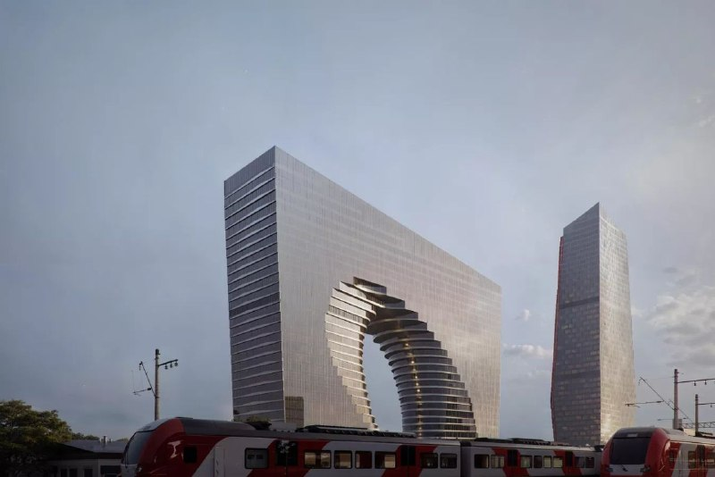
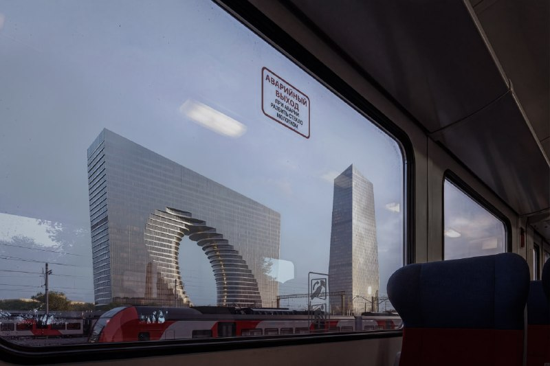

# Киевский грузовой двор: согласован облик квартала с башней 200 м

Власти объявили, что облик делового квартала на Киевском грузовом дворе в Дорогомилове согласован. Три здания, почти 280 тыс. м², главная башня — 200 м. Прежние футуристичные проекты уступили место стеклянной арке бюро IND, а вот кто всё это построит, пока неизвестно.

## Коротко

- **Что согласовано:** облик делового квартала у Киевского вокзала. Об этом власти города объявили в середине октября 2026 года.
- **Параметры:** участок 8,46 га, три здания общей площадью почти 280 тыс. м², главная башня — 200 м.
- **Архитектор:** бюро IND. Фасады обещают из витражей, кассет и ламелей.
- **Чего пока нет:** сроков старта и названия подрядчика. Известно лишь, что стройку планируют в три очереди.

## Что согласовали на Киевском грузовом дворе

Квартал вырастет в [Дорогомилове](/novostroyki/dorogomilovo/), на месте Киевского грузового двора рядом с Киевским вокзалом. Состав такой: офисная башня высотой 200 м, рядом вторая башня и корпус трапециевидной формы с большим проёмом посередине.

Проём — главный приём проекта. Через арку, по замыслу, будет видно кусок города, а с электрички — сам квартал. Официальное описание связывает проект с индустриальным наследием района и «монументальностью исторической Москвы». На наш вкус, наследию здесь достанется скорее роль эпиграфа: когда в фасаде зияет дыра на несколько этажей, говорить об уважении к кирпичной промзоне сложно.

*Корпус с большим проёмом и вторая башня квартала на месте Киевского грузового двора (3). Визуализация: бюро IND*

*Так квартал покажется пассажирам электричек (4). Визуализация: бюро IND*

## Как менялась концепция

Киевский двор рисовали не раз. Сначала показывали концепции «города-сада», позже, в декабре 2025 года, появились рендеры офисной части: две башни, одна волнообразная, другая в форме подковы с глубоким вырезом. Итоговый вариант спокойнее по силуэту, но не по жесту: вместо плавных изгибов — гладкое стеклянное полотно с арочным вырезом.

Сам двор давно в планах «РЖД-Недвижимости»: в декабре 2023 года «Коммерсантъ» писал, что компания собирается застроить шесть грузовых дворов у московских вокзалов, среди них Москва-Товарная-Киевская площадью 49,45 га. Всего — около 2,5 млн м² и 380 млрд ₽ инвестиций по оценке издания. С октября 2023 года «РЖД-Недвижимость» управляется через паевой фонд AAA Capital Management, связанный с Газпромбанком. Полная история проекта — в [досье «Киевский грузовой двор»](/obekty/kievskiy-gruzovoy-dvor/).

## Что это значит для рынка и инвесторов

Это не жильё. Речь о деловом квартале, то есть об офисной и общественно-деловой недвижимости, и покупателям квартир тут пока делать нечего.

Для рынка офисов важнее другое. 280 тыс. м² внутри города — предложение крупное, а согласованный облик ещё не означает решённого вопроса с деньгами. Название застройщика, форма финансирования, цены и сроки старта пока не называли. Согласование [АГР](/slovar/agr/) (архитектурно-градостроительного решения) и утверждение [ТЭП](/slovar/tep/) (технико-экономических показателей) — разные этапы; за кадром остаётся, что именно утверждено по цифрам.

Что отслеживать: появление разрешения на строительство, названия девелопера-исполнителя и графика трёх очередей.

## Что с проектом сейчас

По состоянию на 15 октября 2026 года облик квартала согласован, строительство не началось, дата старта не названа. Цены и условия аренды или продажи офисов не раскрывали.

## Карточка объекта

- **Название:** Киевский грузовой двор (Москва-Товарная-Киевская)
- **Район:** Дорогомилово, Москва
- **Владелец проекта:** «РЖД-Недвижимость» (по досье)
- **Архитектор:** бюро IND
- **Участок под квартал:** 8,46 га
- **Состав:** три здания, почти 280 тыс. м², главная башня 200 м
- **Очерёдность:** три очереди, сроки не названы
- **Стадия:** облик согласован

## Вопросы и ответы

**Что согласовали на Киевском грузовом дворе?**
Облик делового квартала в Дорогомилове: три здания общей площадью почти 280 тыс. м². Главная башня — 200 м. Архитектор — бюро IND.

**Какой размер участка Киевского грузового двора?**
Под деловой квартал отведено 8,46 га. Весь грузовой двор Москва-Товарная-Киевская по оценке 2023 года — 49,45 га.

**Когда начнут строить на Киевском грузовом дворе?**
Сроки старта не названы. Известно лишь, что стройку планируют в три очереди.

**Будут ли здесь квартиры?**
В согласованном проекте речь идёт о деловом квартале, то есть об офисной и общественно-деловой недвижимости. Жилья в описании нет.

## Источники

1. [«Москвич Mag»: проект бизнес-центра с гигантским вырезом на месте Киевского грузового двора, 13 октября 2026](https://moskvichmag.ru/?p=529233)
2. [«Москвич Mag»: два офисных небоскрёба у Киевского вокзала, 25 декабря 2025](https://moskvichmag.ru/?p=471646)
3. [«Коммерсантъ»: РЖД-Недвижимость и шесть грузовых дворов, 4 декабря 2023](https://www.kommersant.ru/doc/6379789)

Материал не является инвестиционной рекомендацией.
