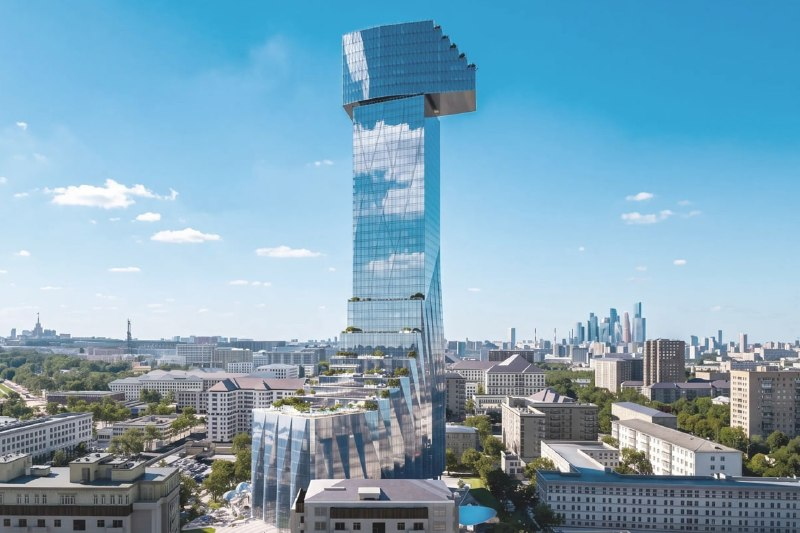
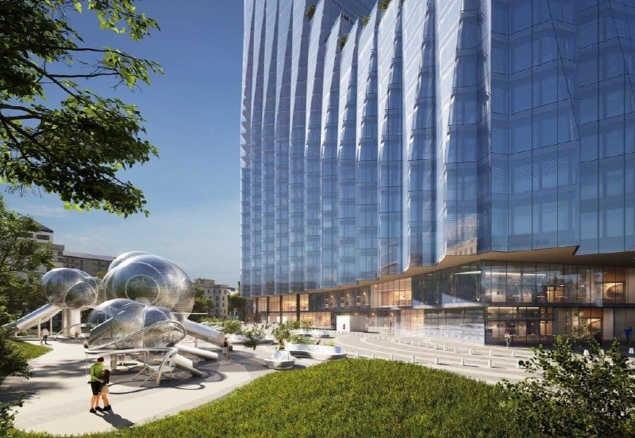

# Дом-молоток: как менялся проект на Шаболовке, 34 с 2024 по 2026

Участок у метро «Шаболовская», где до 2024 года стоял торговый центр, мэрия отдала на голосование: три концепции [ЛСР](/zastroyshchiki/lsr/), ни одного названного автора. Победила, по сообщению «Москвич Mag», башня на 58 этажей с огромным объёмом наверху — её уже прозвали «домом-молотком».

## Коротко

- **Было:** торговый центр с офисами, закрытый в 2024 году и снесённый.
- **Июль 2026-го:** на «Активном гражданине» предложили три концепции — одна башня, две башни на стилобате и две башни разной высоты.
- **Октябрь 2026-го:** по сообщению «Москвич Mag», выбрана башня на 58 этажей.
- **Чего нет:** высоты, площади, числа квартир, авторов и разрешения на строительство.

Полная история участка — в [досье «Шаболовка, 34»](/obekty/shabolovka-34/).

## С чего начинали

До 2024 года на участке стоял торгово-офисный центр. В 2024-м бизнес-центр закрыли, здание снесли, и площадка у выхода из метро осталась пустой. Владелец — ЛСР, та самая группа, которая собирает рядом и участок с недостроенным телецентром на Шаболовке, 35.

Так что точка отсчёта у этой истории скромная: пустая площадка у метро и ни одной утверждённой картинки.

## Что меняли

Весной 2026 года стало известно, что здесь появится жилой комплекс. А 30 июля мэрия вынесла выбор архитектуры на голосование на портале «Активный гражданин».

Что предложили. Все три концепции отсылают к мотивам русского авангарда, у метро — двухуровневый стилобат с кафе и магазинами, под землёй — парковка. А вот силуэты разные:

1. Одна башня сложной геометрии: длинные гранёные складки сходят к земле, наверху большой «ящик».
2. Две округлые башни, соединённые овальной перемычкой.
3. Две стройные стеклянные башни разной высоты.

Авторов концепций мэрия не называла. Голосовать можно было до 27 августа. На 10 августа лидировала вторая концепция, две башни: за неё отдали чуть больше 36% голосов.

## Каким проект стал

12 октября «Москвич Mag» сообщил итог: выбрана концепция башни на 58 этажей, появились и маркетинговые рендеры. Судя по описаниям вариантов, это та самая «одна башня» с объёмом наверху, а не лидер августа. Что произошло между августом и октябрём, остаётся за кадром: итоговых процентов в публикациях нет.

*Башня на Шаболовке, 34 по итогам голосования: «молоток» с вынесенным наверху объёмом. Визуализация: ЛСР, 2026*

Внизу — стилобат с террасами и складчатый стеклянный фасад.

*Низ башни: стилобат у метро и складки стеклянного фасада. Визуализация: ЛСР, 2026*

Что дальше. Выбор в голосовании — это ещё не проект: нужны согласование [АГР](/slovar/agr/) (архитектурно-градостроительного решения), разрешение на строительство и проектная декларация. Высоту, площадь и число квартир официально не называли, цен и сроков продаж тоже нет. Поэтому читать картинку как будущий дом пока рано.

На наш взгляд, 58 этажей рядом со станцией метро и Шуховской башней — решение смелое, и согласование покажет, насколько оно жизнеспособно. Но это мнение, а не факт.

## Было и стало

| Параметр | До 2024 | Июль 2026: варианты на голосовании | 12 октября 2026: выбранная концепция |
|---|---|---|---|
| Что на участке | торгово-офисный центр, затем снос | три концепции жилого комплекса | башня на 58 этажей |
| Количество башен | — | 1 / 2 / 2 | 1 |
| Этажность | — | — | 58 |
| Высота | — | — | — |
| Площадь | — | — | — |
| Квартиры | — | — | — |
| Архитектор | — | не названы | не назван |

## Карточка объекта

- **Адрес участка:** Шаболовка, 34, Донской район, Москва
- **Названия:** Шаболовка, 34; «дом-молоток»
- **Застройщик:** [ЛСР](/zastroyshchiki/lsr/)
- **Район:** [Донской](/novostroyki/donskoy/)
- **Этажность:** 58 (по сообщению «Москвич Mag», октябрь 2026)
- **Стадия:** выбор концепции

## Вопросы и ответы

**Что победило в голосовании по Шаболовке, 34?**
По сообщению «Москвич Mag» от 12 октября 2026 года, концепция башни на 58 этажей, которую уже прозвали «домом-молотком». Опубликованы маркетинговые рендеры.

**Кто автор концепции дома на Шаболовке, 34?**
Официально авторов не называли: в сообщении мэрии о голосовании бюро не указаны. Версию про Coop Himmelb(l)au ничто не подтверждает.

**Кто строит на Шаболовке, 34?**
Группа ЛСР: площадка принадлежит ей, она же вынесла концепции на голосование. До 2024 года на участке стоял торговый центр, его снесли.

**Когда будут продавать квартиры на Шаболовке, 34?**
Сроки не объявлены. Сейчас это выбранная концепция: высота, площадь, число квартир и разрешение на строительство не названы.

## Источники

1. mos.ru, 30 июля 2026 года: [голосование по архитектурной концепции комплекса на Шаболовке, 34](https://www.mos.ru/news/item/173526073/)
2. РБК Недвижимость: [материал о голосовании и трёх вариантах](https://realty.rbc.ru/news/6a6affec9a7947969db5a197)
3. «Москвич Mag»: [«Мэрия запустила голосование по выбору архитектуры для нового небоскрёба у метро «Шаболовская»»](https://moskvichmag.ru/?p=514516)
4. «Приложение Т—Ж», август 2026 года: [«Шаболовская: небоскрёб»](https://t-j.ru/shabolovskaya-neboskreb/)
5. МСК1, 10 августа 2026 года: [ход голосования](https://msk1.ru/text/gorod/2026/08/10/76564209/)
6. «Москвич Mag», 12 октября 2026 года: [«Появились рендеры «дома-молотка» на Шаболовке»](https://moskvichmag.ru/?p=529257)

Материал не является инвестиционной рекомендацией.
