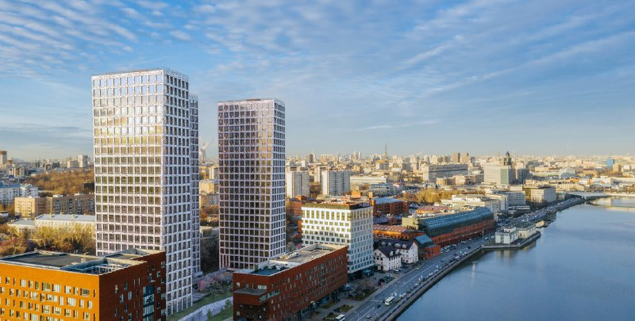

# Новоданиловская, 8 от «Самолёта»: 661 апартамент и первый бизнес-класс компании

«Самолёт», которого привыкли считать королём массового жилья, в марте 2020 года вышел в бизнес-класс. Проект — «Новоданиловская, 8»: три 24-этажные башни у Москвы-реки, 661 апартамент с отделкой. Сдачу обещали на III квартал 2022 года, а ключи пошли после ввода во II квартале 2023-го. К началу 2024 года лоты от застройщика уже разошлись.

*Визуализация комплекса «Новоданиловская, 8» у Москвы-реки. Визуализация: «Самолёт»*

## Коротко

- **Что:** первый проект бизнес-класса группы «Самолёт» в Москве, на территории бывшей Даниловской мануфактуры.
- **Сколько:** три здания по 24 этажа, 661 апартамент; архитектура — студия ADM.
- **Сроки:** обещали III квартал 2022 года, по данным каталога новостроек, ввели во II квартале 2023-го.
- **Сейчас:** все лоты от застройщика реализованы, выдача ключей идёт.

## Кто застройщик «Новоданиловской, 8» и зачем ему бизнес-класс

Девелопер — группа [«Самолёт»](/zastroyshchiki/samolet/), и для неё этот дом был сменой амплуа. Комплекс из трёх 24-этажных зданий с общим двором стоит в 100 м от Новоданиловской набережной, как сообщал РБК Недвижимость 4 марта 2020 года. Продавать собирались 661 апартамент, финансирование проекта выдал банк «Дом.РФ» — по схеме [проектного финансирования](/slovar/proektnoe-finansirovanie/).

Архитектурой занималась студия ADM: её называет автором проекта архитектурное издание, башни высотой около 90 м. На наш взгляд, разумный ход: выходя в новый класс, массовый девелопер взял не безымянный проектный институт, а бюро с именем.

В июле 2020 года в продажу вышел корпус 3: 222 апартамента от студий в 24 м² до пентхаусов, от 7,4 млн ₽, с полной чистовой отделкой. Срок сдачи всех трёх корпусов тогда называли прежний — III квартал 2022 года.

## Когда сдали «Новоданиловскую, 8»

Здесь «Самолёт» опоздал. По данным каталога новостроек, корпуса ввели во II квартале 2023 года — примерно на три квартала позже обещанного. Для рынка история не уникальная, но срок в рекламе и срок в акте ввода — разные вещи, и покупатель 2020 года узнал это на практике.

## Сколько стоят апартаменты сейчас

Корпус 3 стартовал от 7,4 млн ₽ в июле 2020 года. На 10 января 2024 года каталог показывал диапазон от 14,7 млн ₽ за студию в 30 м² до 44 млн ₽ за четырёхкомнатную в 108,3 м². Лоты разные по площади (в 2020 году корпус начинался со студий от 24 м², в 2024-м самая дешёвая — 30 м²), поэтому цену квадратного метра из этих цифр честно не вывести. Но самый дешёвый вход за три с половиной года вырос с 7,4 до 14,7 млн ₽, и это видно без калькулятора.

По состоянию на 15 октября 2026 года каталог пишет, что все лоты от застройщика реализованы. Если вы хотите здесь купить, это уже вторичный рынок, со своими ценами.

## Что с проектом сейчас

Корпуса введены, ключи выдают, у застройщика продавать нечего. Полная история проекта, включая заявления о переносе передачи ключей, — в [досье «Новоданиловская, 8»](/obekty/novodanilovskaya-8/).

## Что это значит для покупателя

Апартаменты — нежилой формат, и бизнес-класс эту оговорку не отменяет. Если вам нужна квартира для жизни, а не для сдачи в аренду, сравните «Новоданиловскую» с жилыми [новостройками бизнес-класса](/novostroyki/biznes-klass/) на тех же деньгах.

Второе: сроки. Урок «Новоданиловской» — считать по акту ввода, а не по рекламе. А общую картину по [ценам на новостройки](/temy/ceny/) полезно держать рядом: единичный рост по одному дому мало что говорит о рынке.

## Карточка объекта

- Названия: Новоданиловская, 8; Новоданиловская 8.
- Застройщик: группа «Самолёт».
- Адрес ЗУ: Новоданиловская, 8.
- Класс: бизнес.
- Архитектура: ADM.
- Состав: три здания по 24 этажа, 661 апартамент (по данным каталога, около 34,5 тыс. м²).
- Стадия: введён во II квартале 2023 года (по данным каталога), выдача ключей.
- Цены: от 7,4 млн ₽ (июль 2020 года, корпус 3); от 14,7 до 44 млн ₽ (январь 2024 года).

## Вопросы и ответы

**Кто застройщик «Новоданиловской, 8»?**
Группа «Самолёт». Для компании это был первый проект бизнес-класса в Москве.

**Сколько апартаментов в «Новоданиловской, 8»?**
661 лот в трёх 24-этажных башнях; по данным каталога, около 34,5 тыс. м² общей площади лотов.

**Когда сдали «Новоданиловскую, 8»?**
Заявленный срок — III квартал 2022 года. По данным каталога новостроек, все три корпуса ввели во II квартале 2023 года.

**Сколько стоили апартаменты в «Новоданиловской, 8»?**
Корпус 3 в июле 2020 года стартовал от 7,4 млн ₽. В январе 2024 года каталог показывал цены от 14,7 млн ₽ за студию 30 м² до 44 млн ₽ за четырёхкомнатную 108,3 м²; лоты от застройщика уже разошлись.

## Источники

1. РБК Недвижимость, 4 марта 2020 года, о выходе «Самолёта» в бизнес-класс: https://realty.rbc.ru/news/5e5f7f969a7947a1aacfa5c6
2. Novostroy-M, 18 июля 2020 года, о старте продаж корпуса 3: https://www.novostroy-m.ru/novosti/gruppa_samolet_zapustila_prodaji
3. Archi.ru, 28 апреля 2021 года, об архитектуре комплекса (студия ADM): https://archi.ru/print/news/en/93023
4. Novostroy-M, карточка «Новоданиловская 8» (сроки, цены, лоты): https://www.novostroy-m.ru/baza/novodanilovskaya_8

Материал не является инвестиционной рекомендацией.
