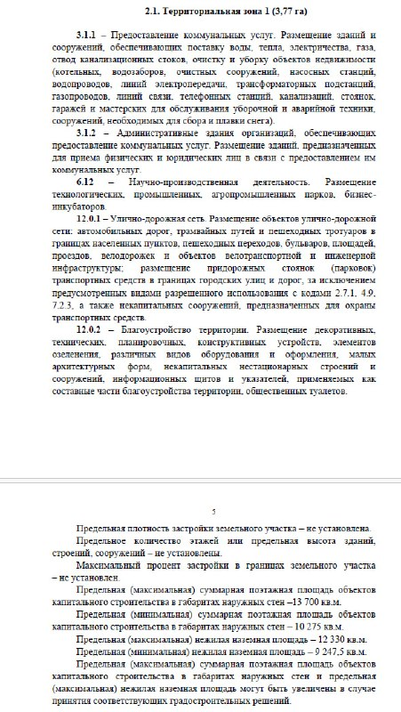

# КРТ «Фабрициуса, 19А (территория 2)»: торги за 46,7 млн ₽ в Южном Тушине

Москва выставила на аукцион право на комплексное развитие 4,42 га нежилой застройки у улицы Фабрициуса в Южном Тушине. Старт — 46,7 млн ₽, торги 19 ноября. Жилья в проекте чуть больше половины, а в нагрузку победитель получает технопарк и здание газовой службы.

## Коротко

- Лот: право на [комплексное развитие территории (КРТ)](/slovar/krt/) нежилой застройки по адресу ул. Фабрициуса, влд. 19А (территория 2), СЗАО, 4,42 га.
- Что можно построить: всего 29,33 тыс. м², из них 15,63 тыс. м² жилья и 13,7 тыс. м² инфраструктуры — технопарк и здание службы газового хозяйства.
- Деньги: старт 46,69 млн ₽, задаток 9,34 млн ₽.
- Сроки: заявки до 12:00 11 ноября, аукцион 19 ноября 2026 года в электронной форме, на реализацию — пять лет.

## Что продают на торгах по КРТ на Фабрициуса, 19А

О торгах 15 октября объявил Департамент градостроительной политики (ДГП) со ссылкой на его главу Владислава Овчинского. Территория — не один квадрат, а два разнесённых участка между улицей Фабрициуса, Походным и Цветочным проездами. Формально это «КРТ нежилой застройки»: город переделывает территорию, где жилья сейчас нет.

Параметры такие: 29,33 тыс. м² наземной площади, из них 15,63 тыс. м² жилья. Остальные 13,7 тыс. м² — инфраструктура: технопарк и здание службы газового хозяйства. По сути, город продаёт один небольшой жилой проект, к которому прилагаются производственная площадка и объект для коммунальщиков.

*Страница документации об аукционе: территориальная зона 1 (3,77 га) — виды разрешённого использования и предельные параметры застройки. Документ Правительства Москвы.*

## Когда торги и как участвовать

Карточка лота на Инвестиционном портале Москвы расписывает график по часам:

- приём заявок — с 9 октября по 11 ноября 2026 года, до 12:00;
- отбор участников — 16 ноября;
- торги — 19 ноября, итоги подведут в тот же день.

Задаток — 9,34 млн ₽, ровно 20% от стартовой цены. Застройщика у проекта пока нет: инвестор определится на аукционе.

## Откуда взялся этот проект

Проект решения о КРТ Овчинский представил 19 февраля 2026 года, документ опубликовали на mos.ru. Уже тогда цифры были те же: более 15,6 тыс. м² жилья и более 13,7 тыс. м² инфраструктуры. Город оценил инвестиции в 6,58 млрд ₽, а бюджетный эффект — до 80,85 млн ₽ в год. От проекта решения до торгов прошло почти восемь месяцев — для московского КРТ темп обычный.

Южное Тушино вообще стало полигоном КРТ: рядом идёт куда более крупная история — [КРТ на месте Тушинского машиностроительного завода](/novosti/tushinskiy-mashinostroitelnyy-zavod-krt-svobody-35/) на 46,3 га. Полная история участка у Фабрициуса — в [досье «Фабрициуса, 19А»](/obekty/fabritsiusa-19a/).

## Что это значит для инвестора и покупателя

Цена входа выглядит смешной: около 3 тыс. ₽ за метр будущего жилья, если делить старт на 15,63 тыс. м². Но дешёвый билет в КРТ — не новость: [КРТ «Тёплый Стан»](/novosti/krt-teplyy-stan-akvilon-aukcion-24-mln/) на 17 га ушёл за 24,66 млн ₽. Деньги в таких сделках не в стартовой цене, а в том, что придётся построить и расчистить.

Здесь, на наш взгляд, и подвох. Жилья — 15,6 тыс. м², это один-два дома. А вдобавок к ним — технопарк и здание для газовой службы, у которых продажи совсем другие, чем у квартир. Всё это на двух разрозненных пятнах и за пять лет. Сама приписка «территория 2» в названии намекает, что территорию у Фабрициуса город развивает по частям, а не одним кварталом. Комплексное развитие территории всё больше похоже на комплексное развитие головной боли инвестора.

Покупателю квартир здесь пока смотреть не на что: ни застройщика, ни проекта, ни сроков продаж. Что отслеживать:

- итоги аукциона 19 ноября — кто зайдёт и сколько будет участников; если один, лот уйдёт по стартовой цене;
- первые разрешения на строительство и проектную декларацию на жилой дом;
- что появится раньше — жильё или технопарк.

Соседние проекты района — в подборке [новостроек Южного Тушина](/novostroyki/yuzhnoe-tushino/), другие торги — в [теме «КРТ»](/temy/krt/).

## Карточка объекта

- Адрес участка: ул. Фабрициуса, влд. 19А (территория 2), Южное Тушино, СЗАО, Москва
- Названия: «Фабрициуса, 19А (территория 2)»
- Застройщик: не определён, инвестор выявится на торгах
- Площадь территории: 4,42 га (два участка)
- Наземная площадь: 29,33 тыс. м², в том числе 15,63 тыс. м² жилья и 13,7 тыс. м² инфраструктуры
- Стадия: торги за право на КРТ, аукцион 19 ноября 2026 года
- Стартовая цена: 46,69 млн ₽, задаток 9,34 млн ₽
- Срок реализации: пять лет

## Вопросы и ответы

**Когда пройдут торги по КРТ на Фабрициуса, 19А?**
Аукцион назначен на 19 ноября 2026 года в электронной форме. Заявки принимают до 12:00 11 ноября, отбор участников — 16 ноября.

**Сколько стоит право на КРТ «Фабрициуса, 19А (территория 2)»?**
Стартовая цена — 46,69 млн ₽, задаток — 9,34 млн ₽.

**Что построят на Фабрициуса, 19А?**
Около 29,33 тыс. м²: 15,63 тыс. м² жилья и 13,7 тыс. м² инфраструктуры, в том числе технопарк и здание службы газового хозяйства. Срок реализации — пять лет.

**Кто застройщик КРТ на Фабрициуса?**
Пока никто: инвестор определится по итогам аукциона 19 ноября 2026 года.

## Источники

1. [Карточка лота «Фабрициуса, влд. 19А (территория 2)», Инвестиционный портал Москвы](https://investmoscow.ru/tenders/tender/20211095)
2. [Пресс-служба ДГП о торгах по КРТ в Южном Тушине, АГН «Москва», 15 октября 2026 года](https://www.mskagency.ru/materials/3570340)
3. [Власти Москвы выставили на торги КРТ в Южном Тушине, РИА Недвижимость, 15 октября 2026 года](https://realty.ria.ru/20261015/vlasti-2124628420.html)
4. [В Южном Тушине появится современный городской квартал по программе КРТ, «Московская перспектива», 19 февраля 2026 года](https://mperspektiva.ru/topics/v-yuzhnom-tushine-poyavitsya-sovremennyy-gorodskoy-kvartal-po-programme-krt/)

Материал не является инвестиционной рекомендацией.
