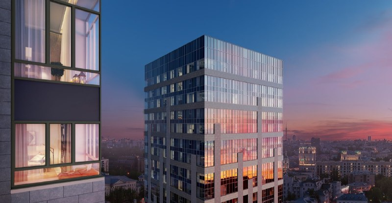

# Селигер Сити: третья очередь от MR Group, старт продаж и цены

20 февраля 2021 года MR Group вывела на рынок третью очередь ЖК «Селигер Сити» в Западном Дегунине: две башни в 43 и 36 этажей, студии от 7,5 млн ₽. Срок сдачи с тех пор сдвинулся со II на IV квартал 2023 года.

## Коротко

- Третья очередь «Селигер Сити» от [MR Group](/zastroyshchiki/mr-group/) стартовала 20 февраля 2021 года; её продавали как [бизнес-класс](/novostroyki/biznes-klass/), тогда как первые две очереди были комфорт-классом.
- Две башни: 43 этажа («Ван Гог») и 36 этажей («Кандинский»).
- Минимальные цены на старте: студия 27,8 м² за 7,5 млн ₽, «трёшка» 80,6 м² за 17,5 млн ₽.
- Срок сдачи: на старте — II квартал 2023 года, в феврале 2023 года ключи планировали выдать в IV квартале 2023 года.

## Что стартовало в «Селигер Сити» в феврале 2021 года

По данным Rambler Finance от 20 февраля 2021 года, MR Group открыла продажи третьей очереди в Западном Дегунине, в двух минутах пешком от метро «Селигерская». В заметке РБК Недвижимости 2023 года расстояние дано иначе: около 200 м. Мы приводим оба источника, так как точное расстояние по пешеходному маршруту не проверяли.

Первые две очереди были комфорт-классом, для третьей застройщик заложил более высокие технические решения. На верхних этажах — панорамные окна и потолки 4,2 м.

*Верхние этажи башни третьей очереди. Визуализация: MR Group*

## Сколько стоили квартиры на старте

Минимальные цены на старте продаж, по данным Rambler Finance:

| Тип | Площадь | Цена от |
|---|---|---|
| Студия | 27,8 м² | 7,5 млн ₽ |
| 1-комнатная | 37,5 м² | 9,1 млн ₽ |
| 2-комнатная | 58,5 м² | 14 млн ₽ |
| 3-комнатная | 80,6 м² | 17,5 млн ₽ |

По нашему расчёту, цена студии на старте — около 270 тыс. ₽ за м². Это стартовый уровень: цены с тех пор менялись, а актуальных данных мы не нашли.

## Контекст: что за проект «Селигер Сити»

По данным РБК Недвижимости от 9 февраля 2023 года, к тому моменту первая и вторая очереди были построены и почти полностью распроданы. Третья очередь состоит из башен «Ван Гог» (43 этажа) и «Кандинский» (36 этажей); большая часть квартир в них была продана. Архитектор проекта — нидерландское бюро MLA+.

Полная история проекта — в [досье «Селигер Сити»](/obekty/seliger-siti/). Район описан на странице [Западное Дегунино](/novostroyki/zapadnoe-degunino/).

## Что с проектом сейчас

Свежих подтверждённых данных на октябрь 2026 года мы не нашли, поэтому описываем последнее, что подтверждено.

- **Срок третьей очереди.** Было: II квартал 2023 года (февраль 2021 года). Стало: ключи планировали в IV квартале 2023 года (по данным на февраль 2023 года). Фактический ввод мы не подтвердили.
- **Четвёртая очередь.** В конце декабря 2022 года Мосгосстройнадзор выдал разрешение на строительство четвёртой и финальной очереди: «Башни Лисицкого», корпуса «Левенгук» и «Ломоносов», 1071 квартира. Сдача запланирована на 2026 год.

Проверить сроки и состояние можно в [проектной декларации](/slovar/proektnaya-deklaratsiya/) на наш.дом.рф.

## Что это значит для покупателя и инвестора

Старт 2021 года показывает, как MR Group позиционировала проект: бизнес-класс с ценой входа 7,5 млн ₽ за студию. Сдвиг срока на два квартала относительно первоначального объявления в таких проектах не редкость, но его нужно учитывать при расчётах. На наш взгляд, покупателю и инвестору важнее сверить фактический ввод и текущие цены, чем ориентироваться на цифры старта. Общий фон по ценам — в разделе [«Цены»](/temy/ceny/).

## Карточка объекта

- Названия: Селигер Сити, 3 очередь Селигер Сити.
- Адрес ЗУ по досье: Дмитровское шоссе, 87.
- Застройщик: MR Group.
- Район: Западное Дегунино, Москва.
- Класс: бизнес (третья очередь).
- Башни третьей очереди: 43 и 36 этажей.
- Старт продаж: 20 февраля 2021 года.

## Вопросы и ответы

**Кто застройщик ЖК «Селигер Сити»?**
Проект ведёт MR Group. Третья очередь вышла в продажу 20 февраля 2021 года как бизнес-класс.

**Сколько стоили квартиры в третьей очереди «Селигер Сити» на старте?**
Минимальные цены на старте: студия 27,8 м² — 7,5 млн ₽, однокомнатная 37,5 м² — 9,1 млн ₽, двухкомнатная 58,5 м² — 14 млн ₽, трёхкомнатная 80,6 м² — 17,5 млн ₽.

**Сколько этажей в башнях третьей очереди?**
В башне «Ван Гог» 43 этажа, в башне «Кандинский» — 36.

**Когда сдавали третью очередь «Селигер Сити»?**
На старте продаж называли II квартал 2023 года, в феврале 2023 года ключи планировали выдать в IV квартале 2023 года. Актуальный срок смотрите в проектной декларации.

## Источники

1. Rambler Finance, 20 февраля 2021 года, «В ЖК «Селигер Сити» начались продажи третьей очереди»: https://finance.rambler.ru/realty/45860038-v-zhk-seliger-siti-nachalis-prodazhi-tretey-ocheredi
2. РБК Недвижимость, 9 февраля 2023 года, материал о «Селигер Сити»: https://realty.rbc.ru/news/63e34a889a7947840cad7bd7

Материал не является инвестиционной рекомендацией.
