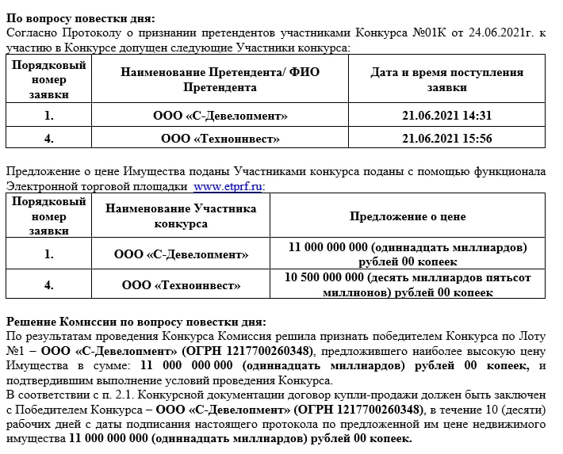

# Вишнёвая, 7: завод Чернышева ушёл с торгов за 11 млрд ₽ и стал Cityzen

Площадку завода имени Чернышева на Вишнёвой, 7 — 60 га и 125 объектов недвижимости — продали на торгах за 11 млрд ₽ при стартовой цене 8,1 млрд ₽. Выиграл «С-Девелопмент», то есть MR Group. Землю про запас компания не держала: на месте завода строится мультиквартал Cityzen, а вход в него с 2024 года подорожал с 9,4 до 15,9 млн ₽.

*Протокол торгов от 24 июня 2021 года: «С-Девелопмент» предложил 11 млрд ₽, «Технонинвест» — 10,5 млрд ₽. Скан протокола торгов*

## Коротко

- **Цена торгов:** 11 млрд ₽ против стартовых 8,1 млрд ₽, то есть на 36% выше старта.
- **Участок:** 60 га и 125 объектов недвижимости, организатор торгов — «РТ-Капитал».
- **Покупатель:** «С-Девелопмент» — юрлицо MR Group; конкурент, «Технонинвест», дал 10,5 млрд ₽.
- **Сейчас:** первая очередь Cityzen строится, цены на квартиры — от 15,9 до 53,2 млн ₽, ближайшие сдачи — III квартал 2027 года.

## Сколько заплатили за завод Чернышева

По протоколу торгов от 24 июня 2021 года до борьбы допустили двух участников. «С-Девелопмент» предложил 11 млрд ₽, «Технонинвест» — 10,5 млрд ₽: разрыв между заявками — полмиллиарда. Победителем комиссия признала первого.

Лот выглядел внушительно. РБК Недвижимость в обзоре сделок 2021 года описывает его как имущественный комплекс из 125 объектов на 60 га: участки принадлежат государству, а завод пользовался ими на праве постоянного бессрочного пользования. Стартовая цена — 8,1 млрд ₽, итоговая выше на 2,9 млрд ₽.

## Кто стоит за «С-Девелопментом» и что он построил

«С-Девелопмент» — это юрлицо [MR Group](/zastroyshchiki/mr-group/): в каталоге новостроек проект записан на ООО СЗ «С-Девелопмент» с брендом MR Group. Площадка стала Cityzen — мультикварталом бизнес-класса в [Покровском-Стрешневе](/novostroyki/pokrovskoe-streshnevo/), СЗАО.

Первую очередь запустили в 2024 году. 21 февраля MR Group вывела на рынок четыре корпуса блока Volna — от 10 до 48 этажей, с ценами от 9,4 до 29 млн ₽. Разрешение на строительство первой очереди компания получила к 29 марта 2024 года: больше 3,68 га, девять корпусов — пять в блоке Parus и четыре в Volna, высота до 163 м (48 этажей), 1574 квартиры, 594 машино-места. Мастер-план делали зарубежные архитекторы вместе с бюро SPICH.

Полная история проекта и площадки — в [досье «Вишневая, 7»](/obekty/vishnevaya-7/).

## Что с проектом сейчас

На 13 октября 2026 года каталог показывает квартиры от 15,9 до 53,2 млн ₽: самая дешёвая студия площадью 20,8 м² стоит 15,9 млн ₽. В феврале 2024 года вход начинался с 9,4 млн ₽, так что за два с лишним года порог вырос примерно в 1,7 раза (в 2024-м речь о старте продаж блока, а не о всём комплексе, сравнение приблизительное).

Сроки такие: корпуса Volna 6–9 и Parus 1–5 — III квартал 2027 года, блок Maiak 1–4 — III квартал 2029 года. Девелопер предлагает скидку 8% и беспроцентную рассрочку до 31 октября. Когда застройщик одновременно поднимает цены и раздаёт скидки, покупателю стоит смотреть на итоговую сумму в договоре, а не на витринный ценник.

## Что это значит для покупателя

Версия «возьмут, согласуют документы и перепродадут» не сбылась: MR Group строит сама. Для покупателя это скорее плюс. Один застройщик на весь проект, известный график, а за девять корпусов первой очереди уже выдано разрешение.

Риски стандартные для большого мультиквартала: сроки сдачи расписаны на годы вперёд, последняя очередь — 2029-й, и обещание «в срок» придётся проверять по стройке. Сравнивайте Cityzen с другими [новостройками бизнес-класса](/novostroyki/biznes-klass/) и с общей картиной по [ценам на новостройки](/temy/ceny/).

## Карточка объекта

- Названия: Вишнёвая, 7; завод Чернышева; Cityzen.
- Адрес ЗУ: Вишнёвая, 7, Покровское-Стрешнево, СЗАО, Москва.
- Застройщик: MR Group (ООО СЗ «С-Девелопмент»).
- Класс: бизнес.
- Площадка: 60 га по итогам торгов 2021 года; первая очередь — более 3,68 га.
- Первая очередь: девять корпусов, до 48 этажей, 1574 квартиры, 594 машино-места.
- Сроки: Volna 6–9 и Parus 1–5 — III квартал 2027 года; Maiak 1–4 — III квартал 2029 года.
- Цены: от 15,9 до 53,2 млн ₽ (на 13 октября 2026 года).

## Вопросы и ответы

**За сколько продали завод Чернышева на Вишнёвой, 7?**
За 11 млрд ₽ при стартовой цене 8,1 млрд ₽. В лоте было 125 объектов недвижимости на 60 га.

**Кто купил завод Чернышева?**
ООО «С-Девелопмент», юрлицо MR Group. Второй допущенный участник, «Технонинвест», предложил 10,5 млрд ₽.

**Что строят на месте завода Чернышева?**
Мультиквартал бизнес-класса Cityzen. Первая очередь — девять корпусов в блоках Parus и Volna, до 48 этажей, 1574 квартиры.

**Сколько стоят квартиры в Cityzen на Вишнёвой, 7?**
На 13 октября 2026 года — от 15,9 до 53,2 млн ₽ по данным каталога новостроек. В феврале 2024 года на старте блока Volna цены начинались от 9,4 млн ₽.

**Когда сдадут Cityzen?**
Корпуса Volna 6–9 и Parus 1–5 — в III квартале 2027 года, Maiak 1–4 — в III квартале 2029 года, по данным каталога.

## Источники

1. РБК Недвижимость, 28 декабря 2021 года, обзор сделок с землёй под жилую застройку: https://realty.rbc.ru/news/61c9826a9a79470dbb9c7b69
2. Журнал «Сноб», 29 марта 2024 года, о разрешении на строительство первой очереди Cityzen: https://snob.ru/news/mr-group-pristupaet-k-stroitelstvu-peredovogo-multikvartala-v-raione-pokrovskoe-streshnevo/
3. Novostroy-M, 21 февраля 2024 года, о старте блока Volna: https://www.novostroy-m.ru/novosti/start_prodaj_novogo_korpusa
4. Novostroy-M, карточка «Вишнёвая, 7» (цены, сроки, застройщик на 13 октября 2026 года): https://www.novostroy-m.ru/baza/jk_vishnevaya_7

Материал не является инвестиционной рекомендацией.
