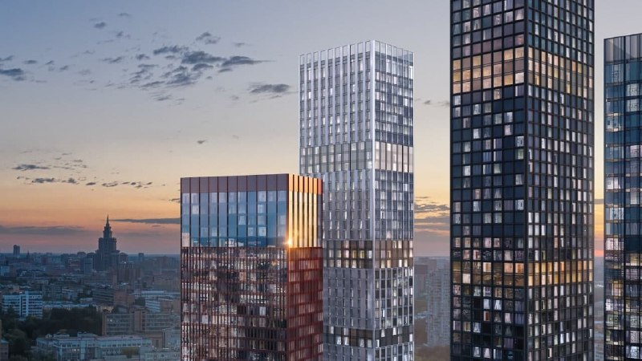
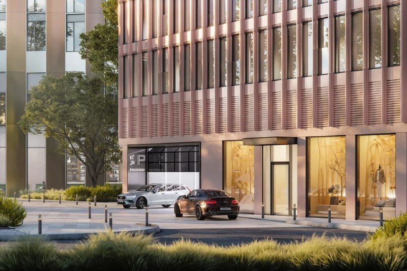
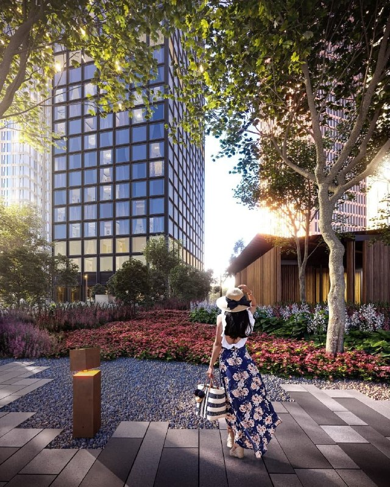

# Symphony 34: от 14,6 млн ₽ в 2021-м, а теперь готовые башни у «Дмитровской»

В июле 2021 года MR Group открыла продажи в ЖК Symphony 34 на 2-й Хуторской: 1862 квартиры, студии и «однушки» от 38 м², бюджет от 14,6 млн ₽, ключи — во втором квартале 2025-го. Дом построили и ввели, а цены с тех пор ушли далеко вперёд: в объявлениях на сентябрь–октябрь 2026 года метр стоит 535–643 тыс. ₽ — в 1,4–1,7 раза дороже стартового.

## Коротко

- **Старт:** июль 2021 года, 1862 квартиры, от 38 м², от 14,6 млн ₽, по нашему расчёту около 384 тыс. ₽/м².
- **Состав:** четыре башни на 36, 43, 49 и 54 этажа, подземный паркинг на 662 машино-места.
- **Срок:** ввод обещали во втором квартале 2025 года, разрешение на ввод стало известно 23 декабря 2024 года.
- **Сейчас:** двушки в объявлениях стоят от 25 до 49 млн ₽, цена за метр там, где она указана, — 535–643 тыс. ₽.

*Башни Symphony 34 на рендере застройщика. Визуализация: MR Group*

## Что продавали в июле 2021 года

Проект стартовал с полным набором «красивой Москвы»: архитектурную концепцию делало бюро Kleinewelt Architekten, планировки — бюро Олега Клодта, лобби — Jaime Beriestain Studio, благоустройство — West 8. Четыре башни получили имена по материалам фасадов: Graphite (54 этажа), Crystal (49), Silver (43) и Sienna (36).

Квартир 1862, и площадь начиналась с 38 м². Отделка — на выбор: предчистовая MR Base или чистовая MR Ready. Из чек-листа амбициозного проекта не хватало разве что цены ниже рынка: уже на старте это был не комфорт-класс. Ключи обещали во втором квартале 2025 года.

## Когда сдали и что построили

Обещание MR сдержала с запасом: сообщение о разрешении на ввод в эксплуатацию вышло 23 декабря 2024 года, то есть раньше заявленного второго квартала 2025-го. Строительство, по словам девелопера, заняло три с половиной года.

По итогу получился комплекс на участке 1,4 га с общей площадью 164,7 тыс. м². Это те же 1862 лота, паркинг на 662 машино-места и больше 2,5 тыс. м² коммерции. Самая высокая башня, Graphite, поднимается на 54 этажа и 190 м. До метро «Дмитровская» можно дойти пешком.

*Нижние этажи с витринами и въездом в паркинг. Визуализация: MR Group*

## Сколько стоят квартиры в Symphony 34 сейчас

Вот что важно: прайса застройщика у нас нет, поэтому ориентир — объявления на сентябрь–октябрь 2026 года. Двушки в них стоят от 25 до 48,8 млн ₽: например, 41,2 м² на 10-м этаже башни Graphite продают за 25–26,5 млн ₽ (607–643 тыс. ₽/м²), а 65,3 м² на 34-м этаже — за 34,95 млн ₽ (535 тыс. ₽/м²). Часть лотов по состоянию на 11 октября 2026 года идёт со скидкой 5–15% от заявленной цены.

Сравните: на старте в 2021 году вход составлял около 384 тыс. ₽/м². За пять лет метр подорожал минимум на 39%. Правда, объявления дают этаж, вид и торг в одном флаконе, и сравнивать их стоит с поправкой на башню и этаж.

## Что это значит для покупателя

Если вы смотрите на Symphony 34 как на готовый дом, главный плюс понятен: строительного риска нет, башни введены, по двору можно пройтись. Вопрос в цене. Ниже стартовой её не купить, а выше рынка соседних проектов она или нет, придётся считать самому: сравните цену за метр в Symphony 34 с другими домами у «Дмитровской», а не только внутри комплекса.

Смотрите на этаж и ориентацию: в 54-этажной башне разброс по метру внутри одного дома оказывается больше, чем между соседними проектами. И уточняйте у продавца, чья это квартира: от застройщика, по переуступке или от собственника. От этого зависит и торг, и документы.

Полная история проекта — в [досье «Symphony 34»](/obekty/symphony-34/). Другие проекты [MR Group](/zastroyshchiki/mr-group/) и [новостройки Савёловского района](/novostroyki/savelovskiy/) — в подборках сайта.

*Внутренний двор: благоустройство бюро West 8. Визуализация: MR Group*

## Что с проектом сейчас

По состоянию на 15 октября 2026 года проект построен: разрешение на ввод получено в декабре 2024 года. В объявлениях есть квартиры в разных башнях. Сколько их осталось у самой MR Group и по какой цене, девелопер публично не называл. Купля-продажа готового дома идёт не по [ДДУ](/slovar/ddu/) (договору долевого участия), если квартира уже оформлена в собственность, так что проверяйте продавца и документы. Общую картину цен на сданные и строящиеся дома смотрите в теме [«Цены»](/temy/ceny/).

## Карточка объекта

- Названия: Symphony 34, «Симфония 34».
- Адрес ЗУ: 2-я Хуторская, 34, Савёловский район, Москва.
- Застройщик: MR Group.
- Корпуса: Graphite (54 этажа), Crystal (49), Silver (43), Sienna (36).
- Квартиры: 1862 лота от 38 м² на старте продаж; общая площадь комплекса 164,7 тыс. м².
- Паркинг: 662 машино-места.
- Отделка: MR Base или MR Ready.
- Стадия: построен, разрешение на ввод получено в декабре 2024 года.

## Вопросы и ответы

**Где находится ЖК Symphony 34?**
На 2-й Хуторской, 34, в Савёловском районе Москвы, в пешей доступности от станции метро «Дмитровская».

**Кто застройщик Symphony 34?**
MR Group. Архитектурную концепцию разработало бюро Kleinewelt Architekten, благоустройство — West 8.

**Сдан ли ЖК Symphony 34?**
Разрешение на ввод в эксплуатацию получено, об этом сообщили 23 декабря 2024 года. Изначально ввод обещали во втором квартале 2025 года.

**Сколько стоят квартиры в Symphony 34 сейчас?**
В объявлениях конца сентября — начала октября 2026 года двухкомнатные квартиры стоят примерно от 25 до 49 млн ₽, цена за метр там, где она указана, — 535–643 тыс. ₽.

## Источники

1. Novostroy-M, 8 июля 2021 года, о старте продаж Symphony 34: https://www.novostroy-m.ru/novosti/v_sao_otkryty_prodaji
2. Рамблер, 23 декабря 2024 года, «Жилой комплекс Symphony 34 сдан в эксплуатацию»: https://finance.rambler.ru/realty/53957795-zhiloy-kompleks-symphony-34-sdan-v-ekspluatatsiyu/
3. CTBUH Skyscraper Center, Symphony 34: https://www.skyscrapercenter.com/complex/4834
4. Яндекс Недвижимость, объявления о продаже квартир у станции «Дмитровская» (сентябрь–октябрь 2026 года): https://realty.yandex.ru/moskva_i_moskovskaya_oblast/kupit/kvartira/dvuhkomnatnaya/railway-dmitrovskaya-196112/v-neboskrebah/

Материал не является инвестиционной рекомендацией.
