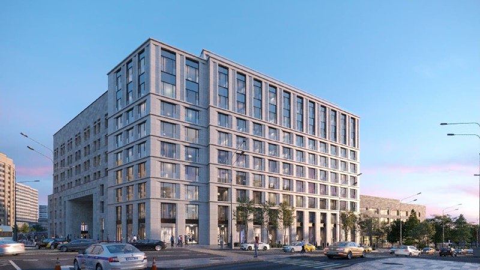
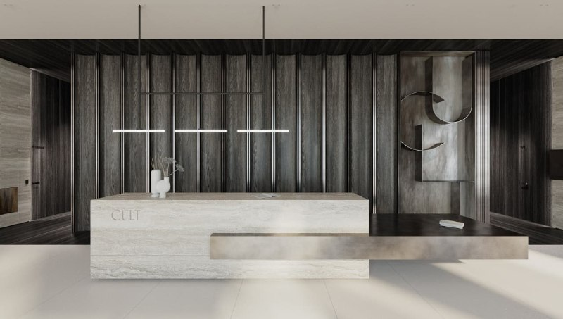

# CULT на Ленинском, 2: гостиница «Варшава» стала апартаментами от 44,6 млн ₽

Советскую гостиницу «Варшава» на Калужской площади [Gravion](/zastroyshchiki/gravion/) превратил в CULT — девятиэтажный комплекс сервисных апартаментов на Ленинском проспекте, 2. Разрешение на строительство девелопер получил в сентябре 2021 года, а к октябрю 2026-го студия около 27 кв. м здесь стоит от 44,6 млн ₽. Цена понятна, а вот со сроком и статусом дома всё не так однозначно.

## Коротко

- Проект бюро SPEECH: 10 403 кв. м, девять этажей, инвестиции девелопера оценивали в 4 млрд ₽.
- Разрешение на строительство — сентябрь 2021 года, старое здание разобрали к февралю 2022 года.
- План — IV квартал 2023 года; по данным агрегатора, срок уехал на пять кварталов.
- Вход — от 44,6 млн ₽, около 1,67 млн ₽/м² (объявления октября 2026 года).

## Отель у «Октябрьской» переучили на апартаменты

CULT стоит на Ленинском проспекте, 2 в Якиманке, в шаге от станции метро «Октябрьская». Как писал «Москвич Mag» 15 сентября 2021 года, гостиницу «Варшава» решили не реставрировать, а перестроить в апарт-комплекс; проект бюро SPEECH показали в июне 2021 года.

Модель простая: все апартаменты продают, а чтобы владельцы могли сдавать их в аренду, девелопер обещал привлечь управляющую компанию. То есть отель остался отелем — только номера теперь принадлежат разным людям.

*(1) Фасад комплекса. Визуализация: Gravion*

*(2) Терраса на крыше. Визуализация: Gravion*

*(3) Лобби с ресепшеном. Визуализация: Gravion*

## Снесли быстро, достраивали дольше

Старт был бодрым. По данным «Новострой-М», разрешение получили в сентябре 2021 года, демонтаж закончили в феврале 2022 года, а к июню 2022-го каркас дорос до третьего этажа. Все девять этажей обещали поднять к сентябрю 2022 года, окончание строительства — в IV квартале 2023 года. Дальше темп, судя по переносу срока, уже не такой спринтерский. Вся история проекта — в [досье «CULT»](/obekty/cult/).

## Сдан или реконструкция — зависит от строчки

По состоянию на 15 октября 2026 года:

- **Стадия.** В карточке комплекса на «Новострой-М» дом одновременно «сдан», на стадии «реконструкция» и с переносом срока на пять кварталов. Три строчки — три версии. Дату ввода ищите в [проектной декларации](/slovar/proektnaya-deklaratsiya/) и разрешении на ввод, а не в агрегаторе.
- **Состав.** Около 80 лотов и 12 пентхаусов, подземный паркинг на 17 машино-мест; апартаменты со 2 по 7 этаж продают с отделкой.
- **Цены.** Студия 26,8 кв. м на втором этаже — 44,63 млн ₽ (1,67 млн ₽/м²), с чистовой отделкой. Потолок в объявлениях — около 910 млн ₽ за 336 кв. м. Даты цен в карточке тоже расходятся: 30 сентября и 16 марта 2026 года.
- **Застройщик.** Gravion, юридически — через специализированный застройщик «Варшава». О продаже проекта другому девелоперу официально не сообщалось.

## Что это значит для покупателя и инвестора

Ценник у CULT вполне в духе адреса, удивляться тут нечему. Важнее другое: апартаменты — не жильё, а нежилые помещения, и у этого дома даже в одной карточке не сходятся статус и стадия.

Если присматриваетесь, начните с бумаг, а не с террасы на рендере: попросите у продавца разрешение на ввод и данные об управляющей компании. Сервис был главным обещанием проекта ещё в 2021 году — пусть покажут, кто именно будет его оказывать. Для сравнения цен — подборка [премиальных новостроек Москвы](/novostroyki/premium-klass/) и раздел [«Премиум»](/temy/premium/).

## Карточка объекта

- Названия: CULT, гостиница «Варшава».
- Адрес: Ленинский проспект, 2, Москва, Якиманка, метро «Октябрьская» ([новостройки Москвы](/novostroyki/moskva/)).
- Застройщик: Gravion (СЗ «Варшава»).
- Формат: премиальные сервисные апартаменты.
- Площадь: 10 403 кв. м, девять этажей.
- Лоты: около 80 и 12 пентхаусов; паркинг на 17 машино-мест.
- Стадия: статус в источниках противоречив (сдан / реконструкция).
- Цена: от 44,6 млн ₽ (студия 26,8 кв. м).

## Вопросы и ответы

**Что такое CULT на Ленинском проспекте?**
Комплекс премиальных сервисных апартаментов Gravion на месте гостиницы «Варшава» у метро «Октябрьская»: девять этажей, около 10,4 тыс. кв. м, проект бюро SPEECH.

**Кто застройщик CULT?**
Gravion Group; по данным «Новострой-М», проект ведёт специализированный застройщик «Варшава».

**Сколько стоят апартаменты в CULT?**
По объявлениям на «Новострой-М» (даты цен в карточке расходятся, один из ориентиров — 16 марта 2026 года) студия около 27 кв. м стоит от 44,6 млн ₽, а пятикомнатный лот 336 кв. м — около 910 млн ₽.

**Когда сдадут CULT?**
Плановым сроком был IV квартал 2023 года. В карточке комплекса одновременно перенос срока на пять кварталов и статус «сдан», так что точную дату ввода сверяйте по проектной декларации.

## Источники

1. «Москвич Mag», 15 сентября 2021 года: https://moskvichmag.ru/?p=189347
2. «Новострой-М», 29 июня 2022 года: https://www.novostroy-m.ru/kompanii/gravion_group/news/cult_vyros_do_tretego
3. «Новострой-М», карточка комплекса CULT: https://www.novostroy-m.ru/baza/kompleks_apartamentov_cult
4. «Новострой-М», карточка студии в CULT: https://www.novostroy-m.ru/kvartiry/apartamenti-v-cult-kult-2b0de72e6047cc81bce16a0db5ae35

Материал не является инвестиционной рекомендацией.
