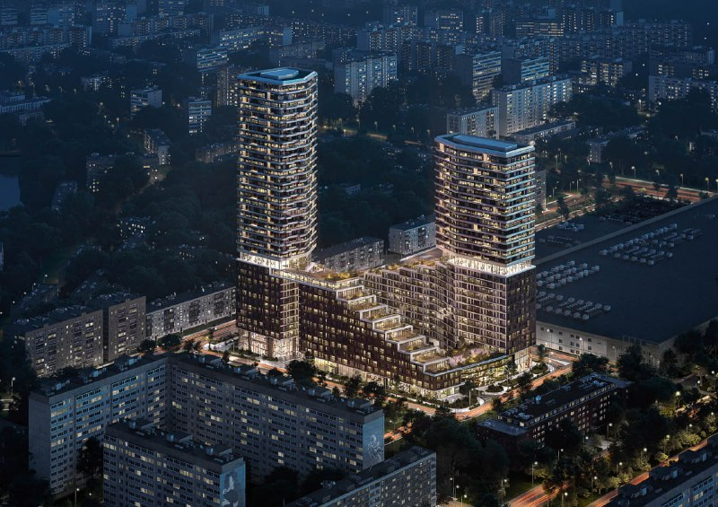
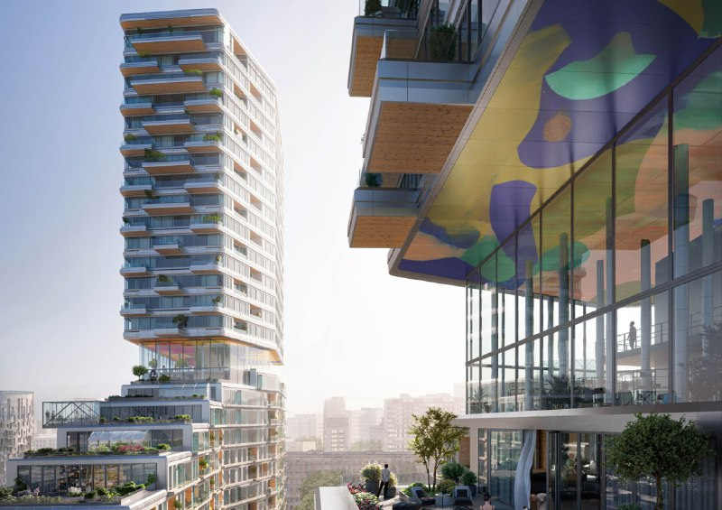
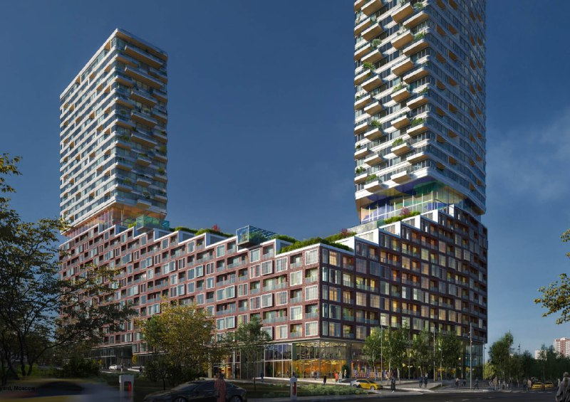

# Кржижановского, 31: башни UNStudio для «Главстроя» стали «Новыми Академиками»

В ноябре 2021 года «Главстрой» выбрал проект для участка на Кржижановского, 31 — и выбрал смело: победило нидерландское бюро UNStudio с двумя башнями и садами на террасах. Пять лет спустя у проекта есть имя «Новые Академики», продажи с марта 2024 года и котлован, а первый корпус, по данным агрегатора, должны сдать в IV квартале 2027 года.

## Коротко

- Конкурс для [«Главстроя»](/zastroyshchiki/glavstroy/) провела Citymakers; UNStudio обошло российское Kamen Architects и бюро из США, Италии и Великобритании.
- Участок 1,93 га, комплекс около 118 тыс. кв. м, из них 71 тыс. кв. м жилья; две башни на ступенчатом подиуме.
- Продажи стартовали 30 марта 2024 года: 784 квартиры, детский сад на 125 мест.
- На октябрь 2026 года — котлован и фундамент, цены «по запросу».

## Голландцы против привычного

Итоги объявили в ноябре 2021 года. «Москвич Mag» 10 ноября 2021 года описывал победителя так: две высотные башни, связанные озеленёнными террасами, где из квартиры можно выйти в собственный сад или оранжерею. Конкуренты были серьёзные — бюро из США, Италии и Великобритании и российское Kamen Architects, чей вариант выглядел привычнее. Жюри выбрало непривычное.

Architects Datafile 15 ноября 2021 года уточнял рамку: конкурс сформулировала и провела Citymakers, заказчик — «Главстрой». Участок — 1,93 га, комплекс — около 118 тыс. кв. м, в том числе 71 тыс. кв. м жилья.

*(1) Общий вид комплекса с двумя башнями на подиуме. Визуализация: «Главстрой»*

*(2) Башня с озеленёнными террасами. Визуализация: «Главстрой»*

*(3) Подиум и торговая зона на уровне улицы. Визуализация: «Главстрой»*

## «Главстрой» поставил конкурсы на поток

Кржижановского — не разовый эксперимент. По данным 360.ru (2 декабря 2021 года), это один из четырёх международных конкурсов, которые «Главстрой» провёл за два года; в жюри сидели урбанисты, архитекторы, представители городских и федеральных властей.

Продукт описывали как семейный квартал с парком: детский сад на 125 мест, фитнес-центр, магазины с кафе, подземный паркинг и парк 0,24 га. Вся история площадки — в [досье «К31»](/obekty/k31/).

## Продажи идут, стройка у нуля

По состоянию на 15 октября 2026 года:

- **Название и застройщик.** Проект называется «Новые Академики»; застройщик — «Главстрой» (ООО СЗ «Новые Академики»), архитектор — UNStudio.
- **Старт продаж.** По данным РБК Недвижимости (26 марта 2024 года), продажи открылись 30 марта 2024 года: 784 квартиры, 475 машино-мест, 3,3 тыс. кв. м спорткомплекса. В продаже — квартиры с террасами или оранжереями, двухуровневые, пентхаусы и лофты. Конкурсная идея с садами, по крайней мере в описании, дожила до прайса.
- **Стадия и срок.** По данным «Новострой-М», на площадке котлован и фундамент, первый корпус — IV квартал 2027 года. С этажностью путаница: 2–39 этажей по РБК, 7–39 этажей и 8 секций по «Новострой-М».
- **Цены.** В карточке — «цена по запросу». Экспертная оценка на сентябрь 2024 года давала вилку от 17,7 до 191 млн ₽, но она давно устарела. Покупка — по [ДДУ](/slovar/ddu/) с эскроу-счетами.

## Что это значит для покупателя и инвестора

Конкурсная архитектура — хороший аргумент, но покупаете вы не рендер 2021 года. Тогда показывали ступенчатый подиум и две башни, а в источниках 2024 и 2026 годов даже этажность названа по-разному. На наш взгляд, честно сравнить конкурсный проект с тем, что строится, пока трудно.

Если присматриваетесь, сверьте параметры с проектной декларацией на наш.дом.рф — прежде всего срок и разрешение на строительство. С котлована до IV квартала 2027 года — путь неблизкий, и следить стоит за стройкой, а не за картинками. Соседние предложения — в подборке [новостроек Академического района](/novostroyki/akademicheskiy/).

## Карточка объекта

- Названия: К31, «Новые Академики».
- Адрес ЗУ: Кржижановского, 31, Москва, ЮЗАО.
- Застройщик: «Главстрой» (ООО СЗ «Новые Академики»).
- Архитектор: UNStudio.
- Площадь: около 118 тыс. кв. м, жильё 71 тыс. кв. м; участок 1,93 га.
- Квартиры: 784.
- Стадия: котлован и фундамент.
- Ввод: IV квартал 2027 года (первый корпус, по данным агрегатора).
- Цена: по запросу.

## Вопросы и ответы

**Кто выиграл конкурс на проект Кржижановского, 31?**
Нидерландское бюро UNStudio. Конкурс для «Главстроя» провела Citymakers, итоги стали известны в ноябре 2021 года (Москвич Mag от 10 ноября 2021 года, Architects Datafile от 15 ноября 2021 года).

**Что построят на Кржижановского, 31?**
Жилой комплекс «Новые Академики» от «Главстроя»: две башни на ступенчатом подиуме, 784 квартиры, детский сад на 125 мест и парк 0,24 га.

**Когда сдадут «Новые Академики»?**
По данным агрегатора «Новострой-М» на октябрь 2026 года, первый корпус — в IV квартале 2027 года, а на площадке пока котлован и фундамент. Срок сверяйте по проектной декларации.

**Сколько стоят квартиры в «Новых Академиках»?**
Официально цены не раскрывают: в карточке — «цена по запросу». Экспертная оценка на сентябрь 2024 года — от 17,7 до 191 млн ₽, но она устарела.

## Источники

1. «Москвич Mag», 10 ноября 2021 года: https://moskvichmag.ru/?p=199350
2. Architects Datafile, 15 ноября 2021 года: https://architectsdatafile.co.uk/?p=287835
3. 360.ru, 2 декабря 2021 года: https://360.ru/news/obschestvo/glavstroj-provel-mezhdunarodnye-konkursy/
4. РБК Недвижимость, 26 марта 2024 года: https://realty.rbc.ru/news/65e6f82b9a7947896bfa79b5
5. «Новострой-М», карточка ЖК «Новые Академики»: https://www.novostroy-m.ru/baza/jk_krjijanovskogo_31

Материал не является инвестиционной рекомендацией.
