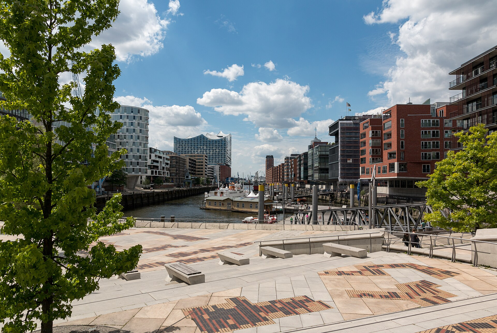

# HafenCity: как Гамбург продаёт бывший порт за концепцию, а не за цену

Представьте, что весь ЗИЛ, весь Южный порт и вся набережная принадлежат одной городской компании. Она сама прокладывает улицы и поднимает набережные, а участки под дома отдаёт тому, у кого лучше идея, а не толще кошелёк. Так Гамбург четверть века строит HafenCity — новый район на месте бывшего порта. Получилось не всё, и самые громкие провалы случились как раз там, где город отступил от собственных правил. Разбираем механику и примеряем её к московскому [КРТ](/slovar/krt/).

## Коротко

- HafenCity — 157 га бывшего порта, 127 га суши, плюс 40% к центру Гамбурга. План — около 8 тыс. квартир на 16 тыс. жителей и до 45 тыс. рабочих мест; к концу 2025 года построено больше 5,5 тыс. квартир, живут около 11 тыс. человек.
- Землёй владеет HafenCity Hamburg GmbH — стопроцентная «дочка» города. Участки она отдаёт по тендеру, где концепция весит 70%, а цена — 30%.
- С 2011 года треть новой жилой площади — субсидируемое жильё. Но в целом по району выходит около четверти: правило опоздало к первым кварталам.
- В Москве на промзонах из 65 проектов КРТ 35 ведут операторы, 20 — инвесторы с торгов и 10 — сами правообладатели. Торги, как на «Автомоторной», идут на повышение цены.

*Эльбская филармония — символ ХафенСити. Фото: Dietmar Rabich, CC BY-SA 4.0, Wikimedia Commons*

## Сколько стоит и кто платит: HafenCity в цифрах

Проект ведёт HafenCity Hamburg GmbH с 1997 года. Мастер-план Сенат Гамбурга утвердил 29 февраля 2000 года, восточную часть переписали в 2008–2010 годах. Масштаб — больше 2,5 млн м² наземной площади, из 45 тыс. будущих рабочих мест 35 тыс. — офисные.

Схема финансирования простая и поэтому интересная. Частные инвесторы вкладывают около 10 млрд €, публичные вложения — около 3 млрд €, и в основном это деньги от продажи тех же участков. Земля HafenCity сведена в особый городской фонд «Город и порт», компания продаёт из него участки и на выручку строит улицы, мосты и набережные. Школы, университет, концертный зал и метро финансирует уже сам город. Линию метро U4 до HafenCity открыли в 2012 году — за годы до того, как в районе набралась хотя бы половина будущих жителей.

Темп — честно скажем, не московский. В 2015 году горизонт развития называли в 25 лет. В документе 2021 года завершение ждали в 2025–2030 годах; тогда, по данным на конец 2019-го, в районе жили около 6,5 тыс. человек и работали около 15 тыс. К концу 2025 года жителей стало около 11 тыс. из 16 тыс. плановых, и общего года окончания официальная страница проекта уже не называет.

*Магеллановы террасы: общественное пространство у воды. Фото: Dietmar Rabich, CC BY-SA 4.0, Wikimedia Commons*

## Концепция против цены: как Гамбург выбирает застройщика

Главное отличие от привычной нам схемы — в порядке шагов. В презентации гендиректора HafenCity Hamburg GmbH Юргена Брунса-Берентельга 2015 года механика расписана по пунктам:

- **Тендер.** Цена за м² заранее дифференцирована по функциям — жильё, офис, торговля. Оценка — 70% концепция, 30% цена. То есть цена учитывается, но решает не она.
- **Эксклюзивный опцион на 18–24 месяца.** Победитель ещё не покупает землю. За это время он проводит архитектурный конкурс (для частных зданий — от 4 до 12 участников) и получает разрешение на строительство.
- **Покупка.** Землю продают, только когда проект доведён до разрешения и город видит, что именно будет построено.

Риск «купил участок и сел ждать роста цены» здесь выключен самой конструкцией. Концепция — не только фасад: в жилых тендерах, например, всё больше учитывают строительные кооперативы, а с 2011 года треть строящейся жилой площади — субсидируемая. Мастер-план прямо требует мелкозернистого смешения функций — по горизонтали и по вертикали.

Отдельная тема — вода. Всю территорию поднимают до 8–9 м над уровнем моря, а парковки встроены в систему защиты от наводнений. Улицы, мосты и набережные строит та же городская компания на деньги от продажи участков, так что застройщик покупает землю уже с инфраструктурой и защитой от воды.

## Где Гамбург споткнулся

Самые дорогие ошибки HafenCity — это исключения из её же правил.

**Эльбская филармония.** Единственное крупное здание, для которого, по словам самой компании, архитектурного конкурса не проводили. Стройку начали в 2007 году, открыть планировали в 2010-м, открыли 11 января 2017 года. Расходы налогоплательщиков выросли с 77 до 789 млн €. Сегодня это символ города, но как пример управления проектом — скорее предостережение.

**Elbtower.** Башню на востоке района проектировали на 245 м. Стройка стоит почти три года, у застройщика конкурсный управляющий. С декабря 2024 года инвестор Дитер Беккен ведёт переговоры о покупке коробки, на август 2026 года соглашения нет. Высоту урезали примерно до 199 м, а город обсуждает, не выкупить ли около 46 тыс. м² под Музей естествознания — максимум за 595 млн €. Ставка на одного частного девелопера и одну эффектную башню обернулась тем, что теперь город достраивает чужой риск.

**Доступное жильё.** Треть субсидируемого жилья — правило с 2011 года, а не с начала проекта, когда первые кварталы уже стояли. Итог по плану — 1,7–2,2 тыс. субсидируемых квартир из примерно 8 тыс., то есть 21–28%. Правило хорошее, но опоздало на десятилетие.

**Баланс функций.** На конец 2019 года жителей было 43% от тогдашнего плана, рабочих мест — около трети. Офисы, на которых держится модель «45 тыс. рабочих мест», приходят медленнее жилья даже там, где город контролирует каждый участок.

## Что из этого применимо к московскому КРТ

Сравниваем механику, а не рендеры. [Трекер КРТ](/krt/) показывает, как это выглядит у нас на живых территориях.

**Кто владеет землёй и готовит территорию.** В Гамбурге — один хозяин: городская компания владеет всеми 127 га суши, поднимает их, строит набережные и только потом продаёт. В Москве земля промзон обычно уже раздроблена между правообладателями. Механизм КРТ это учитывает: инициатором может быть правообладатель или Правительство Москвы, а реализовать проект могут правообладатели, сам город или созданные им юрлица либо инвестор с торгов. На апрель 2025 года из 65 промзонных проектов КРТ (больше 920 га) 35 вели операторы, 20 — инвесторы с торгов, 10 — правообладатели. Ближе всего к HafenCity Hamburg GmbH — именно оператор, то есть структура, созданная городом. Но каждый проект КРТ — отдельная площадка со своими границами, а не весь берег сразу.

Пример раздробленности — «[Северный порт](/obekty/severnyy-port/)». В 2019 году территорию бывшего речного порта начинали Capital Group и «Кортрос», затем по частям в проект вошли LEGENDA (2022), «Мангазея» (2023) и Plus Development (2024). В нашей базе у проекта четыре бюро, включая Сергея Скуратова и Bechu + Associés. Порт есть, мастер-план есть, а единого хозяина набережной нет.

**Кто и как выбирает застройщика.** В Москве торги — конкурс или аукцион на torgi.gov.ru и investmoscow.ru. На практике громкие сделки шли по цене. Право на КРТ «[Автомоторной](/obekty/avtomotornaya/)» (77 га) в 2022 году подорожало на торгах с 740 до 874 млн ₽ и досталось структуре MR Group. В том же году ЛСР выиграла торги на компанию «[ЗИЛ Восток](/obekty/zil-vostok/)» с 25,6 га, стартовая цена — 3,7 млрд ₽. Концепция в Москве появляется после покупки: её проверяют через проект планировки и [АГР](/slovar/agr/), а не на этапе выбора победителя. У «ЗИЛ Восток» в нашей базе стадия архитектуры, автор — Amirov Architects. Гамбургская логика «сначала проект, потом земля» в московских торгах пока не применяется.

**Смешанное использование.** Здесь Москва на бумаге даже амбициознее. По трём КРТ на бывшем ЗИЛе город заявил около 1,2 млн м² недвижимости, из них 624 тыс. м² — общественно-деловые и социальные объекты, и больше 17,8 тыс. рабочих мест. По всей программе на ноябрь 2025 года — 150 проектов, больше 1,5 тыс. га, 30,6 млн м² и около 350 тыс. рабочих мест. Урок HafenCity в том, что заявленные рабочие места приходят последними даже при одном хозяине земли. По соседнему «[ЗИЛАрту](/obekty/zilart/)», который в базе уже сдан, через несколько лет будет видно, как на ЗИЛе выполняется офисная часть.

**Набережные и инфраструктура до продажи.** В HafenCity защиту от воды и набережные строят до того, как появится покупатель, на деньги будущих продаж. В Москве у территорий у реки — «[КРТ Южный порт, территория 4](/obekty/krt-yuzhnyy-port-territoriya-4/)» у ПИК (в базе на стадии участка), «Северный порт», «[Сити-2](/obekty/siti-2/)» у «Страны» с разрешением на строительство и шестью бюро в проекте — у каждого участка свой застройщик и свой график. Единого заказчика на весь берег, который строил бы набережную до продажи земли, как HafenCity Hamburg GmbH, нет.

**Доступное жильё.** В условиях КРТ, которые город публикует на инвестпортале, — границы, срок реализации и предельные параметры застройки, а цель — места обслуживания и приложения труда. Аналога гамбургской трети субсидируемого жилья там нет.

На наш взгляд, перенести можно две вещи, не меняя закон. Первая — давать больший вес концепции в конкурсных торгах на КРТ: формат конкурса механизм уже допускает. Вторая — поручать оператору набережную целиком до торгов, как это делает HafenCity Hamburg GmbH. Остальное — один хозяин на весь берег и субсидируемое жильё — требует другой модели земельной собственности, и ждать этого от московского КРТ не стоит.

Другие материалы о городе и проектах — в рубрике «[Архитектура](/temy/arhitektura/)».

## Вопросы и ответы

**Что такое HafenCity в Гамбурге?**

Новый район на месте бывшего порта: 157 га, из них 127 га суши, которые расширяют центр Гамбурга на 40%. По плану здесь будет около 8 тыс. квартир на 16 тыс. жителей и до 45 тыс. рабочих мест; к концу 2025 года построено больше 5,5 тыс. квартир.

**Кто строит HafenCity?**

Землёй владеет HafenCity Hamburg GmbH — стопроцентная дочерняя компания города. Она строит улицы, мосты и набережные на деньги от продажи участков, а дома — частные инвесторы, которые получают участки по тендеру.

**Как в HafenCity выбирают застройщика?**

По тендеру, где концепция весит 70%, а цена — 30%. Победитель получает эксклюзивный опцион на 18–24 месяца: за это время проводит архитектурный конкурс и получает разрешение на строительство, и только потом покупает землю.

**Сколько доступного жилья в HafenCity?**

С 2011 года треть новой жилой площади — субсидируемое жильё. Но правило ввели, когда первые кварталы уже были построены, поэтому из примерно 8 тыс. квартир субсидируемых по плану 1,7–2,2 тыс., то есть около четверти.

**Чем КРТ в Москве отличается от модели HafenCity?**

В Москве промзоны чаще принадлежат частным правообладателям, а право на КРТ, если его выставляют на торги, разыгрывают по цене или по условиям конкурса. В Гамбурге одна городская компания владеет всей землёй и выбирает застройщика в первую очередь по концепции.

## Источники

- HafenCity Hamburg GmbH: [Daten & Fakten zur HafenCity Hamburg](https://www.hafencity.com/de/ueberblick/daten-fakten-zur-hafencity-hamburg.html).
- HafenCity Hamburg GmbH: [About HafenCity](https://www.hafencity.com/en/overview/about-hafencity) и [Masterplan](https://www.hafencity.com/en/overview/masterplan).
- HafenCity Hamburg GmbH: [Facts and figures, октябрь 2021 года (PDF)](https://www.hafencity.com/_Resources/Persistent/5/0/1/b/501bc0d8dcc763292c0fb4397dfb8a0edf0394c6/HafenCity_Daten%20und%20Fakten%20EN.pdf).
- Jürgen Bruns-Berentelg, «HafenCity Hamburg — The Economics of Urban Transformation», 9 января 2015 года: [презентация (PDF)](https://www.scottishinsight.ac.uk/Portals/80/SUIIProgrammes/Waterfront%20Regeneration/150108%20BW%20Edinburgh%20Knowledge%20Exchange%20-%20final.pdf).
- Lee Kuan Yew World City Prize: [Hamburg — HafenCity](https://leekuanyewworldcityprize.gov.sg/case-studies/hafencity/).
- German History in Documents and Images: [Открытие Эльбской филармонии, 11 января 2017 года](https://germanhistorydocs.org/de/ein-neues-deutschland-1990-2023/die-eroeffnung-der-elbphilharmonie-11-januar-2017).
- ingenieur.de, 24 августа 2026 года: [Elbtower-Debakel](https://www.ingenieur.de/technik/fachbereiche/bau/elbtower-debakel-wie-hamburg-sein-prestigeprojekt-retten-will/).
- Инвестиционный портал Москвы: [Комплексное развитие территорий](https://investmoscow.ru/industries/territorial-evolution).
- mos.ru, 28 апреля 2025 года: [более 920 гектаров бывших промзон по программе КРТ](https://www.mos.ru/news/item/153228073/).
- mos.ru, 25 ноября 2025 года: [Сергей Собянин: в Москве уже одобрено и реализуется 150 проектов КРТ](https://www.mos.ru/mayor/themes/13740050/).
- mos.ru, 15 октября 2025 года: [КРТ на территории бывшей промзоны ЗИЛ](https://www.mos.ru/news/item/160996073/).
- «Ведомости», 5 марта 2022 года: [торги на «ЗИЛ Восток»](https://www.vedomosti.ru/realty/articles/2022/03/05/912271-lsr-postroit-nedvizhimosti).
- «Вечерняя Москва», сентябрь 2022 года: [инвестор для промзоны «Автомоторная»](https://vm.ru/news/997470-efimov-opredelen-investor-kotoryj-zajmetsya-razvitiem-uchastka-byvshej-promzony-avtomotornaya).
- «Деловой Петербург», 15 марта 2024 года: [о проекте «Северный порт»](https://www.dp.ru/a/2024/03/15/peterburgskomu-developeru).
- База «Шахматки»: досье объектов, данные на 15 октября 2026 года.

Дата проверки фактов: 15 октября 2026 года.

Материал не является инвестиционной рекомендацией.
