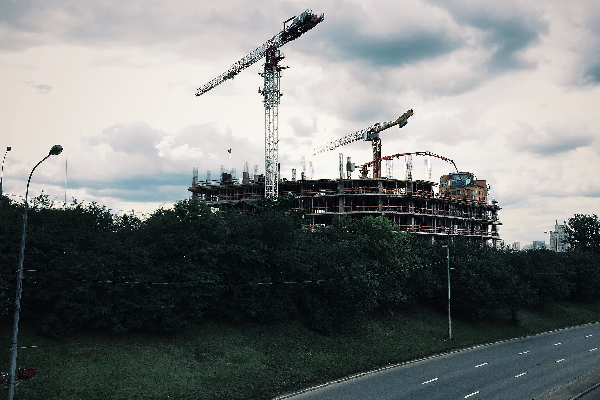
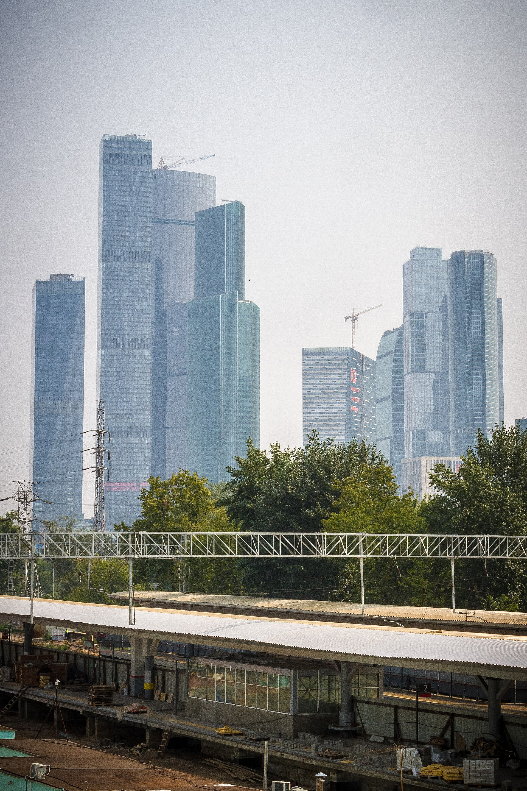

# Как читать АГР и ТЭП: путеводитель по паспорту московской новостройки

Рендер обещает, а свидетельство АГР фиксирует: сколько этажей, из чего фасад и сколько «квадратов» город разрешил построить. А таблица технико-экономических показателей говорит о проекте больше буклета: например, что в ЖК на 219 тыс. кв. м квартиры занимают меньше половины.

## Коротко

- Порядок утверждения АГР в Москве задаёт постановление Правительства Москвы № 284-ПП от 30 апреля 2013 года, последние изменения — № 2358-ПП от 1 октября 2025 года.
- Свидетельство выдаёт Москомархитектура, без него не будет разрешения на строительство.
- Существенные изменения проекта требуют нового свидетельства, а сдвиг показателей в пределах 10% — нет.
- Главная цифра ТЭП — суммарная поэтажная площадь (СПП). У «Начала» на Пресне она больше 218,8 тыс. кв. м, а квартир — 101,3 тыс., или 46%.

*Стройплощадка на Мосфильмовской улице. Фото: Gennady Grachev, CC BY 2.0, Wikimedia Commons*

## Что такое свидетельство АГР и кто его выдаёт

[Архитектурно-градостроительное решение (АГР)](/slovar/agr/) — паспорт внешности здания. По описанию mos.ru, оно фиксирует облик, высотность и этажность, планировку, материалы фасадов и благоустройства и то, как дом вписан в город.

Основа — постановление № 284-ПП. Утверждение АГР — компетенция главного архитектора Москвы, работу ведёт Комитет по архитектуре и градостроительству (Москомархитектура). Для заявителя это электронная госуслуга на mos.ru. Сроки в редакции 2015 года — 10 рабочих дней для окружных объектов и 25 для городских.

Осенью 2026 года согласование и выдачу свидетельства объединяют: после протокола совещания с участием мэра документ сам появится в личном кабинете за два рабочих дня.

АГР нужно почти всем. Исключения прописаны в постановлении: [объекты культурного наследия](/slovar/okn/), ИЖС и линейные объекты, кроме мостов, эстакад и путепроводов.

Главный практический вопрос — что будет, если проект поменяют. Существенные изменения проходят ту же процедуру, что и первое согласование: старое свидетельство аннулируют, выдают новое. А вот уточнить внутренние планировки без переноса санузлов и сдвинуть показатели в пределах 10% можно без согласования. Дом из рекламы и дом из свидетельства законно расходятся на десятую часть.

*Москва-Сити. Фото: Valeri Pizhanski, CC BY-SA 2.0, Wikimedia Commons*

## ГПЗУ → АГР → разрешение на строительство

Три фильтра, каждый следующий строже предыдущего.

1. **[ГПЗУ](/slovar/gpzu/)** — градостроительный план участка: что здесь можно построить в принципе — назначение, предельная высота, плотность, отступы.
2. **АГР** — как будет выглядеть разрешённое. Больше, чем позволяет ГПЗУ, не нарисуешь. Свидетельство можно получить ещё до разработки проектной документации.
3. **Разрешение на строительство** выдаёт Мосгосстройнадзор, утверждённое АГР — одно из оснований. Соответствие АГР проверяют при выдаче разрешения, на стройке и при вводе.

С сентября 2026 года разрешение — это запись в реестре городской информационной системы обеспечения градостроительной деятельности (ГИСОГД) и выписка с QR-кодом.

## Как читать ТЭП: семь строчек

[Технико-экономические показатели (ТЭП)](/slovar/tep/) — сухая таблица, в которой прячется экономика проекта.

- **Площадь участка** — знаменатель для всего остального.
- **СПП в габаритах наружных стен** — площадь всех этажей по внешнему контуру стен. Сюда входят стены, лестницы, холлы, коридоры, коммерция. Поэтому СПП всегда заметно больше площади квартир.
- **Плотность** — СПП, делённая на площадь участка, удобнее всего в тысячах квадратных метров на гектар. Если она упирается в предел из ГПЗУ, участок выжат до конца.
- **Высота и этажность** — смотрите на обе: «от 11 до 48 этажей» — это пейзаж из корпусов разной высоты.
- **Машино-места** — делите на число квартир. Единица и выше — хватит всем, 0,4 — место придётся покупать заранее.
- **Жилая и нежилая площадь** — доля квартир в СПП показывает, сколько построенного продаётся как жильё.
- **Квартирография** — площадь квартир, делённая на их число, даёт среднюю квартиру. Это лучший короткий ответ на вопрос «для кого этот дом».

## Где взять АГР и ТЭП

- **mos.ru и stroi.mos.ru** публикуют новости об АГР и разрешениях на строительство крупных объектов с основными ТЭП.
- **ГИСОГД Москвы** хранит документы по участкам. Сведения запрашивают через gisogd.mos.ru или МФЦ, это платно и занимает до 10 рабочих дней.
- **Проектная декларация на наш.дом.рф** — самый подробный открытый источник для дома в продаже: площади по корпусам, квартирография, реквизиты разрешения.

## Где это в новой Москве: два проекта по ТЭП

Город опубликовал показатели двух проектов из нашей базы при выдаче разрешения на строительство. Разрешение выдают на проект, уже прошедший АГР, так что цифры одной семьи.

**[«Начало»](/obekty/nachalo/), «Донстрой», улица Сергея Макеева, з/у 7, Пресненский район.** Разрешение — ноябрь 2025 года. Восемь корпусов от 11 до 48 этажей, СПП — более 218,8 тыс. кв. м, 962 квартиры на 101,3 тыс. кв. м, 897 машино-мест на двух подземных уровнях.

Квартиры — 46% СПП, средняя квартира — около 105 кв. м, машино-мест — 0,93 на квартиру. Проект для больших семей и больших чеков.

**[Ice Tower](/obekty/ice-tower/) (в документах города — ICE TOWERS), улица Лобачевского, вл. 3–5, Западный округ.** Разрешение — декабрь 2024 года. Три корпуса на общем стилобате, от 2 до 58 этажей. Общая площадь — 178,3 тыс. кв. м, 1523 квартиры на 104,6 тыс. кв. м, 650 машино-мест в четырёхуровневом паркинге и 184 кладовые. В нашей базе над проектом работали [APEX](/arhitektory/apex/), [KAMEN](/arhitektory/kamen/) и [ARCH(E)TYPE](/arhitektory/arch-e-type/).

Квартиры — 59% общей площади, средняя — около 69 кв. м, машино-мест — 0,43 на квартиру.

Вот где подвох для внимательного читателя: у ICE TOWERS город указал «общую площадь», у «Начала» — суммарную поэтажную. Это разные показатели, сравнивать их в лоб нельзя.

При почти одинаковой площади квартир это два разных продукта: 962 большие квартиры с паркингом почти для всех против полутора тысяч средних и очереди за машино-местами. Рендеры этого не скажут, ТЭП — скажут.

Больше разборов — в [других материалах рубрики](/temy/arhitektura/).

## Вопросы и ответы

**Что такое свидетельство АГР?**

Документ Москомархитектуры, которым город утверждает архитектурно-градостроительное решение здания: облик, этажность, высотность, планировку, материалы фасадов и благоустройства. Порядок установлен постановлением Правительства Москвы № 284-ПП от 30 апреля 2013 года.

**Нужно ли АГР для разрешения на строительство в Москве?**

Да, для большинства объектов капитального строительства утверждённое АГР — основание для получения разрешения. Мосгосстройнадзор проверяет соответствие проекту АГР при выдаче разрешения, во время стройки и при вводе. Исключения — объекты культурного наследия, ИЖС и большинство линейных объектов.

**Что такое суммарная поэтажная площадь в габаритах наружных стен?**

Площадь всех этажей здания, измеренная по внешнему контуру стен. В неё входят стены, лестницы, лифтовые холлы и нежилые помещения, поэтому она всегда больше площади квартир. У ЖК «Начало» на 218,8 тыс. кв. м СПП приходится 101,3 тыс. кв. м квартир.

**Можно ли изменить АГР после утверждения?**

Можно, но существенные изменения проходят ту же процедуру, что и первичное согласование: старое свидетельство аннулируют и выдают новое. Уточнение внутренних планировок без переноса санузлов и изменение показателей в пределах 10% согласования не требуют.

**Где посмотреть ТЭП новостройки?**

Ключевые показатели крупных проектов публикуют mos.ru и stroi.mos.ru при одобрении АГР и выдаче разрешения на строительство. Квартирографию и площади по корпусам — в проектной декларации на наш.дом.рф. Документы по участку можно запросить в ГИСОГД Москвы.

## Источники

- Постановление Правительства Москвы от 30 апреля 2013 г. № 284-ПП, текст на [garant.ru](https://base.garant.ru/70373462/).
- Гарант, обзор постановления № 911-ПП от 22 декабря 2015 г.: [изменения в порядке выдачи свидетельства АГР](https://www.garant.ru/hotlaw/moscow/689962/).
- mos.ru, 5 июня 2026 года: [новый порядок оформления АГР](https://www.mos.ru/news/item/170867073/).
- mos.ru, 9 августа 2023 года: [изменения в утверждённое АГР](https://www.mos.ru/news/item/127808073/).
- mos.ru, 14 сентября 2026 года: [реестровая модель разрешений в ГИСОГД](https://www.mos.ru/news/item/175652073/).
- mos.ru, 20 ноября 2025 года: [разрешение на строительство ЖК «Начало»](https://www.mos.ru/news/item/162638073/).
- mos.ru, 25 февраля 2026 года: [начало строительства ЖК «Начало»](https://www.mos.ru/news/item/166558073/).
- mos.ru, 13 мая 2025 года: [строительство ЖК ICE TOWERS на улице Лобачевского](https://www.mos.ru/news/item/153737073/).
- Яндекс Недвижимость, 1 февраля 2025 года: [как запросить сведения из ИСОГД](https://realty.yandex.ru/journal/post/gde-zakazat-vypisku-isogd-i-skolko-eto-stoit/).

Дата проверки фактов: 15 октября 2026 года.

Материал не является инвестиционной рекомендацией.
