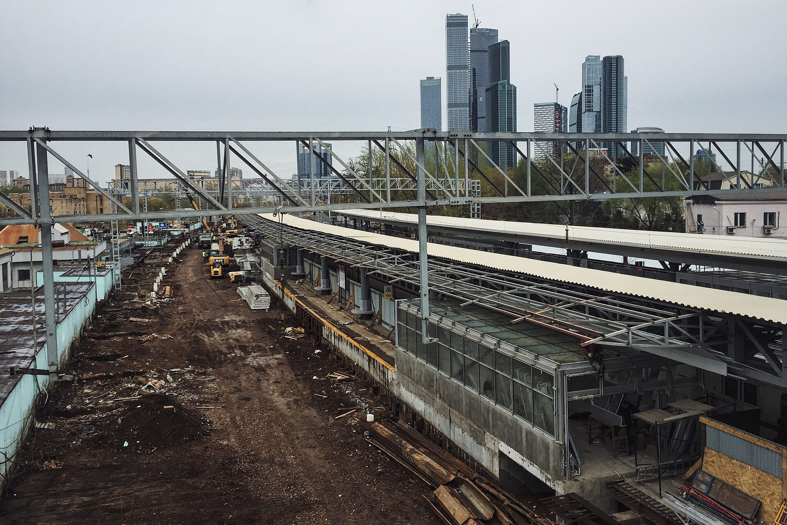
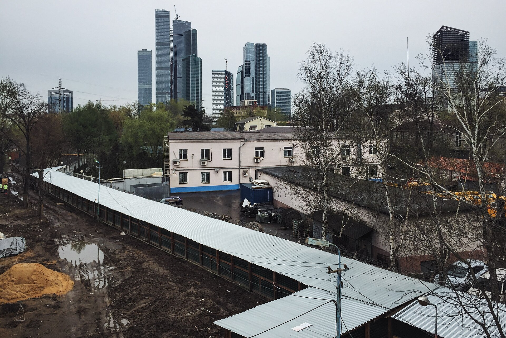

# Конкурс на ТПУ «Фили»: почему Москва выбрала сады над путями

У станции «Фили» сегодня пересадка между метро и МЦД-1 устроена самым честным московским способом: по улице. В апреле 2025 года город показал, как это должно выглядеть через несколько лет. Международный конкурс на ТПУ «Фили» выиграли бюро Тимура Башкаева и группа компаний RRG с проектом «Филёвские сады»: крытый переход, стилобат с общедоступными садами, кровля над путями и высотка с видом на Сити. Разбираем, кто соревновался, что выбрал город и почему этот выбор важнее одной башни.

## Коротко

- Итоги конкурса Москомархитектура объявила 22 апреля 2025 года. Заявок — 31: из 11 городов России и из-за рубежа, в том числе из Белоруссии, Ирана, Турции и Италии.
- Победил проект «Филёвские сады» Бюро Тимура Башкаева и ГК RRG. В финале были KAMEN, мастерская Алексея Ильина, ASADOV, группа «Маркс», «А-Га», Steel и инженерные компании.
- Главный аргумент города — «триединство функциональности, современности и заботы о пешеходе», как сформулировал главный архитектор Москвы Сергей Кузнецов.
- На октябрь 2026 года проект на стадии проектирования: разрешения на строительство нет, сроки стройки не названы.

*Станция Фили во время реконструкции, 2016 год. Фото: Gennady Grachev, CC BY 2.0, Wikimedia Commons*

## Что такое ТПУ «Фили» и зачем понадобился конкурс

ТПУ — транспортно-пересадочный узел: место, где пассажир меняет один вид транспорта на другой и по дороге, желательно, что-нибудь покупает, ест или смотрит. В «Филях» сходятся станция метро, МЦД-1 с аэроэкспрессом в Шереметьево, электрички на Можайск, Кубинку и Голицыно и восемь маршрутов наземного транспорта. К 2030 году узел должен пропускать около 110 тыс. человек в день, в час пик — 25 тыс. в час.

Территория формально относится к «Большому Сити»: до небоскрёбов Пресненской набережной отсюда рукой подать. Значит, обычный вокзальный павильон с ларьками здесь не пройдёт. Городу нужен объект, который одновременно решает транспорт, даёт офисы и общественные пространства и не позорится на фоне Сити.

В [досье ТПУ «Фили»](/obekty/tpu-fili/) застройщиком значится НКК, район — Филёвский Парк. До конкурса публиковалась концепция бюро [ABD](/arhitektory/abd/) — вполне рабочая, но без амбиций доминанты. Конкурс должен был эти амбиции добавить.

*Станция Фили. Фото: Gennady Grachev, CC BY 2.0, Wikimedia Commons*

## Кто проводил конкурс и как он был устроен

Организатор — Москомархитектура, формат — международный. Конкурс открыт для иностранцев, но заявки пришли не из Лондона и Роттердама, а из Белоруссии, Ирана, Турции и Италии: так выглядит международный конкурс в Москве 2025 года.

Задание из публикаций об итогах читается так. Нужно соединить МЦД-1 и метро «Фили» в один узел вместо уличной пересадки, не трогая саму станцию метро. Над железнодорожными путями нужно создать полезное пространство. Наконец, к транспорту требуется добавить общественную и деловую функцию с высотной доминантой. Отсюда главное ограничение: строить приходится над действующей железной дорогой и рядом с ней, а это совсем другая инженерия, чем на чистом поле.

Имена членов жюри в сообщениях об итогах не прозвучали. Выбор от лица города объяснял Сергей Кузнецов. Для сравнения: на параллельном городском конкурсе на Московский депозитарно-выставочный центр в Новой Москве (2025) оператором выступил Институт Генплана Москвы, а конкурс шёл в три шага: заявки с портфолио, шорт-лист финалистов и два месяца на концепции.

## Финалисты конкурса на ТПУ «Фили»: кто и с кем

Среди финалистов:

- «Камень» — [KAMEN](/arhitektory/kamen/);
- архитектурная [мастерская Алексея Ильина](/arhitektory/masterskaya-ilina/);
- [ASADOV](/arhitektory/asadov/) вместе с «НФ Групп»;
- группа компаний «Маркс» — [Marks Group](/arhitektory/marks-group/), а также ИНПИ и «Подземпроект»;
- архитектурная группа [«А-Га»](/arhitektory/ginzburg-architects/), «Горпроект» и Core;
- бюро [Steel](/arhitektory/steel/), Trust, Urbicon и «Со.Здание»;
- [Бюро Тимура Башкаева](/arhitektory/byuro-bashkaeva/) и ГК RRG — будущий победитель.

Посмотрите на состав, а не на картинки. Почти каждая команда — это архитектурное бюро плюс инженеры, подземщики или транспортные проектировщики. «Подземпроект» в названии говорит сам за себя. Конкурс на ТПУ — это не конкурс фасадов. Это конкурс на то, кто убедительнее положит небоскрёб, сад и пересадку на железнодорожные пути и при этом не сломает график электричек.

Отсюда и разброс подходов. Одни ставили на эффектную форму, которая хорошо смотрится на рендере и с Кутузовского проспекта. Другие — на функцию, из которой форма вырастает. Победила вторая школа.

## Победитель: «Филёвские сады» Башкаева и RRG

Ядро проекта — здание общественного центра в окружении садов. В программе детский центр, концертный зал и музей, а рядом объём, который в публикациях сравнивают то с ракушкой, то с драгоценным камнем. С высотной доминанты откроется вид на Москва-Сити. Всё это стоит на общем стилобате, а на нём, по словам Кузнецова, «разместятся общедоступные озеленённые пространства». Сады заходят и на кровлю над путями.

Транспортная часть менее фотогенична, но ради неё всё и затевалось. Крытый переход связывает МЦД-1 с метро «Фили», пересадка уходит с улицы, станцию метро не перестраивают.

Аргументацию Кузнецов уложил в одну формулу: «Реализована концепция триединства — функциональности, современности и заботы о пешеходе». Обратите внимание на порядок слов: функциональность первая, «современность» посередине, пешеход замыкает.

Выбор автора тоже говорит сам за себя. Тимур Башкаев — главный архитектор проектов МЦК и ТПУ «Нижегородская», один из создателей парка «Зарядье». Город отдал узел не автору самой смелой картинки, а команде, которая уже доводила транспортную инфраструктуру до пассажира.

## Что стало с проектом после конкурса

Полтора года спустя «Филёвские сады» остаются концепцией. В нашем досье проект на стадии проектирования, разрешения на строительство нет. Следующая веха, которую стоит ждать, — [архитектурно-градостроительное решение (АГР)](/slovar/agr/): именно в нём конкурсная картинка превращается в согласованный облик с [ТЭП](/slovar/tep/) — площадью, этажностью и высотой. До АГР любые цифры высоты доминанты — гадание.

Сроков стройки город не называл. Единственная дата на горизонте — прогноз пассажиропотока на 2030 год. Если вы присматриваетесь к жилью рядом с «Филями» с расчётом на новый узел, считайте его бонусом с открытой датой, а не аргументом в цене.

## Что этот выбор говорит о вкусах города

На наш взгляд, Москомархитектура голосует здесь за понятную формулу: транспорт плюс общественное пространство плюс зелень на кровле, а доминанта как приложение к ним. Небоскрёб нужен, но как ориентир, а не как цель. «Забота о пешеходе» в официальной формулировке победы — не дежурная фраза. Это критерий, по которому проигрывают красивые, но дорогие в реализации жесты.

Вторая тенденция — конкурс как фильтр компетенций. Городу важна не только идея, но и команда, которая её построит. Отсюда консорциумы с инженерами в финале и победа бюро с транспортным портфелем. На конкурсе депозитарно-выставочного центра в Коммунарке картина похожая: отбор российских бюро по портфолио, шорт-лист и в итоге выразительный, но простой объём — красный куб с выгнутыми гранями.

Третья — «Большой Сити» как бренд. Территории вокруг Сити город упаковывает в цельную историю, и узлы вроде «Филей» должны держать планку соседних башен. Звёздную архитектуру, впрочем, никто не заказывал: от этих мест ждут сначала удобства, потом эффекта.

## Где это в новой Москве

- [ТПУ «Фили»](/obekty/tpu-fili/) — сам объект: досье, финалисты и хронология проекта.
- [ТПУ «Минская»](/obekty/tpu-minskaya/) — соседний узел в Фили-Давыдкове, застройщик BMS Development, архитектура [APEX](/arhitektory/apex/). Хорошая пара для сравнения: два ТПУ одного «Большого Сити» с разными заказчиками.
- [ТПУ «Парк Победы»](/obekty/tpu-park-pobedy/) — проект «Ташира», где в нашей базе рядом с «Меганомом» значится Бюро Тимура Башкаева. Ещё один пересадочный узел с участием победителя «Филей».
- [«Фили Сити»](/obekty/fili-siti/) — проект MR Group в Фили-Давыдкове по проекту [ADM](/arhitektory/adm/): ещё одна заявка западного сектора на имя «Сити».
- [Большой Московский цирк на проспекте Вернадского](/obekty/bolshoy-moskovskiy-tsirk-na-prospekte-vernadskogo/) — конкурс на его концепцию Москомархитектура объявила осенью 2024 года, в нашей базе архитектор — Marks Group, финалист «Филей». Проиграв в одном городском конкурсе, бюро вполне может выиграть в соседнем.

Больше разборов — в разделе [об архитектуре](/temy/arhitektura/).

## Вопросы и ответы

**Кто победил в конкурсе на ТПУ «Фили»?**
Проект «Филёвские сады» бюро Тимура Башкаева и группы компаний RRG. Итоги международного конкурса Москомархитектура объявила 22 апреля 2025 года.

**Кто был в финале конкурса на ТПУ «Фили»?**
Среди финалистов — «Камень» (KAMEN), архитектурная мастерская Алексея Ильина, ASADOV с «НФ Групп», группа «Маркс», ИНПИ и «Подземпроект», «А-Га», «Горпроект» и Core, Steel вместе с Trust, Urbicon и «Со.Здание». Всего на конкурс подали 31 заявку.

**Что построят на месте ТПУ «Фили»?**
По концепции — общественный центр в окружении садов, высотную доминанту с видом на Москва-Сити, детский центр, концертный зал и музей. Здания объединит стилобат с общедоступным озеленением, а МЦД-1 и метро «Фили» свяжет крытый переход вместо уличной пересадки.

**Когда построят ТПУ «Фили»?**
Сроков строительства город не называл. На 15 октября 2026 года проект находится на стадии проектирования, разрешения на строительство нет. Пассажиропоток узла прогнозируют к 2030 году: около 110 тыс. человек в день.

## Источники

- [РБК-Недвижимость: победитель конкурса на концепцию комплекса «Фили», 22 апреля 2025 года](https://realty.rbc.ru/news/6807717c9a79477a19719f74)
- [MSK1.ru: «Филёвские сады», финалисты и параметры ТПУ «Фили», 22 апреля 2025 года](https://msk1.ru/text/transport/2025/04/22/75372014/)
- [«Российская газета»: старт конкурса на Московский депозитарно-выставочный центр, 21 марта 2025 года](https://rg.ru/2025/03/21/startoval-konkurs-na-razrabotku-koncepcii-moskovskogo-depozitarno-vystavochnogo-centra.html)
- [«Москвич Mag»: концепция депозитарно-выставочного центра в Коммунарке, 27 августа 2025 года](https://moskvichmag.ru/?p=448886)

Материал не является инвестиционной рекомендацией.
