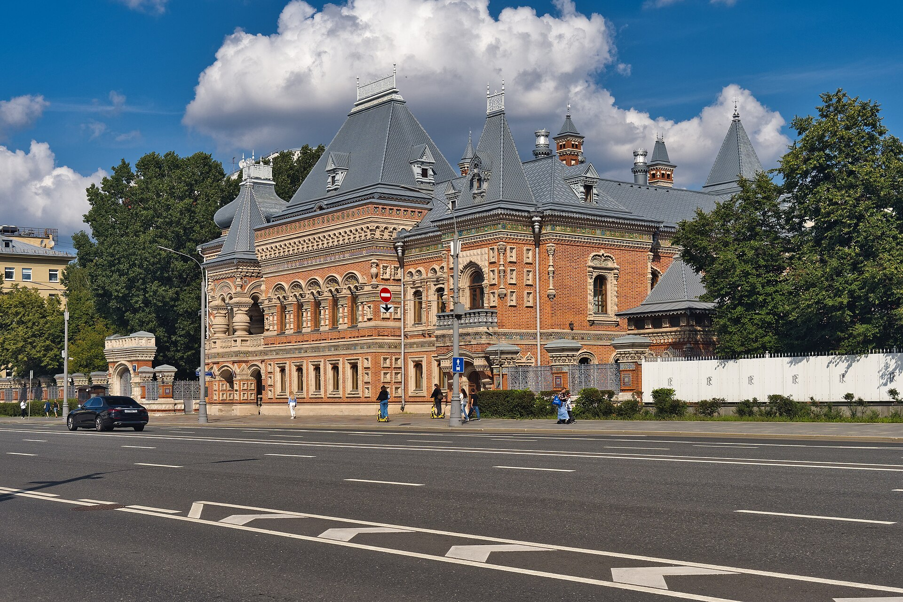
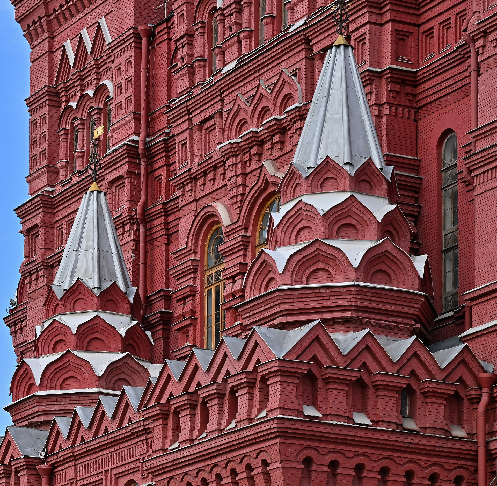
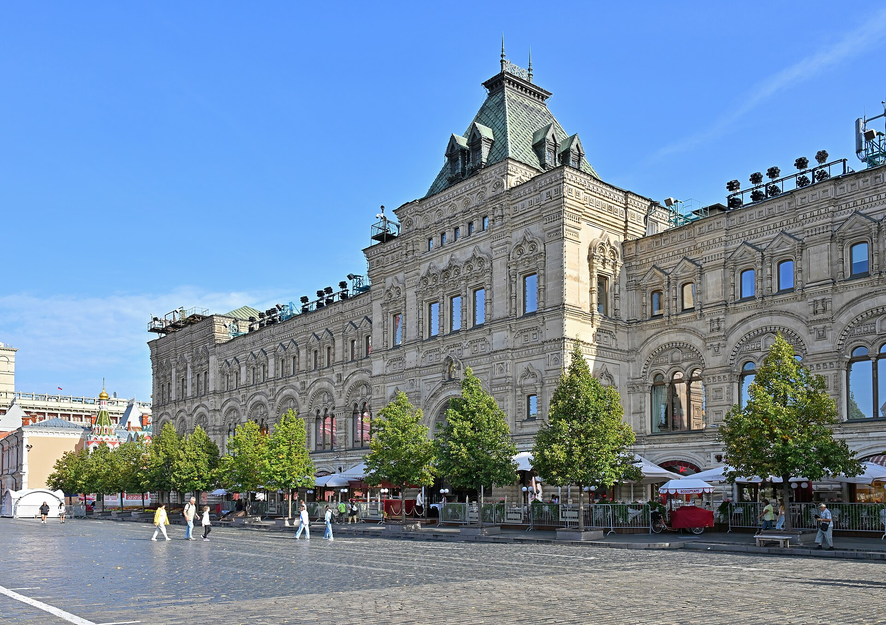

# Псевдорусский стиль в Москве: от Исторического музея до дома Игумнова

Во второй половине XIX века Москва решила, что её подлинная архитектура оборвалась при Петре I, и взялась её достраивать — с кокошниками, шатрами и изразцами. Так появились Исторический музей, Верхние торговые ряды, здание Городской думы и самый сказочный особняк города — дом Игумнова на Большой Якиманке. Разбираемся, откуда взялся псевдорусский стиль, где в истории дома правда, а где молва, и что из этого берут сегодняшние новостройки.

## Коротко

- Псевдорусский, а по-энциклопедически просто русский стиль — эклектика второй половины XIX века, которая цитирует древнерусское зодчество. В 1880–1890-е годы он стал официальным стилем империи.
- Главная тройка у Красной площади: Исторический музей (1875–1883), Верхние торговые ряды, нынешний ГУМ (1889–1893), и здание Городской думы (1890–1892).
- Дом Игумнова на Большой Якиманке, 43 строили в 1888–1895 годах для ярославского фабриканта. С 1938 года он принадлежит Франции, сейчас это резиденция посла.
- В новостройках Москвы русский стиль не цитируют: в нашей базе нет ни одного проекта с теремом или изразцами. Берут кирпич, ручной декор и неоклассику.

*Дом Игумнова на Большой Якиманке, 43. Фото: Alexxx1979, CC BY-SA 4.0, Wikimedia Commons*

## Откуда взялся русский стиль: Тон, Ропет и обиженная традиция

Идея у стиля простая и немного обидчивая. Национальная традиция, считали его авторы, не завершилась: её прервала петровская европеизация, а значит, её надо продолжить. Отсюда цитаты из древнерусских храмов, палат и теремов, собранные в новые здания, для которых у допетровской Руси не было образцов: музеи, торговые ряды, думы, вокзалы.

Первым на эту территорию зашёл Константин Тон. Его называют основоположником русско-византийского стиля: в 1830 году он сделал проект церкви Святой Екатерины в Екатерингофе, и Николай I лично его одобрил. Дальше — Храм Христа Спасителя (строился в 1839–1880 годах, взорван в 1931-м, воссоздан в 1994–2000-м) и Большой Кремлёвский дворец (1839–1849), декор которого повторяет мотивы соседнего Теремного дворца. В 1838 году Тон составил альбом образцовых проектов церквей, и с 1841 года их рекомендовали строить по всей стране.

Но национальное у Тона жило в основном в декоре, а фасады оставались по сути классицистическими. Современники это видели. Герцен писал, что тоновские храмы «дышали натяжкой, лицемерием, анахронизмом».

Второй заход — с противоположной стороны. Иван Ропет (настоящее имя Иван Петров, псевдоним — анаграмма фамилии) черпал не из соборов, а из деревенской избы: резьба по дереву, народный орнамент. Его Теремок в Абрамцеве построен в 1877–1878 годах, а русский павильон на Всемирной выставке в Париже 1878 года он оформил в духе теремного дворца XVII века. Узорчатую манеру быстро окрестили «ропетовщиной» — и не в комплимент.

К 1880-м годам стиль сменил русско-византийский и стал официальным. Отправной точкой энциклопедия называет конкурс на храм Спаса на Крови в Петербурге (1881–1882): эпоха Александра III хотела выглядеть по-русски.

*Фасад Исторического музея со стороны Красной площади. Фото: Юрий Д.К., CC BY 4.0, Wikimedia Commons*

## Исторический музей, ГУМ и Дума: русский стиль у Кремля

*Исторический музей на Красной площади: фасады В. О. Шервуда, 1875–1883. Фото: Diego Delso, CC BY-SA 4.0, Wikimedia Commons*

**Исторический музей.** Самый показательный сюжет — авторство. Владимир Шервуд архитектором формально не был: у него не было соответствующего статуса. Поэтому конкурсный проект под девизом «Отечество» он делал в паре с инженером А. А. Семёновым, и в 1874–1875 годах они получили первую премию. Разделение труда было честным: на Шервуде — фасады и интерьеры, на Семёнове — технические помещения и надзор за стройкой.

Строили в 1875–1883 годах, с перерывом в 1879–1881-м — кончились деньги. В 1879 году Шервуда от стройки отстранили после конфликта с историком И. Е. Забелиным. Стиль — мотивы московского зодчества XVI века, а декор выжимает из кирпича всё: кокошники, ширинки, карнизы, пояса. Красный кирпич здесь не фон, а главный материал выразительности. Это стоит запомнить, к кирпичу мы ещё вернёмся.

**Верхние торговые ряды и Дума.** Шервуд хотел построить и их: у него есть нереализованные проекты Городской думы (1888–1889) и Верхних торговых рядов (1889). Обе площадки ушли другим. Ряды, нынешний ГУМ, построил в 1889–1893 годах Александр Померанцев, здание Городской думы в 1890–1892 годах — Дмитрий Чичагов. В итоге у Красной площади сложился редкий для Москвы ансамбль: три больших здания одного стиля, построенные за неполные двадцать лет.

Критики позже упрекали архитекторов русского стиля в «фантастичности и надуманности» композиций. Справедливо: древнерусского торгового пассажа на три линии никогда не существовало, его пришлось сочинить.

*Верхние торговые ряды (ГУМ), фрагмент фасада. Фото: Юрий Д.К., CC BY 4.0, Wikimedia Commons*

## Дом Игумнова на Якиманке: терем ярославского фабриканта

Если Красная площадь — русский стиль государственный, то Большая Якиманка, 43 — частный, купеческий и самый нарядный.

Заказчик — Николай Игумнов (1855–1924), совладелец товарищества «Ярославская Большая мануфактура» и владелец золотых приисков в Сибири. Участок на Якиманке он получил в наследство от дяди. Строили в 1888–1895 годах. По оценке ГлавУпДК, которое управляет зданием, дом должен был соответствовать статусу хозяина — и с этой задачей справился.

Архитектора Игумнов привёз с собой. Николай Поздеев был городским архитектором Ярославля и за его пределами известен не был. Фасад он собрал из образов деревянных дворцов — среди образцов называют дворец Алексея Михайловича в Коломенском, сгоревший ещё в XVIII веке. Получился каменный терем: шатры, наличники, многоцветная керамика. Изразцы делало тверское товарищество М. С. Кузнецова по эскизам художника Семёна Масленникова. Внутри «русский» стиль соединили с классицизмом в духе Людовика XV — купеческий вкус любил оба мира сразу.

Сам Поздеев окончания стройки не увидел: он умер в 37 лет от туберкулёза. Интерьеры завершал его брат Иван Поздеев.

После революции в доме успели побывать клуб фабрики «Гознак», Институт переливания крови и Институт мозга. В 1938 году здание передали правительству Франции под посольство, сейчас это резиденция французского посла. Реставрацию, по данным ГлавУпДК, вели приглашённые из Франции реставраторы, и интерьеры сохранили исходный характер.

## Легенды и факты о доме Игумнова

Дом такого вида не мог обойтись без мифов. Две главные истории пересказывают все экскурсоводы.

**Легенда: пол из золотых монет.** На приёме в честь новоселья Игумнов якобы велел усыпать пол золотыми монетами, а Николай II разгневался, потому что на монетах был его профиль. **Факт:** подтверждений нет. Историк Филипп Смирнов называет это «красивой метафорой, попыткой объяснить небывалое богатство». Добавим от себя: засыпать паркет портретами императора — плохой способ сохранить прииски.

**Легенда: призрак замурованной любовницы.** **Факт:** реальность, по словам того же Смирнова, прозаичнее. Жена Игумнова осталась жить в Ярославле, и роскошный дом в Москве фактически стоял без хозяйки. Пустых комнат молве хватило, чтобы заселить их призраками.

**Что проверяется документально:** заказчик, архитектор и его ранняя смерть, мастерская Кузнецова, смена хозяев после 1917 года и передача Франции в 1938-м. Всё остальное — фольклор, который сам по себе часть биографии дома.

## Где это в новой Москве: что подхватывают, а что нет

Честный ответ: русский стиль новостройки Москвы не цитируют. Мы прошли по всей базе «Шахматки», в том числе по девяти проектам на Якиманке, где стоит дом Игумнова, и по Замоскворечью. Нет ни одного проекта, где застройщик или бюро заявили бы русский стиль, теремной силуэт, шатры или изразцы. Если исторический стиль и выбирают, то неоклассику.

Вот что берут.

**Неоклассику вместо терема.** В «Хамовниках 12» на 1-м Тружеников переулке фасады нарисовала [мастерская Евгения Герасимова](/arhitektory/masterskaya-gerasimova/), а юрский мрамор с барельефами сделал скульптор Нельсон Афиан. Ручной декор, которого не было в жилье со времён историзма, вернулся, только в ордерной, а не в древнерусской версии. На Часовой, 6/3 город не одобрил вариант с тремя башнями и получил [«Дом на Часовой»](/obekty/dd-oo-mm/) от бюро [СПИЧ](/arhitektory/speech/) — пилоны, рустика, выразительные карнизы.

**Кирпич как материал выразительности.** Тот самый урок Исторического музея. На [Большом Харитоньевском, 13А](/obekty/bolshoy-kharitonevskiy-13a-s10/) бюро Wall спроектировало девятиэтажный графитовый клубный дом с волнистым кирпичным фасадом на месте дома 1890 года. В [К7/11](/obekty/k7-11/) на Климашкина от доходного дома Нирнзее после пожара осталась часть фасада, и новый клубный дом строят с сохранением этой кирпичной стены.

**Чего не берут.** Полихромной керамики, кокошников, шатров, асимметричного «живописного» силуэта — всего, из чего сделан дом Игумнова. Наше предположение: такой декор дорог в ремонте, плохо дружит с современными фасадными системами и слишком легко скатывается в пародию. Ропет это проходил полтора века назад.

Самая наглядная иллюстрация — сама Якиманка. На Ленинском проспекте, 11, в том же районе Якиманка, снесли двухэтажный кирпичный дом, и там строится клубный дом [«Лоран»](/obekty/loran/) на 31 квартиру и почти 45 метров высоты. На визуализациях застройщика — светлый фасад с золотистым верхом. Купеческий терем и купеческий бюджет XXI века говорят на разных языках.

Если вам интересно, как город защищает такие здания, начните со статуса [объекта культурного наследия](/slovar/okn/). Остальные материалы рубрики — в разделе [об архитектуре](/temy/arhitektura/).

## Вопросы и ответы

**Что такое псевдорусский стиль в архитектуре?**

Это стиль второй половины XIX века, разновидность эклектики: архитекторы цитировали древнерусское зодчество — кокошники, шатры, наличники, изразцы. Сегодня в энциклопедиях его называют просто русским стилем, а «псевдорусский» считается устаревшим названием.

**Какие здания Москвы построены в русском стиле?**

Самые известные — Исторический музей (1875–1883, В. О. Шервуд и А. А. Семёнов), Верхние торговые ряды, нынешний ГУМ (1889–1893, А. Н. Померанцев), здание Городской думы (1890–1892, Д. Н. Чичагов) и дом Игумнова на Большой Якиманке, 43 (1888–1895, Н. И. Поздеев).

**Кто построил дом Игумнова и что в нём сейчас?**

Дом построил ярославский городской архитектор Николай Поздеев для фабриканта Николая Игумнова, совладельца Ярославской Большой мануфактуры. С 1938 года здание принадлежит Франции, сейчас это резиденция посла.

**Правда ли, что Игумнов выложил пол золотыми монетами?**

Подтверждений нет. Историк Филипп Смирнов называет эту историю красивой метафорой, которой молва объясняла небывалое богатство хозяина.

**Есть ли новостройки в русском стиле в Москве?**

В базе «Шахматки» нет проекта, где застройщик или бюро заявили бы русский стиль, теремные мотивы или изразцы. Новостройки центра берут у историзма другое: кирпич, ручной декор и сохранённые исторические стены, а стилем чаще выбирают неоклассику.

## Источники

- Большая российская энциклопедия: [Русский стиль](https://bigenc.ru/c/russkii-stil-1aa846).
- Большая российская энциклопедия: [Шервуд Владимир Осипович](https://bigenc.ru/c/shervud-vladimir-osipovich-ea635c).
- Большая российская энциклопедия: [Тон Константин Андреевич](https://bigenc.ru/c/ton-konstantin-andreevich-8b0074).
- Энциклопедия «Кругосвет»: [Ропет Иван Павлович](https://www.krugosvet.ru/enc/kultura_i_obrazovanie/izobrazitelnoe_iskusstvo/ROPET_IVAN_PAVLOVICH.html).
- ГлавУпДК при МИД России: [особняк на Большой Якиманке](https://mansions.updk.ru/en/mansions/32097/).
- «Москвич Mag», 2 сентября 2022 года: [Московский дом: дом купца Игумнова](https://moskvichmag.ru/?p=241873).
- «Москва 24», 13 февраля 2026 года: [какие объекты Москвы обросли мистическими суевериями](https://www.m24.ru/articles/13022026/873256).
- РБК Недвижимость: [клубный дом Coldy в Хамовниках](https://realty.rbc.ru/news/6453e0179a7947ae8a3f9f32).
- «Москвич Mag»: [неоклассика СПИЧ на Часовой](https://moskvichmag.ru/?p=466259), [клубный дом Wall в Большом Харитоньевском](https://moskvichmag.ru/?p=411628), [дом Нирнзее на Климашкина](https://moskvichmag.ru/gorod/na-ostatkah-dohodnogo-doma-nirnzee-na-ulitse-klimashkina-postroyat-klubnyj-dom/), [Ленинский проспект, 11](https://moskvichmag.ru/?p=526521).
- База «Шахматки»: досье объектов на 15 октября 2026 года.

Дата проверки фактов: 15 октября 2026 года.

Материал не является инвестиционной рекомендацией.
