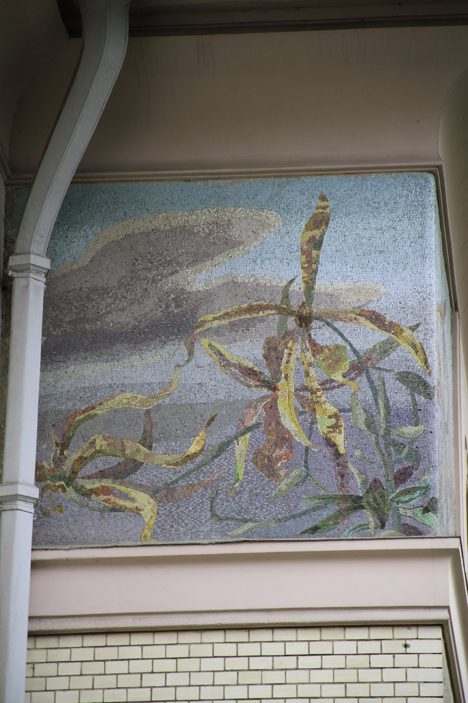
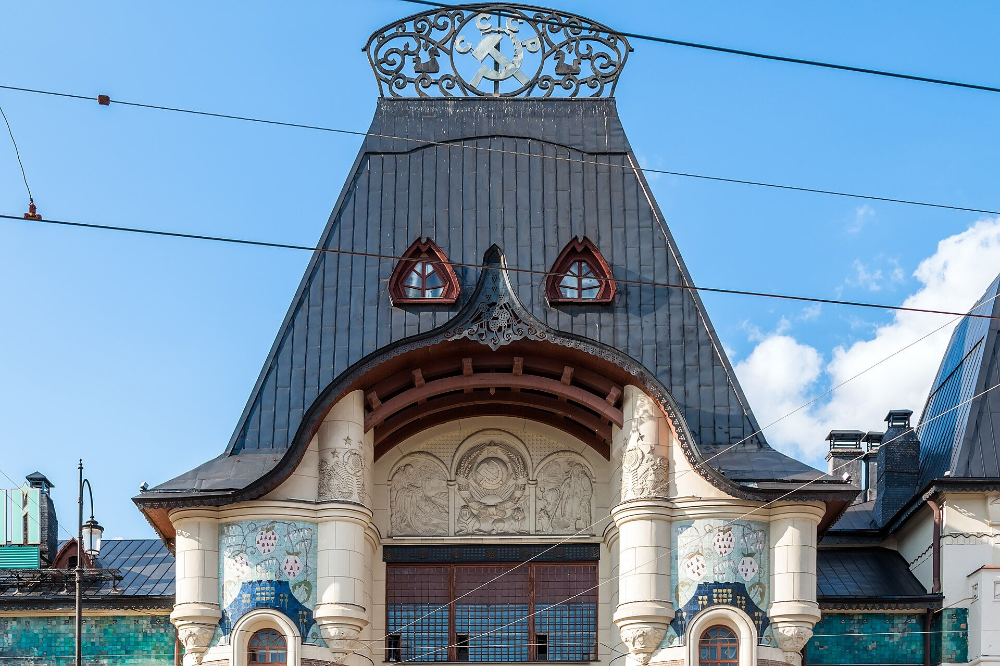
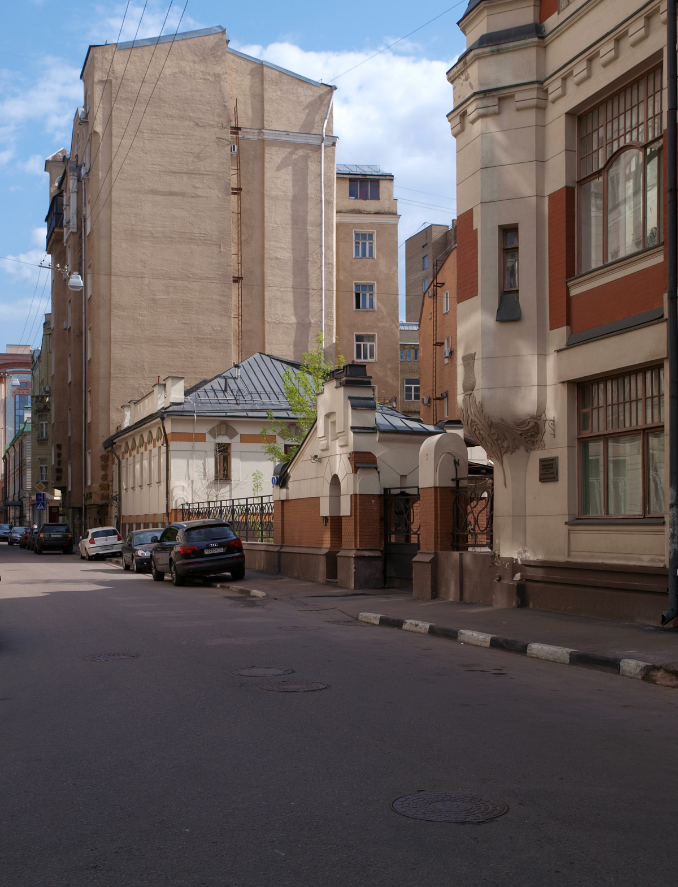

# Московский модерн Шехтеля: от особняка Рябушинского до клубного дома у Левенсона

Самый известный архитектор московского модерна не окончил училище и долго не имел права подписывать собственные проекты. Зато у него были заказчики, которым диплом был не нужен: Морозовы, Рябушинские, владелец скоропечатни Левенсон. Вместе они придумали стиль, по которому мы до сих пор узнаём Москву начала XX века. А во дворе одной из его построек — типографии в Трёхпрудном переулке — сейчас достраивают клубный дом.

## Коротко

- Фёдор Шехтель (1859–1926) учился в Московском училище живописи, ваяния и зодчества, но в 1878 году был отчислен. Право подписывать проекты как «техник архитектуры» он получил в 1894-м — экзаменом стал проект особняка Зинаиды Морозовой.
- Главные постройки — особняк Морозовой (1893–1898), скоропечатня Левенсона (1900), особняк Рябушинского (1900–1903), Ярославский вокзал (1902–1904), МХТ (1902). Все пять стоят.
- Типографию Левенсона в 2013–2016 годах отреставрировали, в 2021-м город утвердил её предмет охраны. На участке строят клубный дом «Левенсон», сдача по каталогу новостроек — III квартал 2027 года.
- Утрачено меньше, чем можно подумать: фасад дома Левенсона на Петровке, павильон Туркестана 1923 года, часть интерьеров Ярославского вокзала.

*Особняк Рябушинского на Малой Никитской: мозаичный фриз с ирисами. Фото: Shesmax, CC BY-SA 4.0, Wikimedia Commons*

## Как появился московский модерн: архитектор без диплома

Шехтель родился в Петербурге в 1859 году и до перехода в православие звался Францем Альбертом. В Москве он поступил на архитектурное отделение училища живописи, ваяния и зодчества, но в 1878 году его отчислили за пропуски. Дальше — подённая работа: графика для журналов (псевдоним «Финь-Шампань» ему придумал Антон Чехов), театральные декорации, оформление сада «Эрмитаж».

Вот первая легенда, которую стоит развенчать: «великий архитектор» долго был архитектором только по факту. Официальное право строить он получил в 35 лет, сдав экзамен проектом особняка для Зинаиды Морозовой. Неплохая курсовая.

Вторая поправка — к самому слову «модерн». [Большая российская энциклопедия](https://bigenc.ru/c/shekhtel-fiodor-osipovich-de9367) делит Шехтеля на периоды: неоготика (особняк Морозовой), неорусский стиль (Ярославский вокзал), романтический модерн (особняк Рябушинского), рационалистический модерн (типография «Утро России» в Большом Путинковском, 1907–1909), потом неоклассицизм. «Московский модерн» — зонтик над всем этим, а не один рецепт.

*Ярославский вокзал. Фото: Mike1979 Russia, CC BY-SA 4.0, Wikimedia Commons*

## Заказчики: Морозовы, Рябушинские и Левенсон

Модерн в Москве оплатили не дворяне, а купцы и промышленники, среди них старообрядцы Рябушинские. Им нужно было показать деньги, но не в дворянском классицизме, а в чём-то новом.

**Морозовы.** Особняк на Спиридоновке, 17, Савва Морозов строил для семьи, но записал на жену Зинаиду. Неоготический замок с панно и скульптурами Михаила Врубеля внутри. После смерти Саввы в 1905 году вдова продала дом Михаилу Рябушинскому. Сейчас здесь Дом приёмов МИД России, так что внутрь попадают в основном дипломаты.

Тот же Савва Морозов заказал Шехтелю перестройку здания Художественного театра в Камергерском переулке в 1902 году. Шехтель нарисовал и эскизы занавеса, и эмблему с чайкой, которую МХТ носит до сих пор.

**Рябушинские.** Для Степана Рябушинского Шехтель в 1900–1903 годах построил особняк на Малой Никитской, 6/2, — хрестоматию московского модерна. Лестница-волна, мозаика пола с водной рябью, капители с морскими мотивами. Под крышей — тайная старообрядческая молельня: староверам не разрешали строить храмы, и вера переехала в частный дом. Современники восторга не разделяли: Корней Чуковский назвал дом в дневнике «самым гадким образцом декадентского стиля». Для Павла Рябушинского позже появилась типография газеты «Утро России».

**Левенсон.** Александр Левенсон начинал в 1881 году с одной печатной машины, а к 1896 году стал поставщиком императорского двора. В 1899-м он купил участок в Трёхпрудном переулке и позвал Шехтеля, с которым был знаком по афишам «Эрмитажа». В 1900 году здесь вырос производственный комплекс, и это, по словам главы Департамента культурного наследия Алексея Емельянова, был необычный проект для промышленного предприятия: административный корпус похож на небольшой романо-готический замок с эркером и шатровыми башенками.

*Трёхпрудный переулок, бывшая типография Левенсона, 2009 год. Фото: NVO, CC BY-SA 3.0, Wikimedia Commons*

## Ярославский вокзал: майолика вместо мрамора

Вокзал на Комсомольской площади, 5, Шехтель не строил с нуля, а реконструировал в 1902–1904 годах. Площадь выросла примерно втрое. Фасад собран из мотивов Русского Севера: высокая кровля-терем, асимметричная башня, входная арка с килевидным козырьком, гербы Москвы, Ярославля и Архангельска над порталом.

Главное украшение — керамический фриз с растительным орнаментом. По эскизам Шехтеля его сделали в Абрамцевской мастерской Саввы Мамонтова, зелёной и коричневой глазурованной плиткой с майоликовыми вставками. Это и есть ответ на вопрос, откуда в московском модерне столько керамики: у купцов была своя мастерская.

Распространённая путаница: панно Константина Коровина о Русском Севере к майолике отношения не имеют. Их написали для Нижегородской выставки 1896 года, оригиналы хранятся в Третьяковской галерее и Русском музее, а в вокзале висят копии.

## Что сохранилось, а что утрачено

Хорошая новость: все пять главных зданий стоят. Плохая — не все в первозданном виде.

- **Особняк Рябушинского** пережил Госиздат (с 1919 года), Общество культурной связи с заграницей (1925–1931) и детский сад. В 1931 году его отдали Максиму Горькому, а с 1965 года здесь музей писателя — один из немногих способов увидеть интерьер Шехтеля изнутри.
- **Ярославский вокзал** терял больше всех. В начале 1930-х пути отодвинули, и часть интерьеров Шехтеля пропала. В 1962–1965 годах между крыльями встроили новый корпус, в 2005-м провели реконструкцию с реставрацией. Фасад и майоликовый фриз на месте.
- **Особняк Морозовой** и **МХТ** работают по назначению — дипломатическому и театральному.
- **Утрачены** перестроенный Шехтелем в 1890 году фасад дома Левенсона на Петровке и павильон Туркестана на сельскохозяйственной выставке 1923 года — последняя реализованная работа архитектора. После 1917 года заказов у него почти не было.

Собственный особняк Шехтеля в Ермолаевском переулке, 28 (1896), тоже цел: над входом мозаика с ирисами и цифрами 96.

## Типография Левенсона: от скоропечатни к клубному дому

Здесь история Шехтеля переходит в историю девелопмента — и в нашу базу.

После революции скоропечатню национализировали, она стала 16-й типографией треста «Мосполиграф» и работала до 1942 года. До того здесь на свои деньги напечатала первые сборники, «Вечерний альбом» и «Волшебный фонарь», Марина Цветаева. В 2013–2016 годах административный корпус отреставрировали: вернули исходный цвет, лепнину, барельеф, надписи на фасаде, кабинет Левенсона с отделкой Шехтеля. Реставрация стала лауреатом конкурса «Московская реставрация — 2016». В январе 2021 года Департамент культурного наследия утвердил предмет охраны здания по адресу Трёхпрудный пер., 9, стр. 1, 4. Под охраной фасады 1900–1909 годов, барельефы, лестницы, интерьеры, чугунные колонны, паркет, метлахская плитка. Подробнее о том, что это значит для собственника, — в словаре: [объект культурного наследия (ОКН)](/slovar/okn/).

Участок за эти годы сменил несколько сценариев. В ноябре 2020 года здание выставляли на продажу за 1 млрд руб. В нашей базе два досье по этому адресу. [Первый проект](/obekty/tipografiya-levensona/) в 2019–2020 годах рисовало бюро [APEX](/arhitektory/apex/). В 2021-м площадка сменила девелопера, появились фасады с арками и вариант от [nowadays](/arhitektory/nowadays/). В 2023 году город разрешил застройку двора скоропечатни, а проект, показанный тогда же, называли работой «Цимайло, Ляшенко и партнёров».

Что сейчас (на 15 октября 2026 года): по данным каталога новостроек, на Трёхпрудном, 9/1, Vesper (застройщик — СЗ «Трехпрудный») строит клубный дом «Левенсон» — 4–6 этажей, корпуса 9/1, 9/2, 9/4 и 9/7, срок сдачи — III квартал 2027 года. На конец сентября шла отделка фасадов. В нашем [досье «Левенсона»](/obekty/levensona/) проект отнесён к классу де-люкс, квартиры продаются.

## Где модерн в новой Москве

Честно: прямых цитат модерна в московских новостройках меньше, чем хотелось бы. Девелоперы охотнее берут арки и камень, чем майолику и асимметрию.

**«Левенсон» — самая буквальная связь.** Это не цитата, а соседство с оригиналом: новый дом стоит на том же участке, что и охраняемый корпус Шехтеля. В описании проекта перечислены натуральный камень, арочные окна, кованые ограждения, мозаика, витражные окна и крыши «в стиле модерн». По сути, это попытка продолжить разговор с шехтелевским замком его же языком. Получилось ли — увидим после снятия лесов в 2027-м.

**Соседи по кварталам Шехтеля.** На той же Малой Никитской, где стоит особняк Рябушинского, в базе два проекта: [Малая Никитская, 27](/obekty/malaya-nikitskaya-27/) (ПИК, архитектура WALL) и Малая Никитская, 29 (Coldy). У Патриарших, в двух шагах от собственного особняка Шехтеля в Ермолаевском, — Большой Козихинский, 22 (Coldy, бюро WALL и Ariada) и Pentagram на Большом Козихинском, 31 (Palladio Group, SPEECH). Стилистически с модерном их ничто не связывает: это не оммаж, а контекст. Но именно на этих улицах новым домам приходится выдерживать соседство с лестницей-волной и замком с чертополохом.

Главный урок Шехтеля для сегодняшнего рынка, на наш вкус, не в декоре. Его заказчики платили за архитектуру как за личное высказывание, а не за «премиальный формат». Типография Левенсона строилась как завод, и её до сих пор реставрируют по авторским чертежам. Посмотрим, кого из нынешних клубных домов через сто лет будут охранять так же. Больше историй — в [материалах об архитектуре](/temy/arhitektura/).

## Вопросы и ответы

**Какие здания в Москве построил Фёдор Шехтель?**
Среди главных — особняк Зинаиды Морозовой на Спиридоновке (1893–1898), особняк Степана Рябушинского на Малой Никитской (1900–1903), скоропечатня Левенсона в Трёхпрудном переулке (1900), Ярославский вокзал (1902–1904) и перестройка здания МХТ в Камергерском переулке (1902).

**Где посмотреть особняк Рябушинского изнутри?**
В особняке на Малой Никитской, 6/2, с 1965 года работает музей Максима Горького, вход со двора. Внутри сохранилась знаменитая лестница-волна.

**Что сейчас с типографией Левенсона?**
Здание — охраняемый памятник, административный корпус отреставрировали в 2013–2016 годах. На участке Vesper строит клубный дом «Левенсон» в 4–6 этажей, сдача по каталогу новостроек — III квартал 2027 года.

**Был ли Шехтель дипломированным архитектором?**
Нет. Его отчислили из Московского училища живописи, ваяния и зодчества в 1878 году, а право подписывать проекты как «техник архитектуры» он получил только в 1894 году — сдав экзамен проектом особняка Морозовой.

## Источники

- [Шехтель Фёдор Осипович — Большая российская энциклопедия](https://bigenc.ru/c/shekhtel-fiodor-osipovich-de9367)
- [Особняк Рябушинского — «Узнай Москву»](https://um.mos.ru/houses/osobnyak_ryabushinskogo/)
- [Маршрут «Дома Фёдора Шехтеля» — «Узнай Москву»](https://um.mos.ru/routes/doma-fedora-shehtelya/)
- [Ярославский вокзал — «Узнай Москву»](https://um.mos.ru/houses/yaroslavskiy-vokzal/)
- [Утверждён предмет охраны скоропечатни Левенсона — mos.ru, 15 января 2021 года](https://www.mos.ru/news/item/85243073/)

Материал не является инвестиционной рекомендацией.
