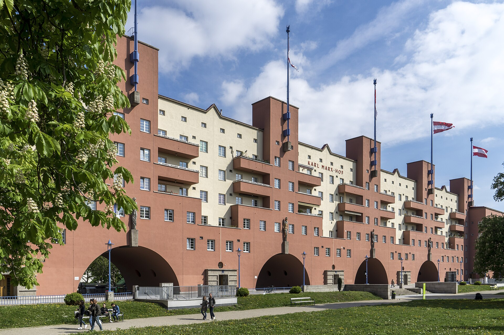
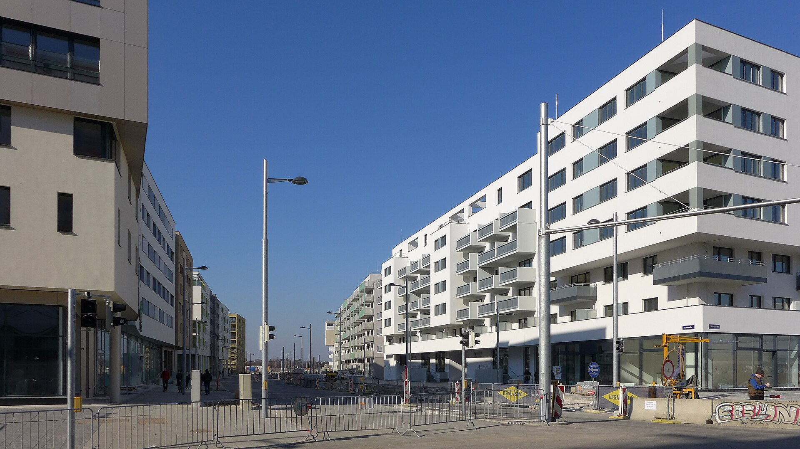
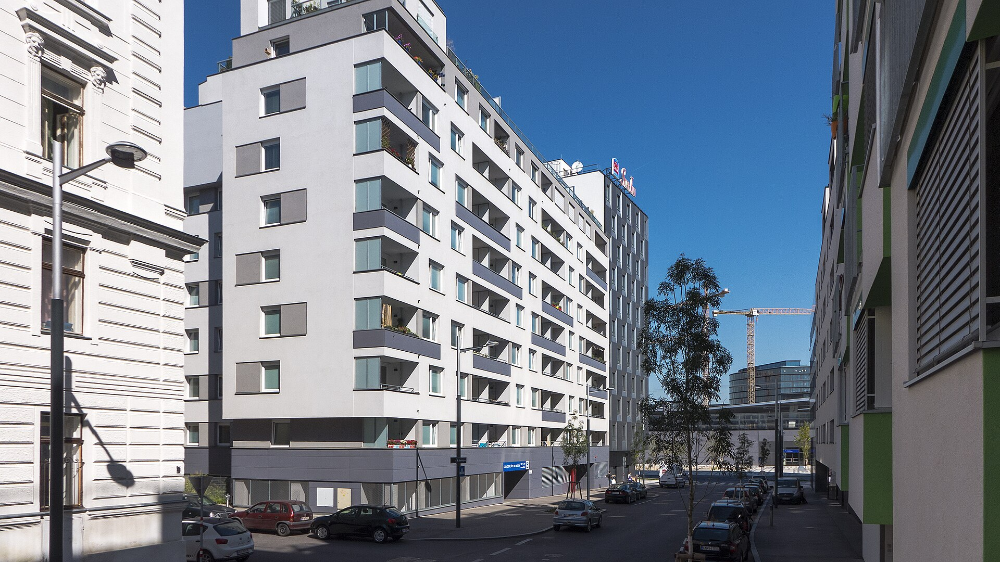

# Венская модель жилья: конкурс по четырём критериям и что из неё взять Москве

В Вене землю под новое жильё получает не тот, кто больше заплатит, а тот, кто убедит жюри по четырём пунктам сразу: архитектура, экономика, экология и социальная устойчивость. Так город строит с 1995 года. Итог — социальное жильё в Вене стало нормой для среднего класса, а не гетто для бедных: около 60% жителей живут в домах, построенных или обновлённых на субсидии. Звучит как открытка. Но у модели есть очереди, долги и районы, которые годами росли медленнее плана. Разбираемся, как это устроено и что из этого пригодится Москве, где главный городской застройщик — Фонд реновации, а главный инструмент развития — [КРТ](/slovar/krt/).

## Коротко

- В Вене около 220 тыс. муниципальных квартир (Gemeindebau) и около 185 тыс. квартир лимитированно-прибыльных компаний — примерно 40% всего жилого фонда.
- С 1995 года через конкурс застройщиков (Bauträgerwettbewerb) прошли 303 проекта-победителя и около 40 тыс. квартир. Четвёртый критерий — социальную устойчивость — добавили в 2009 году.
- Деньги — из жилищного взноса в 1% фонда оплаты труда. Субсидии выдают займами под 1% на 40 лет, и возвраты снова идут в оборот.
- Москве целиком модель не подходит: реновация переселяет собственников, а не арендаторов. Но многокритериальный конкурс и условия по доступному жилью вполне встраиваются в договоры КРТ.

*Карл-Маркс-Хоф — самый известный муниципальный дом Вены. Фото: Thomas Ledl, CC BY-SA 4.0, Wikimedia Commons*

## Как устроено социальное жильё в Вене: два этажа системы

Первый этаж — **Gemeindebau**, муниципальные дома. Город сам владелец и арендодатель: управляет ими Wiener Wohnen. Это самая известная часть системы: по оценке журнала profil на 2015 год, в муниципальных домах жил примерно каждый третий венец, около 500 тыс. человек.

Второй этаж — **лимитированно-прибыльные компании** (gemeinnützige Bauvereinigungen, их часто называют кооперативами). Это частные и общественные застройщики, которым закон ограничивает доходность — 3,5%. Взамен они получают дешёвые займы и доступ к городской земле. Именно они строят основную часть новых субсидируемых квартир.

Порог входа низкий по-европейски: право на социальное жильё потенциально имеют около 80% венских домохозяйств. В этом и философия — смешивать, а не концентрировать бедность. Для самых доступных квартир есть отдельный продукт: SMART-квартиры с арендой 7,5 евро за м² в месяц и разовым взносом 60 евро за м². С 2019 года половина квартир в новых субсидируемых проектах должна быть SMART.

*Зеештадт Асперн — новый район на месте бывшего аэродрома. Фото: Gugerell, CC0, Wikimedia Commons*

## Конкурс застройщиков: четыре критерия вместо одной цены

Главная механика, ради которой стоит смотреть на Вену, — **Bauträgerwettbewerb**. Его проводит городской фонд wohnfonds_wien. Конкурс обязателен в двух случаях: если земля принадлежит фонду или если на чужом участке планируют больше 500 субсидируемых квартир.

Заявки сравнивают по четырём столпам:

- **экономика** — стоимость земли и стройки, будущая плата жильцов, условия договоров;
- **социальная устойчивость** — удобство в быту, экономия за счёт планировки, общие пространства, квартиры под меняющиеся семьи;
- **архитектура** — градостроительная структура, планировки, облик;
- **экология** — климат, ресурсы, вторичное использование материалов, качество зелени и открытых пространств.

Судит междисциплинарное жюри: архитекторы, градостроители, экологи, экономисты, инженеры, юристы по жилищному праву, социологи и исследователи жилья, плюс представители района, города, фонда и владельца земли. Победитель покупает участок или получает право застройки — и обязан построить ровно то, что выиграло. Сейчас критериев уже пять: отдельно выделены климат и общественные пространства.

За первые 25 лет фонд провёл 80 конкурсов: 303 проекта-победителя, около 40,4 тыс. квартир. Важная деталь: экономика здесь — не «кто дал больше за землю», а «сколько будут платить жильцы». Цена квартиры для конечного пользователя — часть оценки, а не побочный результат.

*Зонвендфиртель у Главного вокзала Вены. Фото: Gugerell, CC0, Wikimedia Commons*

## Кто платит: 1% зарплаты и займы по кругу

Источник денег — **Wohnbauförderungsbeitrag**, жилищный взнос в размере 1% фонда оплаты труда. По Австрии это около 1,3 млрд евро в год. С финансового выравнивания 2018 года взнос стал земельным налогом: каждая земля сама решает, как его тратить.

Ключевое слово — займы. Субсидии выдают в основном кредитами под 1% на 40 лет, и деньги возвращаются в систему. В 2022 году Вена потратила на жилищные субсидии 296 млн евро, а получила 440 млн евро возвратов по старым займам. Это не бездонная бочка бюджета, а револьверный фонд, который десятилетиями кормит сам себя.

## Новые районы: Seestadt Aspern и Sonnwendviertel

**Seestadt Aspern** — самый большой венский проект на месте бывшего аэродрома: 240 га, по плану больше 25 тыс. жителей и больше 20 тыс. рабочих мест. Мастер-план утвердили в 2007 году, стройку начали в 2010-м. На июнь 2026 года здесь живут больше 12 тыс. человек, построено 5 тыс. квартир из более чем 11,5 тыс. запланированных, общий объём инвестиций — около 6 млрд евро. Ведёт проект девелопер Wien 3420 aspern Development AG. Жилые кварталы разыгрывали через конкурс застройщиков в 2012 и 2017 годах.

Сильная сторона — транспорт вперёд жилья: метро U2 пришло сюда в октябре 2013 года, примерно за год до первых квартир. Слабая — управление. Счётная палата Австрии в 2015 году написала, что у города не было полного контроля над проектом, а у руководства проекта — общей картины расходов на инфраструктуру. Продление U2 обошлось примерно в 340 млн евро без НДС. Первоначальный план обещал 20 тыс. жителей к концу проекта; спустя 13 лет после старта их 12 тыс., а горизонт сдвинулся в 2030-е.

**Sonnwendviertel** у нового Главного вокзала — другой рецепт. Около 5,5 тыс. квартир и 13 тыс. жителей, вокруг большого парка. Западная часть — в основном субсидируемое жильё по конкурсам 2009, 2012 (SMART) и 2016 годов, восточная — в основном свободного финансирования. То есть даже в Вене новый район — это смесь, а не стопроцентно социальный проект.

## Без открыток: что в венской модели не работает

**Муниципальное жильё перестали строить.** Последний новый Gemeindebau до перерыва открыли в 2004 году. Следующий — Barbara-Prammer-Hof на Fontanastraße, 3 в Фаворитене на 120 квартир — сдали только в ноябре 2019-го. Аренда там — 7,50 евро за м² брутто, без собственного взноса, залога и срока договора. Город пообещал около 4 тыс. таких квартир — на фоне 220 тыс. в фонде это немного.

**Очередь и лимиты.** По данным profil на 2015 год, в очереди на муниципальную квартиру стояли около 27 тыс. претендентов, ждать приходилось больше полутора лет. Лимит дохода для одиночки тогда составлял 3140,71 евро чистыми 14 раз в год — и проверялся только при заселении. Разбогатевший жилец сохраняет квартиру с низкой арендой. Сторонники называют это социальным смешением, критики — субсидией для среднего класса.

**Долги и износ.** Тогда же у Wiener Wohnen было 2,7 млрд евро долга, а часть домов 50–60 лет жила без капитального ремонта.

**Стройка проседает.** Разрешений на квартиры в Вене выдали до 26 тыс. в 2017 году, 14 тыс. в 2022-м, а на 2023-й прогноз был ниже 10 тыс.

## Что из этого применимо к московскому КРТ

Напрямую сравнивать не получится. Вена сдаёт квартиры в долгую аренду и держит их на балансе десятилетиями. Москва в реновации меняет собственность на собственность. Программа, утверждённая в августе 2017 года, расселяет 5176 домов и касается около миллиона москвичей.

Фонд реновации — действительно городской застройщик, как Wiener Wohnen в лучшие годы. Но экономика другая: часть квартир фонд продаёт на открытом рынке под маркой «Московские кварталы». В [доме на 6-й Радиальной, 7/1 к2](/obekty/mk-6-ya-radialnaya-7-1-k2/) в Бирюлёве Восточном в июле 2026 года просили от 305 тыс. ₽ за м², лоты — от 11,3 млн ₽. На [3-й Прядильной, з/у 13](/obekty/mk-3-ya-pryadilnaya-z-u-13/) в Измайлове фонд строит дом на 877 квартир с вводом в 2027 году и тоже продаёт часть квартир. Венская система деньги возвращает займами, московская — продажами по рыночной цене.

Архитектура реновационных домов проходит обычную процедуру [АГР](/slovar/agr/): за девять месяцев 2025 года Москомархитектура выдала 259 свидетельств на такие дома. Это согласование, а не конкурс: город проверяет проект, а не выбирает лучший из нескольких.

С [КРТ](/krt/) интереснее. Договор о комплексном развитии город заключает либо по итогам торгов, либо с правообладателями земли — то есть в лучшем случае побеждает цена, в остальных выбора нет вовсе. Архитектура появляется позже и зависит от застройщика. Вот что можно взять из Вены:

1. **Конкурс до земли, а не после.** На крупных городских участках КРТ — тот же порог в 500 квартир, что и в Вене, — выбирать инвестора по нескольким критериям, где цена для конечного жильца весит не меньше цены участка.
2. **Экономику жильца — в условия договора.** Доля квартир для города, арендный фонд или потолок цены на часть площадей — то, что в Вене решает конкурс, в Москве можно прописать в договоре КРТ.
3. **Жюри, а не только экспертиза.** Пример того, как застройщики уже сами играют в многоавторство, — [КРТ Дербеневская](/obekty/krt-derbenevskaya/) «Пионера», где в досье пять бюро: [APEX](/arhitektory/apex/), [Kleinewelt Architekten](/arhitektory/kleinewelt/), [WALL](/arhitektory/wall/), [«Цимайло, Ляшенко и партнёры»](/arhitektory/tsimailo-lyashenko/) и [ADM](/arhitektory/adm/). Разница с Веной в том, кто выбирает: здесь — заказчик, там — независимое жюри с правом голоса района.
4. **Метро раньше домов — и смета на виду.** Seestadt показывает обе стороны: транспорт за год до заселения работает, а непрозрачные расходы на инфраструктуру потом всплывают в отчёте аудиторов. Для КРТ вроде [«Выхино»](/obekty/krt-vykhino/) «Аквилона» на Ферганской, 8, которое сейчас на стадии архитектуры, или [«Курской»](/obekty/krt-kurskaya/) ПИК с проектом ABD, которая пока на стадии участка, вопрос «кто и когда платит за дороги и школы» стоит задать до первых продаж.

Чего брать не стоит — идеи, что конкурс решит всё. В Вене он работает, потому что за ним стоят дешёвые займы, городская земля и вековая привычка снимать жильё. Без этих трёх опор четыре критерия превращаются в красивую анкету.

Больше о том, как устроены города, — в разделе [«Архитектура»](/temy/arhitektura/).

## Вопросы и ответы

**Сколько жителей Вены живут в социальном жилье?**

По данным IBA Wien, около 60% венцев живут в квартирах, построенных или обновлённых на жилищные субсидии. Собственно социальный фонд — около 220 тыс. муниципальных квартир и около 185 тыс. квартир лимитированно-прибыльных компаний, примерно 40% всех квартир города.

**Что такое Bauträgerwettbewerb?**

Это конкурс застройщиков, который фонд wohnfonds_wien проводит с 1995 года. Команды застройщика и архитектора соревнуются по четырём критериям — архитектура, экономика, экология и социальная устойчивость (последний добавлен в 2009 году). Победитель получает участок и субсидию и обязан построить проект.

**Откуда Вена берёт деньги на жильё?**

Основа — жилищный взнос в размере 1% фонда оплаты труда, с 2018 года это земельный налог. Субсидии выдаются в основном займами, и возвраты старых займов снова идут в оборот: в 2022 году Вена получила 440 млн евро возвратов при 296 млн евро расходов.

**Можно ли перенести венскую модель в Москву?**

Целиком нет: в Вене жильё сдают в долгую аренду, а реновация в Москве переселяет собственников в собственность, и часть квартир Фонд реновации продаёт по рыночным ценам. Но многокритериальный конкурс на землю и условия по доступному жилью можно встроить в договоры КРТ.

## Источники

- IBA Wien: [Social housing policy in Vienna](https://www.iba-wien.at/en/iba-wien/iba-wien-1-1-1-1-1).
- wohnfonds_wien, сентябрь 2024 года: [буклет о конкурсе застройщиков](https://www.wohnfonds.wien.at/media/Website%20PDF-INFO%20Downloads/Publikationen/Neubau/20240912%20BTW%20Folder%20final.pdf).
- wohnfonds_wien, 2021 год: [25 лет конкурса застройщиков](https://www.wohnfonds.wien.at/media/Website%20PDF-INFO%20Downloads/Publikationen/Neubau/2021_Ausstellung%2025JahreBTW.pdf).
- Город Вена (MA 50): [доклад о жилищных субсидиях в Австрии за 2023 год](https://www.wien.gv.at/spezial/studien/ma50/berichtsstandardwohnbaufoerderung2023.pdf).
- Wien 3420 aspern Development AG, июнь 2026 года: [factsheet Seestadt Aspern](https://www.aspern-seestadt.at/Downloads-Pdfs/aspern_Seestadt_Factsheet-EN.pdf).
- Счётная палата Австрии, Wien 2015/2: [Erschließung Seestadt Aspern](https://www.rechnungshof.gv.at/rh/home/home/Erschliessung_Seestadt_Aspern.pdf).
- Австрийское географическое общество, 2022 год: [экскурсия по Sonnwendviertel](https://oegg.univie.ac.at/fileadmin/user_upload/k_oegg/exkursionen/OeEX_Sonnwendviertel-2022.pdf).
- vienna.at, 5 ноября 2019 года: [Erster «neuer» Gemeindebau steht in Wien-Favoriten](https://www.vienna.at/erster-neuer-gemeindebau-steht-in-wien-favoriten/6413629).
- profil, 11 марта 2015 года: [Nostalgie in Beton](https://www.profil.at/oesterreich/nostalgie-beton-spoe-gemeindewohnungen-gemeindebau-5549965).
- mos.ru, 18 сентября 2026 года: [Московская программа реновации жилья](https://www.mos.ru/news/item/175879073).
- РИАМО, 16 октября 2025 года: [Ефимов: 14 тыс. АГР оформили в Москве за 14 лет](https://riamo.ru/news/nedvizhimost/efimov-14-tys-arhitekturno-gradostroitelnyh-reshenij-oformili-v-moskve-za-14-let/).
- База «Шахматки»: [проекты КРТ](https://шахматка.москва/krt/) и досье объектов, данные на 15 октября 2026 года.

Дата проверки фактов: 15 октября 2026 года.

Материал не является инвестиционной рекомендацией.
