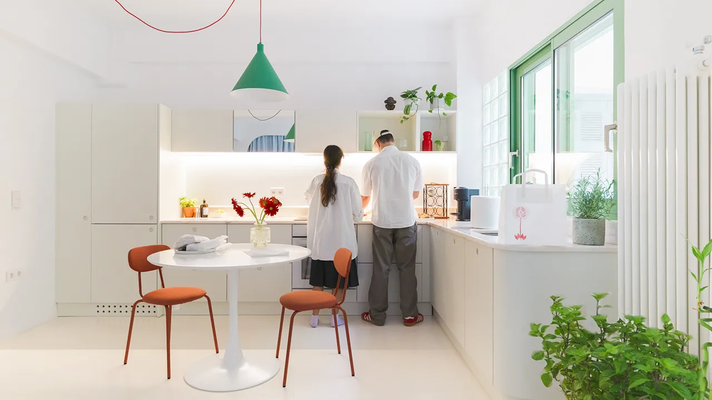
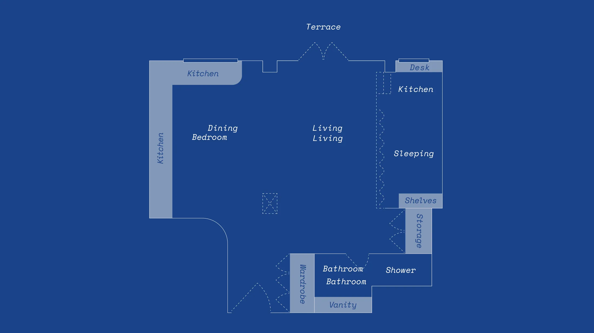
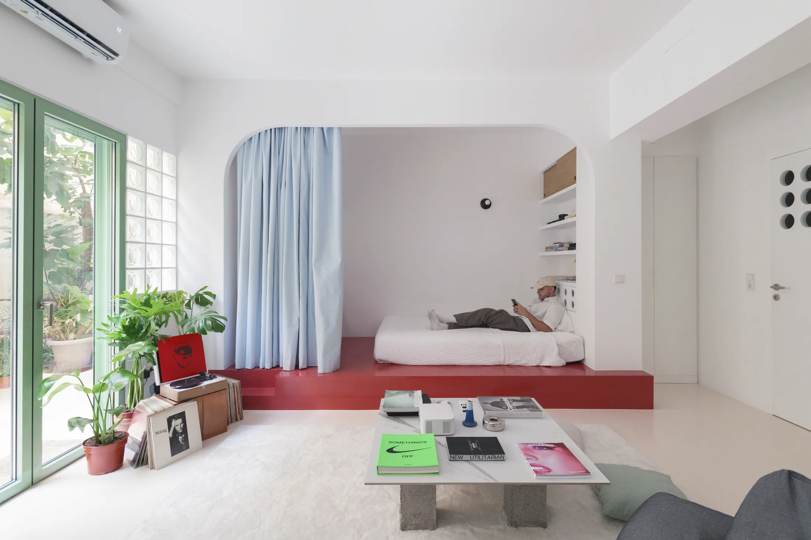
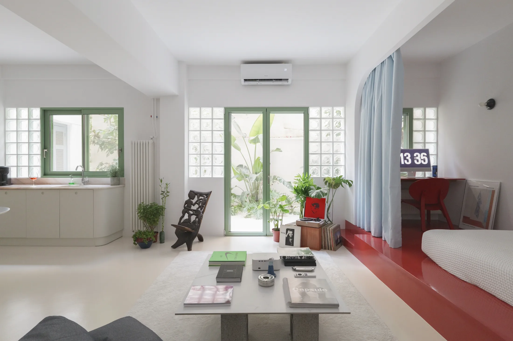
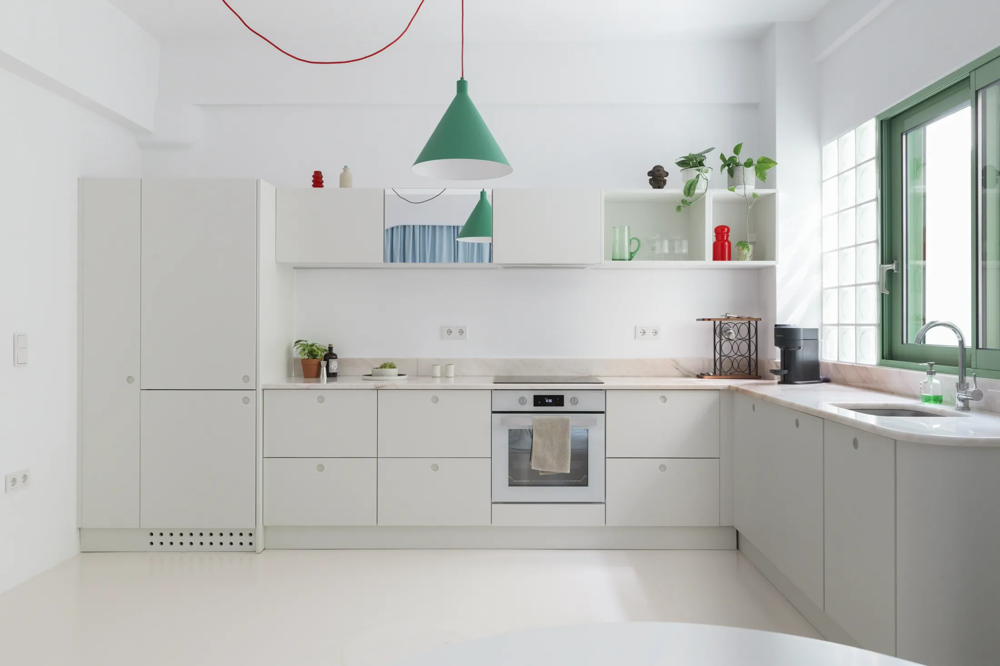
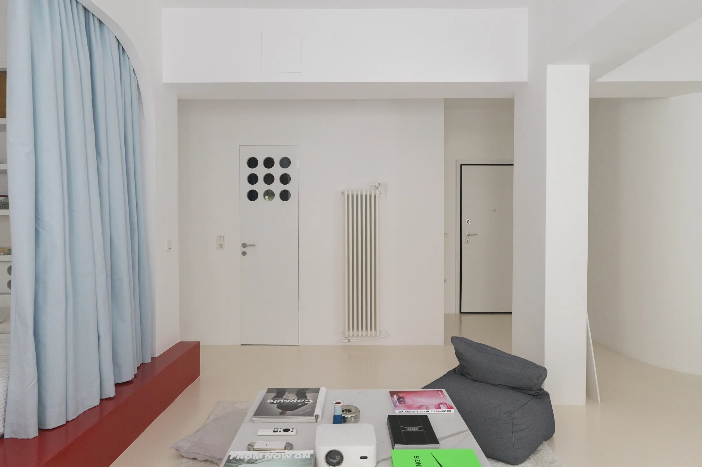
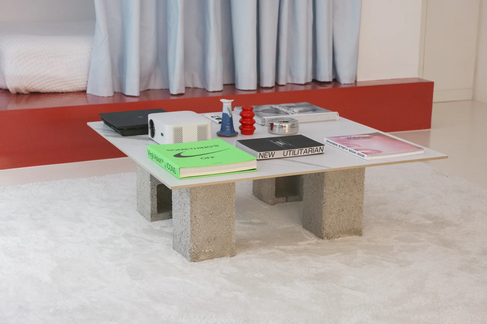

# Шторка вместо двери и стеклоблоки: пять приёмов из афинской квартиры

В Афинах большую часть жилого фонда составляют «поликатикии» — многоквартирные дома середины XX века из бетона, с балконами и высокими потолками. Квартира Carmen — на первом этаже такого дома, в районе Эксархия. Её перестроила итальянка Федерика Скалисе (Federica Scalise): архитектор и иллюстратор, живущая в Афинах и работающая над жилыми интерьерами и реновациями. Фотографировала проект Лея Мартин (Lea Martin).

Площадь квартиры в публикации Never Too Small не указана, но по названию и по тому, как сжата спальня, понятно: квартира компактная. Для московского читателя это интересно сразу по двум причинам. Во-первых, афинская «поликатикия» — близкая родственница московского конструктивизма и сталинок: бетонный каркас, высокие потолки (здесь около трёх метров) и городская среда вокруг. Во-вторых, московские студии и однушки сегодня по минимуму ограничены 28 м² (постановление № 1672-ПП), так что идеи «меньше стен — больше жизни» нужны не только в старом фонде.

*Квартира Carmen, Афины. Архитектор Федерика Скалисе. Фото: Lea Martin / Never Too Small*

## Коротко

- Спальня уменьшена до алькова на подиуме; приватность даёт голубая плотная штора.
- Свет вглубь плана проводят стеклянные кирпичи вдоль фасада и дверь с девятью круглыми окошками.
- Зелёные рамы окон и дверей собирают интерьер и напоминают об исторических ставнях.
- Узкие верхние шкафы «растягивают» потолок высотой около трёх метров.
- Мебель простая: столик из четырёх строительных блоков и одной большой плитки.

*План квартиры после перепланировки. Чертёж: Федерика Скалисе / Never Too Small*

## Приём 1: спальня-альков со шторой

Скалисе сократила типичную отдельную спальню до алькова. Кровать стоит на приподнятом подиуме, окрашенном в глянцевый красный; закрывает её плотная голубая штора, которая и скрывает от глаз, и затемняет. В подиум и вокруг него встроены библиотека, хранение, прикроватная тумба и небольшой письменный стол под окном — то есть к кровати привязаны сразу несколько функций.

*Спальня-альков на подиуме, отгороженная шторой. Фото: Lea Martin / Never Too Small*

**Для Москвы.** В студии 25–30 м² кровать за шторой — один из самых недорогих способов получить «спальню», не строя стену. Плотный блэкаут на потолочном карнизе пригодится в Москве: летом светает очень рано, а уличные фонари под окнами горят всю ночь. Подиум стоит делать с выдвижными ящиками, как минимум под зимние вещи. Внимание: штора не заменяет звукоизоляцию, а ставить подиум вплотную к окну с радиатором нельзя — потеряете тепло.

## Приём 2: стеклянные кирпичи — свет без прозрачности

Вдоль главного фасада архитектор поставила перегородки из стеклянных кирпичей. Они пропускают дневной свет дальше вглубь плана, но не дают видеть, что происходит за ними. Это нужно в квартире на первом этаже: окна выходят на улицу, и открытость прохожим не нужна.

*Стеклянные кирпичи пропускают свет вглубь квартиры и сохраняют приватность. Фото: Lea Martin / Never Too Small*

Рамы окон и дверей покрашены в зелёный — отсылка к исторической раскраске ставен и способ «обвести» вид за окном, как рамку картины.

**Как повторить.** Стеклоблоки знакомы по советскому строительству, и в московской квартире они выглядят уместно. В квартире их можно использовать там, где нужна полупрозрачная перегородка: между прихожей и комнатой, между кухней и ванной. Но любые работы со стенами требуют согласования: несущие конструкции трогать нельзя, а перегородку нужно ставить так, чтобы не перекрывать вентиляционные каналы (их ликвидация и уменьшение запрещены по 508-ПП). Альтернатива без стройки — рифлёное или матовое стекло в двери.

## Приём 3: узкие шкафы и «случайное» зеркало

Кухня в афинской квартире высокая: потолки около трёх метров. Верхние шкафы сделаны узкими, а над ними оставлено пространство — туда поставили растения и вещи. Один из дверок шкафа затянут зеркалом: оно отражает свет и добавляет глубины, а выглядит как «найденный» предмет, а не продуманный элемент.

*Узкие верхние шкафы подчёркивают высоту потолка, а зеркало на дверце добавляет глубины. Фото: Lea Martin / Never Too Small*

**Для Москвы.** Приём подходит для сталинки или дореволюционного доходного дома с потолками 3 м и выше. Узкие верхние шкафы глубиной 20–25 см вместо стандартных 30–35 дают лёгкость и не нависают над головой. В новостройке с потолком 2,7 м проще оставить кухню без верхних шкафов вовсе и добавить открытые полки.

## Приём 4: дверь с «иллюминаторами»

Самая запоминающаяся деталь — дверь в ванную. Ванная в этой квартире без окна, поэтому в верхней части заказной двери прорезаны девять круглых отверстий. Через них дневной свет попадает из гостиной в санузел, а сама дверь остаётся глухой на уровне глаз.

*Дверь в ванную без окна: девять круглых «иллюминаторов» пропускают свет. Фото: Lea Martin / Never Too Small*

**Как повторить.** Окна в ванных московских хрущёвок и панелек почти не бывает, так что приём применим массово. Заказной щит из массива или фанеры с круглыми вставками из матового стекла — работа для столяра, не для строителей. Диаметр отверстий и их количество подбирайте так, чтобы получилось не «решето», а рисунок. Что важно по правилам: вентиляционное отверстие в стене ванной оставляйте нетронутым и не заменяйте его «окошком» в двери.

## Приём 5: столик из блоков

Журнальный столик в гостиной сделал давний жилец Такис Димитриадис (Takis Dimitriadis): четыре строительных блока и одна большая плитка. Высота подобрана под проектор хозяина — столик служит и подставкой, и местом для напитков, и его можно пересобрать в другую форму.

*Журнальный столик из строительных блоков и плитки. Фото: Lea Martin / Never Too Small*

**Как повторить.** В Москве такие блоки продаются в любом строительном магазине, а плитка — остаток от ремонта ванной. Столик «без гвоздей» удобен тем, кто арендует и не хочет везти мебель при переезде: разобрал, перевёз, собрал заново.

## Чек-лист

1. Если спальня — не отдельная комната, а ниша, закройте её шторой на потолочном карнизе.
2. Подиум делайте с ящиками и не вплотную к радиатору.
3. Для света без видимости используйте стеклоблоки, рифлёное стекло или дверь с вставками.
4. Рамы окон и дверей красьте в один цвет — это быстро и дёшево собирает комнату.
5. При потолке от 3 м делайте верхние шкафы уже и оставляйте над ними воздух.
6. Любую перепланировку сверяйте с 508-ПП.

Больше идей для небольших квартир — в разделе [«Интерьер»](/temy/interer/). Выбираете квартиру в новостройке — посмотрите [каталог новостроек Москвы](/novostroyki/moskva/).

## Вопросы и ответы

**Можно ли отделить спальню шторой вместо стены?**
Да, если спальня — альков или ниша, а не отдельная комната с окном. Плотная блэкаут-штора на потолочном карнизе закрывает кровать от света и глаз. Тёплой и звукоизолированной стены она не заменяет, поэтому для комнаты с шумным соседом лучше дополнить её ковром и мебелью.

**Чем стеклоблоки лучше обычного окна в перегородке?**
Они пропускают рассеянный свет, но не дают видеть, что происходит с другой стороны. Это удобно в студии, где нужно отделить спальню или санузел, не отнимая у квартиры дневной свет. Несущие и самонесущие стены трогать без согласования нельзя.

**Какие перепланировки в Москве запрещены даже в маленькой квартире?**
Постановление 508-ПП запрещает, среди прочего, ликвидировать или уменьшать вентиляционные каналы, объединять лоджии и балконы с комнатами и делать проём между комнатой и газифицированной кухней без плотной двери.

## Источники

1. Never Too Small. A compact Athenian apartment full of quietly brilliant design moves — https://www.nevertoosmall.com/post/compact-athenian-apartment-full-of-brilliant-design-moves
2. Мосжилинспекция: какие перепланировки запрещены (постановление 508-ПП) — https://www.mos.ru/news/item/76897073/
3. ppt.ru: постановление Правительства Москвы от 23.07.2024 № 1672-ПП — https://ppt.ru/obzory/vstupaet-v-silu/postanovlenie-pravitelstva-moskvy-23-07-2024-1672-pp

*Материал подготовлен по мотивам публикаций Never Too Small и использует их фото с разрешения правообладателя.*
