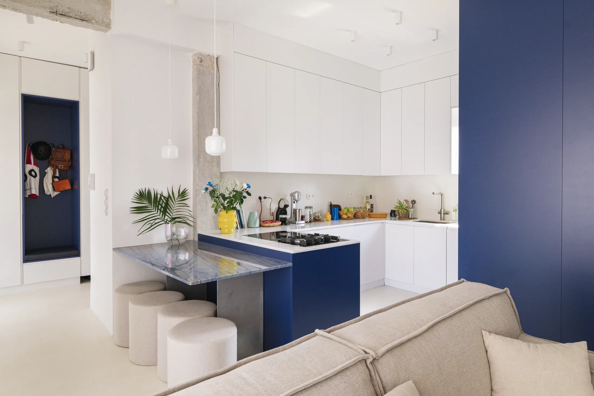
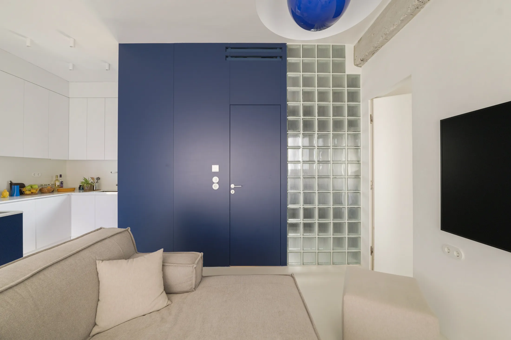
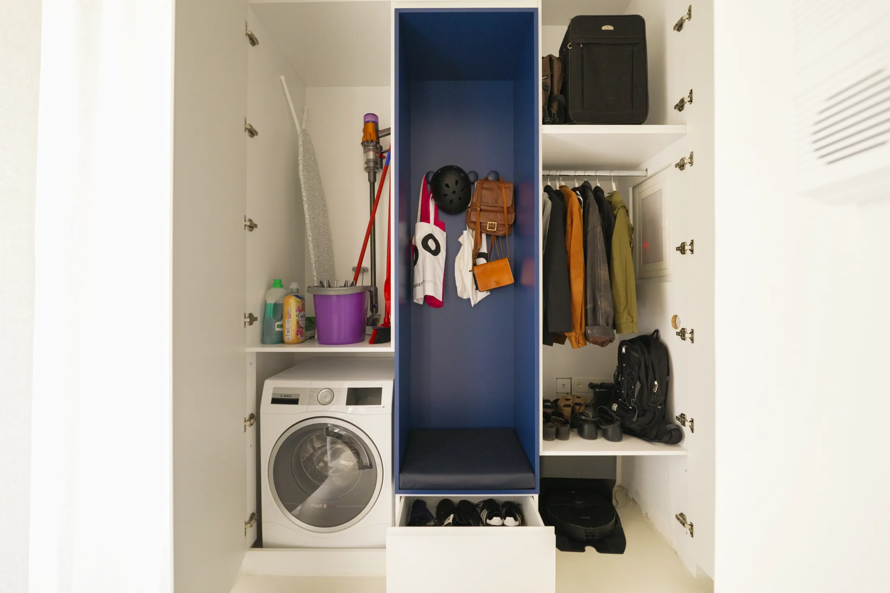
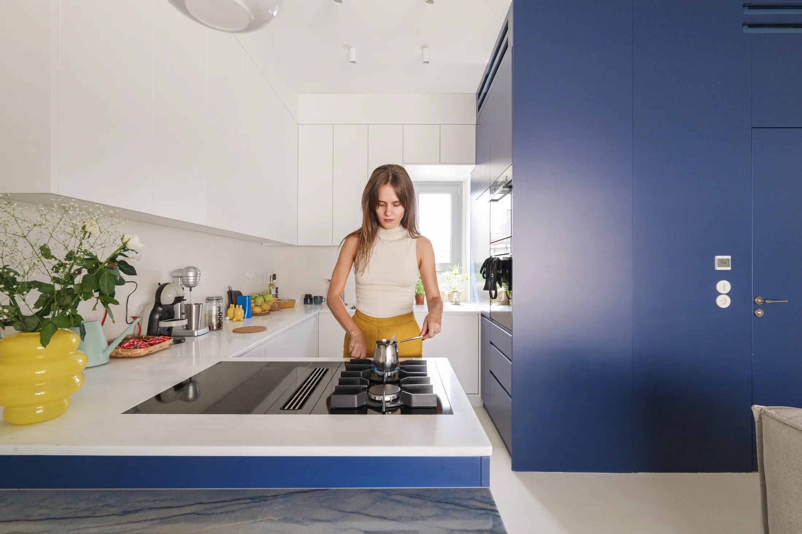
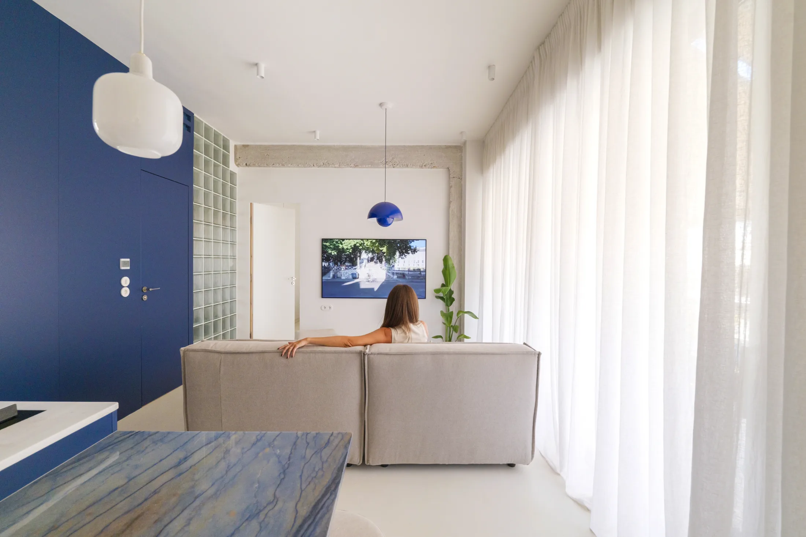
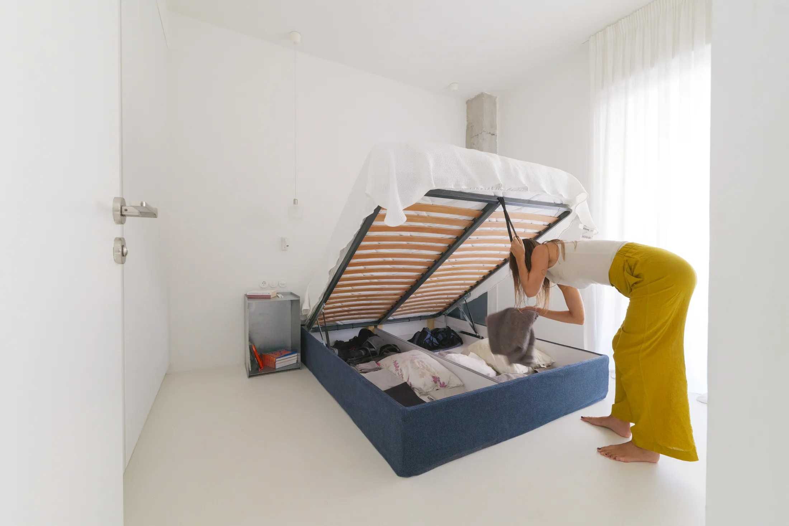
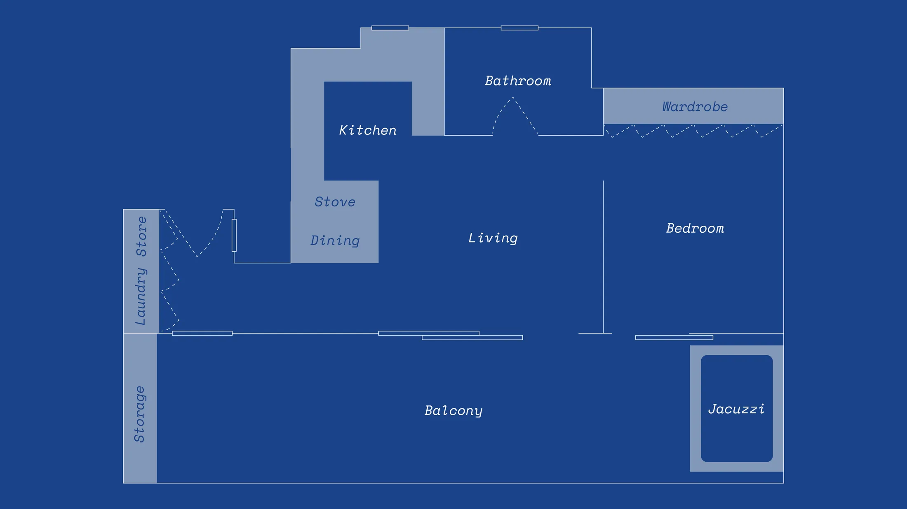

# Пять умных деталей афинской квартиры, которые стоит украсть для московской

В Афинах нет нашей зимы, но проблемы маленькой квартиры те же: некуда поставить обувь, кухня загромождена техникой, спальня занимает место, которое нужно для жизни. Архитектор Элли Атанасиаду (Elli Athanasiadou) из бюро Space Is Around Us решила эти задачи в квартире Kyano — по-гречески «синий» — на верхнем этаже дома 1960-х годов. В ней нет одного эффектного трюка, зато есть пять аккуратных приёмов. Мы разобрали каждый и проверили, что можно сделать в Москве, а где мешают нормы.

Площадь квартиры в оригинале не указана, но по составу — прихожая, кухня, гостиная, спальня, ванная — это обычная небольшая «евро-однушка» или компактная двушка. Для читателя Москвы, где доля студий в предложении за год упала на 6 процентных пунктов до 11%, такие идеи актуальны особенно: всё больше покупателей выбирают квартиру с отдельной спальней.

## Коротко

- Рифлёная стена из стеклоблоков отделяет ванную от гостиной и пропускает свет.
- Прихожая — не коридор, а узел: хранение, скамья, уборка, стирка и место для робота-пылесоса.
- Кухня без вытяжки над плитой — столешница остаётся ровной и свободной.
- Светильник Flowerpot задаёт границу гостиной без перегородок.
- Кровать с подъёмным механизмом прячет бельё и сезонную одежду.

*Kyano, Афины. Архитектор Элли Атанасиаду, бюро Space Is Around Us. Фото: Never Too Small*

## Приём 1. Стеклоблоки вместо стены в ванную

Между ванной и гостиной стоит стена из рифлёных стеклоблоков. Она фильтрует дневной свет и даёт приватность, а вечером светится изнутри. Белый цементный пол принимает этот рассеянный свет и разносит его по комнате.

*Приём 1: стена из рифлёных стеклоблоков между ванной и гостиной. Фото: Never Too Small*

**Для Москвы.** В хрущёвках и панельных домах ванная почти всегда без окна, а в зимние месяцы световой день в Москве очень короткий, поэтому каждый источник дневного света на счету. Светопропускающая перегородка между ванной и соседней комнатой — понятный приём. Если стена не несущая, а перепланировка согласована, вместо глухой гипсокартонной стены можно поставить стеклоблоки или рифлёное стекло. Но есть ограничение: вентиляционные каналы ликвидировать и уменьшать запрещено (постановление 508-ПП), а стеклоблоки не заменяют вентиляцию. Короб с вытяжкой нужно оставить доступным.

## Приём 2. Прихожая как узел

Вход в квартиру сделан как маленький технический центр. Здесь вместе живут одежда и обувь, скамья из натуральной кожи, шкафчики для уборки и стирки, место для робота-пылесоса, а модем и электрощиток спрятаны за дверцами. Фасады — белые и синие, на заказ.

*Приём 2: прихожая — узел хранения, уборки и техники. Фото: Never Too Small*

**Как повторить.** Московские прихожие в хрущёвках узкие, зато там часто есть встроенная ниша или антресоль. Ниша под робот-пылесос с розеткой и скамья для обуви вместо тумбы с вешалкой превращают коридор в рабочее пространство. Модем и роутер удобнее прятать в шкафу заранее: проводить кабели после ремонта сложнее. Не забудьте вентиляционные отверстия в дверце, если внутри будет техника.

## Приём 3. Кухня без вытяжки над плитой

На кухне нет привычного купола над плитой. Вытяжка встроена в столешницу, а сама плита — газовая и индукционная конфорки — работает на чистой рабочей поверхности. Верх свободен: ничего не нависает над головой, на столешнице можно резать, подавать и ставить тарелки.

*Приём 3: кухня без вытяжки над плитой. Фото: Never Too Small*

**Для Москвы.** Скрытая вытяжка — решение для небольших кухонь. Но в московской квартире, где вентканал расположен в строго определённом месте, а в доме подведён газ, установка меняет работу вентиляции. Закрывать вентиляционные каналы нельзя, а при газовой плите отдельно проверьте требования управляющей компании и газовой службы. В новостройке с электроплитой вариант проще, и его можно обсуждать с кухонной компанией на этапе проекта.

## Приём 4. Светильник, который заменяет перегородку

Над зоной отдыха висит подвесной светильник Flowerpot VP1 дизайнера Вернера Пантона (Verner Panton), созданный в 1968 году. Его повесили так, чтобы он не бликовал на экране телевизора, и одновременно он очерчивает гостиную как отдельное место.

*Приём 4: светильник Flowerpot VP1 Вернера Пантона задаёт зону гостиной. Фото: Never Too Small*

**Как повторить.** В студии, где нет возможности поставить стену, свет делит пространство не хуже мебели. Один крупный подвесной светильник над диваном, другой — над обеденным столом: каждая зона получает свой центр. Следите за положением относительно телевизора, чтобы не было бликов. Оригинал Flowerpot — дорогая покупка, но вариантов с похожей формой на рынке много.

## Приём 5. Кровать, которая поднимается

В спальне — кровать с подъёмным механизмом. Под основанием лежат постельное бельё, подушки и сезонная одежда. В квартире также есть раздвижная дверь в спальню, не отнимающая места.

*Приём 5: кровать с подъёмным механизмом и хранением. Фото: Never Too Small*

**Для Москвы.** Для климата, где сезонная одежда — это пуховик, шапки, шарфы и тёплая обувь, объём под кроватью даёт реальную экономию. Минимальная однокомнатная в новом московском проекте теперь 28 м² (постановление № 1672-ПП): на такой площади каждая кровать с хранением снимает нагрузку со шкафа. Проверьте высоту потолка: механизм потребует подъёма матраса.

## Терраса и лоджия: чего нельзя повторить

В оригинале квартира имеет большую террасу, и дизайнеры используют её как продолжение комнат. В московских домах этот сценарий закрыт: по постановлению 508-ПП запрещено объединять лоджии и балконы с комнатами и переносить на них общедомовые радиаторы. Холодный остеклённый балкон можно оформить как отдельное место для чтения или хранения. Но убрать стену и сделать из лоджии часть комнаты нельзя.

*План после перепланировки. Чертёж: Space Is Around Us / Never Too Small*

## Чек-лист

1. Если у ванной нет окна, подумайте о светопроницаемой перегородке и оставьте доступ к вентиляции.
2. Прихожая: скамья, ниша под робот-пылесос, спрятанный роутер.
3. Кухня: освободите верх над плитой, но сначала проверьте вентиляцию и тип плиты.
4. Один выразительный светильник над зоной отдыха.
5. Кровать с подъёмным механизмом и сезонное хранение под ней.
6. Лоджию не присоединять к комнате.

Больше идей для небольших квартир — в разделе [«Интерьер»](/temy/interer/). Если вы ищете квартиру с готовой хорошей планировкой, начните с [новостроек Москвы](/novostroyki/moskva/).

## Вопросы и ответы

**Можно ли в московской квартире заменить стену ванной стеклоблоками?**
Конструктивно — да, если стена не несущая и перепланировка согласована. Главное — не трогать вентиляцию: постановление 508-ПП запрещает ликвидировать или уменьшать вентиляционные каналы. Стеклоблоки же только пропускают свет и не заменяют вентиляцию ванной.

**Можно ли в Москве объединить лоджию с комнатой, как делают с террасой?**
Нет. По 508-ПП в Москве запрещено объединять лоджии и балконы с комнатами и переносить на них общедомовые радиаторы. Лоджию можно оформить как отдельную зону, но не как часть комнаты.

**Какая минимальная площадь однокомнатной квартиры в новостройках Москвы?**
С 1 августа 2024 года — 28 м² для однокомнатной и 44 м² для двухкомнатной квартиры (постановление Правительства Москвы № 1672-ПП от 23 июля 2024 года).

## Источники

1. Never Too Small. Clever design details in a small Athenian apartment — https://www.nevertoosmall.com/post/clever-design-details-small-athenian-apartment
2. Мосжилинспекция: какие перепланировки запрещены (постановление 508-ПП) — https://www.mos.ru/news/item/76897073/
3. ppt.ru: постановление Правительства Москвы от 23.07.2024 № 1672-ПП — https://ppt.ru/obzory/vstupaet-v-silu/postanovlenie-pravitelstva-moskvy-23-07-2024-1672-pp
4. РБК Недвижимость: доля студий в предложении Москвы, I полугодие 2026 — https://realty.rbc.ru/news/6a6094b09a7947481c9c3ec4

*Материал подготовлен по мотивам публикаций Never Too Small и использует их фото с разрешения правообладателя.*
