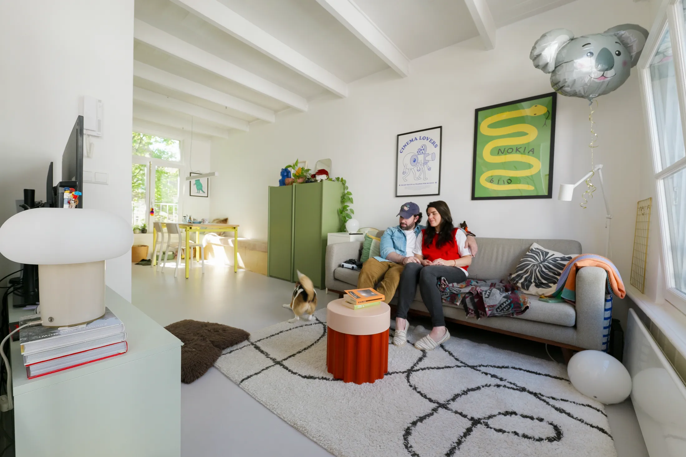
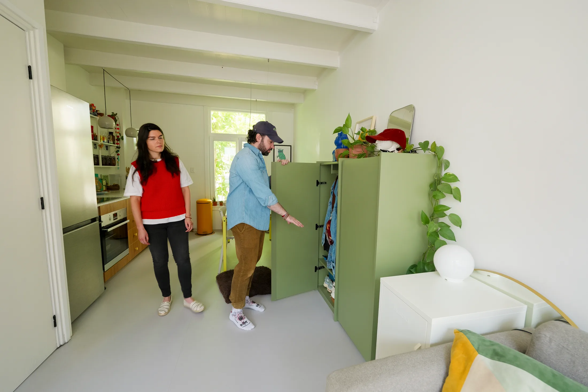
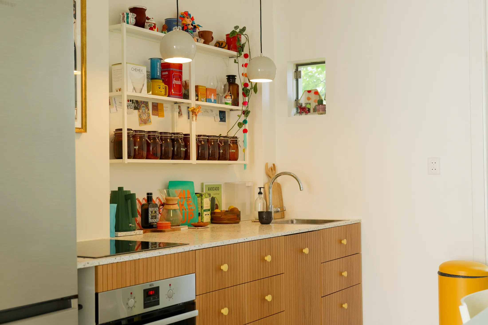
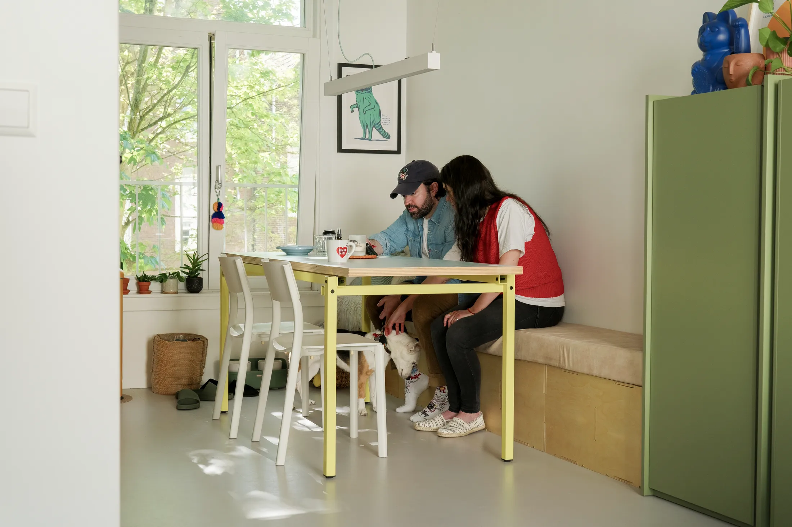
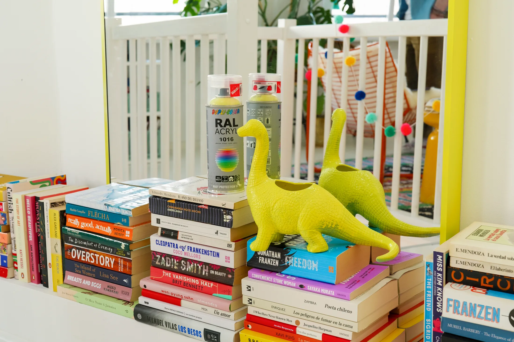
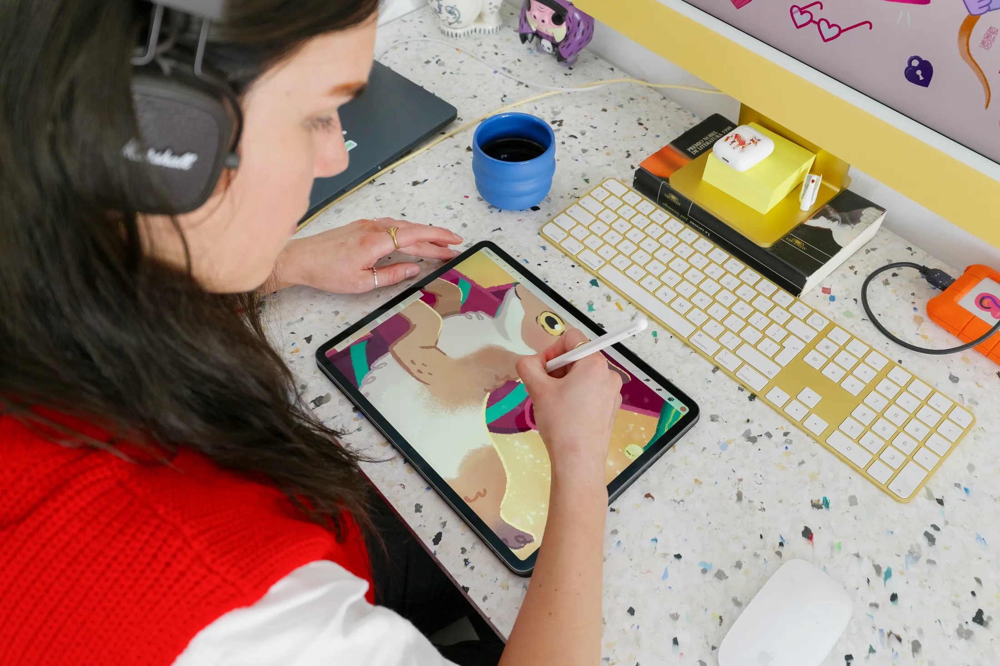
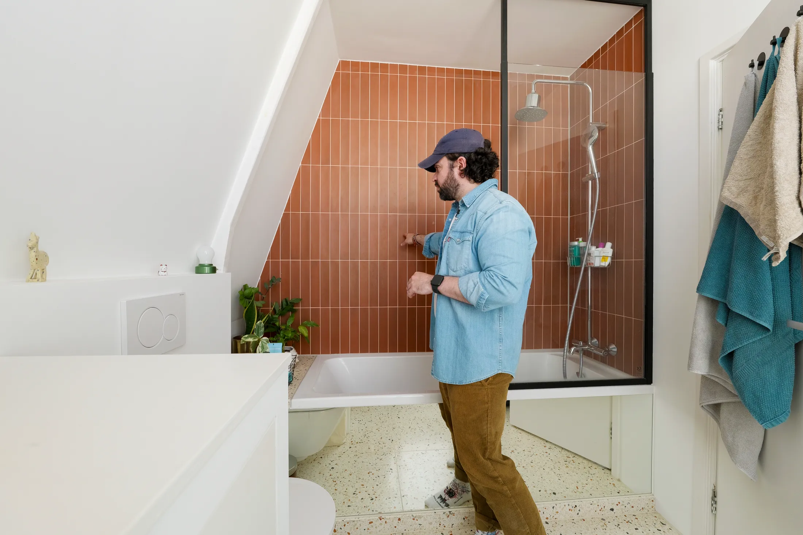

# Дом и мастерская на 54 м²: как пара из Амстердама уживается с работой из дома

Работа из дома давно перестала быть временной мерой. По опросу hh.ru за июнь 2025 года, 23% россиян хотят работать полностью удалённо, ещё 26% — в гибридном режиме, а 35% сидят в офисе, но перешли бы на удалёнку, если бы могли. В офис по-настоящему хотят лишь 16%. Для покупателя небольшой квартиры это значит простую вещь: в планировке нужно сразу закладывать место, где можно работать, а не «потом поставим стол куда-нибудь».

Пара из Амстердама — Педро Орландо (Pedro Orlando), основатель стартапа, и Азия Орландо (Asia Orlando), иллюстратор и видеоблогер, — решила эту задачу на 54 м². Их дом Casa Koala — часть канального дома, которому около 145 лет; жильё они перестраивали комната за комнатой. Авторы интерьера в публикации Never Too Small не названы, зато видно много решений, которые можно повторить без архитектора: самоделки, переделанная мебель, остатки материалов.

## Коротко

- Дом рассчитан на людей, которым важны уют и спокойствие: насыщенные цвета, мягкие фактуры, личные вещи на виду, никакого стерильного минимализма.
- Планировка открытая, но с чёткими линиями обзора: шкаф у входа не загораживает комнату.
- Рабочая студия вынесена на мансарду, а столы сделаны из остатков кухонной столешницы.
- В ванной зеркало вдоль ванны, стиральная машина спрятана в узкий шкаф, а плитка — тёплая.
- Часть мебели переделана: стол был дверью, шкафы приехали из прошлой квартиры.

*Casa Koala, Амстердам, 54 м². Цвета и фактуры подобраны так, чтобы бодрить и успокаивать. Фото: Never Too Small*

## Приём 1: дом, в котором не страшно жить

Хозяева называют свой подход «гнездом»: им важно, чтобы после рабочего дня дом не выглядел как офис. Цвета и фактуры подобраны так, чтобы с одной стороны стимулировать, а с другой — успокаивать. Ковёр поглощает звук, огромный мягкий диван не смущает посетителей, а на полках стоят вещи с историей — безделушки, сувениры, мелочи, которые обычно выбрасывают при «расхламлении».

**Для Москвы.** Короткий световой день с октября по март — главный враг московской небольшой квартиры. При сером небе стерильный белый интерьер быстро начинает давить. Плотный ковёр на ламинате или паркете — это ещё и звукоизоляция в панельном доме, где слышно соседей. Выбирайте 2–3 яркие поверхности (стена за диваном, дверь, шторы) и разбавляйте их живыми материалами — деревом, шерстью, керамикой.

## Приём 2: вход, который не закрывает комнату

В прихожей поставили компактный шкаф для курток и сумок, сделанный на заказ. Его особенность — он подобран так, чтобы не перекрывать взгляд: зашедший человек сразу видит гостиную и окно, и квартира кажется больше.

**Как повторить.** В московской хрущёвке или панельной «евродвушке» прихожая обычно крошечная и тёмная. Вместо массивного шкафа-купе во всю стену попробуйте узкий шкаф глубиной 35–40 см для верхней одежды и открытую скамью для обуви. Остальные сезонные вещи уносите вглубь квартиры — на антресоли или в кладовую.

*Входная группа: компактный шкаф на заказ, не закрывающий обзор. Фото: Never Too Small*

## Приём 3: кухня как центр дома

Кухня в Casa Koala — один линейный блок с глубокой столешницей. Её выбрала Азия: плиты из переработанного пластика, выглядящие как камень. Корпуса — шкафы IKEA, которые заказали с деревянными фасадами на заказ. Благодаря такой «обшивке» шведская мебель выглядит как индивидуальная работа.

За обеденным столом хозяева завтракают, и там же иногда работают. Стол собран из старой двери: сначала она была дверью, потом столом в мастерской, теперь стала кухонным столом. Под ним — лежанка собаки Лупе.

*Столешница из переработанного пластика на кухне. Фото: Never Too Small*

*Обеденный стол — бывшая дверь, потом письменный стол. Фото: Never Too Small*

**Для Москвы.** Приём «стандартные корпуса плюс индивидуальные фасады» хорошо работает у нас: фасады из дерева или крашеного МДФ можно заказать у местной мебельной мастерской, а каркасы взять из масс-маркета. Старую дверь для стола можно найти в Москве на барахолках и в мастерских, которые обновляют двери в сталинках и дореволюционных домах: плотные дубовые полотна там часто выбрасывают при ремонте.

## Приём 4: мансарда-мастерская

Самое интересное в проекте — студия на верхнем уровне, в бывшем чердаке. Скошенные потолки и узкие ниши, от которых обычно отказываются, здесь превращены в книжные полки и «площадки» для книг. Рабочее место узкое и простое: Азия рисует на компьютере, и ей достаточно длинной столешницы. Для материалов, красок и инструментов есть аккуратное хранение. Столы сделаны из остатков той же столешницы, что и на кухне, — поэтому интерьер выглядит цельным, а стоимость ниже.

*Студия на мансарде: ниши под скатами стали полками и «площадками» для книг. Фото: Never Too Small*

*Рабочие столы сделаны из остатков кухонной столешницы. Фото: Never Too Small*

**Как повторить.** Мансард в московских новостройках немного, но в лофтах бывших фабрик — например, во «Флаконе» или на «Арме» — часто встречаются высокие потолки с антресолью. А там, где потолок обычный, работа с «неудобными» местами выглядит иначе: ниша у окна, торец лоджии (если она остеклена и утеплена, но не присоединена к комнате — объединять лоджию с комнатой нельзя по 508-ПП), простенок между окнами. Рабочий стол из остатка кухонной столешницы стоит копейки, а столярам нужно просто отрезать нужную длину.

## Приём 5: ванная, которая выглядит больше

В ванной хозяева оборудовали умывальную нишу в неудобном углу на заказных шкафах. Стиральная машина спрятана в узком шкафу — его размер подобран так, чтобы окно открывалось полностью. Вдоль ванны повесили зеркало: оно отражает свет и расширяет комнату визуально. Терраццо и терракотовая плитка добавляют теплоты — это не холодный белый кафель.

*Ванная: зеркало вдоль ванны, плитка терраццо и терракота. Фото: Never Too Small*

**Для Москвы.** В московских домах ванная редко бывает с окном, а вот узкая и длинная — часто. Шкаф под стиральную машину, который подгоняют по размеру, лучше заказывать под размеры конкретной машины. Тепло в ванной — это ещё и вопрос отопления: тёплый пол от общедомовых систем делать запрещено (508-ПП), поэтому рассчитывайте на электрический полотенцесушитель и тёплые оттенки плитки.

## Приём 6: спальня без изголовья

В спальне скошенные стены, поэтому вместо изголовья просто закрасили участок стены нужным цветом. Под кроватью — места для полотенец и белья. Фанерные шкафы привезли из прежнего жилья: они вписались в новую комнату. У изножья кровати — низкая ниша для Лупе.

**Как повторить.** Покрашенный участок стены вместо изголовья стоит дешевле и занимает меньше места, чем мягкое изголовье. Для московской квартиры такой приём удобен там, где кровать стоит в нише: контрастный цвет по границе ниши делает её «комнатой в комнате».

## Чек-лист: рабочее место в небольшой квартире

1. Выберите стол не «где поместится», а там, где есть дневной свет и розетка.
2. Если нет отдельной комнаты — используйте нишу, торец кухни или остеклённую лоджию без объединения с комнатой.
3. Не покупайте новую мебель «под цвет»: остатки столешницы и старые двери делают интерьер цельным.
4. Входную группу делайте глубиной 35–40 см и не закрывайте обзор.
5. Положите ковёр там, где слышно соседей.
6. В ванной — зеркало вдоль ванны и шкаф под стиральную машину по размерам.

Больше идей для небольших квартир — в разделе [«Интерьер»](/temy/interer/). Если вы подбираете квартиру и уже думаете, где будет стоять рабочий стол, начните с [каталога объектов](/obekty/).

## Вопросы и ответы

**Сколько людей в России хотят работать из дома?**
По опросу hh.ru в июне 2025 года, 23% опрошенных хотят работать полностью удалённо, 26% — в гибридном формате, ещё 35% сейчас в офисе, но перешли бы на удалёнку. Только 16% предпочитают офис.

**Можно ли в маленькой квартире обойтись без отдельного кабинета?**
Да, если рабочее место встроено в уже существующую зону: в нишу у окна, в торец кухонной столешницы или на антресоль. Главное — чтобы за стол можно было сесть, не убирая постель или обеденную посуду, и чтобы рядом была розетка и свет.

**Как сделать узкую ванную визуально просторнее?**
Повесить большое зеркало вдоль ванны, выбрать тёплую плитку и спрятать стиральную машину в узкий шкаф. Вентиляционные каналы при этом нельзя ликвидировать или уменьшать — это запрещено постановлением 508-ПП.

## Источники

1. Never Too Small. How a creative couple live and work in a small Amsterdam loft — https://www.nevertoosmall.com/post/how-a-creative-couple-live-and-work-in-small-amsterdam-loft
2. «Коммерсантъ»: опрос hh.ru об удалённой работе, июнь 2025 — https://www.kommersant.ru/doc/8336320
3. Мосжилинспекция: какие перепланировки запрещены (постановление 508-ПП) — https://www.mos.ru/news/item/76897073/

*Материал подготовлен по мотивам публикаций Never Too Small и использует их фото с разрешения правообладателя.*
