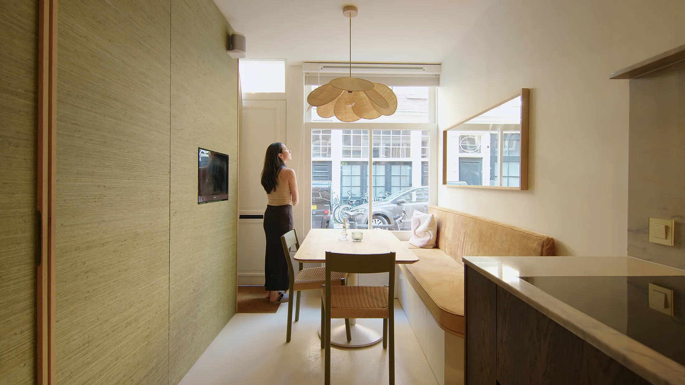
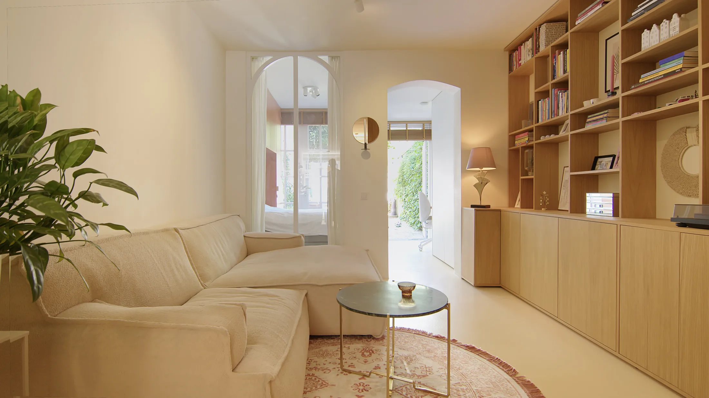
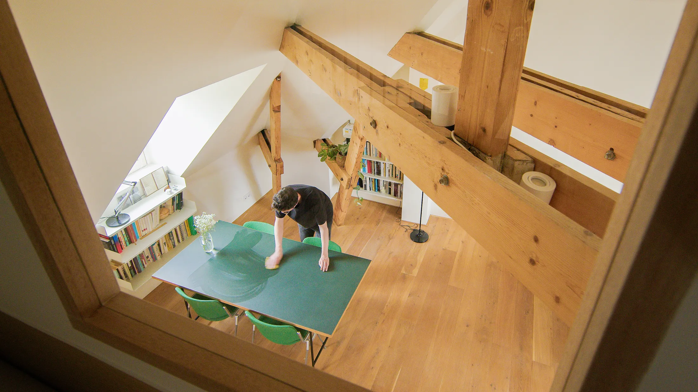
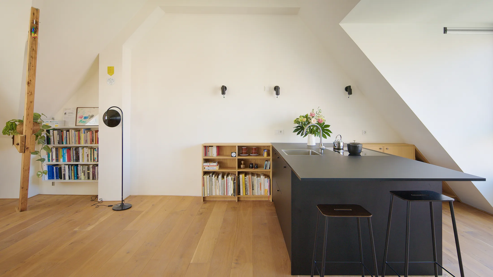
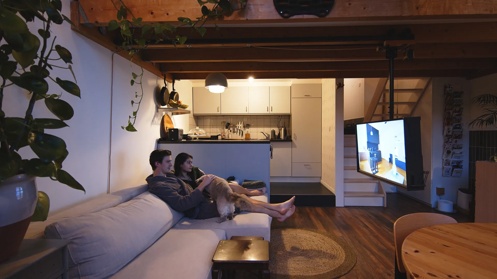
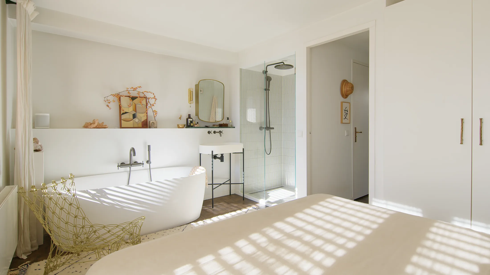
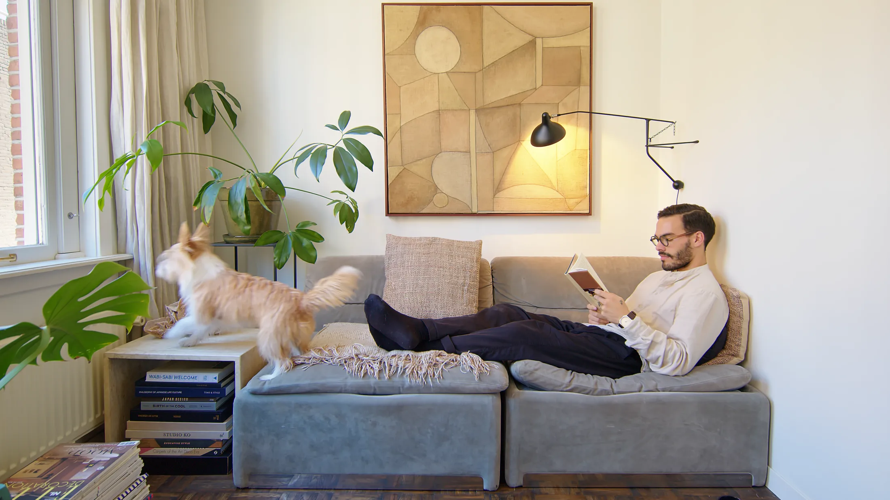
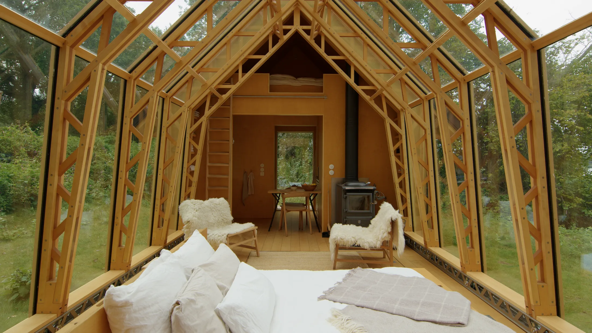

# Пять маленьких домов Амстердама: что взять в свою квартиру до 60 м²

Амстердам — город, где жильё тесное по определению: узкие дома вдоль каналов, бывшие склады, чердаки под скатной крышей. Поэтому местные дизайнеры давно научились делать так, чтобы 33, 45 или 60 метров казались большими. Редакция Never Too Small собрала пять таких проектов, и мы разобрали из них то, что пригодится в Москве: в хрущёвке, евродвушке, лофте на бывшей фабрике и даже на даче.

Площади здесь вполне московские. Для сравнения: в новых проектах столицы однокомнатная квартира с 1 августа 2024 года не может быть меньше 28 м², а двухкомнатная — меньше 44 м² (постановление № 1672-ПП). Так что 33 и 45 м² — это ровно ваш диапазон, а 60 м² — просторная евротрёшка.

## Коротко

- Мебельный блок с кухней и ванной делит квартиру, но не закрывает свет.
- Антресоль даёт спальню без стен, но нужна высота потолка — для хрущёвки это не вариант.
- Телевизор можно спрятать в шкаф или пустить по направляющей: стена остаётся свободной.
- Ванная может переехать в спальню, а туалет остаться отдельным — но в Москве такое надо согласовывать.
- Выдвижные и раздвижные конструкции особенно выигрывают на даче.

## Приём 1: квартира в Йордане, 48 м² — мебель вместо стен

Йордан — старый район в центре Амстердама. Квартира занимает первый этаж социального дома 1905 года: длинная и узкая, как вагон. Дизайнер и столяр Мариин Крёйкемейер (Marijn Kruikemeier, Mi Studio) и его партнёрша Лия Ян (Liya Yang), хозяйка квартиры, не стали резать её перегородками. Вместо этого посередине встал дубовый мебельный блок: в нём спрятаны ванная, кухонная техника и инженерия. Напротив тянется длинная кухня-«коридор», вдоль стены идёт изогнутая рейчатая столярка.

*Квартира в Йордане, Амстердам, 48 м². Мариин Крёйкемейер (Marijn Kruikemeier), Mi Studio. Фото: Never Too Small*

Свет идёт с двух торцов плана, а обеденная зона встроена прямо в уличное окно. Телевизор живёт в шкафу от пола до потолка и выезжает на электроподъёмнике только на время просмотра. Спальня выходит прямо в закрытый садик. Всё — шкафы, мебель, столярка — сделано на заказ в амстердамской мастерской.

*Йордан, 48 м²: шкаф до потолка с телевизором на электроподъёмнике. Фото: Never Too Small*

**Для Москвы.** Вытянутая квартира с окнами на торцах — это и дореволюционный доходный дом в Замоскворечье или на Басманной, и сталинка с длинным коридором. Принцип «центральный блок вместо стен» пригодится там, где комната делится пополам без перегородки. Только помните: инженерные стояки и вентиляция остаются на своих местах, а их перенос ограничен — постановление 508-ПП запрещает ликвидировать и уменьшать вентканалы. Так что блок нужно проектировать вокруг существующей мокрой зоны, а не переставлять её.

## Приём 2: лофт на мансарде, 60 м² — антресоль и низкая мебель

Второй проект — бывший чердак в доме 1920-х годов в восточной части Амстердама. Художник и дизайнер интерьеров Михил Хилбринк (Michiel Hilbrink, Ardor Studio) оставил деревянные балки и форму крыши как главное украшение. Спальня переехала на антресоль, рядом с ней уместилась компактная детская: стен нет, но у каждого есть своё место. Сверху открывается вид вниз, на гостиную.

*Лофт на мансарде, Амстердам, 60 м². Михил Хилбринк (Michiel Hilbrink), Ardor Studio. Фото: Never Too Small*

Под антресолью — низкая мебель: кресло Ричарда Лампера (Richard Lampert) и диван выбраны так, чтобы поместиться под скатом. Кухня собрана в один блок: холодильник, морозильник, духовка и посудомойка спрятаны внутри, сверху — индукционная панель, фасады из чёрного ламината высокого давления. Палитра минималистичная, хранение встроено.

*Лофт, 60 м²: кухонный блок с техникой, фасады из чёрного ламината. Фото: Never Too Small*

**Как повторить.** В хрущёвке с её невысокими потолками антресоль не нужна: потолок просто не даст пространства для двух уровней. Зато в сталинках и дореволюционных домах, а также в лофтах «Флакона», «Армы» или Даниловской мануфактуры, где высота измеряется метрами, этот приём работает. Выбирайте низкую мебель: она «растворяется» под антресолью и оставляет воздух. А кухню-монолит с встроенной техникой стоит посмотреть и тем, у кого студия: это компактнее ряда отдельных модулей.

## Приём 3: Scheeps, 45 м² — телевизор на направляющей

Scheeps — лофт у воды в восточной гавани Амстердама, с высокими потолками и видом на гавань. Здесь живёт дизайнер Коен Фрайман (Koen Fraijman) с партнёршей Фадиме Гёккайя (Fadime Gökkaya) и котом по имени Сок. Почти всё в квартире сделано под заказ: подвижные элементы, самодельные детали, мебель.

*Scheeps, Амстердам, 45 м². Коен Фрайман (Koen Fraijman): телевизор на направляющей. Фото: Never Too Small*

Телевизор висит на подвижной направляющей: его можно выдвинуть в комнату или прижать к стене вплотную. В спальне — зеркальные шкафы, которые умножают свет и пространство. А южные окна заливают светом гостиную и столовую, заставленные растениями.

**Для Москвы.** Рельсы и зеркальные фасады — самый дешёвый способ «подарить» комнате площадь без перепланировки. Особенно они нужны в зимние месяцы: когда светлого времени в Москве мало, каждое зеркало на уровне окна возвращает его в комнату. А если ваши окна выходят на Москву-реку, на парк или на ВДНХ, рельсовый телевизор позволит развернуть кресло к окну, а не к экрану.

## Приём 4: Apartment 33, 33 м² — ванная в спальне

Самый маленький проект подборки сделали для себя дизайнеры Карла Радол (Carla Radoll) и Бруну Граса (Bruno Graça) из Hum Studio & Gallery. Главная идея: ванную вынесли в спальню, чтобы она получала дневной свет и вид на небо, а туалет оставили отдельно — с яркими цветами и дизайнерскими обоями.

*Apartment 33, Амстердам, 33 м². Карла Радол (Carla Radoll) и Бруну Граса (Bruno Graça), Hum Studio & Gallery. Фото: Never Too Small*

Кухня линейная, со столешницей из травертина; обеденный стол авторы спроектировали сами. Они сохранили старый паркет и ручную плитку, а душевая облицована японской плиткой ручной работы. Многослойный свет помогает гостиной и столовой уживаться, не загромождая друг друга. Винтажный диван стоит на металлических пластинах, которые отражают пол: кажется, что он парит.

*Apartment 33: диван «парит» над полом за счёт металлических пластин на основании. Фото: Never Too Small*

**Для Москвы.** Решение с ванной внутри спальни — красивая картинка, но в московской квартире его нужно сначала проверить на нормы. Нельзя расширять санузел за счёт жилой площади и убирать вентиляционные каналы; любая перепланировка согласуется в Мосжилинспекции. Тем не менее два приёма можно взять без перепланировки: яркий отдельный туалет с обоями (маленькая комната прощает смелость) и диван на высоких ножках или с зеркальной «пяткой» — он визуально освобождает пол в студии.

## Приём 5: Cabin ANNA — хижина, которая раздвигается

Последний проект не про город: хижина стоит в природном заповеднике примерно в часе езды от Амстердама. Архитектор Каспар Схолс (Caspar Schols) придумал модульный домик площадью от 30 до 50 м² — размеры меняются. Две ручные раздвижные внешние стены превращают его то в закрытую комнату, то в открытый павильон. Деревянные раздвижные и поворотные панели постепенно открывают интерьер ландшафту.

*Cabin ANNA, 30–50 м². Архитектор Каспар Схолс (Caspar Schols). Фото: Never Too Small*

Кровать и ванна уходят в пол, хранение складывается, а над ними — антресоль для сна. Камбузная кухня сделана из нержавейки и берёзовой фанеры. Дом разборный, автономный и рассчитан на то, чтобы не оставлять следов.

**Как повторить.** Для московской дачи в Подмосковье это готовая шпаргалка: летом дом открыт и работает как веранда, зимой закрывается и экономит тепло. Разумеется, склад-кровать в полу в квартиру не перенести, но принцип — одна комната, меняющая размер, — отлично живёт на лоджии и в студии с раздвижной перегородкой.

## Чек-лист: что взять из Амстердама

| Приём | Где сработает в Москве | Условие |
|---|---|---|
| Центральный блок вместо перегородки | Вытянутые квартиры, сталинки, доходные дома | Не трогать вентканалы и стояки |
| Антресоль | Лофты на бывших фабриках, сталинки, мансарды | Нужна высота потолка |
| Низкая мебель под антресолью | Те же лофты | Подбирать по высоте ската |
| Телевизор на рельсе или в шкафу | Любая студия и евродвушка | Нужна несущая стена |
| Зеркальные фасады шкафов | Спальни с одним окном | Не ставить напротив яркого света |
| Яркий отдельный санузел | Любой тип дома | Без изменения вентиляции |

Больше идей для небольших квартир — в разделе [«Интерьер»](/temy/interer/). А если вы только выбираете жильё, загляните в [каталог новостроек Москвы](/novostroyki/moskva/).

## Вопросы и ответы

**Можно ли в Москве перенести ванную в спальню, как в Apartment 33?**
Сама по себе спальня с душем — вопрос проекта и мебели, но мокрые зоны нельзя расширять за счёт жилых комнат, а вентиляционные каналы нельзя убирать или уменьшать (постановление 508-ПП). Любая перепланировка согласуется в Мосжилинспекции.

**Подходит ли антресоль для хрущёвки?**
Обычно нет: при потолке около 2,5 м второй уровень оставляет слишком мало высоты. Антресоль работает в сталинках, дореволюционных домах, мансардах и лофтах бывших фабрик, где потолки заметно выше.

**Чем мебель-перегородка лучше стены?**
Блок с кухней или ванной делит пространство, но не перекрывает свет и вид через всю квартиру, а сама мебель одновременно хранит вещи. Перед установкой любой крупной конструкции уточните в управляющей компании и проектной организации, что она не затрагивает инженерные системы.

## Источники

1. Never Too Small. Five of Amsterdam's best small homes under 60sqm/645sqft — https://www.nevertoosmall.com/post/five-of-amsterdams-best-small-homes-under-60sqm-645sqft
2. ppt.ru: постановление Правительства Москвы от 23.07.2024 № 1672-ПП — https://ppt.ru/obzory/vstupaet-v-silu/postanovlenie-pravitelstva-moskvy-23-07-2024-1672-pp
3. Мосжилинспекция: какие перепланировки запрещены (постановление 508-ПП) — https://www.mos.ru/news/item/76897073/
